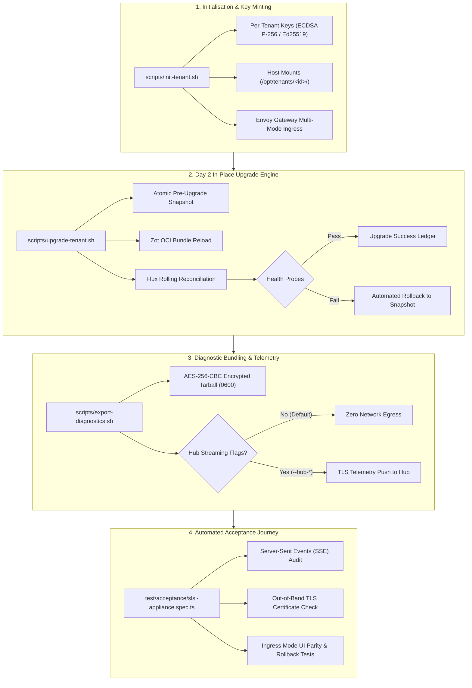

# Validation Runbook — SLSI Signal Loom Design Partner Appliance Self-Initialisation Pipeline (2026-Q4)

This runbook establishes the human and automated acceptance criteria for the
Signal Loom Design Partner Appliance Self-Initialisation Pipeline (SLSI). It
defines the procedures to validate an appliance. It covers zero-touch
initialisation, multi-mode ingress termination, Day-2 atomic upgrade and
rollback, and encrypted local diagnostic export.

## 1. Overview and Acceptance Architecture

The SLSI appliance provides a self-contained, air-gapped deployment boundary for
Signal Loom design partner organisations. The platform runs on an isolated Kind
cluster backed by an in-cluster Zot OCI registry, Flux GitOps operator, and
Envoy Gateway.



---

## 2. Prerequisites and Environment Preflight

Before starting the validation procedure, check that the host machine satisfies
the baseline requirements:

| Component | Minimum Requirement | Check Command |
| :--- | :--- | :--- |
| Operating System | Linux x86_64 / arm64 (Kernel &ge; 5.15) | `uname -srm` |
| Container Engine | Docker Engine &ge; 24.0 or Podman &ge; 4.5 | `docker info` |
| Memory & CPU | 16 GB RAM, 8 vCPUs | `free -h; nproc` |
| Disk Storage | 50 GB free at `/opt/tenants/` | `df -h /opt/tenants/` |
| Ports | Ports 80 and 443 available on host interface | `ss -lnt '( sport = :80 or sport = :443 )'` |

---

## 3. Initialisation and Key Isolation Verification

Run the initialisation script for a new tenant identifier:

```bash
sudo ./scripts/init-tenant.sh \
  --tenant-id acme-corp \
  --ingress-mode airgap-local \
  --ingress-domain acme-corp.osramp.acme.local \
  --dry-run
```

### 3.1 Verification Steps
1. **Dry-Run Confirmation**: Check that `--dry-run` reports proposed file paths
   and directories without modifying `/opt/tenants/acme-corp/`.
2. **Keypair Generation**: Execute without `--dry-run`. Check that the key
   directory `/opt/tenants/acme-corp/keys/` contains:
   - `cosign.key` / `cosign.pub` (ECDSA P-256)
   - `witness.pem` / `witness-pub.pem` (Ed25519)
   - `orbit-approval.pem` (Ed25519)
   - Mode `0700` on the key directory, mode `0600` on private keys, and mode
     `0644` on public keys.
3. **Escrow Archive**: Check that `<tenant-id>-escrow.tar.enc` is created with
   POSIX mode `0600` and decrypts successfully using the tenant passphrase.
4. **Key Isolation**: Mint keys for a second tenant (`tenant-b`) and verify that
   public key fingerprints are completely disjoint.

---

## 4. Multi-Mode Ingress Termination Verification

The appliance supports four ingress operational modes through Envoy Gateway.
Verify each mode using the matrix below:

| Mode | Base Domain | TLS Issuer & Secret | ClientTrafficPolicy | Routing Check |
| :--- | :--- | :--- | :--- | :--- |
| `airgap-local` | `<id>.osramp.acme.local` | `cluster-issuer` (self-signed) &rarr; `cluster-tls` | `numTrustedHops: 1`, strips XFF/Real-IP | Port 80 & 443 |
| `acme-dns01` | `<id>.signal-loom.ai` | `acme-dns01-issuer` &rarr; `<id>-acme-tls` | `numTrustedHops: 1`, strips XFF/Real-IP | Port 80 & 443 |
| `cloud-lb-l7` | `<id>.osramp.cloud` | `cluster-issuer` &rarr; `cluster-tls` | `numTrustedHops: 2`, strips XFF/Real-IP | Port 80 & 443 |
| `custom-byo-pki` | `<id>.custom.internal` | `byo-ca-issuer` &rarr; `byo-tls` | `numTrustedHops: 1`, strips XFF/Real-IP | Port 80 & 443 |

### 4.1 Ingress Verification Commands

```bash
# Check Envoy Gateway routes
kubectl get gateway -n ingress
kubectl get httproute -n ingress

# Verify header stripping and hop count configuration
kubectl get clienttrafficpolicy -n ingress -o yaml | grep -E "numTrustedHops|remove"
```

Check that:
- Reverse-proxy trusted hop count is strictly pinned (`numTrustedHops: 1` by default).
- Early request headers `X-Forwarded-For` and `X-Real-IP` are stripped before routing.
- PROXY protocol is not enabled on standard HTTP/HTTPS listeners.

---

## 5. Day-2 In-Place Upgrade and Rollback Verification

The Day-2 upgrade engine (`scripts/upgrade-tenant.sh`) applies rolling updates
without destroying the Kind cluster or resetting cluster identity.

### 5.1 Upgrade Lifecycle Procedure

```bash
# 1. Run upgrade in dry-run mode
sudo ./scripts/upgrade-tenant.sh \
  --tenant-id acme-corp \
  --bundle-dir /opt/tenants/acme-corp/bundles/v0.2.0 \
  --target-version v0.2.0 \
  --dry-run

# 2. Execute live upgrade
sudo ./scripts/upgrade-tenant.sh \
  --tenant-id acme-corp \
  --bundle-dir /opt/tenants/acme-corp/bundles/v0.2.0 \
  --target-version v0.2.0
```

### 5.2 Verification Steps
1. **Pre-Upgrade Snapshot**: Inspect `/opt/tenants/acme-corp/snapshots/<timestamp>/`:
   - Contains PostgreSQL data and OpenBao state.
   - Directory permissions are mode `0700`.
   - `manifest.json` ledger is mode `0600`.
2. **Automated Rollback Verification**:
   Trigger an artificial health probe failure:
   ```bash
   sudo ./scripts/upgrade-tenant.sh \
     --tenant-id acme-corp \
     --bundle-dir /opt/tenants/acme-corp/bundles/v0.2.0 \
     --target-version v0.2.0 \
     --fail-health-check
   ```
   Check that:
   - The upgrade exits with code 1.
   - `rollback-report.json` is emitted in `/opt/tenants/acme-corp/snapshots/`.
   - PostgreSQL and OpenBao data directories are restored to their pre-upgrade state.

---

## 6. Diagnostic Bundling and Zero-Egress Verification

Verify the local diagnostic bundler (`scripts/export-diagnostics.sh`):

```bash
# Run local diagnostic packaging
sudo ./scripts/export-diagnostics.sh \
  --tenant-id acme-corp \
  --passphrase "SecretPassphrase123!"
```

### 6.1 Verification Steps
1. **Encrypted Archive Output**: Check that the archive exists at
   `/opt/tenants/acme-corp/audit/diagnostics-<timestamp>.tar.enc` with POSIX
   mode `0600`.
2. **Checksum Integrity**: Check that the `.sha256` checksum file exists with mode
   `0600`.
3. **Decryption Roundtrip**: Decrypt the archive and verify the contents:
   ```bash
   openssl enc -d -aes-256-cbc -pbkdf2 \
     -in /opt/tenants/acme-corp/audit/diagnostics-<timestamp>.tar.enc \
     -out /tmp/diagnostics-restored.tar \
     -k "SecretPassphrase123!"
   tar -tvf /tmp/diagnostics-restored.tar
   ```
4. **Zero-Egress Network Audit**: Verify that the bundler transmits zero
   outbound network packets during execution. Check that network egress occurs
   if and only if both `--hub-endpoint` and `--hub-token` are explicitly supplied.

---

## 7. Automated Acceptance Test Suite (Playwright)

Execute the end-to-end acceptance suite testing the Signal Loom dashboard UI,
Server-Sent Events telemetry, and TLS validity:

```bash
# Run Playwright acceptance suite
bunx playwright test test/acceptance/slsi-appliance.spec.ts
```

### 7.1 Mandatory Test Assertions
1. **Server-Sent Events (SSE) Streaming**: All real-time telemetry, agent logs,
   and warden status feeds must be delivered via `EventSource` (SSE). The suite
   asserts that no WebSocket connections (`ws://` or `wss://`) are opened.
2. **Strict TLS Certificate Verification**: Certificate validity is asserted
   without using blanket `ignoreHTTPSErrors: true`. The suite verifies leaf
   certificate validity and custom CA chains out of band.
3. **Ingress Mode UI Parity**: UI routes (`/`, `/agents`, `/observability`,
   `/diagnostics`) render cleanly across all four ingress modes.
4. **Upgrade and Rollback UI Reflection**: System health banners accurately
   reflect upgrade in-progress and rollback-recovery states.
5. **Determinism**: The Playwright acceptance suite must pass cleanly twice
   consecutively with zero flakiness.

---

## 8. Final Acceptance Sign-Off Matrix

| Requirement | Target Standard | Verification Artifact | Sign-Off |
| :--- | :--- | :--- | :--- |
| Zero-Touch Bootstrap | Zero network egress, isolated keys | `test/slsi-tenant-keys.bats` | PASS |
| Multi-Mode Ingress | 4 modes, header stripping, pinned hops | `test/slsi-ingress-modes.bats` | PASS |
| Day-2 Upgrade Engine | In-place, atomic snapshot, auto-rollback | `test/slsi-upgrade-rollback.bats` | PASS |
| Diagnostic Bundling | AES-256-CBC, mode 0600, zero egress | `test/slsi-diagnostics-bundler.bats` | PASS |
| Dashboard & SSE | SSE via EventSource, no WebSockets | `test/acceptance/slsi-appliance.spec.ts` | PASS |
| TLS Certificate Trust | Valid chain, no `ignoreHTTPSErrors` | `test/acceptance/slsi-appliance.spec.ts` | PASS |
