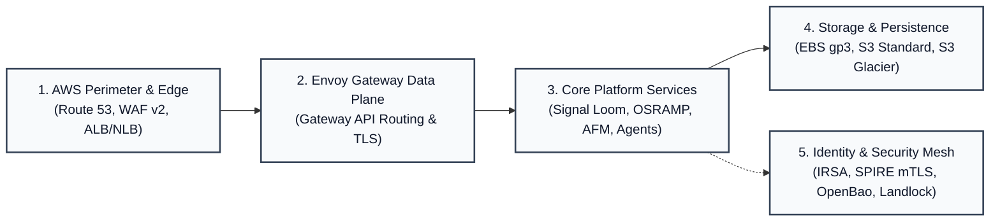
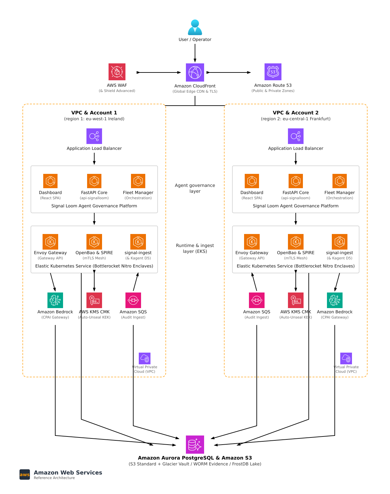
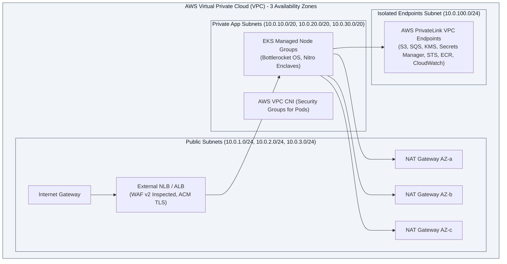
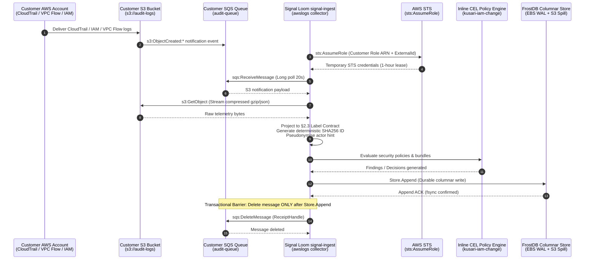

# OSRAMP & Signal Loom — AWS & Amazon EKS Architecture Specification

This document defines the AWS architecture for OSRAMP and Signal Loom. It deploys the platform on Amazon Elastic Kubernetes Service (Amazon EKS).

---

## 1. Executive Architecture Overview & Design Principles

The AWS deployment architecture realizes a secure, multi-tenant deployment of OSRAMP and Signal Loom. It satisfies high-assurance regulatory requirements while maintaining cloud cost efficiency and operational agility.

The diagram shows the five core architecture tiers of the platform.



### Core Architecture Principles

1. **Zero-Trust In-Cluster & Cloud Edge**:
   - All network traffic crossing the edge is inspected by AWS WAF v2. It terminates with TLS 1.3 at the load balancer and Envoy Gateway.
   - All in-cluster pod communication uses mutual TLS (mTLS). This communication uses short-lived X.509 SVIDs from SPIRE (`spiffe://osramp.controlplane.io/...`).
   - Workload access to AWS APIs uses AWS IAM Roles for Service Accounts (IRSA) or EKS Pod Identity. Workloads avoid long-lived static credentials.
2. **Strict Separation of Concerns & Isolation**:
   - Agent sandboxes in `agent-trust-platform` and `kagent` run under Linux Landlock LSM (`#nono` profile). Tetragon eBPF probes monitor agent actions.
   - Customer AWS account monitoring requires zero write access. Telemetry ingestion is strictly read-only and governed by cryptographic external IDs.
3. **Zero Raw Event Retention in Telemetry Engine**:
   - The `signal-ingest` engine projects telemetry onto the canonical §2.3 Label Contract. It stores structured projections, pseudonymised actor hints, and SHA256 evidence pointers in FrostDB.
   - The customer S3 bucket remains the sole immutable system of record.
4. **Transactional Ingestion Barrier**:
   - The engine runs `sqs:DeleteMessage` only after FrostDB confirms the write. If a node fails, the message returns to the queue automatically.
5. **Cryptographic Provenance & GitOps**:
   - Container images and Flux ResourceSets in Amazon ECR are signed with Cosign. They use an AWS KMS Customer-Managed Key (CMK).
   - Flux verifies all signatures before it reconciles the cluster state.

---

## 2. AWS Supporting Infrastructure & Network Topology

### 2.1 Multi-Tenant SaaS Regional Deployment Stamp (AWS Reference Architecture)

The deployment stamp diagram models active-active multi-region deployment across paired AWS regions.



- Editable vector SVG: [osramp-aws-multitenant-saas.drawio.svg](../d2-signalloom/apps/docs-signalloom/public/diagrams/osramp-aws-multitenant-saas.drawio.svg)
- Native Draw.io XML: [osramp-aws-multitenant-saas.drawio](../d2-signalloom/apps/docs-signalloom/public/diagrams/osramp-aws-multitenant-saas.drawio)
- High-resolution raster PNG: [osramp-aws-multitenant-saas.png](../d2-signalloom/apps/docs-signalloom/public/diagrams/osramp-aws-multitenant-saas.png)

### 2.2 In-Cluster Service & Subnet Topology (Mermaid)

The diagram shows the VPC layout and subnet tiers across three Availability Zones.



### 2.1 Private Amazon EKS Cluster Architecture
- **Control Plane**:
  - Fully managed Amazon EKS control plane running across three AZs.
  - **Private Endpoint Enabled**: Control plane API access is restricted to the private VPC and management networks. Public endpoint access is disabled.
  - **Envelope Encryption**: Kubernetes `secrets` resources are encrypted at rest. They use an AWS KMS Customer Managed Key (CMK) dedicated to EKS (`arn:aws:kms:<region>:<account>:key/eks-secrets-cmk`).
- **Data Plane (Managed Node Groups)**:
  - **Operating System**: **Bottlerocket OS** (`ami-bottlerocket-*`). It provides a read-only root filesystem (`dm-verity`), kernel lockdown, and atomic updates.
  - **Hardware & Instance Types**: AWS Nitro instances (such as `c6i.2xlarge`, `m6i.4xlarge`). They support **AWS Nitro Enclaves** for hardware-isolated cryptographic operations.
  - **VPC CNI Plugin**: AWS VPC CNI with prefix delegation and **Security Groups for Pods**. This configuration permits granular security group enforcement on individual pods.

### 2.2 Perimeter, Ingress & Gateway Routing
- **Amazon Route 53**:
  - Manages public and internal DNS hosted zones.
  - Configured with Route 53 Health Checks, latency-based routing, and DNSSEC.
  - Alias records point to the ingress load balancer.
- **AWS WAF v2**:
  - Associated with the Application Load Balancer or API Gateway.
  - Enforces managed rules: `AWSManagedRulesCommonRuleSet`, `AWSManagedRulesKnownBadInputsRuleSet`, and `AWSManagedRulesBotControlRuleSet`.
  - Enforces rate limiting (for example, 2,000 requests per 5-minute window per IP) and geographic restrictions.
- **Load Balancer Integration (Dual-Mode)**:
  - **Mode A (Performance)**: AWS Network Load Balancer (NLB) with cross-zone balancing. It terminates TLS 1.3 via ACM and sends PROXY protocol v2 traffic to Envoy Gateway.
  - **Mode B (WAF-Centric Edge)**: AWS Application Load Balancer (ALB) via AWS Load Balancer Controller. It inspects traffic with WAF, terminates TLS, and forwards HTTP/2 to Envoy Gateway.
- **Envoy Gateway (`envoy-gateway-system`)**:
  - Deploys Envoy Gateway Controller and proxy data plane implementing Kubernetes Gateway API (`GatewayClass: eg`, `Gateway`, `HTTPRoute`).
  - Routes traffic by path:
    - `/` and `/dashboard/*` -> `fe-signalloom/dashboard-spa:80` (Signal Loom Web Portal)
    - `/api/*` -> `fe-signalloom/fastapi-backend:8000` (FastAPI Platform API)
    - `/dex/*` -> `fe-signalloom/dex-oidc:5556` (Dex OIDC Identity Provider)
    - `/afm-api/*` -> `kubesec-afm/afm-platform:8080` (KubeSec-AFM Formal RBAC Analysis)

### 2.3 Container Registry & Supply Chain (Amazon ECR)
- Private ECR repositories encrypted with KMS CMK.
- Integrated with **Amazon Inspector v2** for continuous vulnerability scanning of OS packages and application dependencies.
- Hosts signed OCI container images and **Flux OCI ResourceSets** (`oci://<account>.dkr.ecr.<region>.amazonaws.com/osramp/...`).
- Images and manifests are signed with **Cosign** using an AWS KMS key pair (`awskms://arn:aws:kms:...`). Flux validates signatures before applying manifests.

### 2.4 Secrets Lifecycle & Auto-Unseal
- **AWS KMS CMK for OpenBao Auto-Unseal**:
  - OpenBao configuration in `inf-bao`:
    ```hcl
    seal "awskms" {
      region     = "us-east-1"
      kms_key_id = "arn:aws:kms:us-east-1:<ACCOUNT_ID>:key/<OPENBAO_UNSEAL_KEY_ID>"
    }
    ```
  - Replaces manual Shamir threshold unsealing. Enables automated, zero-touch pod recovery and rolling restarts.
- **AWS Secrets Manager**:
  - Stores initial bootstrap seeds, customer external IDs, and Dex OAuth client credentials.
  - Synchronized into Kubernetes secrets via External Secrets Operator (ESO) or fetched directly by OpenBao.

### 2.5 Storage Tiering & Persistence
- **High-Performance Block Tier (Amazon EBS `gp3`)**:
  - Provisioned via Amazon EBS CSI Driver with KMS envelope encryption.
  - Dynamic IOPS (3,000 - 16,000) and throughput (125 - 1,000 MB/s) configured independent of storage size.
  - Backs OpenBao Raft consensus logs (`/vault/data`), FrostDB active WAL (`/data/frostdb`), Prometheus TSDB (`/prometheus`), and PostgreSQL data volumes.
- **Active Object Storage Tier (Amazon S3 Standard)**:
  - Primary bucket: `s3://osramp-evidence-platform-<account>-<region>/`.
  - Stores active FrostDB Parquet segment spills, OSRAMP immutable evidence batches, Cosign signatures, and Witness attestations.
  - Configured with Server-Side Encryption (`aws:kms`), bucket versioning, and default encryption.
- **Compliance Cold Archive Tier (Amazon S3 Glacier)**:
  - S3 Lifecycle policies transition Parquet segments and evidence records:
    - Day 90: Transition to **S3 Glacier Instant Retrieval** for cost reduction with sub-second query availability.
    - Day 365: Transition to **S3 Glacier Deep Archive** for long-term regulatory retention.
  - **S3 Object Lock**: Enabled in Compliance mode with a 7-year retention period. Enforces WORM (Write Once, Read Many) integrity for compliance audits.

---

## 3. Multi-Account & Cross-Account Telemetry Ingest

The sequence diagram shows the cross-account telemetry ingestion flow from customer accounts into FrostDB.



### 3.1 Customer AWS Account Architecture
In each monitored customer account, infrastructure code configures the ingestion plumbing:
1. **Telemetry Delivery**:
   - **AWS CloudTrail**: Multi-region trail collecting management events and data events (S3, KMS, IAM, STS), delivered to `s3://<customer-audit-bucket>/cloudtrail/`.
   - **VPC Flow Logs**: Configured for 1-minute aggregation interval in v2 format, delivered to `s3://<customer-audit-bucket>/vpcflow/`.
   - **IAM Access Analyzer / Audit**: Events emitted to S3.
2. **Event Notification & Queueing**:
   - S3 Event Notification triggers on `s3:ObjectCreated:*` and delivers metadata messages to Amazon SQS `https://sqs.<region>.amazonaws.com/<customer-account>/<customer-queue>`.
   - **Dead Letter Queue (DLQ)**: An auxiliary SQS queue configured with `maxReceiveCount: 5` to isolate poison messages.
3. **Cross-Account Trust Role**:
   - Role ARN: `arn:aws:iam::<CUSTOMER_ACCOUNT_ID>:role/SignalLoomCollectorRole`.
   - **Trust Policy**:
     ```json
     {
       "Version": "2012-10-17",
       "Statement": [{
         "Effect": "Allow",
         "Principal": {
           "AWS": "arn:aws:iam::<SIGNAL_LOOM_ACCOUNT_ID>:role/signal-loom-collector-irsa"
         },
         "Action": "sts:AssumeRole",
         "Condition": {
           "StringEquals": {
             "sts:ExternalId": "<CUSTOMER_UNIQUE_EXTERNAL_ID>"
           }
         }
       }]
     }
     ```
   - **Permissions Policy (Strict Least Privilege)**:
     ```json
     {
       "Version": "2012-10-17",
       "Statement": [
         {
           "Effect": "Allow",
           "Action": ["s3:GetObject"],
           "Resource": "arn:aws:s3:::<CUSTOMER_AUDIT_BUCKET>/*"
         },
         {
           "Effect": "Allow",
           "Action": ["sqs:ReceiveMessage", "sqs:DeleteMessage", "sqs:GetQueueAttributes"],
           "Resource": "arn:aws:sqs:<REGION>:<CUSTOMER_ACCOUNT_ID>:<CUSTOMER_QUEUE>"
         }
       ]
     }
     ```
   - **Strict Read-Only Guarantee**: The role contains zero write capabilities. Permissions `s3:Put*`, `s3:Delete*`, `sqs:Send*`, and `iam:*` are completely absent.

### 3.2 Signal Loom `signal-ingest` Pipeline & Label Contract
The `signal-ingest` daemon runs in namespace `fe-signalloom`:
- **Identity Binding**: The Kubernetes ServiceAccount `awslogs-collector-sa` is bound via EKS Pod Identity or IRSA to the IAM Role `arn:aws:iam::<SIGNAL_LOOM_ACCOUNT_ID>:role/signal-loom-collector-irsa`.
- **Multi-Account Dynamic Worker Pool**: Spawns one concurrent `awslogs` collector worker per onboarded customer account based on configuration secrets (`AWSLOGS_ROLE_ARN`, `AWSLOGS_EXTERNAL_ID`, `AWSLOGS_QUEUE_URL`, `AWSLOGS_REGION`).
- **Telemetry Streaming & Decompression**:
  - Performs 20-second long polling on the customer SQS queue.
  - Fetches the referenced S3 object via streaming `s3:GetObject`.
  - Transparently decompresses gzip payloads and parses JSON records without writing uncompressed raw files to disk.
- **The Canonical §2.3 Label Contract**:
  Every record is projected onto `model.Observation`:

| Contract Key | CloudTrail Event | IAM Audit Event | VPC Flow Log (v2) |
| :--- | :--- | :--- | :--- |
| `tenant_id` | Customer Tenant ID | Customer Tenant ID | Customer Tenant ID |
| `provider` | `"aws"` | `"aws"` | `"aws"` |
| `aws_account_id` | `recipientAccountId` | `recipientAccountId` | `account-id` (field 2) |
| `actor_account_id` | `userIdentity.arn` field 4 | `userIdentity.arn` field 4 | `—` |
| `aws_region` | `awsRegion` | `awsRegion` | Collector Region |
| `event_source` | `eventSource` | `"iam.amazonaws.com"` | `"vpcflow"` |
| `event_name` | `eventName` | `eventName` | Action (`ACCEPT` \| `REJECT`) |
| `error_code` | `errorCode` (when present) | `errorCode` (when present) | `—` |
| `resource_type` | `resources[0].type` | `resources[0].type` / allowlist | `"AWS::EC2::NetworkInterface"` |
| `resource_name` | `resources[0].ARN` | `resources[0].ARN` / allowlist | `interface-id` (field 3) |
| `source_ip` | `sourceIPAddress` | `sourceIPAddress` | `srcaddr` (field 4) |
| `dst_ip` | `—` | `—` | `dstaddr` (field 5) |
| `dst_port` | `—` | `—` | `dstport` (field 7) |
| `protocol` | `—` | `—` | `protocol` (field 8, IANA number) |
| `bytes` | `—` | `—` | `bytes` (field 10) |

- **Non-Label Model Attributes**:
  - `Layer`: `LayerCloudControlPlane` (CloudTrail, IAM) or `LayerNetworkEgress` (VPC Flow).
  - `Source`: `aws:cloudtrail`, `aws:iam`, or `aws:vpcflow`.
  - `ActorHint`: Verbatim `userIdentity.arn`, pseudonymised by FrostDB using `SIGNAL_SEGMENT_PSEUDONYM_KEY`.
  - `Timestamp`: Derived deterministically from `eventTime` or flow `start`. Never uses `time.Now()`.
  - `ID`: Deterministic SHA256 hex of `RawEvidenceRef` (`s3://<bucket>/<key>#<record-index>`), guaranteeing idempotent deduplication.
  - `RawEvidenceRef`: Points back to the customer S3 bucket. Raw payloads are never retained in Signal Loom.
- **Transactional Ingestion Barrier**:
  The collector runs `sqs:DeleteMessage` only after `Store.Append` returns cleanly. If FrostDB is temporarily unreachable or the pod terminates, the message returns to the queue automatically.

---

## 4. Unified Kubernetes Topology (Standard Platform Namespaces)

The diagram shows the nine platform namespaces running on the cluster.

```mermaid
flowchart TD
  subgraph CLUSTER ["Unified EKS Cluster Topology"]
    direction TB
    NS1["envoy-gateway-system<br/>(Envoy Gateway Controller & Proxy Data Plane)"]
    NS2["cert-manager<br/>(cert-manager, Route 53 DNS-01, ACM PCA Issuers)"]
    NS3["flux-system<br/>(Flux Operator, Source/Kustomize Controllers, Cosign Verifier)"]
    NS4["inf-bao<br/>(OpenBao HA Raft, AWS KMS Auto-Unseal, SPIRE Server & Agents)"]
    NS5["fe-signalloom<br/>(Dashboard SPA, FastAPI Backend, Dex OIDC, Fleet Mgr, signal-ingest, FrostDB)"]
    NS6["d2-osramp-apps<br/>(OSRAMP Listener, Processor, Archiver with S3 Spill)"]
    NS7["agent-trust-platform & kagent<br/>(Kagent CNCF D5 Agents, CPAI Proxy, Olly SRE, Landlock/eBPF)"]
    NS8["kubesec-afm<br/>(KubeSec-AFM Formal RBAC Analysis & Z3 SMT Solver)"]
    NS9["monitoring<br/>(Prometheus Operator, Alertmanager, Grafana, AMP Remote Write)"]
  end

  classDef ns fill:#ffffff,stroke:#0284c7,color:#0369a1,stroke-width:2px;
  class NS1,NS2,NS3,NS4,NS5,NS6,NS7,NS8,NS9 ns;
```



### Detailed Namespace Responsibilities:
1. `envoy-gateway-system`:
   - Deploys Envoy Gateway Operator and data plane proxy pods backed by Gateway API resources.
   - Enforces TLS 1.3 termination, rate-limiting, CORS, and path routing to backend services.
2. `cert-manager`:
   - Manages internal and external X.509 certificate lifecycles.
   - ClusterIssuers: AWS Route 53 DNS-01 Issuer (public domains) and AWS Private CA (ACM PCA) Issuer (internal PKI).
3. `flux-system`:
   - Flux GitOps reconciliation engine (Source Controller, Kustomize Controller, Helm Controller).
   - Polls signed OCI ResourceSets from Amazon ECR.
   - Cryptographically verifies container and manifest signatures using Cosign with an AWS KMS CMK before applying changes to the cluster.
4. `inf-bao`:
   - **OpenBao**: Highly available 3-node Raft consensus cluster backed by EBS `gp3` PVCs. Integrated with AWS KMS CMK for automated auto-unseal.
   - **SPIRE Server & Agents**: Deploys SPIRE Server StatefulSet and SPIRE Agent DaemonSet mounting `/run/spire/sockets/agent.sock` on each node.
   - Issues short-lived SPIFFE X.509 SVIDs for mTLS pod-to-pod identity.
5. `fe-signalloom`:
   - **Dashboard SPA**: Static React/Vite dashboard served by Nginx.
   - **FastAPI Backend**: Platform REST/WebSocket API and real-time policy query engine.
   - **Dex OIDC**: Enterprise federated identity provider connecting to Okta, Microsoft Entra ID, and Google Workspace.
   - **Fleet Manager**: Multi-cluster governance coordinator.
   - **`signal-ingest`**: Ingestion engine hosting multi-account `awslogs` collector workers.
   - **FrostDB**: Columnar dynamic-schema Parquet storage engine with in-memory write buffer, EBS `gp3` WAL, and asynchronous S3 Standard segment spilling.
6. `d2-osramp-apps`:
   - **OSRAMP Listener**: High-throughput HTTP webhook and API receiver.
   - **OSRAMP Processor**: Event normalization, validation, and enrichment pipeline.
   - **OSRAMP Archiver**: Cryptographic batching, signing, and spilling of immutable audit evidence to Amazon S3 Standard and Glacier.
7. `agent-trust-platform` & `kagent`:
   - **Kagent**: CNCF D5 milestone declarative AI agent framework and Custom Resource Definitions (CRDs).
   - **CPAI Runtime Proxy**: Secure OpenAI-compatible translation proxy connecting agent pods to external LLMs (AWS Bedrock, Vertex AI, Anthropic).
   - **Olly Sentinel**: Autonomous AI SRE replica for self-healing cluster diagnostics and remediation.
   - **Runtime Confinement**: Agents execute under strict Linux Landlock LSM profiles (`#nono`) and eBPF kernel enforcement (Tetragon).
8. `kubesec-afm`:
   - **KubeSec-AFM Platform**: Formal-methods RBAC analysis engine powered by the **Z3 SMT Solver**.
   - Proves RBAC invariants, detects privilege escalation cycles, and verifies cross-namespace boundary compliance.
9. `monitoring`:
   - Prometheus Operator, Alertmanager, and Grafana dashboards.
   - Metrics forwarded via Prometheus Remote Write to **Amazon Managed Service for Prometheus (AMP)**.
   - Node and container log telemetry streamed to **Amazon CloudWatch Container Insights**.

---

## 5. Identity, Attestation & Security Matrix

### 5.1 AWS IRSA & EKS Pod Identity Matrix

| Kubernetes Namespace | ServiceAccount Name | AWS IAM Role Name | AWS Permissions Summary |
| :--- | :--- | :--- | :--- |
| `fe-signalloom` | `awslogs-collector-sa` | `SignalLoomCollectorIRSA` | `sts:AssumeRole` on customer account roles with `sts:ExternalId` |
| `inf-bao` | `openbao-sa` | `OpenBaoKmsUnsealIRSA` | `kms:Encrypt`, `kms:Decrypt`, `kms:DescribeKey` on OpenBao Unseal CMK |
| `flux-system` | `flux-sa` | `FluxEcrKmsIRSA` | `ecr:GetAuthorizationToken`, `ecr:BatchGetImage`, `kms:Decrypt` (Cosign) |
| `d2-osramp-apps` | `osramp-archiver-sa` | `OsrampS3ArchiverIRSA` | `s3:PutObject`, `s3:GetObject` on `osramp-evidence-platform-*` |
| `cert-manager` | `cert-manager-sa` | `CertManagerRoute53IRSA` | `route53:GetChange`, `route53:ChangeResourceRecordSets` |
| `monitoring` | `prometheus-sa` | `PrometheusRemoteWriteIRSA` | `aps:RemoteWrite` on Amazon Managed Prometheus workspace |

### 5.2 SPIFFE / SPIRE Workload Identity Matrix

| Workload Component | Kubernetes Namespace | SPIFFE ID Format | Auth Mechanism | Downstream Services |
| :--- | :--- | :--- | :--- | :--- |
| `signal-ingest` | `fe-signalloom` | `spiffe://osramp.controlplane.io/ns/fe-signalloom/sa/signal-ingest` | X.509 SVID (mTLS) | FrostDB, OpenBao |
| `fastapi-backend` | `fe-signalloom` | `spiffe://osramp.controlplane.io/ns/fe-signalloom/sa/backend-sa` | X.509 SVID (mTLS) | FrostDB, AFM Platform, OpenBao |
| `afm-platform` | `kubesec-afm` | `spiffe://osramp.controlplane.io/ns/kubesec-afm/sa/afm-sa` | X.509 SVID (mTLS) | FastAPI Backend |
| `kagent` Agents | `kagent` | `spiffe://osramp.controlplane.io/ns/kagent/sa/agent-worker` | X.509 SVID (mTLS) | CPAI Proxy, FastAPI Backend |
| `osramp-proc` | `d2-osramp-apps` | `spiffe://osramp.controlplane.io/ns/d2-osramp-apps/sa/processor-sa` | X.509 SVID (mTLS) | OSRAMP Archiver, OpenBao |

---

## 6. Complete Production-Grade Architecture Diagram

The diagram models the complete AWS perimeter, managed cloud services, cross-account ingestion pipeline, in-cluster Kubernetes topologies, persistence tiers, and identity mesh.

```mermaid
flowchart TB
  %% AWS Perimeter & Ingress Tier
  subgraph AWS_PERIMETER ["AWS Perimeter & Ingress Tier"]
    direction TB
    R53["AWS Route 53<br/>(Public DNS / Health Checks / DNSSEC)"]
    WAF["AWS WAF v2<br/>(OWASP CRS, Rate Limiting, Bot Control)"]
    ALB_NLB["AWS NLB / ALB<br/>(ACM TLS 1.3 Termination, Dual-Stack)"]
    R53 -->|"HTTPS :443"| WAF
    WAF -->|"Inspected Traffic"| ALB_NLB
  end

  %% AWS Managed Supporting Services
  subgraph AWS_MANAGED ["AWS Managed Supporting Services"]
    direction TB
    ECR["Amazon ECR (Private)<br/>KMS CMK Encrypted<br/>Inspector v2 Scanning<br/>Signed OCI & ResourceSets"]
    KMS["AWS Key Management Service (KMS)<br/>- EKS Secrets Envelope Key<br/>- OpenBao Auto-Unseal CMK<br/>- Cosign/Witness Verify CMK<br/>- EBS gp3 & S3 CMK"]
    SM["AWS Secrets Manager<br/>(Bootstrap Secrets, External IDs,<br/>Dex Client Credentials)"]
    AMP["Amazon Managed Prometheus (AMP)<br/>& CloudWatch Container Insights"]
  end

  %% Customer AWS Account (Cross-Account Telemetry)
  subgraph CUSTOMER_AWS ["Customer AWS Account (Cross-Account Telemetry)"]
    direction TB
    CT["AWS CloudTrail<br/>(Management & Data Events)"]
    IAM_EVT["AWS IAM Audit<br/>(Access Analyzer & Events)"]
    VPC_FLOW["AWS VPC Flow Logs<br/>(1-min Aggregation, v2)"]
    CUST_S3["Customer S3 Log Bucket<br/>(Log Archive & Lifecycle)"]
    CUST_SQS["Customer SQS Queue<br/>(s3:ObjectCreated Events)"]
    CUST_DLQ["Customer SQS Dead-Letter Queue<br/>(Poison Message Retention)"]
    CUST_ROLE["Customer IAM Role<br/>arn:aws:iam::...:role/SignalLoomCollector<br/>Trust: sts:AssumeRole + sts:ExternalId<br/>Perms: s3:GetObject, sqs:Receive/Delete"]

    CT -->|"Deliver Logs"| CUST_S3
    IAM_EVT -->|"Deliver Events"| CUST_S3
    VPC_FLOW -->|"Deliver Flows"| CUST_S3
    CUST_S3 -->|"Event Notification"| CUST_SQS
    CUST_SQS -.->|"Max Receive Exceeded"| CUST_DLQ
    CUST_ROLE -.->|"Read-Only Scope"| CUST_S3
    CUST_ROLE -.->|"Receive/Delete Scope"| CUST_SQS
  end

  %% Storage & Persistence Layer
  subgraph STORAGE_PERSISTENCE ["Storage & Persistence Layer"]
    direction TB
    EBS_CSI["Amazon EBS gp3 CSI Driver<br/>(KMS Encrypted, High IOPS)"]
    EBS_BAO["EBS gp3 PVC<br/>(OpenBao Raft Storage)"]
    EBS_FROST["EBS gp3 PVC<br/>(FrostDB WAL & Cache)"]
    EBS_PROM["EBS gp3 PVC<br/>(Prometheus TSDB)"]

    S3_ACTIVE["Amazon S3 Standard (Platform Bucket)<br/>- Active FrostDB Parquet Segments<br/>- OSRAMP Evidence & Attestations<br/>- Cosign Supply Chain Signatures"]
    S3_COLD["Amazon S3 Glacier (Flexible / Deep Archive)<br/>- S3 Lifecycle Rule (90d / 365d Transition)<br/>- Object Lock WORM (Regulatory Compliance)"]

    EBS_CSI --> EBS_BAO
    EBS_CSI --> EBS_FROST
    EBS_CSI --> EBS_PROM
    S3_ACTIVE -->|"Lifecycle Policy"| S3_COLD
  end

  %% Security & Identity Layer
  subgraph SECURITY_IDENTITY ["Security & Identity Layer (IRSA, SPIRE, OpenBao)"]
    direction TB
    IRSA_OIDC["EKS IAM OIDC Provider<br/>& EKS Pod Identity"]
    ROLE_COLLECTOR["IAM Role: SignalLoomCollectorRole<br/>Trust: awslogs-collector-sa<br/>Perm: sts:AssumeRole on Customer Roles"]
    ROLE_UNSEAL["IAM Role: OpenBaoKmsRole<br/>Trust: openbao-sa<br/>Perm: kms:Encrypt, kms:Decrypt on CMK"]
    ROLE_FLUX["IAM Role: FluxEcrKmsRole<br/>Trust: flux-sa<br/>Perm: ecr:Get*, kms:Decrypt"]
    ROLE_ARCH["IAM Role: OsrampS3Role<br/>Trust: osramp-archiver-sa<br/>Perm: s3:PutObject on Platform S3"]

    IRSA_OIDC --> ROLE_COLLECTOR
    IRSA_OIDC --> ROLE_UNSEAL
    IRSA_OIDC --> ROLE_FLUX
    IRSA_OIDC --> ROLE_ARCH
  end

  %% Private Amazon EKS Cluster
  subgraph EKS_CLUSTER ["Private Amazon EKS Cluster (VPC Private Subnets, Nitro / Bottlerocket)"]
    direction TB

    subgraph NS_ENVOY ["Namespace: envoy-gateway-system"]
      EG_CTRL["Envoy Gateway Controller<br/>(Gateway API)"]
      EG_PROXY["Envoy Gateway Data Plane<br/>(Envoy Proxy Fleet, TLS Edge, Routing)"]
      EG_CTRL -->|"Configures"| EG_PROXY
    end

    subgraph NS_CERT ["Namespace: cert-manager"]
      CERT_MGR["cert-manager<br/>(Controller & Webhook)"]
      R53_ISSUER["Route53 DNS01 /<br/>ACM PCA ClusterIssuer"]
      CERT_MGR -->|"Reconciles"| R53_ISSUER
    end

    subgraph NS_FLUX ["Namespace: flux-system"]
      FLUX_OP["Flux Operator & Controllers<br/>(Source, Kustomize, Helm)"]
      FLUX_COSIGN["Cosign KMS Verifier<br/>(Validates OCI Signatures)"]
      FLUX_OP -->|"Verifies via"| FLUX_COSIGN
    end

    subgraph NS_BAO ["Namespace: inf-bao"]
      OPENBAO["OpenBao Vault Cluster (HA Raft)<br/>- Transit & KV v2 Engines<br/>- SPIFFE Auth Engine"]
      SPIRE_SRV["SPIRE Server (StatefulSet)<br/>(Workload Identity Authority)"]
      SPIRE_AGT["SPIRE Agent (DaemonSet)<br/>(Workload API /agent.sock)"]
      SPIRE_SRV -->|"Syncs Tokens"| SPIRE_AGT
      OPENBAO -->|"Attests SVIDs via"| SPIRE_SRV
    end

    subgraph NS_SL ["Namespace: fe-signalloom"]
      DASH["Dashboard SPA<br/>(React / Vite Portal)"]
      BACKEND["FastAPI Backend API<br/>(Query & Policy Engine)"]
      DEX["Dex OIDC Provider<br/>(Identity Federation)"]
      FLEET["Fleet Manager<br/>(Cluster & Tenant Coordinator)"]
      SIG_INGEST["signal-ingest Daemon<br/>(Multi-Account awslogs Collector)"]
      FROSTDB["FrostDB Columnar Store<br/>(Dynamic Parquet Storage)"]

      DASH -->|"REST / WebSocket"| BACKEND
      BACKEND -->|"OIDC Auth"| DEX
      BACKEND -->|"Queries"| FROSTDB
      SIG_INGEST -->|"Evaluates CEL & Appends"| FROSTDB
    end

    subgraph NS_OSRAMP ["Namespace: d2-osramp-apps"]
      OS_LISTENER["OSRAMP Listener<br/>(High-Throughput Ingestion)"]
      OS_PROC["OSRAMP Processor<br/>(Validation & Transformation)"]
      OS_ARCH["OSRAMP Archiver<br/>(Batching & Attestation)"]

      OS_LISTENER -->|"Raw Events"| OS_PROC
      OS_PROC -->|"Validated Batches"| OS_ARCH
    end

    subgraph NS_AGENT ["Namespaces: agent-trust-platform & kagent"]
      KAGENT_CTRL["Kagent Operator / CRDs<br/>(CNCF D5 Declarative Agents)"]
      CPAI_PROXY["CPAI Runtime Proxy<br/>(OpenAI API Translation)"]
      OLLY_REP["Olly Sentinel SRE Replica<br/>(Autonomous Remediation)"]
      AGENT_SANDBOX["Agent Sandboxes<br/>- Landlock LSM (#nono)<br/>- Tetragon eBPF Kernel Probes"]

      KAGENT_CTRL -->|"Spawns"| AGENT_SANDBOX
      AGENT_SANDBOX -->|"LLM Requests"| CPAI_PROXY
      AGENT_SANDBOX -->|"Telemetry & Incidents"| OLLY_REP
    end

    subgraph NS_AFM ["Namespace: kubesec-afm"]
      AFM_API["KubeSec-AFM Platform API<br/>(RBAC Analysis Service)"]
      Z3_SOLVER["Z3 Formal SMT Solver<br/>(RBAC Invariant & Loop Checks)"]
      AFM_API -->|"Formal Proofs"| Z3_SOLVER
    end

    subgraph NS_MON ["Namespace: monitoring"]
      PROM["Prometheus Operator & Alertmanager"]
      GRAFANA["Grafana Dashboards"]
      GRAFANA -->|"Queries"| PROM
    end
  end

  %% Inter-Layer Connections & Cross-Account Telemetry Flow
  ALB_NLB -->|"TCP / Proxy Protocol"| EG_PROXY

  %% Gateway Routing
  EG_PROXY -->|"Path: / or /dashboard/*"| DASH
  EG_PROXY -->|"Path: /api/*"| BACKEND
  EG_PROXY -->|"Path: /dex/*"| DEX
  EG_PROXY -->|"Path: /afm-api/*"| AFM_API

  %% Cross-Account Telemetry Ingest
  ROLE_COLLECTOR -.->|"1. sts:AssumeRole (with ExternalId)"| CUST_ROLE
  SIG_INGEST -.->|"Assumes Identity via IRSA"| ROLE_COLLECTOR
  SIG_INGEST ==>|"2. Polls SQS (ReceiveMessage)"| CUST_SQS
  SIG_INGEST ==>|"3. Fetches Telemetry (GetObject)"| CUST_S3
  SIG_INGEST -.->|"4. Deletes Message ONLY after Append"| CUST_SQS

  %% Storage Mounts & Spilling
  OPENBAO -->|"Mounts WAL & Raft State"| EBS_BAO
  FROSTDB -->|"Mounts Active WAL"| EBS_FROST
  FROSTDB -->|"Spills Parquet Segments"| S3_ACTIVE
  OS_ARCH -->|"Spills Evidence Records"| S3_ACTIVE
  PROM -->|"Mounts TSDB"| EBS_PROM

  %% Security, Unseal & Attestation
  OPENBAO -->|"Auto-Unseal Requests"| KMS
  ROLE_UNSEAL -.->|"Authorizes KMS Unseal"| KMS
  FLUX_COSIGN -->|"Verifies Signatures via KMS Key"| KMS
  FLUX_OP -->|"Pulls Signed OCI Manifests"| ECR
  ROLE_FLUX -.->|"Authorizes ECR & KMS"| ECR

  %% Workload Identity mTLS (SPIFFE)
  SPIRE_AGT -.->|"Issues X.509 SVIDs"| SIG_INGEST
  SPIRE_AGT -.->|"Issues X.509 SVIDs"| BACKEND
  SPIRE_AGT -.->|"Issues X.509 SVIDs"| AGENT_SANDBOX
  SPIRE_AGT -.->|"Issues X.509 SVIDs"| OS_PROC
  AGENT_SANDBOX -.->|"mTLS via SPIFFE SVID"| BACKEND

  %% Observability Remote Write
  PROM -->|"Remote Write Metrics"| AMP

  %% Styling Classes
  classDef perimeter fill:#ecfeff,stroke:#0891b2,color:#164e63,stroke-width:2px;
  classDef managed fill:#fffbeb,stroke:#d97706,color:#78350f,stroke-width:2px;
  classDef customer fill:#fef2f2,stroke:#dc2626,color:#7f1d1d,stroke-width:2px;
  classDef storage fill:#f0fdf4,stroke:#16a34a,color:#14532d,stroke-width:2px;
  classDef security fill:#faf5ff,stroke:#9333ea,color:#581c87,stroke-width:2px;
  classDef k8s fill:#eff6ff,stroke:#2563eb,color:#1e3a8a,stroke-width:1.5px;

  class R53,WAF,ALB_NLB,EG_CTRL,EG_PROXY perimeter;
  class ECR,KMS,SM,AMP managed;
  class CT,IAM_EVT,VPC_FLOW,CUST_S3,CUST_SQS,CUST_DLQ,CUST_ROLE customer;
  class EBS_CSI,EBS_BAO,EBS_FROST,EBS_PROM,S3_ACTIVE,S3_COLD storage;
  class IRSA_OIDC,ROLE_COLLECTOR,ROLE_UNSEAL,ROLE_FLUX,ROLE_ARCH,OPENBAO,SPIRE_SRV,SPIRE_AGT security;
  class DASH,BACKEND,DEX,FLEET,SIG_INGEST,FROSTDB,OS_LISTENER,OS_PROC,OS_ARCH,KAGENT_CTRL,CPAI_PROXY,OLLY_REP,AGENT_SANDBOX,AFM_API,Z3_SOLVER,PROM,GRAFANA,CERT_MGR,R53_ISSUER,FLUX_OP,FLUX_COSIGN k8s;
```



---

## 7. Operational Readiness & Verification Checklist

1. **VPC & EKS Control Plane Verification**:
   - `aws eks describe-cluster --name osramp-eks --query "cluster.resourcesVpcConfig.endpointPrivateAccess"` returns `true`.
   - `aws eks describe-cluster --name osramp-eks --query "cluster.encryptionConfig[0].provider.keyArn"` returns the dedicated KMS CMK ARN.
2. **IRSA & Pod Identity Verification**:
   - Pod `awslogs-collector` in `fe-signalloom` contains environment variables `AWS_ROLE_ARN` and `AWS_WEB_IDENTITY_TOKEN_FILE`.
   - `aws sts get-caller-identity` inside the container reflects `arn:aws:sts::<ACCOUNT_ID>:assumed-role/SignalLoomCollectorIRSA/...`.
3. **Cross-Account Telemetry Verification**:
   - Check cross-account assume role:
     ```bash
     aws sts assume-role \
       --role-arn arn:aws:iam::<CUSTOMER_ACCOUNT>:role/SignalLoomCollectorRole \
       --role-session-name VerifyIngest \
       --external-id <CUSTOMER_EXTERNAL_ID>
     ```
   - Confirm SQS polling returns message. Confirm S3 `GetObject` retrieves gzip file. Confirm FrostDB `Store.Append` writes rows. Confirm SQS `DeleteMessage` removes message.
4. **Supply Chain & GitOps Verification**:
   - `cosign verify --key awskms://arn:aws:kms:... <ECR_IMAGE_URI>` returns verified claims.
   - Flux reconciles ResourceSets: `flux get kustomizations -A`.
5. **OpenBao & SPIRE Attestation**:
   - `vault status` in `inf-bao` reports `Sealed: false`, `HA Enabled: true`, `Storage Type: raft`.
   - SPIRE agent health check: `spire-agent healthcheck -socketPath /run/spire/sockets/agent.sock` reports healthy.
