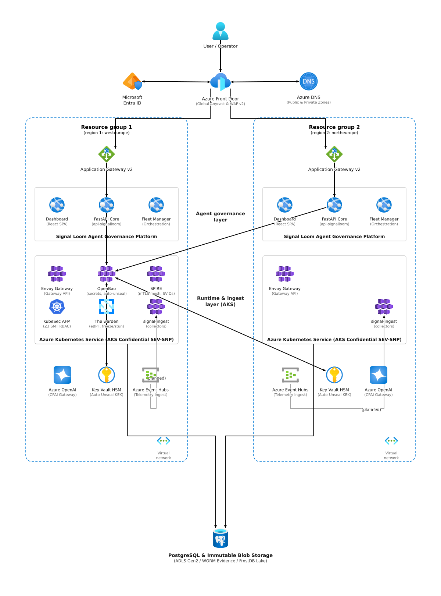

---
tags:
  - architecture-specification
  - azure
  - aks
  - signalloom
  - osramp
  - confidential-computing
  - cilium
  - workload-identity
date: 2026-10-06
status: active
author: Signal Loom Architecture Team
title: "Azure & Azure Kubernetes Service (AKS) Architecture Specification — Signal Loom Platform"
version: 1.0.0
---

# Azure & Azure Kubernetes Service (AKS) Architecture Specification

## Executive Summary

This specification establishes the target architecture, security model, and implementation topology for deploying the **Signal Loom** governance platform on **Microsoft Azure** and **Azure Kubernetes Service (AKS)**.

The architecture addresses three critical enterprise requirements:
1. **Confidential Hardware Isolation:** Hardware-enforced enclaves using AMD SEV-SNP / Intel TDX confidential virtual machines on AKS, guaranteeing code and cryptographic state privacy against hypervisor and cloud operator inspection.
2. **Zero-Trust Identity Federation & Cryptography:** Total elimination of static credentials through Microsoft Entra ID Workload Identity federation, SPIFFE/SPIRE dynamic X.509 SVID mutual TLS (mTLS), and OpenBao HSM auto-unseal via Azure Key Vault Managed HSM (FIPS 140-2 Level 3).
3. **High-Performance & Tamper-Proof Audit Telemetry:** Real-time ingestion of cloud plane (Azure Activity, Entra Audit, NSG Flow Logs) and kernel eBPF signals via Azure Event Hubs into `signal-ingest` (`azureaudit` collector), evaluated by Common Expression Language (CEL) policy engines, and persisted across sub-millisecond Ultra SSD WAL disks, FrostDB Arrow/Parquet columnar storage, and WORM-enforced Immutable Azure Blob Storage.

---

## 1. System Topology & Architectural Blueprint

The architecture is partitioned into five distinct operational domains:
- **Azure Perimeter & Ingress:** Global Anycast edge routing, Layer 7 WAF, DDoS mitigation, and private ingress routing.
- **Azure Managed Supporting Services:** Enterprise PaaS services covering container registry, hardware security modules, event streaming, and cloud intelligence.
- **In-Cluster Unified Kubernetes Topology:** Standard platform namespace contract implemented on private AKS with Cilium eBPF dataplane and confidential computing.
- **Storage & Persistence Layer:** Tiered disk and object storage providing sub-millisecond commit latency and immutable long-term compliance retention.
- **Security & Identity Layer:** Federated Entra ID identities, SPIFFE/SPIRE workload attestation, and OpenBao secrets engine.

### 1.1 Multi-Tenant SaaS Regional Deployment Stamp (Microsoft Reference Architecture)

The deployment stamp diagram follows Microsoft Learn reference architecture patterns. It models active-active multi-region deployment across paired Azure regions.



- Editable vector SVG: [osramp-azure-multitenant-saas.drawio.svg](../d2-signalloom/apps/docs-signalloom/public/diagrams/osramp-azure-multitenant-saas.drawio.svg)
- Native Draw.io XML: [osramp-azure-multitenant-saas.drawio](../d2-signalloom/apps/docs-signalloom/public/diagrams/osramp-azure-multitenant-saas.drawio)
- High-resolution raster PNG: [osramp-azure-multitenant-saas.png](../d2-signalloom/apps/docs-signalloom/public/diagrams/osramp-azure-multitenant-saas.png)

### 1.2 In-Cluster Service & Namespace Topology (Mermaid)

```mermaid
flowchart TB
    %% External Traffic Entry
    CLIENT(["External Clients / Operators / Browsers"])

    %% 1. Azure Perimeter & Ingress Subgraph
    subgraph PERIMETER ["Azure Perimeter & Ingress Layer"]
        AFD["Azure Front Door Premium<br/>(Global Anycast Edge & TLS 1.3)"]
        WAF["Azure WAF v2<br/>(OWASP CRS 3.2, Rate Limiting & Bot Control)"]
        DNS["Azure DNS Zones<br/>(Public DNS & Private DNS Zones)"]
        AGW_ILB["Azure App Gateway v2 / Internal LB<br/>(Private IP Forwarder to AKS)"]
    end

    %% 2. Azure Managed Supporting Services Subgraph
    subgraph AZURE_SERVICES ["Azure Managed Supporting Services (PaaS)"]
        ACR["Azure Container Registry (ACR) Premium<br/>(Private Endpoint, ACR Tasks, Defender)"]
        AKV["Azure Key Vault Managed HSM<br/>(FIPS 140-2 L3, KEK, CMK, Cosign Keys)"]
        EVH["Azure Event Hubs<br/>(Kafka/AMQP Endpoint for Azure Audit/Flow Logs)"]
        AZ_MON["Azure Monitor & Log Analytics<br/>(Activity Logs, NSG Flow Logs, Managed Prometheus)"]
        AZ_OAI["Azure OpenAI Service<br/>(GPT-4o Enterprise Endpoints via Private Endpoint)"]
    end

    %% 3. Security & Identity Layer Subgraph
    subgraph SEC_IDENTITY ["Security & Identity Layer"]
        ENTRA["Microsoft Entra ID<br/>(Tenant & Directory Services)"]
        WI_OIDC["AKS OIDC Discovery Issuer<br/>(Federated Identity Credentials)"]
        
        subgraph MANAGED_IDENTITIES ["User-Assigned Managed Identities"]
            MI_OPENBAO["id-openbao-unseal<br/>(Key Vault Crypto User)"]
            MI_FROSTDB["id-frostdb-storage<br/>(Storage Blob Data Contributor)"]
            MI_ARCHIVER["id-evidence-archiver<br/>(Storage Blob Data Contributor)"]
            MI_AUDIT["id-azureaudit-collector<br/>(Event Hubs Data Receiver)"]
            MI_CERT["id-cert-manager<br/>(DNS Zone Contributor)"]
            MI_FLUX["id-flux-cosign<br/>(Key Vault Crypto User)"]
        end
    end

    %% 4. Private AKS Cluster & Core Namespaces
    subgraph AKS_CLUSTER ["Private AKS Cluster (Azure CNI Powered by Cilium — eBPF & WireGuard)"]
        
        %% Subgraph: envoy-gateway-system
        subgraph NS_ENVOY ["ns: envoy-gateway-system"]
            EG_CTRL["Envoy Gateway Controller<br/>(Gateway API Reconciler)"]
            EG_DATA["Envoy Gateway Data Plane<br/>(Envoy Proxy Replicas - TLS Termination)"]
        end

        %% Subgraph: cert-manager
        subgraph NS_CERT ["ns: cert-manager"]
            CM_POD["cert-manager Controller & Webhook"]
            CM_ISSUER["ClusterIssuer<br/>(Azure DNS ACME & Key Vault CA)"]
        end

        %% Subgraph: flux-system
        subgraph NS_FLUX ["ns: flux-system"]
            FLUX_OPERATOR["Flux Operator & Controllers<br/>(Source, Kustomize, Helm, Notification)"]
            FLUX_RS["ResourceSets & GitOps Engine"]
            COSIGN_VAL["Cosign Verification Engine<br/>(Signature & Attestation Gate)"]
        end

        %% Subgraph: inf-bao
        subgraph NS_BAO ["ns: inf-bao"]
            OPENBAO["OpenBao HA Cluster<br/>(3 Replicas - Raft Consensus)"]
            SPIRE_SRV["SPIRE Server<br/>(mTLS Authority & SVID Generator)"]
            SPIRE_AGT["SPIRE Agent DaemonSet<br/>(Node & Workload Attestation)"]
        end

        %% Subgraph: fe-signalloom
        subgraph NS_FE ["ns: fe-signalloom"]
            FE_UI["Dashboard SPA<br/>(Next.js 14 / React Flow UI)"]
            FE_API["FastAPI Backend (api-signalloom)<br/>(Async SQLAlchemy, Orchestrator)"]
            DEX["Dex OIDC Provider<br/>(Entra ID OAuth/OIDC Bridge)"]
            FLEET_MGR["Fleet Manager<br/>(Multi-Tenant Cluster Coordinator)"]
            SIG_INGEST["signal-ingest Sink<br/>(Go Pipeline, CEL Evaluator)"]
            AZ_COLLECTOR["azureaudit Collector<br/>(Event Hubs & Blob Consumer)"]
            FROSTDB["FrostDB Columnar Store<br/>(Arrow / Parquet Engine & Query Node)"]
        end

        %% Subgraph: fe-signalloom-ingest
        subgraph NS_INGEST ["ns: fe-signalloom-ingest"]
            INGEST_LISTENER["ingest-listener<br/>(High-Throughput Ingestion)"]
            INGEST_PROCESSOR["ingest-processor<br/>(Schema Validation & Enricher)"]
            INGEST_ARCHIVER["evidence-archiver<br/>(Signed Package Bundler)"]
        end

        %% Subgraph: agent-trust-platform & kagent
        subgraph NS_AGENTS ["ns: agent-trust-platform & kagent"]
            KAGENT_CTRL["Kagent Controller (CNCF D5)<br/>(Declarative Agent CRDs)"]
            CPAI_PROXY["CPAI Runtime Proxy<br/>(LLM Gateway & Audit Filter)"]
            AGENT_RUNNER["Agent Sandboxes<br/>(Kernel LSM & eBPF Isolation)"]
            OLLY_SENTINEL["Olly Sentinel SRE Replica<br/>(Autonomous Incident Triage)"]
        end

        %% Subgraph: kubesec-afm
        subgraph NS_AFM ["ns: kubesec-afm"]
            AFM_ENGINE["KubeSec-AFM Platform<br/>(Formal RBAC / Z3 SMT Solver)"]
        end

        %% Subgraph: monitoring
        subgraph NS_MON ["ns: monitoring"]
            PROM_STACK["Prometheus Operator & Alertmanager"]
            GRAFANA["Grafana Dashboards"]
            AMA_DS["Azure Monitor Agent (AMA) DaemonSet<br/>(Container Insights Telemetry)"]
        end
    end

    %% 5. Storage & Persistence Layer Subgraph
    subgraph STORAGE_LAYER ["Storage & Persistence Layer"]
        subgraph AZ_DISKS ["Azure Managed Disks (CSI: disk.csi.azure.com)"]
            DISK_BAO["Ultra SSD Disk (CMK)<br/>(OpenBao Raft Journal)"]
            DISK_FROST["Ultra SSD Disk (CMK)<br/>(FrostDB Active Write WAL)"]
            DISK_PG["Premium SSD v2 (CMK)<br/>(PostgreSQL State DB)"]
        end

        subgraph AZ_BLOB ["Azure Blob Storage (Storage Accounts ADLS Gen2)"]
            BLOB_HOT["Hot Tier Blob Container<br/>(FrostDB Parquet Spills)"]
            BLOB_COOL["Cool / Archive Tier<br/>(Historical Telemetry Lifecycle)"]
            BLOB_WORM["Immutable Blob Container (WORM)<br/>(Audit Trails & Evidence Dossiers)"]
        end
    end

    %% Network & Ingress Routing Flow
    CLIENT -->|"HTTPS / 443"| AFD
    AFD -->|"WAF Inspection & Routing"| WAF
    WAF -->|"Private Link / VNet Ingress"| AGW_ILB
    AGW_ILB -->|"TCP / mTLS 443"| EG_DATA
    EG_CTRL -->|"Configures Proxies via xDS"| EG_DATA

    EG_DATA -->|"Route: /"| FE_UI
    EG_DATA -->|"Route: /api/"| FE_API
    EG_DATA -->|"Route: /dex/"| DEX
    EG_DATA -->|"Route: /afm-api/"| AFM_ENGINE

    %% Workload Identity Connections
    ENTRA -->|"OIDC Trust"| WI_OIDC
    WI_OIDC -.->|"Federates"| MANAGED_IDENTITIES
    MI_OPENBAO -.->|"Injected Token"| OPENBAO
    MI_FROSTDB -.->|"Injected Token"| FROSTDB
    MI_ARCHIVER -.->|"Injected Token"| INGEST_ARCHIVER
    MI_AUDIT -.->|"Injected Token"| AZ_COLLECTOR
    MI_CERT -.->|"Injected Token"| CM_POD
    MI_FLUX -.->|"Injected Token"| FLUX_RS

    %% Supporting Services Connections
    OPENBAO -->|"Auto-Unseal KEK (wrap/unwrap)"| AKV
    FLUX_RS -->|"Verify Artifacts"| COSIGN_VAL
    COSIGN_VAL -->|"Fetch Cosign PubKey"| AKV
    FLUX_RS -->|"Pull Signed Images"| ACR
    CM_POD -->|"DNS01 Challenge Validation"| DNS

    %% Telemetry Pipeline Flow
    AZ_MON -->|"Diagnostic Stream"| EVH
    EVH -->|"AMQP / Kafka Event Stream"| AZ_COLLECTOR
    AZ_COLLECTOR -->|"Raw Azure Records"| SIG_INGEST
    SIG_INGEST -->|"CEL Decision & Observations"| FROSTDB

    %% Storage Connections
    OPENBAO -->|"Raft Log I/O"| DISK_BAO
    FROSTDB -->|"Active Write WAL"| DISK_FROST
    FROSTDB -->|"Parquet Segment Flush"| BLOB_HOT
    BLOB_HOT -->|"Lifecycle Management"| BLOB_COOL
    FE_API -->|"Relational CRUD"| DISK_PG
    INGEST_ARCHIVER -->|"Signed WORM Audit Export"| BLOB_WORM
    FE_API -->|"Evidence Dossier Archival"| BLOB_WORM

    %% Agent Platform Connections
    KAGENT_CTRL -->|"Schedules Sandboxes"| AGENT_RUNNER
    AGENT_RUNNER -->|"Controlled LLM Queries"| CPAI_PROXY
    CPAI_PROXY -->|"Enterprise Private Link"| AZ_OAI
    AGENT_RUNNER -.->|"eBPF Telemetry"| SIG_INGEST
    OLLY_SENTINEL -->|"Inspects Cluster Health"| FE_API

    %% Ingestion Processing Flow
    INGEST_LISTENER -->|"Raw Messages"| INGEST_PROCESSOR
    INGEST_PROCESSOR -->|"Batch Bundles"| INGEST_ARCHIVER
    INGEST_PROCESSOR -->|"Telemetry Stream"| SIG_INGEST

    %% SPIRE Security Flow
    SPIRE_SRV -->|"Issue X.509 SVIDs"| SPIRE_AGT
    SPIRE_AGT -.->|"Local Socket mTLS Identity"| EG_DATA
    SPIRE_AGT -.->|"Local Socket mTLS Identity"| FE_API
    SPIRE_AGT -.->|"Local Socket mTLS Identity"| SIG_INGEST
    SPIRE_AGT -.->|"Local Socket mTLS Identity"| AFM_ENGINE

    %% Monitoring Integration
    AMA_DS -->|"Export Metrics & Logs"| AZ_MON
    PROM_STACK -->|"Prometheus Remote Write"| AZ_MON
```



---

## 2. Azure Supporting Infrastructure Details

### 2.1 Private Azure Kubernetes Service (AKS) Architecture

The AKS cluster is deployed as a fully private, hardened cluster within a Hub-and-Spoke Virtual Network topology:

- **Private Cluster API:** The Kubernetes API server is completely isolated from the public internet. Access is mediated via an Azure Private Endpoint in the AKS Spoke VNet, with name resolution managed by the private DNS zone `privatelink.<region>.azmk8s.io`. Operator and CI access occurs through Azure Bastion or ExpressRoute/VPN peering.
- **Azure CNI Powered by Cilium:**
  - Standard `kube-proxy` is replaced by Cilium's eBPF dataplane, avoiding iptables scaling bottlenecks and kernel state exhaustion.
  - Native Cilium NetworkPolicies enforce strict L3/L4 and L7 microsegmentation.
  - Transparent data-in-transit encryption is enabled using Cilium WireGuard node-to-node encryption, providing line-rate cryptographic security without proxy overhead.
  - Cilium Hubble provides real-time eBPF flow logging and service dependency visualization.
- **Confidential Computing Node Pools:**
  - **Worker Node Pool (Confidential):** Utilizes `Standard_DC4as_v5` or `Standard_EC4as_v5` VM instances backed by AMD SEV-SNP (Secure Encrypted Virtualization-Secure Nested Paging) or Intel TDX hardware. Physical memory is encrypted with hardware-generated keys managed by the AMD/Intel secure processor, preventing unauthorized physical DRAM inspection or host-hypervisor compromise.
  - **Attestation:** Nodes undergo hardware root-of-trust attestation via Microsoft Azure Attestation (MAA) before joining the cluster and joining the SPIRE trust domain.
- **Ubuntu Pro Node OS:**
  - Base OS is Ubuntu Pro 22.04 LTS configured with FIPS 140-3 validated cryptographic modules.
  - Canonical Livepatch provides rebootless kernel vulnerability patching for zero-downtime operations.
  - 10-year Expanded Security Maintenance (ESM) compliance profile.

### 2.2 Perimeter & Ingress Architecture

Traffic ingress combines global edge acceleration with multi-tier inspection:
1. **Azure Front Door (AFD) Premium:** Acts as the external global Anycast entrypoint. AFD terminates external TLS 1.3 connections, applies global DDoS protection, and routes traffic via Azure Private Link directly into the customer's VNet without traversing the public internet.
2. **Azure WAF v2:** Deployed on Front Door / Regional Application Gateway. Enforces OWASP Core Rule Set (CRS 3.2), custom rate limiting (preventing credential stuffing and DoS attacks against `/dex/` and `/api/`), and automated bot detection rules.
3. **Internal Load Balancer & Envoy Gateway:** An Azure Standard Internal Load Balancer receives traffic from the Private Link origin and forwards it to Envoy Gateway data plane proxies running in the `envoy-gateway-system` namespace.
4. **Azure DNS:** Integrates public DNS for apex domain resolution with Azure Private DNS zones for internal cluster service routing and Private Endpoint resolution.

### 2.3 Container Supply Chain & Registry (ACR)

- **Azure Container Registry (ACR) Premium:**
  - Private Endpoint configured in the cluster VNet; public network access is disabled (`publicNetworkAccess = Disabled`).
  - Geo-replication across paired regions (`northeurope` / `westeurope`) ensures high availability and disaster recovery.
  - ACR Tasks execute automated image builds within isolated network perimeters.
- **Security & Integrity Enforcement:**
  - **Microsoft Defender for Containers:** Conducts agentless image vulnerability scanning (Trivy engine integration) on push and continuous scanning for newly disclosed CVEs.
  - **Cosign Image Signing & Attestation:** All container images, Helm charts, and Flux OCI artifacts are signed with Sigstore Cosign keys hosted in Azure Key Vault Managed HSM. The Flux `flux-system` admission controller verifies signatures and in-toto provenance attestations before image admission.

### 2.4 Azure Key Vault & Secrets Management

- **Azure Key Vault Managed HSM (FIPS 140-2 Level 3):**
  - Dedicated hardware security module providing hardware-isolated key storage.
  - **OpenBao Auto-Unseal:** Hosts an RSA-HSM 4096-bit Key Encryption Key (KEK) used by `inf-bao` to wrap and unwrap the OpenBao master key via Azure Key Vault Key Encryption algorithms (`RSA-OAEP-256`), eliminating human intervention during pod rollout.
  - **Customer-Managed Keys (CMK):** Manages cryptographic root keys for Azure Disk Encryption Sets (DES) applied to all AKS worker node OS disks and persistent volumes (Ultra SSD / Premium SSD v2).
  - **Cosign Root Keys:** Secures release signing keys.
- **Secrets Store CSI Driver (`secrets-store.csi.k8s.io`):**
  - Integrated via the Azure Key Vault Provider for Secrets Store CSI Driver.
  - Mounts certificates, TLS private keys, and bootstrap configuration directly into pod memory (`tmpfs`), avoiding persistence to disk.

### 2.5 Storage Tiering & Compliance Architecture

The storage architecture is designed to handle high-throughput columnar ingestion while guaranteeing tamper-proof audit trails:

| Storage Type | Technology / SKU | Namespace / Workload | SLA & Access Characteristics | Purpose |
|:---|:---|:---|:---|:---|
| **Ultra High IOPS Disk** | Azure Ultra SSD (`disk.csi.azure.com`) | `inf-bao` (OpenBao) | < 1 ms latency, up to 160,000 IOPS, CMK encrypted | Raft write-ahead log & transactional storage |
| **Active Telemetry Disk** | Azure Ultra SSD (`disk.csi.azure.com`) | `fe-signalloom` (FrostDB) | Sub-millisecond write latency, 100k IOPS, CMK encrypted | FrostDB active write WAL and in-memory buffer staging |
| **Relational State Disk** | Azure Premium SSD v2 | `fe-signalloom` (PostgreSQL) | 3 ms latency, scalable IOPS & throughput | Metadata, RBAC policies, and user state |
| **Hot Object Storage** | Azure Blob Storage (Hot Tier, ADLS Gen2) | `fe-signalloom` (FrostDB) | High throughput, multi-GB/s read for Parquet queries | Asynchronous Parquet segment spillover from FrostDB |
| **Cool / Cold Object Storage** | Azure Blob Storage (Cool Tier) | `fe-signalloom` (FrostDB) | Cost-optimized analytical storage | Automated lifecycle compaction for historical metrics > 30 days |
| **Immutable WORM Storage** | Azure Immutable Blob Storage (WORM) | `fe-signalloom-ingest` & `fe-signalloom` | Strict legal hold & time-based retention policy (WORM) | Tamper-proof audit logs and evidence dossiers |

### 2.6 Cloud Telemetry Ingestion Pipeline (`azureaudit`)

The platform integrates deep cloud telemetry through a zero-agent, streaming pipeline:
1. **Source Signals:**
   - **Azure Activity Logs:** Subscription-level administrative actions, role assignments, security group modifications.
   - **Microsoft Entra ID Audit & Sign-In Logs:** Authentication events, token grants, conditional access verdicts, service principal activities.
   - **Azure Network Watcher / VNet Flow Logs:** Flow-level network conversations across subnets, dropped connections, NSG rule hits.
2. **Streaming Spine (Azure Event Hubs):**
   - Azure Diagnostic Settings stream all log categories to Azure Event Hubs (Standard/Premium tier, Kafka 1.0+ compatible endpoint, dedicated hub `evh-signalloom-audit`).
3. **Signal Loom `azureaudit` Collector:**
   - The `azureaudit` collector in `d2-signalloom/apps/signal-ingest` consumes from Event Hubs via AMQP 1.0 / Kafka protocol using Entra ID Workload Identity (`id-azureaudit-collector`).
   - Translates raw Azure JSON schema records into canonical Signal Loom observations:
     ```json
     {
       "timestamp": "2026-10-06T15:30:00.123456Z",
       "tenant_id": "azure-prod-tenant-01",
       "actor_id": "spn:00000000-0000-0000-0000-000000000000@entra",
       "action": "Microsoft.KeyVault/vaults/secrets/read",
       "resource": "/subscriptions/.../vaults/akv-prod/secrets/db-cred",
       "layer": "cloud",
       "verdict": "allow",
       "metadata": { "callerIp": "20.10.5.4", "correlationId": "..." }
     }
     ```
4. **Policy Engine & Columnar Store:**
   - Two-stage CEL engine evaluates observations in real time:
     - **Stage 1 (CEL Predicates):** Stateless rules detect unauthorized cross-tenant operations, anomalous secret fetches, or NSG bypass attempts.
     - **Stage 2 (Windowed Aggregators):** Stateful counters detect brute-force surges, privilege escalations, and egress anomalies.
   - Losslessly appended to FrostDB columnar store on Ultra SSD and spilled to Azure Blob Storage.

---

## 3. Security & Zero-Trust Identity Architecture

### 3.1 Azure Workload Identity Federation

Static service principal secrets are strictly prohibited. Identity federation is established via the AKS OIDC Issuer:
- The cluster exposes its discovery endpoint: `https://<region>.oic.prod-aks.azure.com/<tenant-id>/<cluster-id>`.
- Entra ID User-Assigned Managed Identities are configured with **Federated Identity Credentials** specifying:
  - `Issuer`: The AKS OIDC endpoint URL.
  - `Subject`: `system:serviceaccount:<namespace>:<serviceaccount-name>`.
  - `Audience`: `api://AzureADTokenExchange`.
- The Azure Workload Identity mutating webhook injects:
  - `AZURE_CLIENT_ID`: The client ID of the Managed Identity.
  - `AZURE_TENANT_ID`: The Azure Entra directory tenant ID.
  - `AZURE_FEDERATED_TOKEN_FILE`: Path to the projected SAT (`/var/run/secrets/azure/tokens/azure-identity-token`).
  - `AZURE_AUTHORITY_HOST`: `https://login.microsoftonline.com/`.

#### Role Assignment Matrix:
- `id-openbao-unseal`: Role `Key Vault Crypto User` scoped to the Managed HSM.
- `id-frostdb-storage`: Role `Storage Blob Data Contributor` scoped to `container-frostdb-parquet`.
- `id-osramp-archiver`: Role `Storage Blob Data Contributor` scoped to `container-osramp-worm`.
- `id-azureaudit-collector`: Role `Azure Event Hubs Data Receiver` scoped to `evh-signalloom-audit`, and `Storage Blob Data Reader` for cold batch replay.
- `id-cert-manager`: Role `DNS Zone Contributor` scoped to Azure DNS Private/Public zones.
- `id-flux-cosign`: Role `Key Vault Crypto User` scoped to Cosign keys.

### 3.2 SPIRE Workload Attestation & mTLS Mesh

- **SPIRE Server** runs in `inf-bao` backed by OpenBao PKI engine.
- **SPIRE Agent** runs as a privileged DaemonSet on every AKS node:
  - Node attestation uses the Azure Instance Metadata Service (IMDS) signed VM identity document and TPM hardware module.
  - Workload attestation verifies container runtime PID, cgroup path, namespace, and ServiceAccount name.
  - Issues short-lived (1-hour) X.509 SVIDs exposed over the standard SPIFFE Workload API Unix Domain Socket (`/run/spire/sockets/agent.sock`).
  - All inter-service communication (e.g. Envoy to API, API to FrostDB, Signal Ingest to FrostDB) enforces mutual TLS with cryptographic SPIFFE ID validation.

---

## 4. Unified Kubernetes Topology & Namespace Contract

The platform strictly implements the standard nine-namespace architecture:

### 4.1 `envoy-gateway-system`
- **Role:** Platform ingress and egress gateway control and data planes.
- **Components:**
  - `gateway-operator` / Envoy Gateway Controller: Reconciles Gateway API resources (`GatewayClass: eg`, `Gateway: signalloom-gateway`, `HTTPRoute`).
  - Envoy Data Plane Proxies: Scaled horizontal deployment terminating TLS 1.3, validating SPIFFE client certificates, and enforcing routing rules:
    - Path `/` & `/dashboard/` $\rightarrow$ `fe-signalloom/dashboard-signalloom:3000`
    - Path `/api/` $\rightarrow$ `fe-signalloom/api-signalloom:8000`
    - Path `/dex/` $\rightarrow$ `fe-signalloom/dex:5556`
    - Path `/afm-api/` $\rightarrow$ `kubesec-afm/afm-platform:8080`
    - Sub-routes for `/governance/`, `/demos/agentmaxxing`, and `/evidence/`

### 4.2 `cert-manager`
- **Role:** Automated X.509 certificate lifecycle management.
- **Components:**
  - `cert-manager` controller, webhook, and cainjector.
  - `ClusterIssuer: azure-dns-issuer`: Uses ACME DNS-01 challenge against Azure Public/Private DNS using Workload Identity (`id-cert-manager`).
  - `ClusterIssuer: akv-private-ca`: Integrates with Azure Key Vault Private CA for internal mTLS root certificates.

### 4.3 `flux-system`
- **Role:** GitOps reconciliation and OCI supply-chain gatekeeper.
- **Components:**
  - Flux Operator, Source Controller, Kustomize Controller, Helm Controller, and Notification Controller.
  - Reconciles declarative ResourceSets across regional tenant clusters.
  - **Cosign Verification Gate:** Intercepts OCI artifact downloads and Git revisions, verifying cryptographic signatures and attestation digests against Azure Key Vault Managed HSM before applying manifests.

### 4.4 `inf-bao`
- **Role:** Centralized secrets vault and identity authority.
- **Components:**
  - **OpenBao Cluster:** 3-replica High Availability deployment using embedded Raft consensus backed by Azure Ultra SSD persistent volumes.
  - **Auto-Unseal:** Configured with Azure Key Vault Managed HSM unseal mechanism using Workload Identity (`id-openbao-unseal`).
  - **SPIRE Server:** Integrates with OpenBao for root CA secret storage.
  - **SPIRE Agent:** Node DaemonSet issuing SPIFFE SVIDs.

### 4.5 `fe-signalloom`
- **Role:** Core Signal Loom platform, application backend, analytical store, and stream ingestion.
- **Components:**
  - `dashboard-signalloom`: Next.js 14 SPA featuring the AgentMaxxing interactive containment console, React Flow topology visualizations, and evidence dossier viewer.
  - `api-signalloom`: FastAPI backend with async SQLAlchemy, providing REST endpoints for governance policies, actor-resolution spines, and agent lifecycle management.
  - `dex`: OpenID Connect (OIDC) identity provider brokering corporate Entra ID accounts.
  - `fleet-manager`: Coordinates cross-cluster deployments and reconciles Flux ResourceSets.
  - `signal-ingest`: High-throughput Go stream ingestion sink hosting the `azureaudit` collector, CEL policy evaluation pipeline, and memory staging buffers.
  - `frostdb`: Columnar Arrow/Parquet analytical database writing active chunks to Azure Ultra SSD and asynchronously flushing compressed Parquet segments to Azure Blob Storage Hot/Cool tiers.

### 4.6 `fe-signalloom-ingest`
- **Role:** Ingestion and compliance packaging pipeline.
- **Components:**
  - `ingest-listener`: High-throughput message and webhook receiver.
  - `ingest-processor`: Stream filtering, JSON schema validation, and event deduplication.
  - `evidence-archiver`: Packages verified audit records into signed archive bundles and pushes directly to Azure Immutable Blob Storage (WORM container).

### 4.7 `agent-trust-platform` & `kagent`
- **Role:** Autonomous AI agent execution, sandboxing, and governance.
- **Components:**
  - `kagent-controller`: CNCF D5 declarative agent framework managing CRDs (`Agent`, `AgentSwarm`, `ToolPolicy`).
  - `cpai-proxy`: OpenAI-compatible runtime proxy mediating LLM requests to Azure OpenAI Service (GPT-4o) via private endpoints, enforcing token budgeting, PII filtering, and audit logging.
  - `agent-runner` Sandboxes: Multi-stage deterministic agent containment executing under Kernel LSM confinement, seccomp syscall filters, and eBPF network isolation.
  - `olly-replica`: Autonomous AI SRE sentinel providing automated diagnostic investigations, health checks, and self-healing remediations.

### 4.8 `kubesec-afm`
- **Role:** Formal mathematical RBAC analysis.
- **Components:**
  - `afm-platform`: Formal methods verification engine utilizing the Z3 SMT (Satisfiability Modulo Theories) solver.
  - Exposes `/afm-api/` for analyzing Kubernetes RBAC role-bindings, synthesizing minimal privilege boundaries, and detecting privilege escalation vectors.

### 4.9 `monitoring`
- **Role:** Metrics, alerting, and cloud telemetry integration.
- **Components:**
  - Prometheus Operator (`kube-prometheus-stack`), Alertmanager, and Grafana.
  - Azure Monitor Managed Service for Prometheus: Configured for remote_write to stream cluster metrics to central Azure Monitor workspaces.
  - Azure Monitor Agent (AMA) DaemonSet: Container Insights integration collecting container stdout/stderr logs and node performance metrics into Azure Log Analytics.

---

## 5. End-to-End Data & Execution Flows

### 5.1 Ingress Request Flow
1. **User / Browser** initiates an HTTPS request to `https://signalloom.contoso.com/api/v1/agents`.
2. **Azure Front Door Premium** terminates TLS 1.3, inspects the request against **Azure WAF v2** rules (OWASP CRS 3.2, bot mitigation), and routes over Azure Private Link to the spoke VNet.
3. The **Azure Internal Load Balancer** directs the TCP packet to an **Envoy Gateway Data Plane** proxy pod in `envoy-gateway-system`.
4. Envoy Gateway validates path prefix `/api/`, enriches headers with SPIFFE metadata, and routes over internal mTLS to `fe-signalloom/api-signalloom:8000`.
5. The API checks session claims with `dex` and queries PostgreSQL / FrostDB before returning the JSON payload.

### 5.2 Cloud Telemetry Ingestion Flow (`azureaudit`)
1. An administrator creates an Entra role assignment or modifies an NSG rule in Azure.
2. **Azure Monitor Diagnostic Settings** immediately captures the event and routes it to **Azure Event Hubs** (`evh-signalloom-audit`).
3. The `azureaudit` collector inside `fe-signalloom/signal-ingest` consumes the partition stream using Entra Workload Identity (`id-azureaudit-collector`).
4. The collector projects the raw JSON into a canonical observation and passes it to the **Two-Stage CEL Policy Evaluator**:
   - Predicates detect high-risk actions (e.g. `Microsoft.Authorization/roleAssignments/write` with Owner scope).
   - Stateful aggregators update sliding-window threat scores.
5. Observations and generated findings are committed to **FrostDB** WAL on Ultra SSD and asynchronously written to **Azure Blob Storage (Hot Tier)**.

### 5.3 Agent Sandboxing & CPAI LLM Gateway Flow
1. A **Kagent** declarative agent initiates a tool execution requiring an LLM inference step.
2. The agent executes inside an `agent-runner` container restricted by Kernel LSM confinement, restricting file access strictly to its working scratch directory.
3. The agent sends the prompt to the local **CPAI Proxy** (`d2-cpai`).
4. CPAI inspects prompt tokens for sensitive data, logs the transaction to `signal-ingest`, and forwards the request over Azure Private Endpoint to **Azure OpenAI Service** (GPT-4o).
5. Responses return through CPAI back to the sandboxed agent, while all process execs and socket connects are captured via Cilium eBPF and streamed to `fe-signalloom`.

### 5.4 WORM Immutable Compliance Packaging Flow
1. **`d2-osramp-apps/osramp-processor`** aggregates verified compliance records and passes them to `osramp-archiver`.
2. `osramp-archiver` bundles the records into an immutable parquet/tar archive, signs the digest with Cosign, and uploads the object to the **Immutable Azure Blob Storage** container using Workload Identity (`id-osramp-archiver`).
3. The storage account enforces a **time-based retention policy (WORM)** and legal hold, preventing modification or deletion by any principal (including Subscription Owners and Azure Global Admins) until the retention window expires.

---

## 6. Infrastructure-as-Code & Azure Resource Mapping

### 6.1 Resource Naming & Azure Configuration

```hcl
# Core Azure Resource Group
resource "azurerm_resource_group" "signalloom" {
  name     = "rg-signalloom-prod-weu"
  location = "westeurope"
}

# Private AKS Cluster with Azure CNI Powered by Cilium
resource "azurerm_kubernetes_cluster" "aks" {
  name                    = "aks-signalloom-prod"
  location                = azurerm_resource_group.signalloom.location
  resource_group_name     = azurerm_resource_group.signalloom.name
  dns_prefix_private_cluster = "aks-signalloom"
  private_cluster_enabled = true
  private_dns_zone_id     = azurerm_private_dns_zone.aks.id

  # Azure CNI Powered by Cilium
  network_profile {
    network_plugin      = "azure"
    network_plugin_mode = "cilium"
    network_policy      = "cilium"
    ebpf_data_path      = "cilium"
    outbound_type       = "userDefinedRouting"
  }

  # Azure Workload Identity & OIDC Issuer
  oidc_issuer_enabled       = true
  workload_identity_enabled = true

  # Confidential System Node Pool
  default_node_pool {
    name       = "system"
    node_count = 3
    vm_size    = "Standard_DC4as_v5" # AMD SEV-SNP Confidential VM
    os_sku     = "Ubuntu"           # Ubuntu Pro FIPS baseline
    vnet_subnet_id = azurerm_subnet.aks_system.id
    ultra_ssd_enabled = true
  }
}
```

### 6.2 Kubernetes Workload Identity ServiceAccount Example

```yaml
apiVersion: v1
kind: ServiceAccount
metadata:
  name: signal-ingest-sa
  namespace: fe-signalloom
  annotations:
    azure.workload.identity/client-id: "11111111-2222-3333-4444-555555555555" # id-azureaudit-collector
    azure.workload.identity/tenant-id: "aaaaaaaa-bbbb-cccc-dddd-eeeeeeeeeeee"
---
apiVersion: apps/v1
kind: Deployment
metadata:
  name: signal-ingest
  namespace: fe-signalloom
spec:
  template:
    metadata:
      labels:
        azure.workload.identity/use: "true"
    spec:
      serviceAccountName: signal-ingest-sa
      containers:
        - name: signal-ingest
          image: acrsignalloomprod.azurecr.io/signal-ingest:v2.4.0
          env:
            - name: COLLECTOR_AZUREAUDIT_MODE
              value: "live"
            - name: AZURE_EVENTHUB_NAMESPACE
              value: "evh-signalloom-audit.servicebus.windows.net"
            - name: AZURE_EVENTHUB_NAME
              value: "audit-events"
```

---

## 7. Verification & Operational Assurance

### 7.1 Preflight & Operational Gates
1. **Confidential Hardware Attestation:** Run MAA hardware attestation probe to confirm SEV-SNP encryption status on worker nodes before deploying `inf-bao` and `agent-runner`.
2. **Cilium Dataplane Health:** Confirm Cilium eBPF bypass of iptables: `cilium status --verbose` and `hubble status`. Verify WireGuard transparent encryption is active across all node-to-node tunnels.
3. **Workload Identity Handshake:** Test token projection in test pod: verify `/var/run/secrets/azure/tokens/azure-identity-token` acquires valid Azure management tokens for Azure Key Vault and Event Hubs.
4. **WORM Blob Immutability:** Verify that attempts to overwrite or delete objects in the `container-osramp-worm` return HTTP 403 `BlobImmutableDueToPolicy`.
5. **Cosign Verification:** Attempt deployment of an unsigned test image into `fe-signalloom`; verify that the Flux admission gate blocks deployment with `ImageRefusedUnsigned`.

---

## 8. Summary Table: Platform Namespace & Azure Mapping

| Namespace | Platform Role | Azure Managed Identity | Azure Target Services | Storage Volume Type |
|:---|:---|:---|:---|:---|
| `envoy-gateway-system` | Ingress & TLS Data Plane | `id-envoy-gateway` | Azure App Gateway / ILB | Ephemeral |
| `cert-manager` | Automated Cert Provisioning | `id-cert-manager` | Azure DNS (Private/Public) | Ephemeral |
| `flux-system` | GitOps & OCI Gatekeeper | `id-flux-cosign` | Azure Key Vault Managed HSM, ACR | Ephemeral |
| `inf-bao` | OpenBao Vault & SPIRE CA | `id-openbao-unseal` | Azure Key Vault Managed HSM | Azure Ultra SSD (Raft Log) |
| `fe-signalloom` | Dashboard, API, Ingest, FrostDB | `id-frostdb-storage`, `id-azureaudit-collector` | Event Hubs, Azure Blob (Hot/Cool), Azure Monitor | Azure Ultra SSD (WAL), Premium SSD v2 (PostgreSQL) |
| `fe-signalloom-ingest` | Evidence Ingest & Packaging | `id-evidence-archiver` | Azure Immutable Blob Storage (WORM) | Premium SSD v2 |
| `agent-trust-platform` & `kagent` | Declarative Agents & Sandboxes | `id-cpai-proxy` | Azure OpenAI Service (Private Link) | Ephemeral (Sandboxes) |
| `kubesec-afm` | Formal RBAC Z3 Analysis | None (In-Cluster) | In-Cluster API & Dex | Ephemeral |
| `monitoring` | Prometheus & Log Analytics | `id-azure-monitor` | Azure Monitor Managed Prometheus, Log Analytics | Premium SSD v2 |
