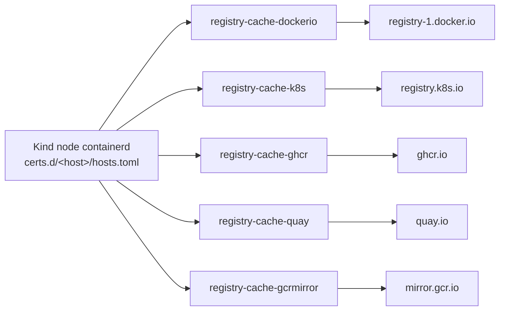

# Cluster & Registry Debugging Notes

These field notes help engineers debug the local Kind cluster foundation and application slices.
Use these notes alongside `make doctor` (`scripts/cluster-debug.sh`).

## 1. ZOT Registry Crash-Loop — `cache.db: permission denied`

**Symptom**: `make up` fails during `zot-up` with timeout:
`kubectl rollout status deploy/zot --timeout=2m` returns `timed out waiting for the condition`.
The ZOT pod enters `CrashLoopBackOff` or `Init:RunContainerError`.

**Diagnosis**:
Run these commands to inspect pod status and logs:
```bash
kubectl -n registry get pods
kubectl -n registry logs -l app=zot -c zot --tail=30
```

Root cause: `open /var/lib/zot/cache.db: permission denied`.
ZOT runs under UID 65532 and writes its bolt cache to `.cache/zot` on the host.
If concurrent or cancelled `make up` runs alter file ownership, ZOT cannot open `cache.db`.
The process exits with code 1 during startup.

**Recovery**:
Execute this fast recovery sequence:
```bash
make zot-cache-reset
kubectl -n registry delete pod -l app=zot
source scripts/lib/wait.sh && wait_rollout zot -n registry 120
```

If crashes continue, reset the cluster completely:
```bash
kind delete cluster --name osramp
rm -rf .cache/zot; docker volume rm -f osramp-zot-cache
make up
```

**Prevention**:
Do not run concurrent `make up` commands against the same cluster.
Host directory `.cache/zot` requires ownership `65532:65532` and permissions `0750`.

## 2. Pull-Through Registry Mirror (Base-Image Cache)

`scripts/registry-cache.sh` runs five pull-through container proxies on the `kind` Docker network.
`create-kind-cluster.sh` configures containerd using `/etc/containerd/certs.d/<host>/hosts.toml`.
These proxies persist across cluster resets to accelerate cold-start image downloads.

The flowchart shows the path from the Kind node to each upstream registry.



The five proxies run on the `kind` Docker network. Their names and upstreams are in
[`scripts/registry-cache.sh`](../scripts/registry-cache.sh).

**Verification**:
Verify that the proxy containers run and handle requests:
```bash
docker ps --filter name=registry-cache
docker exec osramp-control-plane cat /etc/containerd/certs.d/ghcr.io/hosts.toml
docker logs registry-cache-k8s 2>&1 | grep -c 'GET /v2'
```

Caution: You must write `hosts.toml` using `docker exec -i`.
Without `-i`, the file writes empty and containerd bypasses the mirror.

## 3. Resilient Waits — `scripts/lib/wait.sh`

The platform uses [`scripts/lib/wait.sh`](../scripts/lib/wait.sh) for all polling operations.
The principles, the verbs, and the tunables are in [`resilient-waits.md`](resilient-waits.md).

**Debugging Variables**:
- `WAIT_DEADLINE_SCALE=10`: Multiplies deadlines for heavily loaded hosts.
- `WAIT_SOFT_RATIO=0.6`: Logs warning and retry commands when 60% of deadline elapses.
- `WAIT_STAT_FILE`: Records wait metrics for performance analysis.
  `make doctor` reads `/tmp/osramp-wait-stats` when the variable is not set.
  Analyze slowest operations with:
  ```bash
  WAIT_STAT_FILE=/tmp/osramp-wait-stats make doctor
  ```

## 4. `make up` Cold-Start Convergence

`wait-reconciled.sh` verifies object existence before checking status conditions.
Cold bootstrap takes approximately seven minutes.
The monitoring stack requires the longest startup time.
Prometheus operator must install the `ServiceMonitor` CRD before Trivy reconciles.
If reconciliation lags, run:
```bash
flux reconcile kustomization infra-configs -n trivy-system
```

## 5. Fleet `tenants` Kustomization Build Failure

**Symptom**: `make up` hangs during resource synchronization.
`kubectl get resourceset -A` shows only `flux-operator`.
Downstream ResourceSets never appear.
Inspect error messages with:
```bash
kubectl -n flux-system get kustomization tenants -o jsonpath='{.status.conditions[?(@.type=="Ready")].message}'
```

**Cause**: `d2-osramp-fleet/tenants/local/kustomization.yaml` patches the OCIRepository.
Using `op: replace /spec/resources/N/spec/verify` fails if the target path is missing.
When array index `N` shifts, Kustomize build fails and Flux halts reconciliation.

**Fix**: Use `op: add` instead of `op: replace` for the verify path.
Verify that array index numbers match actual OCIRepository positions.

---

## 6. Isolated Remote CI (VM2)

Use VM2 to reproduce remote CI failures without modifying local clusters or VM1.
The commands, the paths, and the debugging order are in
[`scripts/ci/README.md`](../scripts/ci/README.md#usage) and its section
[Resuming an isolated VM2 investigation](../scripts/ci/README.md#resuming-an-isolated-vm2-investigation).

## 7. Cosign Local Signing Without Transparency Logs

Local mode signs OCI artifacts and container images with keys from `make signing-keys`.
Offline environments must never upload records to the public Rekor transparency log.

**SigningConfig Configuration**:
`make signing-keys` creates `.keys/signing-config.json`:
```bash
cosign signing-config create \
  --no-default-rekor --no-default-fulcio --no-default-oidc --no-default-tsa \
  --out .keys/signing-config.json
```

All `cosign sign` invocations include `--signing-config .keys/signing-config.json`.
Do not use the deprecated `--tlog-upload=false` flag.
The empty configuration file keeps signing operations offline and key-based.
The test suite `dashboard-supplychain.bats` validates these arguments.

**Verify Signatures Offline**:
```bash
cosign verify --key .keys/cosign.pub --insecure-ignore-tlog=true \
  --allow-insecure-registry <ref>@<digest>
```

## 8. False-Positive Diagnostic Probes

Some diagnostic checks report success when underlying components fail.
A wait that cannot succeed and a test that cannot fail are both defects.
Review these observed diagnostic pitfalls:

### `nc` Exit Codes Do Not Distinguish Denial from Network Errors

`busybox nc` returns exit code 1 for blocked IPs, unreachable hosts, and stopped containers.
Only standard error output reveals the true cause:

```bash
nc -z -w 2 240.0.0.1 9999     # exit 1: NetworkPolicy blocked connection
nc -z -w 2 nope.invalid 9999  # exit 1: DNS lookup failed
```

Capture standard error to classify results.
`scripts/agent-trust-local.sh` marks unclassified network failures as `UNVERIFIED`.

### New Pods Remain Unconfined During Initialization

The CNI plugin applies NetworkPolicy rules after container startup.
Tests executed at container launch measure initialization delay rather than policy enforcement.

Validate connectivity with a positive control before testing policy denial.
Confirm that permitted paths function before asserting that denied paths fail.
Report timeouts as `UNVERIFIED`. Do not report timeouts as successful denials.

### NetworkPolicies Match Labels, Not Identity

Network policies evaluate pod labels instead of ServiceAccounts or SPIFFE IDs.
If a pod lacks required labels, the network drops traffic and returns HTTP 504.
When creating probe pods, assign component label `app.kubernetes.io/component: probe`.
Exclude probe pods when querying application workloads.

### RoleBindings Target Non-Existent ServiceAccounts Silently

Kubernetes accepts a RoleBinding that names a ServiceAccount that does not exist.
The trap and its check are in
[`deploying-a-backend-service.md`](deploying-a-backend-service.md#two-silent-configuration-pitfalls).

### Missing Reverse Proxy Locations Return `index.html` with 200 OK

Without a matching `location`, nginx serves `index.html` with status 200 OK.
The trap and its route guard are in
[`deploying-a-backend-service.md`](deploying-a-backend-service.md#four-independent-layers).

### Unmatched `kubectl jsonpath` Queries Exit With Status 0

Queries with unmatched array elements print index errors to standard output and exit 0.
Always verify that target Kubernetes resources exist before parsing specific array elements.

### Read Probe Output from Termination Logs

Probe CronJobs configure `terminationMessagePolicy: File`.
Standard container logs remain empty after execution.
Inspect the termination message directly:

```bash
kubectl -n agent-trust-acme-payments get pod <probe-pod> \
  -o jsonpath='{.status.containerStatuses[0].state.terminated.message}'
```

## What `make doctor` checks (`scripts/cluster-debug.sh`)

`make doctor` checks unhealthy pods, Flux reconciliations, image pulls, and cluster events.
Commit `1bc64391` (2026-08-01) added these checks to
[`scripts/cluster-debug.sh`](../scripts/cluster-debug.sh):

1. **ZOT cache permission**: When the ZOT pod is not ready, it reads the pod logs for `permission denied`.
   It prints the recovery command:
   `make zot-cache-reset && kubectl -n registry delete pod -l app=zot`.
   It also checks that the host directory `.cache/zot` has ownership `65532:750`.
2. **Missing ResourceSet detection**: It reads Flux status messages for `build failed`.
   It names the patch to fix and reports absent downstream ResourceSets.
3. **Pull-through mirror status**: It counts the running `registry-cache-*` containers.
   It reports each empty `certs.d/*/hosts.toml` on the control-plane node.
4. **Wait latency ranking**: It reads `WAIT_STAT_FILE` and ranks the slowest waits.
   The default file is `/tmp/osramp-wait-stats`.

`make doctor` is read-only. Each detected failure prints an exact recovery command.
