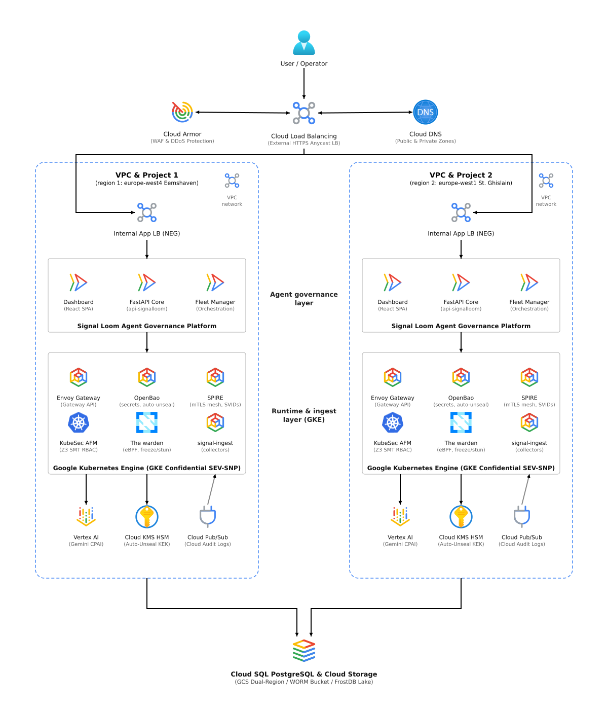

# Enterprise Architecture Specification: GCP / GKE Deployment Environment
**Platform:** Signal Loom Enterprise Platform  
**Target Environment:** Google Cloud Platform (GCP) & Google Kubernetes Engine (GKE)  
**Security Posture:** Zero-Trust (ZTNA), Least-Privilege Identity Federation, Sovereign Auditability, FedRAMP High / SOC 2 Type II Aligned  

---

## 1. Executive Summary & Production Objectives

This specification defines the production-grade deployment architecture for the **Signal Loom** agent governance platform on **Google Cloud Platform (GCP)** and **Google Kubernetes Engine (GKE)**.

The deployment models a sovereign, multi-tenant governance control plane that hosts AI agent workforces (Kagent D5, CPAI, Olly Sentinel) under deterministic Linux security modules (Landlock LSM `#nono`), eBPF network confinement, SPIFFE/SPIRE cryptographic workload attestation, and continuous formal verification (KubeSec-AFM SMT/Z3 solver).

## 2. Multi-Tenant SaaS Regional Deployment Stamp (Google Cloud Reference Architecture)

The deployment stamp diagram models active-active multi-region deployment across paired Google Cloud regions.

- Editable vector SVG: [osramp-gcp-multitenant-saas.drawio.svg](../../d2-signalloom/apps/docs-signalloom/public/diagrams/osramp-gcp-multitenant-saas.drawio.svg)
- Native Draw.io XML: [osramp-gcp-multitenant-saas.drawio](../../d2-signalloom/apps/docs-signalloom/public/diagrams/osramp-gcp-multitenant-saas.drawio)
- High-resolution raster PNG: [osramp-gcp-multitenant-saas.png](../../d2-signalloom/apps/docs-signalloom/public/diagrams/osramp-gcp-multitenant-saas.png)
