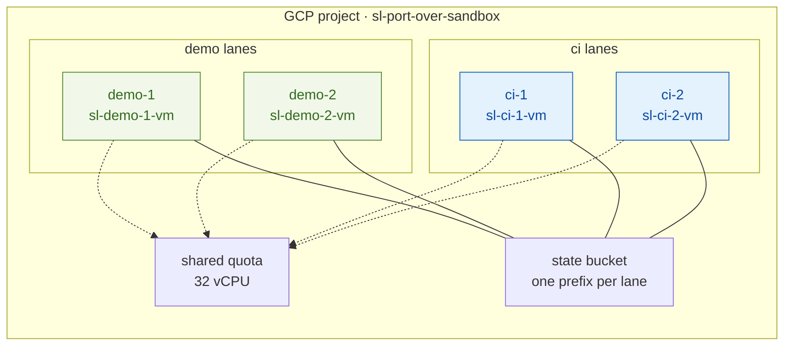
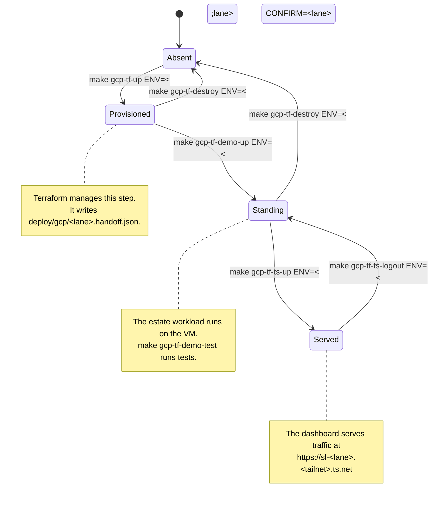

# GCP Lane Operations

This page describes the four-lane GCP infrastructure, health monitoring tools, and common diagnostic traps.
Read [`RUNBOOK.md`](RUNBOOK.md) first if you deploy a new lane.
The runbook covers initial deployment. This page covers operational maintenance.

Every command accepts `ENV=<lane>`.
Valid lane keys include `demo-1`, `demo-2`, `ci-1`, and `ci-2`.

## The Four Lanes

A **lane** represents one isolated GCP environment.
Each lane contains one VM, one Tailscale node, and one hand-off configuration file.
The lanes share a GCP project, a state bucket, and a compute quota.



Demo lanes and CI lanes differ in these specific properties:

| Property | Demo Lane | CI Lane |
| :--- | :--- | :--- |
| `ci-lane=<key>` label | Absent | Present |
| `idle-suspend-minutes` metadata | Absent | Present |
| `SUSPENDED` instance state | FAIL | PASS |

CAUTION: Do not resume a suspended CI lane manually.
The automated reaper suspends idle VMs to reduce costs.
Resuming the VM restarts compute billing without resolving issues.

Do not assign the `ci-lane` label to demo VMs.
The automated reaper will terminate active demonstrations unexpectedly.
See `scripts/node-doctor/demo.sh` and `scripts/node-doctor/ci.sh`.

## Lane Lifecycle



WARNING: An unverified destroy command can leave active billing instances running.
Always run `./scripts/gcp-tf/teardown-verify.sh` after you destroy infrastructure.
Verify complete removal before you exit.

## Health Tooling

Three independent tools monitor lane health:

| Tool | Purpose | Execution Context |
| :--- | :--- | :--- |
| `make doctor` | Tests Kubernetes cluster health | Runs locally or inside VM |
| `make doctor-node ENV=<lane>` | Tests underlying VM host health | Runs locally over IAP tunnel |
| `make gcp-tf-surfaces-report` | Tests both network surfaces for all lanes | Runs locally across all lanes |

### `make doctor` — Cluster Diagnostics

`make doctor` executes `scripts/cluster-debug.sh`.
It verifies core infrastructure components beneath the Kubernetes control plane:
- Docker daemon status
- Kind control-plane container health
- Local registry mirror caches
- Containerd `hosts.toml` configuration
- ZOT cache directory permissions

Note: `make doctor` inspects the active Kubernetes context only.
It cannot target remote cloud lanes directly from a local workstation.
The deployment pipeline runs this check directly on the remote VM.

### `make doctor-node ENV=<lane>` — Node Diagnostics

The node doctor operates below the cluster layer via IAP.
It evaluates the GCP instance, Tailscale networking, container runtimes, and local storage.
It detects two critical silent failure modes:

1. **Unlinked Registry Storage**:
   If a process unlinks the ZOT blob storage directory, the ZOT pod returns HTTP 200 on `/v2/`.
   Container image pushes fail silently.
   The tool verifies storage using three checks:
   - Inode consistency across bind mounts
   - Log inspections
   - End-to-end OCI blob upload and download cycles

2. **Unpopulated Platform Services**:
   The `afm-cluster-import` CronJob runs every 30 minutes.
   The service endpoint `/afm/health` returns status 200 before importing cluster data.
   Downstream UI pages display empty tables without reporting errors.
   The node doctor verifies that cluster counts exceed zero.

The node doctor returns four distinct verdicts:

| Verdict | Meaning |
| :--- | :--- |
| `PASS` | The test ran and the component operates correctly. |
| `FAIL` | The test ran and the component failed. |
| `WARN` | The component functions currently but requires attention. |
| `UNKNOWN` | The test could not execute. |

The tool never converts `UNKNOWN` results to `PASS`.
It returns exit status 3 when tests cannot run.
For example, reading an inaccessible log file returns `UNKNOWN` rather than zero errors.

Run `make doctor-node-all` to evaluate all active lanes.
The command returns a non-zero exit code if any lane fails.

### `make gcp-tf-surfaces-report` — Dual-Surface Verification

Each lane provides two distinct surfaces:
- **VM Surface**: Tests application components directly on the VM.
- **Tailnet Surface**: Tests endpoints remotely over Tailscale without cloud credentials.

Lanes can pass on one surface and fail on the other.
Run `make gcp-tf-surfaces-report` to generate a status matrix.
Run `make gcp-tf-test-both ENV=<lane>` to verify both surfaces for a specific lane.

## Working from Git Worktrees

Fresh git worktrees contain tracked files only.
Runtime state in `deploy/gcp/` and `.keys/` is gitignored and absent in new worktrees.
Run verification commands before executing Terraform:

```bash
make gcp-tf-worktree-check
make gcp-tf-worktree-status
make gcp-tf-worktree-bootstrap
```

WARNING: Without `deploy/gcp/deploy-sa`, Terraform applies configurations using your personal identity.
Ensure this file exists before running deployment commands.

The bootstrap tool creates complete environments before execution.
It prevents partially configured states.
Do not symlink mutable state files into worktrees.
Writing through symlinks modifies the source checkout and corrupts state mappings.

## Running All Four Lanes

Execute the parallel test cycle:

```bash
./scripts/gcp-tf/four-lane-loop.sh [cycles] [lanes...]
```

The script runs destroy, provision, deploy, test, and diagnostic phases across all lanes.
It logs distinct exit codes for each phase and reads results from `summary.json`.

WARNING: Ensure teardown completes before provisioning new instances.
Four 8-vCPU instances consume the entire 32-vCPU project quota.
Overlapping instances cause deployment deadlocks.

## Operational Pitfalls

Review these recurring operational issues:

### `yes` Sends Incorrect Input to Terraform

Standard `yes` emits `y`.
`terraform destroy` requires the exact string `yes`.
Pipe the correct input using `yes yes |`.

### Pipes Under `pipefail` Return Exit Code 141

Under `set -o pipefail`, pipelines return 141 when upstream writers encounter SIGPIPE.
When Terraform finishes, `yes` receives SIGPIPE and triggers code 141.
Inspect the exit code of `make` using `${PIPESTATUS[1]}`.

### `grep -q` Triggers Exit Code 141

Under `set -o pipefail`, ending a pipeline with `grep -q` can return exit code 141.
`grep -q` exits after the first match, terminating upstream writers with SIGPIPE.
Capture complete command output before matching patterns with grep.

### `ssh-agent` Conflicts with gcloud Commands

Run `unset SSH_AUTH_SOCK` before running `gcloud compute ssh`.
Without this step, gcloud commands fail with `agent refused operation`.
Always supply `--impersonate-service-account` for SSH connections.

### Recursive Make Executes During Dry Runs

In Makefiles, recipe lines containing `$(MAKE)` execute during `make -n` dry runs.
Do not use `make -n` on targets that contain recursive Make invocations.

### `KUBESEC_AFM_ROOT` Requires Source Directory Paths

The default path `<repo>/../kubesec-afm` fails inside git worktrees.
Export the absolute path before building AFM images:

```bash
export KUBESEC_AFM_ROOT=/path/to/kubesec-afm
```

### `tailscale cert` Returns Status 0 on Failure

`tailscale cert` can return exit status 0 when certificate generation fails.
Always verify that certificate files exist on disk and contain valid hostnames.

### Let's Encrypt Limits Certificates to Five Per Week

Let's Encrypt permits five certificates per exact DNS hostname per 168 hours.
Each lane uses a dedicated hostname: `sl-<lane>.<tailnet>.ts.net`.

WARNING: Rebuilding a single lane more than five times in a week exhausts its certificate limit.
Deploy to an alternative lane when you reach rate limits.

### `tailscale logout` Clears Service Configuration

Running `tailscale logout` releases the device name and creates a new node ID.
This command resets the reverse proxy configuration.
The node reconnects with the correct name but stops serving traffic.
Use instance suspension to preserve network identity without ongoing compute costs.

### Modifying Startup Scripts Triggers Instance Replacement

Modifications to VM startup scripts require full instance destruction and recreation.
A full recreation cycle takes approximately 40 minutes.

## Reference Documentation

| File | Topic |
| :--- | :--- |
| [`RUNBOOK.md`](RUNBOOK.md) | Step-by-step deployment and troubleshooting guide |
| [`INCIDENTS-2026-08.md`](INCIDENTS-2026-08.md) | Incident post-mortems and diagnostic proofs |
| [`../../deploy/gcp/README.md`](../../deploy/gcp/README.md) | Deployment inputs and hand-off specifications |
| [`../../terraform/CONTRACT.md`](../../terraform/CONTRACT.md) | Inter-module contracts for Terraform |
| [`../../scripts/ci/README.md`](../../scripts/ci/README.md) | CI pipeline architecture for `signalloom-ci` |
