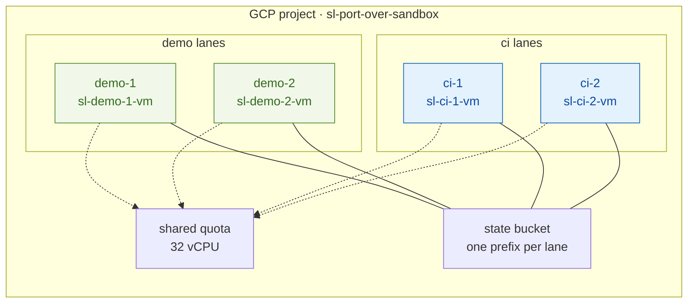
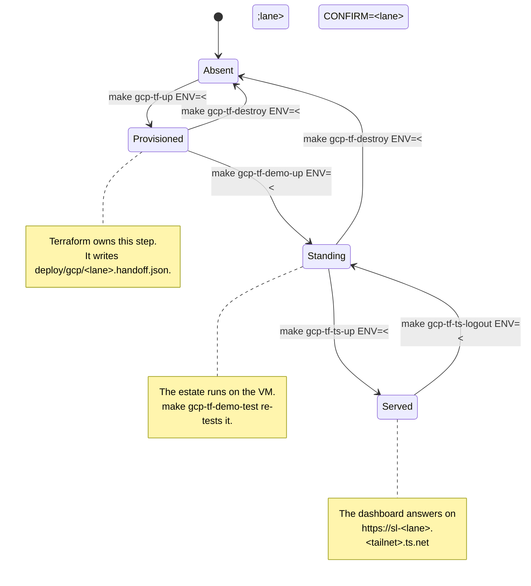

# GCP lane operations

This page describes the four-lane GCP estate, the tools that report its health,
and the traps that misreport their own cause. Read
[`RUNBOOK.md`](RUNBOOK.md) first if you have never stood a lane up. The runbook
takes you from an empty project to a dashboard. This page is what you need
after that.

Every command here takes `ENV=<lane>`. The lane keys are `demo-1`, `demo-2`,
`ci-1` and `ci-2`.

## The four lanes

A **lane** is one GCP environment. Each lane owns one VM, one tailnet node and
one hand-off file. The lanes share a project, a state bucket and a CPU quota,
and they share nothing else.



The two lane kinds differ in exactly two ways, and the health tooling asserts
no more than these two:

| Fact | demo lane | ci lane |
| :--- | :--- | :--- |
| `ci-lane=<key>` label | absent | present |
| `idle-suspend-minutes` metadata | absent | present |
| `SUSPENDED` instance state | FAIL | PASS |

CAUTION: DO NOT RESUME A SUSPENDED CI LANE TO "FIX" IT. THE REAPER SUSPENDED
IT TO STOP THE BILLING. A RESUME RESTARTS THAT BILLING AND FIXES NOTHING.

A demo VM that carries the `ci-lane` label is an incident in the other
direction. The reaper can switch it off in the middle of a demonstration.
Source: `scripts/node-doctor/demo.sh` and `scripts/node-doctor/ci.sh`.

## The lane lifecycle



WARNING: A DESTROY THAT YOU DO NOT VERIFY CAN LEAVE A BILLING VM BEHIND.
Run `./scripts/gcp-tf/teardown-verify.sh` after every destroy. Believe the
destroy only after that script agrees.

## Health tooling

Three tools report on a lane. Each answers a different question, and none
replaces another.

| Tool | Question it answers | Where it runs |
| :--- | :--- | :--- |
| `make doctor` | Is the Kubernetes cluster healthy? | On the VM, or against your local kind cluster |
| `make doctor-node ENV=<lane>` | Is the node under that cluster healthy? | Here, over IAP, against one lane |
| `make gcp-tf-surfaces-report` | Did both surfaces of every lane run and pass? | Here, against every lane |

### `make doctor` — the cluster doctor

`make doctor` runs `scripts/cluster-debug.sh`. It is a good doctor, and it
reaches below the Kubernetes API. It checks five things beneath the cluster:

- the Docker daemon
- the kind control-plane container
- the registry-cache mirrors
- the containerd `hosts.toml` files
- the Zot cache directory's ownership

It has one structural limit. It has no lane concept. It inspects whatever
`kubectl config current-context` and the local Docker point at, so from your
own machine it cannot reach any lane. The pipeline runs it on the VM.

### `make doctor-node ENV=<lane>` — the node doctor

The node doctor runs one layer below the cluster and reaches a lane over IAP.
It checks the GCP instance, the tailnet, Docker and containerd, the filesystem,
and two facts that a green cluster actively hides.

The first hidden fact is **a registry that serves and cannot store.** Something
unlinks the Zot blob store directory. The pod keeps answering `/v2/` with 200
at 1/1 Ready. Only a push fails.

The node doctor therefore uses three independent detectors, because each one
alone has a blind spot:

- inode agreement across the bind mount
- the pod log
- a real OCI blob round trip

The second hidden fact is **a platform that is up and empty.**
`afm-cluster-import` runs on a `*/30` schedule, and a CronJob does not run when
you create it. So `/afm/health` answers 200 while it holds zero clusters, for
up to half an hour. Every page downstream renders empty and reports success.
The cluster count is its own check, and zero is a FAIL.

The node doctor reports four verdicts, not three:

| Verdict | Meaning |
| :--- | :--- |
| `PASS` | The check ran and the thing is right. |
| `FAIL` | The check ran and the thing is wrong. |
| `WARN` | The check ran, the thing is not wrong yet, and it heads there. |
| `UNKNOWN` | The check could not run. |

`UNKNOWN` never folds into `PASS`, and it gets exit status 3. A sweep can then
tell "this lane is broken" from "this lane was not measured". The clearest case
is the Zot log: `grep -c readdirent` returns 0 for a healthy registry and 0 for
a log that nobody could read.

Run `make doctor-node-all` to check every lane that has a hand-off file. It
reports all lanes and fails if any lane failed.

Source: `scripts/node-doctor.sh`, `scripts/node-doctor/{probe,lib,demo,ci}.sh`.
The collector runs on the VM and never adjudicates. The adjudicators run here,
and each one is a pure function of the collector's text. That split is what
lets `test/node-doctor.bats` drive states you cannot produce on demand, such as
an unlinked blob store or a drifted MagicDNS name.

### `make gcp-tf-surfaces-report` — both surfaces, every lane

A lane has two surfaces. The **on-VM surface** tests the estate from the VM.
The **tailnet surface** tests it from here, over the tailnet, with no cloud
credentials. A lane can pass on one surface and fail on the other.

`make gcp-tf-surfaces-report` reports every lane on both surfaces in one table.
`STALE` and `MISSING` both fail. Use `make gcp-tf-test-both ENV=<lane>` to run
both surfaces for one lane and assert that both ran.

## Working from a git worktree

A fresh worktree carries tracked content only. All of this repository's
operational state is gitignored under `deploy/gcp/` and `.keys/`, so a fresh
worktree has none of it. Every absence then surfaces as a failure that names a
different subsystem.

Run the preflight before Terraform, not after:

```bash
make gcp-tf-worktree-check                  # name what is absent, and why it matters
make gcp-tf-worktree-status                 # per-item table against the source checkout
make gcp-tf-worktree-bootstrap              # copy the state in
```

`gcp_tf_require_worktree_state` wires the check into `make gcp-tf-up`, ahead of
Terraform.

WARNING: WITHOUT `deploy/gcp/deploy-sa`, TERRAFORM APPLIES COMPLETELY AND
SUCCESSFULLY AS YOUR OWN PRINCIPAL. The Makefile reads that file with
`sed ... 2>/dev/null`, so absent and empty look identical, and the
impersonation guard refuses only when `TF_DEPLOY_SA` is non-empty. The failure
lands afterwards in `gcp-tf-handoff` as "the terraform outputs do not carry
every value the hand-off contract requires ... deploy_sa". Both causes that
message suggests are wrong here. A full apply cycle is spent before the
diagnosis points at `outputs.tf`.

`provision` plans before it acts. A required file that is absent from the
source, or a destination that is newer than its source, blocks the whole run
and copies nothing. A half-provisioned tree is the state this tool prevents.

The tfvars and `deploy-sa` are read-only inputs, so `LINK=1` may symlink them.
The hand-offs and the preserve baseline are regenerated in place, so `LINK=1`
is refused for that class. `gcp-tf-handoff` writes its target with a truncating
`>`, and a write through a symlink lands in the source checkout. That silently
repoints the main checkout's lane at the worktree's estate.

Source: `scripts/gcp-tf/worktree-bootstrap.sh`.

## Running all four lanes

```bash
./scripts/gcp-tf/four-lane-loop.sh [cycles] [lanes...]     # default: 3 cycles, all four
```

Each cycle runs destroy, up, estate, tests and doctor across the lanes in
parallel. Three cycles across four lanes across five phases is sixty state
transitions. The harness records an explicit exit code per lane per phase to a
file, and it derives the cycle verdict from each lane's own `summary.json`.

That derivation is the point. An aborted run and a run whose tests failed both
exit non-zero, and they mean entirely different things. Conflating them is how
"three lanes aborted at create-cluster" once got read as a test result.

WARNING: TEARDOWN MUST FULLY COMPLETE BEFORE ANY CREATE. Four lanes at the
8-vCPU floor need exactly 32 of a 32-vCPU quota, so any overlap deadlocks the
estate. The harness polls capacity and treats it as a gate: a cycle that cannot
confirm the estate is empty does not create.

Source: `scripts/gcp-tf/four-lane-loop.sh`.

## Traps

Every item here has already cost hours. Each one reports a cause that is not
its cause.

### `yes` gives the wrong answer to Terraform

`yes` emits `y`. `terraform destroy` requires exactly `yes` and answers
"Destroy cancelled" to anything else. Use `yes yes |`.

### A pipe under `pipefail` reports 141 for a successful destroy

`set -o pipefail` makes this worse than a masked exit status. `yes` dies of
SIGPIPE the moment Terraform stops reading, so the pipeline reports 141 even
when the destroy succeeded. Take the exit status of `make` by its index:
`${PIPESTATUS[1]}`, not `[0]`, because `[0]` is `yes` and is the 141 itself.

### `grep -q` returns 141 when it matches

Under `set -o pipefail`, a pipeline that ends in `... | grep -q` returns 141 on
a match. `grep -q` exits at the first match, the writer then dies of SIGPIPE,
and `pipefail` takes that 141 as the pipeline's status.

The trap is that this depends on timing, so it looks intermittent. Measured
under `set -o pipefail`:

```
seq 1 200000 | grep -q '^1$'      # match, writer still writing  -> 141
printf 'hit\n' | grep -q 'hit'    # match, writer already done   ->   0
seq 1 200000 | grep -q 'nomatch'  # no match                     ->   1
```

A guard written against the second case passes every test and fails in
production against a large stream. Do not end a pipeline with `grep -q` under
`pipefail`. Capture the output first, then match it.

### `ssh-agent` refuses gcloud's operations

Run `unset SSH_AUTH_SOCK` before any `gcloud compute ssh`, ad-hoc calls
included. Without it, gcloud fails with `agent refused operation`. That failure
surfaces during the provisioning wait and reads as a VM that never came up.

Every gcloud SSH call also needs `--impersonate-service-account`. Org-external
OS Login is bypassed by service-account impersonation, and the error changes to
`4033` when you get this right.

### `make -n` runs recursive make for real

A dry run is not side-effect-free here. Any recipe line that contains `$(MAKE)`
really executes. Do not use `make -n` to inspect a target that recurses.

### `KUBESEC_AFM_ROOT` resolves only from the source checkout

The default is the sibling of the repository root: `<repo>/../kubesec-afm`.
From a worktree, that path resolves to a directory that does not exist. Export
it before you build the AFM image:

```bash
export KUBESEC_AFM_ROOT=/path/to/kubesec-afm
```

`make gcp-tf-worktree-check` reports this as a warning, because it blocks the
AFM stage and not Terraform. Callers that need AFM set `REQUIRE_AFM=1` to make
it an error.

### `tailscale cert` exits 0 when it fails

Do not read the exit status of `tailscale cert` as a verdict. Check that the
certificate files exist and that the name matches.

### Let's Encrypt gives each lane five certificates per week

The limit is five certificates per **exact** DNS name per 168 hours. The name
is `sl-<lane>.<tailnet>.ts.net`, so each lane holds its own clock. The limit is
per lane, not per estate.

WARNING: A LANE THAT YOU REBUILD SIX TIMES IN A WEEK LOSES HTTPS FOR THE REST
OF THAT WEEK. The failure appears in the tailscaled journal as:

```
getCertPEM: 429 urn:ietf:params:acme:error:rateLimited: too many certificates
(5) already issued for this exact set of identifiers in the last 168h0m0s
```

Rebuild a different lane instead of waiting. Each lane has its own budget.

### `tailscale logout` frees the name and wipes the serve config

Logout releases the device record so the next build can reclaim the name, which
takes under ten seconds. It also mints a new node ID, and it wipes the serve
configuration. The node then returns online with the right name and serves
nothing.

A suspend preserves the tailnet identity. A destroy does not: it takes the disk
with it and the name can drift to `sl-<lane>-1`.

### Editing the VM startup script replaces the VM

The startup script is create-time. A text edit to it destroys and recreates the
estate, and that costs about 40 minutes.

## Read next

| File | Why |
| :--- | :--- |
| [`RUNBOOK.md`](RUNBOOK.md) | The step-by-step operator path, and its failure-mode catalogue |
| [`INCIDENTS-2026-08.md`](INCIDENTS-2026-08.md) | The five blockers of August 2026, each with its measurement |
| [`../../deploy/gcp/README.md`](../../deploy/gcp/README.md) | The estate's inputs and the hand-off contract |
| [`../../terraform/CONTRACT.md`](../../terraform/CONTRACT.md) | What the Terraform roots guarantee |
| [`../../scripts/ci/README.md`](../../scripts/ci/README.md) | The older CI lane on `signalloom-ci`, a separate system |
| [`../../terraform/notes/k-from-scratch-test-plan.md`](../../terraform/notes/k-from-scratch-test-plan.md) | The current from-scratch test plan |
