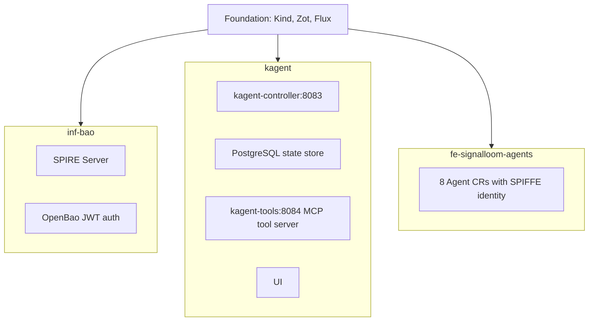
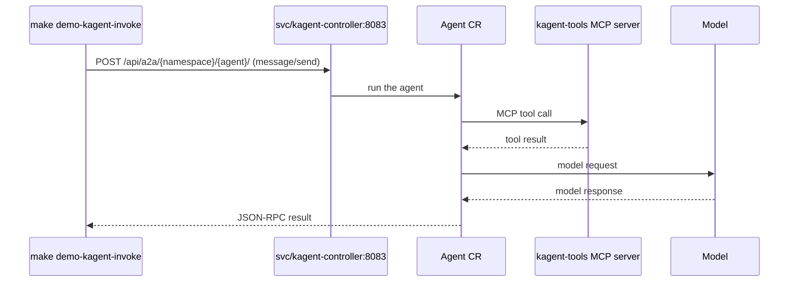

# docs/kagent-d5.md — Kagent Cloud-Native AI Agents (Demo 5)

## Overview

Demonstrates the CNCF sandbox AI agent framework **Kagent** (`v0.9.9`) running on
Signal Loom, with agent identity issued through SPIRE and credentials brokered by
OpenBao.

Replaces ~120-line hand-crafted Knative Serving manifests with declarative ~30-line
Custom Resources (`Agent`, `ModelConfig`, `MCPServer` in `kagent.dev/v1alpha2`).

## Status of this demo — read this before quoting anything below

This document previously described a working Kagent control plane. It was not one.
Up to commit `f879ec4c` the "control plane" consisted of placeholders:

| Component | What was actually deployed | Consequence |
|---|---|---|
| `kagent-controller` | `python:3.12-alpine` running `while True: time.sleep(10)`, readiness probe `sh -c "echo ready"` | Nothing reconciled. All 8 `Agent` CRs sat at `status: null` indefinitely. |
| `kagent-tool-server` | `python:3.12-alpine` whose `do_POST` wrote **one hardcoded literal for every request** | Tool calls were not dispatched. A call naming `k8s_get_resources` and one naming `totally_made_up_xyz` returned byte-identical JSON. |
| `kagent-ui` | `nginx:1.27-alpine` serving a static hand-written `index.html` | No product. Deployment readiness was satisfied by nginx starting. |
| `kagent-anthropic-key` | the literal string `mock-anthropic-key-for-local-demo` | No agent could complete a single model call. |

All 36 Kagent assertions passed against that stack. That is the defect
`test/kagent-anti-stub.bats` exists to prevent recurring. Its file header explains
the reasoning behind each assertion.

**Current state.** The real charts have since landed: `kagent 0.9.9` with
`cr.kagent.dev/kagent-dev/kagent/controller:0.9.9`,
`ghcr.io/kagent-dev/kagent/tools:0.2.1` and `…/ui:0.9.9`. **Twelve of the
thirteen anti-stub assertions now pass with no change to the tests.** The tool
server discriminates its input, the controller writes real status conditions,
and it materialises resources it owns. Those are the three properties the
placeholder stack could not produce.

This section is a snapshot and dates quickly. `make demo-kagent-test` is the
current answer. At the time of writing, verified against the cluster:

- **Seven of eight agents compile. Six of them work.** The two numbers are
  deliberately kept apart, because the gap between them is the entire subject of
  this document. `kagent-chaos-prober` reports `Accepted=True Ready=True` with a
  Running pod and two tools that do not exist. It began compiling the moment
  its `RemoteMCPServer` appeared, which made it green without making it capable.
  Quoting the Ready column here would be the exact reading `kagent-anti-stub.bats`
  exists to prevent.
- **One dangling reference remains:** `kagent-commit-summariser` binds
  `github-tool`, which does not exist, so it does not compile at all
  (`Accepted=False`, no workload). Note the contrast. An absent *server* fails
  loudly. Absent *tools* on a present server are accepted silently. Only the
  second needed a new test.
- **Note the CR kind.** The controller resolves `RemoteMCPServer.kagent.dev`,
  not the `MCPServer` CRs the original manifests declared. That mismatch is why
  all eight failed to compile initially.
- **The placeholder credential is gone.** `mock-anthropic-key-for-local-demo` no
  longer appears as a live assignment anywhere. The key is supplied by the
  operator through OpenBao as `Secret/kagent-anthropic-key`, in both `kagent`
  and `fe-signalloom-agents`. On **this** branch
  `infra/kagent/base/controller.yaml` is a one-line comment. Its content was
  deleted with the rest of the stub manifests, so there is no credential for the
  forbidden-literal guard to tolerate here. (The guard's comment-stripping is
  still doing real work. The literal appears in this file's own prose,
  describing what was removed, and the guard correctly scopes itself to
  manifests. See "a guard matched the comment explaining the absence", below.)

Claims about *declarative structure* are verified on disk and in the cluster
today. Those claims cover the Agent CRs, their tool bindings, SPIFFE naming,
and the OpenBao path mapping.

## Architecture & lifecycle

The diagram shows the three namespaces on the foundation.



The sequence diagram shows one invocation from `make demo-kagent-invoke` to the model.



The names in the diagrams are in
[`d2-signalloom/infra/kagent`](../d2-signalloom/infra/kagent),
[`d2-signalloom/infra/agent-swarm/remotemcpserver.yaml`](../d2-signalloom/infra/agent-swarm/remotemcpserver.yaml),
and [`scripts/kagent-invoke.sh`](../scripts/kagent-invoke.sh).

### Lifecycle targets

| Command | Purpose |
|---------|---------|
| `make swarm-kagent-up` | Deploy Kagent CRDs, controller, PostgreSQL, tool server, and UI |
| `make swarm-kagent-down` | Uninstall the Kagent release and namespace. The CRDs stay in place |
| `make demo-kagent-up` | Deploy all 8 Kagent declarative agents to `fe-signalloom-agents` |
| `make demo-kagent-down` | Remove the Kagent declarative agents |
| `make demo-kagent-test-config` | Statically render the CRDs and agent overlays, then run the contract suite — no cluster required |
| `make demo-kagent-test` | Run every Kagent BATS suite against a live cluster |
| `make demo-kagent-demo` | Run the interactive CLI walkthrough |

## The Agent Swarm

Eight Agent CRs in `fe-signalloom-agents`, all `runtime: go`, all sharing one
`anthropic-claude` ModelConfig and one namespace-local `RemoteMCPServer`
(`d2-signalloom/infra/agent-swarm/remotemcpserver.yaml`). That server points
at the chart's built-in tool server at `http://kagent-tools.kagent:8084/mcp`.

**Every tool name below has been verified by calling it against that server.**
That sentence is the whole point of this section — see "How this list got wrong"
at the end.

### Operational (6)

1. **K8s Resource Reader (`kagent-k8s-reader`)** — `k8s_get_resources`,
   `k8s_get_available_api_resources`. Declarative Go ADK runtime, ~128Mi.
2. **Incident Responder (`kagent-incident-responder`)** — `k8s_get_events`,
   `k8s_get_pod_logs`, `k8s_describe_resource`, `k8s_get_resources`. Correlates
   restarts, exit codes and log tails into a timeline. Read-only: proposes
   remediation, never applies it. Agent Card contract
   (`agent-card.kagent-incident-responder.v1.json`) for A2A hand-offs.
3. **Security Analyst (`kagent-security-analyst`)** — `k8s_get_resources`,
   `k8s_get_resource_yaml`, `k8s_describe_resource`, `k8s_get_events`. Reports
   Kubernetes posture from workload security contexts, RBAC and NetworkPolicies.
   **No CVE or advisory lookup** (see Deferred). Agent Card contract
   (`agent-card.kagent-security-analyst.v1.json`).
4. **Network Auditor (`kagent-network-auditor`)** — `k8s_get_resources`,
   `k8s_get_resource_yaml`, `k8s_describe_resource`. Reports the *declared*
   network posture: missing default-deny, selectors matching nothing, broad
   ingress. **Does not probe live reachability, SPIFFE boundaries or Envoy
   routes** (see Deferred).
5. **Compliance Checker (`kagent-compliance-checker`)** — `k8s_get_resources`,
   `k8s_get_resource_yaml`, `k8s_describe_resource`. Reads RBAC, NetworkPolicy
   and workload manifests and reports policy posture. **Does not run CIS
   benchmarks** (see Deferred).
6. **FinOps Optimizer (`kagent-finops-optimizer`)** — `k8s_get_resources`,
   `k8s_get_resource_yaml`, `k8s_describe_resource`. Reads *declared* requests,
   limits and PVC inventory and flags unset or implausible values. **Does not
   measure observed utilisation** (see Deferred).

### Deferred (2) — declared, NOT working

Kept in the repo deliberately rather than deleted. Both reference tools that do
not exist. **They fail in two different ways, and the difference is the single
most important thing on this page:**

- `kagent-commit-summariser` names a `RemoteMCPServer` that does not exist
  (`github-tool`), so it does not compile: `Accepted=False`, no workload. Loud.
- `kagent-chaos-prober` names the tool server that DOES exist and asks it for
  two tools that do not. It compiles, reports **`Accepted=True, Ready=True`,
  and runs a pod** — while being able to do nothing at all. Silent.

Do not read this section's agents as "the broken ones you can see". One of them
is green on every dashboard in the repo. That is why the count that matters is
"agents whose tool names were verified against `tools/list`", currently 6 of 8.
It is not the Ready column.

7. **Chaos Prober (`kagent-chaos-prober`)** — wants `chaos_simulate_latency`,
   `chaos_probe_recovery`. **Blocker:** the tool server has no chaos tooling of
   any kind — not a missing backend, no such tool. The nearest real capability
   is `k8s_delete_resource`, which the tool server's ServiceAccount is denied by
   design (`kagent-tools.rbac.readOnly: true`). Needs a chaos MCP server that
   nobody has written, plus a deliberate decision to grant it write access.
   **Currently `Accepted=True, Ready=True` with a Running pod and zero working
   tools** — see the warning above.
8. **Commit Summariser (`kagent-commit-summariser`)** — wants
   `github_list_commits`, `github_get_commit` via the `github-tool` MCPServer.
   **Blocker:** no `github_*` tool exists on the built-in server. Needs an
   external GitHub MCP server wired in as its own `RemoteMCPServer`. The
   OpenBao-managed GitHub token plumbing is already in place and is not the
   blocker.

## Deferred capabilities

Capabilities removed from an agent's declaration rather than approximated with
a tool that does something weaker. Each is blocked on a component that is not
installed, **not** on agent configuration.

| Capability | Tool that would provide it | Blocker |
|---|---|---|
| CIS benchmark scanning | `kubescape_get_configuration_scan`, `kubescape_list_configuration_scans` | Tool exists; **Kubescape operator absent**. Calling it returns `workloadconfigurationscans.spdx.softwarecomposition.kubescape.io` not found. |
| CVE / advisory lookup | `kubescape_list_vulnerabilities` | Tool exists; **Kubescape operator absent** (`vulnerabilitymanifests` CRD missing). No other CVE/OSV tool on the server. |
| Observed resource utilisation | `prometheus_query_range_tool`, `prometheus_query_tool` | Tool exists; **no Prometheus reachable** — hardcoded `http://localhost:9090` from the tool pod. |
| PromQL query generation | `prometheus_promql_tool` | Tool exists; needs an **`OPENAI_API_KEY`** in the tool server (it is LLM-backed). Doubly blocked. |
| Envoy route inspection | `istio_proxy_config`, `istio_ztunnel_config` | Tools exist; **no Istio installed** (`istioctl` exits 64). |
| SPIFFE boundary probing | — | **No tool exists** on the server at all. |
| Live reachability probing | `k8s_check_service_connectivity` | Tool exists; execs a curl pod, which the **read-only tool-server RBAC denies**. |

Installing Kubescape unblocks two rows and re-points two agents. A reachable
Prometheus unblocks one. Both are cluster-capacity decisions, not agent work.

### How this list got wrong, so it does not happen again

The tool server was a stub until 2026-08-30: `python:3.12-alpine` running
`http.server`, returning **one hardcoded literal to every POST**. Posting
`k8s_get_resources` and `totally_made_up_xyz` produced byte-identical output.
So no tool name in this repo had ever been checked against an implementation.
Of the 21 requested across the swarm, 18 were fictional, including six
requested from the tool server that genuinely exists.

Two properties of kagent 0.9.9 kept that invisible:

- The controller validates that a `RemoteMCPServer` **exists**, never that the
  `toolNames` are served by it. An agent requesting nothing but fictional tools
  still reports `Accepted=True, Ready=True` with a Running pod. **`Ready` means
  "compiled and running", not "can do anything."**
- The hand-written CRDs it replaced declared
  `x-kubernetes-preserve-unknown-fields: true`, so nothing validated.

Compressed to the one line worth remembering:

> **An absent server fails loudly. Absent tools on a present server are
> accepted silently.**

That asymmetry is the whole reason a tool-existence guard had to exist at all.
The loud half needed no test — the controller already refuses to compile the
agent and says so. Only the silent half did.

`d2-signalloom/test/kagent-chart.bats` and the tool-existence contract test now
guard this. Check by hand with `tools/list` against the tool server. A missing
tool returns JSON-RPC `-32602 tool 'x' not found`.

Previous revisions of this document described five. Eight are defined on disk
(`d2-signalloom/infra/agent-swarm/kagent-*/`), deployed by
`scripts/kagent-agents.sh`, and asserted by the test suites.

### The layer none of our checks reach

Everything above — tool existence, tool callability, CRD schemas, reconciliation
status — is about the **tool layer**. On 2026-08-30, with all of it green,
`kagent-incident-responder` returned this:

```
## Pods in Error State (16 pods):
  … 18 pods actually listed …
**Summary**: There are **16 pods in Error state**
```

Reconciled against `kubectl get pods -A`: **18** were in Error, and the agent
had **missed none of them**. The tool call was complete and correct. Only the
model's own arithmetic, in prose, over its own correct data, was wrong.

An operator reads "16 pods require investigation" sitting directly above a list
of 18. For a demo about risk and governance that is the finding, not a footnote:

- **Every assertion in this repo is on the tool layer.** A wrong number in a
  summary passes all of them, because nothing we test looks at the prose.
- It is the same shape as `chaos-prober` and as the pruned `apiKeySecret`: a
  confident, well-formed output over something that is not there or not true.
  The three differ only in which layer went quiet.

Mitigated where it can be — `kagent-incident-responder`'s systemMessage now
forbids stating a count in prose and tells it to enumerate and let the reader
count.

**Re-run after the change, live, same prompt:** 68 lines, 41 pod bullets, no
"N pods", no Total, no Summary line. It presented the list and let the reader
count. Accuracy was also perfect that run: `kubectl` non-Running = 41, agent
listed 41, missed 0. But that is one run against a quieter cluster and should
not be read as caused by the instruction. Only the count suppression reproduced
deterministically, because it is a behaviour asked for directly.

### The mitigation had the same blind spot as the defect

Raised by the credentials workstream and worth stating plainly: the mitigation
was itself **undetectable if removed**. It lives in a systemMessage, no test
asserts on model output, so deleting that paragraph would have failed nothing.
The only detector was a human running the agent and reading. Same shape as the
finding, one level up.

That splits into a testable half and an untestable one, and only one of them is
now closed:

| | Status |
|---|---|
| Is the instruction still declared? | **Tested.** `kagent-chart.bats` asserts it, mutation-checked. |
| Does the model obey it? | **Not tested, and not testable here.** Verified by hand once. |

Do not let the passing test imply the second row. A guard that reads as proving
more than it does is exactly the failure this page is about.

### The worse failure: invented values for absent fields

Testing whether the miscount generalised produced the opposite result, and a
sharper finding. `kagent-security-analyst` was invoked with **no**
count-suppression instruction and its counts were **correct three times over**.
It reported "8 out of 9 pods lack `runAsNonRoot: true`", verified against the
namespace, three for three. So the arithmetic failure does **not** generalise, and rolling
the count instruction across the swarm on one instance would have been wrong.

What it did instead is worse. For a pod whose spec genuinely sets
`runAsUser: 65532` it reported exactly that — correct, grounded in the data it
fetched. For pods where `runAsUser` is **absent**, it supplied `UID 100,
GID 101` — values appearing nowhere in the 138KB it retrieved. Both were
presented identically under "Runtime user".

**It reads the field accurately when it exists and invents a plausible value
when it is missing.** That is absence-triggered, not summary-triggered, and it
is the more dangerous of the two:

- The fabrication lands **precisely where the posture is weakest**, which is
  exactly where an auditor looks.
- For `kagent-finops-optimizer` and `kagent-network-auditor` an absent field
  **is** the finding. A fabricated value would report healthy sizing, or a
  policy that is not written, on the very workloads that have neither.

Mitigated on the four posture agents: security-analyst, finops-optimizer,
network-auditor, compliance-checker. Each is told that an absent field is the
finding and never to substitute a plausible value. Not applied to
`kagent-k8s-reader` (makes no posture claims) or `kagent-incident-responder`
(reads events and logs, not sparse spec fields). Guarded by
`kagent-chart.bats`, declaration only, on the same terms as the count
instruction: **whether the model obeys is untested and untestable here.**

**Confirmed by hand, twice, on two agents and two different sparse fields:**

| Check | Result |
|---|---|
| `kagent-security-analyst` on `agent-cardvault` — the exact pod it previously reported as "UID 100, GID 101" | `securityContext is ABSENT` three times, **no UID supplied** |
| Sweep of that whole response for surviving UID claims | Exactly one — `runAsUser: 65532` for `agent-sir-lancelot`, the pod that genuinely sets it |
| `kagent-finops-optimizer` on `inf-bao`, 3/3 containers with no requests or limits | Four `ABSENT`s per container, **no figures invented** |
| `kagent-finops-optimizer` on `agent-cardvault` — `requests` populated, `limits` has memory and **no CPU** | `CPU request: 5m`, `Memory request: 16Mi`, `Memory limit: 64Mi`, **`CPU limit: ABSENT`** |

**Three shapes, all held:** wholly-absent (`inf-bao`), absent-vs-present across
pods (the UID sweep), and absent-*within*-a-populated-block (the last row).

Rows two and four are the discriminating ones. An instruction that had merely
suppressed all UID mentions would have lost the true value too. It kept the
real one and dropped the invented ones. And in the last row the absent field
sits **between two correctly-reported ones in the same block**. It did not
smooth the gap, did not infer a limit from the request, and did not carry the
memory limit across. It also drew the right conclusion unprompted. It wrote:
*"CPU limits are absent in both cases, meaning these workloads have no upper
bound on CPU consumption and can burst without restriction."*

That third shape was the sharpest remaining probe. The reasoning is that a
model is likelier to fill a gap in a populated structure than in an empty one.
It was run and it held.

### This evidence expires when the instruction is edited

The four runs above are the **only** evidence of obedience that exists. No test
asserts it and none can here. So this is a statement about observed model
behaviour on 2026-08-30, not a property of the system. **Change the wording
and the evidence no longer applies to what is deployed.** If you edit one of
these systemMessages, re-run the corresponding check and replace the row.

This is as well evidenced as it can be without asserting on model output. It is
still not a guarantee.

Note this is mechanism-reasoning from **one** observation, applied narrowly.
The count instruction was deliberately *not* generalised because a second
observation contradicted it. Two failures, two different scopes, and the
difference is the evidence rather than the plausibility of the story.

**Treat agent prose as unverified until a human or a tool has checked it
against the cluster.**

## Tool bindings

Every agent uses the Go ADK runtime and the `anthropic-claude` `ModelConfig`.

**Tool bindings are deliberately not enumerated here.** They are in active flux:
five of the eight were re-pointed at real tools while this document was being
written. And a list of tool names in prose is a copy of the manifest that goes
stale silently. `kubectl get agents -n fe-signalloom-agents -o yaml` is the
answer, and `test/kagent-agents.bats` enforces that every name in it exists on
the live server.

| Agent | Role | Tools status |
|---|---|---|
| `kagent-k8s-reader` | Cluster state queries. The only agent with a `ClusterRole` (`kagent-k8s-reader-role`: get/list/watch on pods, services, deployments, namespaces, nodes, events). | real |
| `kagent-security-analyst` | Posture assessment. Publishes an A2A Agent Card. | real |
| `kagent-network-auditor` | NetworkPolicy, SPIFFE boundary and Envoy route auditing. | real |
| `kagent-incident-responder` | SRE triage and restart correlation. Publishes an A2A Agent Card. | real |
| `kagent-compliance-checker` | Policy and CIS benchmark checks. | real |
| `kagent-finops-optimizer` | Cost and waste analysis. | real |
| `kagent-commit-summariser` | Git commit and PR summarisation via `github-tool`. | **roadmap — no `github_*` tool exists on the server** |
| `kagent-chaos-prober` | Fault injection and recovery probing. | **roadmap — no chaos tool exists on the server** |

The last two are why `test/kagent-agents.bats` fails today. See "Declared tools
must exist" below.

### What the agents cannot yet do, and why

- **Agent execution requires a model API key the operator must supply**, and the
  reference to it is currently lost on apply. Three separate facts, all live:
  1. The `kagent-anthropic-key` Secret now holds a real `ANTHROPIC_API_KEY`.
     It briefly held *two* keys, the real one plus the original mock `api-key`.
     The cause is that `kubectl apply` merges, so a write that set only the new
     key left the placeholder underneath it. Resolved with `replace --force`.
  2. **`spec.anthropic.apiKeySecret` was silently pruned** — now fixed, and worth
     keeping on record because the failure mode leaves no trace. The v1alpha2 CRD
     defines `apiKeySecret` and `apiKeySecretKey` at the **top level of `spec`**.
     `spec.anthropic` admits only `baseUrl`/`maxTokens`/`temperature`/`topK`/
     `topP`. `kubectl apply` succeeded, nothing warned, and the field was
     dropped — `spec.anthropic` read back as `{}`. A pruned field fails at run
     time, not at apply time, so nothing between the manifest and the first
     model call would have told you. `test/kagent-credentials.bats` accepts the
     reference at either location and fails if it resolves at neither.
  3. [`d2-signalloom/infra/kagent/base/controller.yaml`](../d2-signalloom/infra/kagent/base/controller.yaml)
     is now a one-line comment and carries no credential. The chart supplies the
     Secret. `test/kagent-anti-stub.bats` fails on any mock credential in a
     tracked manifest, because that is a hazard whether or not today's topology
     reads it.
- **Seven of the eight agent ServiceAccounts hold no RBAC at all.** Only
  `kagent-k8s-reader` is bound to a Role. The negative RBAC assertions in
  `test/kagent-adversarial.bats` are therefore true but weak for those seven: they
  confirm an absence of permissions rather than a drawn boundary. That file states
  the limit in its header rather than papering over it.
- **`kagent-tool-server` is referenced by five Agent CRs but is not an `MCPServer`
  CR** in `fe-signalloom-agents`. It is the control-plane MCP endpoint in the
  `kagent` namespace. `test/kagent-agents.bats` excludes it by name when resolving
  MCPServer references.

## The Model Credential

The Anthropic API key is supplied by the operator. It is stored in OpenBao under
a path scoped by each agent's own SPIFFE ID. From there it is projected into the
one Kubernetes Secret the kagent controller is contractually required to read.

```bash
# 1. put the key in .env at the MAIN checkout root (gitignored, never committed)
cp .env.example .env      # then set ANTHROPIC_API_KEY=sk-ant-...
# 2.
make demo-kagent-credentials          # seed -> sync -> verify
make demo-kagent-credentials-verify   # evidence without disclosure
```

`ANTHROPIC_API_KEY` exported in the environment takes precedence over `.env`.
The provenance is printed either way, so the source is never a guess.

**`.env` is resolved from the MAIN checkout, not from `$PWD`.** It is gitignored,
so it is never checked out into a linked worktree. A `$PWD`-relative read
from a worktree finds nothing, reports "no key configured", and exits 0 while
the operator's key sits in the main checkout. `scripts/lib/env-file.sh` resolves
it through `git rev-parse --git-common-dir`. `SIGNALLOOM_ENV_FILE` overrides,
for CI and the GCP lanes where there may be no git repo. All four `.env` readers
in this repo (`kagent-credentials`, `olly-llm-secret`, `olly-pdi-secret`,
`security-sandbox`) now share that resolver.

**Two different behaviours, deliberately.** `make demo-kagent-credentials`
**no-ops with guidance** when no key is configured, matching
`scripts/olly-llm-secret.sh`: a missing optional credential must not break
`make up`. `make demo-kagent-invoke` **fails loudly**, because there the key is
required and quietly doing nothing is the fake-success mode being removed.

This replaces a committed Secret containing a 33-byte placeholder. No agent
could complete a model call with it, and every presence check reported it as
healthy.

**No key may ever be tracked by git.** `d2-signalloom/test/no-tracked-secrets.bats`
fails the build if an Anthropic- or OpenAI-shaped key reaches the git index. It
scans `git ls-files`, not the working directory — `.env` holding a real key is
the intended state and must never trip it.

| Layer | What holds the credential |
|---|---|
| System of record | OpenBao kv-v2, `secret/data/agents/ns/<ns>/sa/<sa>/anthropic/api-key` |
| Authorisation | Per-agent policy over that prefix only; per-agent JWT role with `bound_subject` = that agent's exact SPIFFE ID, `token_ttl` 15m |
| Projection | `Secret/kagent-anthropic-key`, key `ANTHROPIC_API_KEY`, in every namespace holding a `ModelConfig` |

**Per-agent roles, not one shared role.** A single role over `secret/data/agents/*`
would let any agent's SVID read any other agent's credential. That is credential
mediation in the diagram, none of its isolation in practice. Verified: a token
carrying `signalloom-agent-kagent-k8s-reader` reads its own path, and is denied
both a sibling's path and enumeration of the prefix.

**The Secret must exist in the ModelConfig's own namespace.** Upstream, verbatim:
*"Must be a reference to the name of a secret in the same namespace as the
referencing ModelConfig."* Hence two namespaces, not one.

The key never enters `git`, a manifest, argv, or `set -x` output. It crosses
process boundaries only on stdin, and is staged to a `umask 077` temporary file
that is removed on exit. `verify` prints path, presence, byte count and a
truncated SHA256 — never the value.

> **Limit worth stating:** presence and length cannot distinguish a real key from
> a well-formed fake. The only proof that the credential works is a successful
> invocation — which is what `make demo-kagent-invoke` exists for.

## Invoking an Agent

```bash
make demo-kagent-invoke AGENT=kagent-k8s-reader \
     PROMPT="List every namespace in this cluster, then tell me how many there are."
```

Uses kagent's own A2A surface, nothing bespoke. The controller serves
`GET /api/a2a/{namespace}/{agent}/.well-known/agent.json` and
`POST /api/a2a/{namespace}/{agent}/` (JSON-RPC `message/send`) on port 8083 of
`svc/kagent-controller`. That is the same surface the `kagent` CLI and the
dashboard use. Implemented as a dependency-free client so the kagent CLI need
not be installed.

Four distinct failure modes are treated as failures, three of which arrive as
HTTP 200:

- a JSON-RPC `error` object
- `result.status.state == "failed"`
- an HTML gateway page served with a 200
- a completed task carrying no text

Checking only the status code, or only `.error`, reports the other three as
success.

## OpenBao integration

- **Current seam.** Agent workloads map secrets through OpenBao SPIFFE-scoped paths
  (`secret/data/agents/<spiffe-id>/<key>`), declared in
  `d2-signalloom/infra/agent-swarm/openbao-secret-paths.yaml`. That ConfigMap has
  one data key per agent and is asserted key-by-key by the contract suite.
- **OpenBao Agent compatibility.** The pod templates and `ModelConfig` definitions
  are shaped so an `openbao-agent` sidecar or injector can render secrets to
  `/vault/secrets/` on a tmpfs `emptyDir`. It can do so without modifying the
  `Agent` CRs or the MCP tool definitions. This is a design property of the
  manifests. No injector is deployed today.

## SPIFFE identity derivation

The dashboard builds a SPIFFE ID as `spiffe://<trust-domain>/ns/<ns>/sa/<sa>`, where
`<sa>` is **derived from the Agent CR's name**. An `Agent.kagent.dev` CR carries no
ServiceAccount field, so the value is inferred rather than observed. If an agent's
ServiceAccount ever stops being named after the agent, the governance UI renders an
identity SPIRE never issued.

Two independent assertions in `d2-signalloom/test/kagent-contract.bats` hold that
invariant on disk. One asserts Agent name == ServiceAccount name. The other asserts
the agent-card `spiffeId` matches `spiffe://<domain>/ns/<ns>/sa/<that name>` in
full. `test/kagent-credentials.bats` holds it against the cluster.

### Trust domain: `signalloom.demo`

The canonical SPIFFE trust domain is **`signalloom.demo`**, declared once in
`d2-signalloom/infra/inf-bao/controllers/base/spire-openbao-config.yaml` — the
manifest that renders the `spire-server-config` ConfigMap. The tests derive the
expected domain from that file rather than hardcoding it, so changing SPIRE's
domain automatically requires the agent cards to follow.

All 8 `agent-card.json` files previously advertised
`spiffe://osramp.acme.local/...`, which was never an identity. `osramp.acme.local`
is the Gateway DNS name (`dashboard.osramp.acme.local`, `*.osramp.acme.local`) and
had been pasted into the SPIFFE authority field. Three independent checks agreed:

- OpenBao's JWT roles bind `bound_subject` to `spiffe://signalloom.demo/...`
  (14 occurrences, none for the other domain). A card advertising
  `osramp.acme.local` therefore named a credential OpenBao would **reject**. The
  cards did not merely disagree with SPIRE, they described something that could
  not work.
- Live SPIRE registration entries are all `spiffe://signalloom.demo/...`,
  including entries in `fe-signalloom-agents` itself.
- Across tracked files, `spiffe://signalloom.demo` appears 132 times against 8 for
  `spiffe://osramp.acme.local` — and those 8 were exactly these cards.

The `/ns/fe-signalloom-agents/sa/<agent>` path was verified correct on all 8
before the change, so the authority was the only wrong segment. Fixed.

Unrelated and still outstanding: `signalloom.local` appears as `trustDomain:` in
`d2-signalloom/agents/*.yaml` and `apps/fleet-manager/base/fleet-config.yaml`.
That is a third domain, outside the kagent surface and not covered by these tests.

## Tests & verification

Run everything with `make demo-kagent-test` (wraps `scripts/kagent-test.sh`).

| Suite | Asserts | Does **not** assert |
|---|---|---|
| `d2-signalloom/test/kagent-contract.bats` | Declarative size reduction, label and runtime/ModelConfig/tool contract for all 8 agents, OpenBao path-map keys, SPIFFE name derivation, agent-card schema | Anything about a running cluster |
| `test/kagent-install.bats` | CRDs registered and serving `v1alpha2` with a status subresource; namespace label; controller/postgres/tool-server/UI scheduled with Services carrying ready endpoints; postgres NetworkPolicy selects real pods | That any component *does* anything |
| `test/kagent-agents.bats` | Exactly 8 Agent CRs; every agent's declarative shape (runtime, a server, at least one tool, a ModelConfig); every referenced MCPServer exists; **every requested tool name exists on the live MCP server** | Whether a tool call succeeds |
| `test/kagent-credentials.bats` | ServiceAccounts and their labels; Agent↔ServiceAccount name correspondence; ModelConfig names a model and an existing Secret; GitHub secret wired to the summariser | Whether credentials are usable |
| `test/kagent-adversarial.bats` | Negative RBAC probes, each gated on the subject existing, plus a **positive control** proving RBAC is evaluated; controller can write `agents/status` but cannot escalate; NetworkPolicy declares Ingress | Boundaries for the seven agents with no RBAC |
| **`test/kagent-anti-stub.bats`** | **That the control plane is real**: no generic base images, no inline-interpreter containers, no `echo` readiness probes, kagent-published image provenance, tool-server input discrimination, `tools/list` naming, UI is an application, Agent CRs reconciled to non-null status with typed conditions, controller-owned resources, no placeholder model key | — |
| `test/kagent-infra.bats` | Lifecycle command behaviour of `scripts/kagent-infra.sh` via a stubbed `kubectl` | — |

Additionally, `test/acceptance/kagent-agents.spec.ts` drives the dashboard `/agents`
page with Playwright and expects all eight agent names to render. It opts out of
demo mode (`login(page, { demoMode: false })`) because the agents exist only as
Agent CRs discovered through `fake-integration-proxy`.

### Known gap: silent re-pointing between real tools

Nothing detects an agent being re-pointed from one **real** tool to another
real one. That is deliberate, and it is worth stating why so it is not "fixed"
by reintroducing what used to be here.

Eight tests once pinned each agent's exact `toolNames`. They compared the
manifest to a copy of the manifest — circular, and green whether or not a
single named tool existed. Worse, such a test cannot detect the thing it
appears to. It fails on every *legitimate* re-point until someone edits it to
match. That trains people to update the expectation without thinking. That is
ceremony, not detection.

The honest control for "should this agent have that tool" is code review. The
tests hold the properties a test can actually hold: the tool exists on the
server, the MCPServer resolves, and the shape is usable.

### Declared tools must exist

`Ready` on an Agent CR means **compiled and running**. It does not mean the agent
can do anything. `kagent-chaos-prober` reports `Accepted=True` / `Ready=True`
while every tool it binds is unknown to the tool server. The controller does not
check `toolNames` against the server. So a fabricated tool name is not a
startup error, it is an agent that silently cannot act.

`test/kagent-agents.bats` closes that gap by asking the live server. Measured
when the guard was written: **124 tools available, 3 of the 21 requested
(agent, tool) pairs present.** Asserted per pair, not per distinct name.
`k8s_get_resources` is requested by two agents, so a name-wise count reads
2 of 20 and hides that one satisfied name is doing double duty.

Talking to the server has three traps, all documented in `test/lib/mcp.bash`
because each returns something that looks like an answer:

1. A bare `tools/list` POST returns **HTTP 400**. The handshake is mandatory —
   `initialize`, keep the `mcp-session-id` response header, send
   `notifications/initialized`, then call `tools/list`.
2. The reply may be **SSE-framed (`data: {...}`) or plain JSON**, varying by
   call. On `kagent-tools:0.2.1`, `tools/list` answers in plain JSON. A parser
   assuming SSE reads zero tools and reports "the server offers none".
3. An empty tool list makes every presence check fail, so an unreachable or
   mis-parsed server reads as *"all 21 tools are missing"*. That is a
   true-looking verdict for entirely the wrong reason. The helper therefore
   **errors on an empty list** instead of returning it.

**Presence is not callability, and this guard only checks presence.** A tool can
appear in `tools/list` and fail every time it is called. On this cluster
`kubescape_*`, `prometheus_*` and `istio_*` are all advertised and all
non-functional. There is no Kubescape operator (the `vulnerabilitymanifests` CRD
is absent), no Prometheus (hardcoded `localhost:9090`), and no Istio (`istioctl`
exits 64). `prometheus_promql_tool` additionally wants an `OPENAI_API_KEY`. An
earlier re-pointing plan aimed four agents at exactly those tools. It would have
traded "tool does not exist" for "tool exists and always errors", **and this
guard would have passed it**. The agents were pointed at the verified-working
`k8s_*` set instead. Closing the gap properly means a `tools/call` probe. That
needs a per-tool judgement about which calls are safe to make against a live
cluster, and it is deliberately not attempted here.

**Deferred agents.** `kagent-chaos-prober` and `kagent-commit-summariser` are
deferred by ruling: no `chaos_*` tool and no `github_*` tool exist on the server.
They are named in `DEFERRED_AGENTS` in the test, with a recorded reason each.

A hardcoded allowlist normally rots into a permanent hole, so it carries an
anti-rot clause. **A deferral asserts that the tools do not exist, and fails the
moment they do.** If a `chaos_*` tool ever appears, the deferral is stale and the
suite fails until the agent is removed from the list and re-enforced. A deferral
naming an agent that no longer exists fails too, as does one with no reason. The
list can only shrink by itself.

An earlier draft put this in an Agent CR annotation, so the decision would live
in the manifest rather than the test. That was the better shape, but neither
branch owning those manifests was adding annotations. So it would have meant the
guard staying red on a decision that had in fact been made. Reversed
deliberately. The anti-rot clause is what makes the static form safe.

### Known-red suites

- **`test/kagent-anti-stub.bats` — 13/13 failing at `f879ec4c` by design.** Every
  assertion targets a property the placeholder stack lacks. These flip green when
  the real charts and credentials land. A passing run against a stub would mean the
  suite had broken.
- **`test/kagent-infra.bats` — 4/4 failing.** It tests an interface
  `scripts/kagent-infra.sh` does not implement: a `KAGENT_INFRA_MANIFEST_DIR`
  override, `rollout status deployment/<name> --timeout=15s`, exit code 2 on an
  unknown subcommand, and a `Usage: kagent-infra.sh` string. The script uses a
  fixed manifest path, `wait_rollout`, exit 1, and `Usage: $0`. The suite was
  omitted from `scripts/kagent-test.sh`, so `make demo-kagent-test` reported green
  while it was red. It is now included. Either the script grows that interface or
  the suite is rewritten against the one it has. Either way, the mismatch is
  visible.

### Seven ways these suites have produced a confident wrong answer

Each of these was hit for real while building the kagent suites, the credential
wiring, and the SPIRE durability work. What they share is not that they fail —
it is that they **return a plausible verdict instead of an error**. A test that
fails tells you about itself. One that answers confidently and wrongly does not.
Most produce a false green. #1 produces a false *accusation*, which is the same
defect seen from the other side.

The one question that resolves all seven:

> **Before believing a green, ask what would have had to happen for it to be
> red, and confirm that thing was reachable.**

Worked through, it answers each of them without needing to decide what kind of
failure any of them is:

- **#1** — the test would have to be selected by the filter. It never was.
- **#4** — the mutated file would have to be reached by the loop. The suite
  failed on an earlier one first.
- **#5** — `bash -n` would have to exit non-zero. For that one fault it never
  can, at all.
- **#6** — Flux would have to reach its apply stage. It was failing before it.

An earlier draft of this section sorted these into categories. The categories
were "the check never ran" versus "the check ran but its verdict was lossy"
versus "the check ran but its stimulus never occurred". Every one of those
distinctions turned out to be
arguable, and two were argued, correctly, after being written down. The
categories were doing no work that the question above does not do better, so
they are gone. If you find yourself debating which bucket a new instance belongs
in, that is the signal to ask the question instead.

1. **A test-filter that matches nothing exits 0.** A mutation harness breaks
   a guard and runs `bats -f '<name>'` to watch it fail. It reads the exit 0 as
   "the test stayed green under the mutation", that is, *this test guards
   nothing*. It then files a false accusation against a guard that works
   perfectly. The real cause was a filter reading "…retired mock
   **placeholder**" against a test named "…retired mock **literal**".

   The filter matching is a **precondition, not a result**. Require
   `bats "$suite" -f "$name" --count` to equal exactly 1 before applying the
   mutation. Report anything else as INCONCLUSIVE, never as SURVIVED.
   Identical hazard in `pytest -k`, `go test -run`, `jest -t`.

2. **A stub that returns a plausible wrong value rather than failing.** Two
   instances of one family, both of which made tests fail for reasons unrelated
   to the code under test:

   - *Quoting mangled through a generated heredoc.* A kubectl stub emitted into a
     `<<'STUB'` heredoc by a Python script lost its escaping, so every query
     returned empty. And empty is indistinguishable from "the field is absent".
     The stub is now a real fixture file
     (`d2-signalloom/test/fixtures/kubectl-stub.sh`), not generated text.
   - *`-o jsonpath` caught by an `-o json` glob.* A `case` arm matching
     `*"-o json"*` sits before the jsonpath arm and matches
     `-o jsonpath={.data.X}` too, because `-o json` is a prefix of `-o jsonpath`.
     Every scalar query returned the whole Secret object, which decoded to
     nothing and read as "key present but empty". Order the jsonpath arm first
     and require the trailing space (`*"-o json "*`).

   "A stub should be more brittle" was the first attempt at a rule here, and it
   is the wrong axis. It also fails to describe the second instance at all.
   Two rules, because these are two mechanisms:

   1. **A stub's failure value must not be something the real thing could
      legitimately return.** `""`, `0`, `null`, `[]` are almost always legal
      answers. So a stub that returns one on failure collides with a real state
      the caller is entitled to observe. Fail loudly instead.
   2. **A stub must reject queries it does not understand, not fall through.**
      A `*)` arm returning success is where a *well-formed answer to the wrong
      question* gets manufactured. The `-o jsonpath` case was a dispatch error,
      not a fallback-value one. No amount of brittleness would have caught it.

   Applying rule 2 to that stub immediately found two more defects in the same
   family. `create --dry-run=client -o yaml` was unhandled, so it emitted
   nothing and the pipeline into `replace --force -f -` carried an **empty
   manifest** while every test passed. The tests asserted on argv and never on
   the pipe having content. Fixing that exposed a fourth: the stub never drained
   stdin for `-f -`. That was harmless while it emitted nothing. But once it
   emitted a real manifest the producer died of **SIGPIPE**, surfacing under
   `pipefail` as exit **141** with no message. That is now asserted
   specifically, because a bare non-zero check cannot tell SIGPIPE from a real
   failure.

   **And the fix can be worse than the bug.** Draining stdin unconditionally
   hung an entire bats file — `cat` blocks on a terminal or any inherited
   descriptor that never closes. A silent failure had been traded for a loud
   one. Drain only genuine pipes (`[ -p /dev/stdin ]`).

3. **A positional index over a map silently changes what is tested.** Reading a
   Secret with `jq '.data | to_entries[0].value'` tests whichever key sorts
   first. When `kagent-anthropic-key` grew a second key, `ANTHROPIC_API_KEY`
   (real) sorted ahead of `api-key` (still the mock, and the one the ModelConfig
   actually names). So the assertion passed while the credential in use was a
   placeholder. **Assert over every key, never a positional index.** The general
   form: if a collection can grow, an index into it is a silent rebinding.
   Chasing this one found a second defect underneath it: `kubectl apply` MERGES,
   so a stale `api-key` survived beneath a write that only set the new key. The
   sync now uses `replace --force`, and its verify step compares the key name
   the ModelConfig *requests* against the key name sync *provides*.

4. **Mutating into an already-red suite proves nothing.** Falsifying the SPIFFE
   trust-domain assertion by pointing one card at `spiffe://wrong.example`
   produced a red. But the failure named a *different* card. The suite
   was already failing on the first one alphabetically and never reached the
   mutation. A falsification must start from green. Fix everything, confirm the
   suite passes, then break exactly one thing and check the failure names the
   thing you broke.

5. **`bash -n` misses exactly one syntax fault: the unterminated here-document.**
   Keep using it — this is a single carve-out, not a reason to distrust the tool.
   `bash -n` exits **2** on every other malformed construct. The exception is
   semantic: bash *accepts* a here-doc delimited by EOF. So to bash it is not an
   error at all but a recoverable oddity, reported as a warning at exit 0.

   Measured across nine constructs:

   | script | rc | stderr |
   |---|---|---|
   | valid | 0 | *(none)* |
   | **unterminated heredoc** | **0** | `warning: here-document at line 1 delimited by end-of-file (wanted 'ROLE')` |
   | unclosed `if` / `while` / `case` / function | 2 | `syntax error: unexpected end of file` |
   | unclosed quote | 2 | ``unexpected EOF while looking for matching `"'`` |
   | unclosed paren / arithmetic | 2 | ``unexpected EOF while looking for matching `)'`` |

   So `run bash -n "$f"; [ "$status" -eq 0 ]` passes on a script whose heredoc
   silently swallows everything after it. **Assert both channels: exit 0 AND
   `[ -z "$output" ]`** — bats folds stderr into `$output`.

   Note the discriminator is the *exit code paired with stderr being non-empty*,
   never the message text. The unclosed-quote case says "unexpected EOF while
   looking for matching" too, and does so at rc=2. Exit-0-with-stderr was unique
   to the heredoc across all nine.

   Worst where a script lives in a ConfigMap block scalar, because the
   terminator's real column is decided by YAML indent-stripping. Indent it two
   spaces and it still *looks* aligned in the editor. But after extraction it is
   no longer at column 0. Corollary: extract the script the way the runtime does
   and check the extracted bytes, never the manifest.

6. **A green result from a stage that was never reached.** A conclusion that Flux
   would not revert a hand-applied Deployment field rested on an SSA dry-run plus
   two live reconciles that left the field untouched. Both reconciles were
   failing *before the apply stage* — nothing was applied, so nothing could be
   reverted. A code path that never ran reads exactly like a code path that
   passed. When the blocking error was cleared, Flux reverted the field within
   seconds and destroyed a SPIRE CA.

   **Before trusting a negative result, confirm the code path you are testing
   actually executed.** For Flux: compare `status.lastAppliedRevision` against
   `lastAttemptedRevision`, and treat a sub-second reconcile as a signal that it
   failed before doing any work.

7. **A guard matched the comment explaining the absence.** A grep for a forbidden
   token also matches the line documenting why the token is gone. So the guard
   reports the defect it was just told had been fixed. And the obvious way to
   make it pass is to delete the explanation. `test/kagent-anti-stub.bats` and
   `bats-registry-coverage.bats` both strip whole-line comments before matching.

   Only *whole-line* comments. The fourth case below is what makes that correct
   rather than merely convenient. It is the case a naive `sed 's/#.*//'`
   gets wrong, laundering a live assignment because someone appended a `# TODO`:

   | manifest state | verdict |
   |---|---|
   | literal present as a real assignment | red |
   | literal replaced by an explanatory comment | **green** |
   | that comment *plus* a restored assignment | red |
   | live assignment with trailing `# TODO replace` | red |

   Whole-line stripping also removes `#` lines *inside* a YAML block scalar,
   where they are shell comments in data rather than YAML comments. For a
   forbidden-literal scan that is the wanted behaviour either way. It would only
   matter to a guard needing to assert something *about* an embedded script's
   comments.

### The proof artefact

`scripts/kagent-harness-exec.sh` writes `.kagent-preflight-proof.json`, which is
git-tracked. Because it is committed, a stale copy answers for runs it never
observed. The committed version recorded commit `ef483f3e`, four pod names that no
longer existed, five Agent CRs out of eight, and `test_assertions_passed: 23`.
That last figure was a hardcoded literal in the harness and never matched any run.

`test/kagent-demo-harness.bats` now asserts freshness. The artefact must still
describe the current tree. Its `agent_crs` must equal the live set exactly. Its
pass count must be consistent with what the runner measured. Regenerate with
`scripts/kagent-harness-exec.sh` after any run whose evidence you intend to quote.

**Expect the artefact to record one failure more than a fresh run reports**, and
do not chase it. The freshness test is evaluated *during* the run, at which point
the artefact on disk is still the previous one. So if any kagent file changed
since, that test is legitimately red and gets counted. Committing the new
artefact then makes it green. The artefact therefore cannot record its own
freshness assertion as passing. It is a self-reference, not a regression. If the
counts differ by more than that one test, something real has changed.
