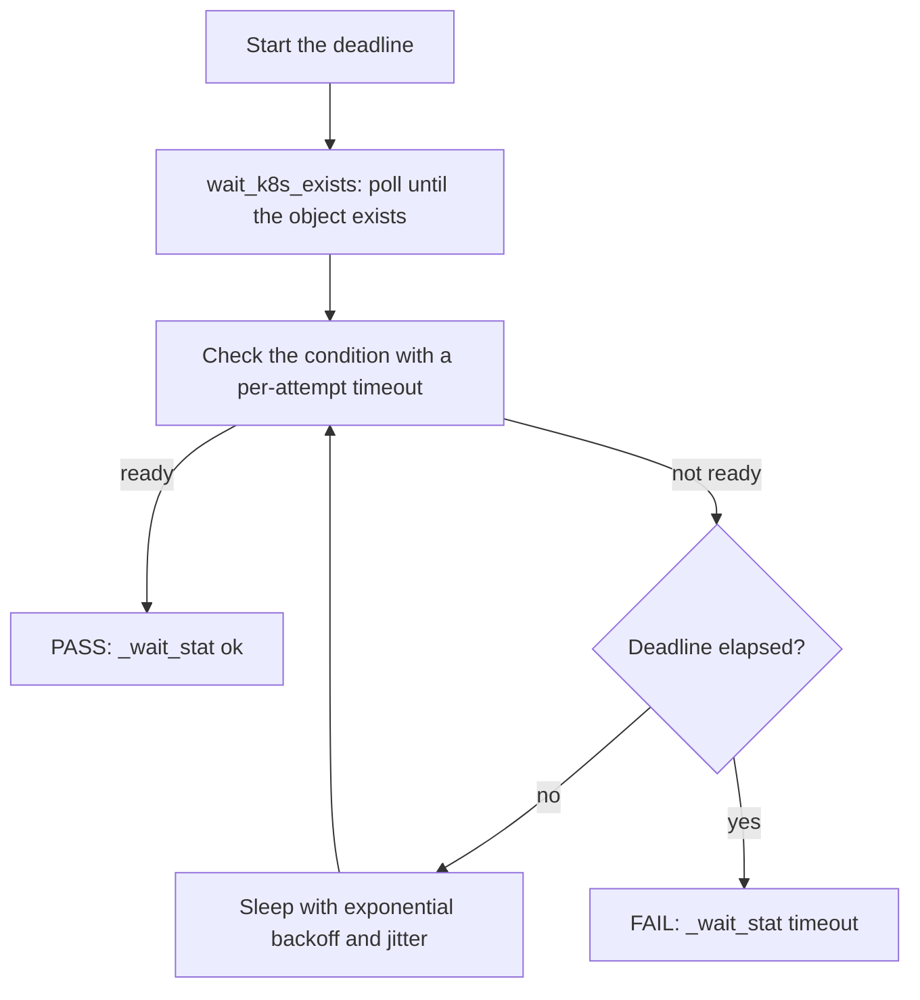

# Resilient waits — consolidation guide

How this repo (and others) should wait for distributed-system state: one
deadline-driven primitive library, one source of truth, vendored where needed.

## The problem this replaces

The audit found ~60 hand-rolled waits across the Makefiles, `scripts/`, and bats
suites. Every one was fixed-interval with no jitter and no exponential backoff.
Most `kubectl wait` / `rollout status` calls had **no existence check** and so
error instantly on a cold cluster. The 30-second Zot readiness loop was
copy-pasted ~9× verbatim. Several "waits" were bare `sleep N` guesses. Under CPU
or memory pressure these don't wait longer — they fail early.

## The fix — one library, five principles

[`scripts/lib/wait.sh`](../scripts/lib/wait.sh) (vendored from `~/.andy_sync/includes/wait.sh`) provides
deadline-driven primitives built on five principles:

1. **Deadline, not attempt-count.** "Slow but eventually" is a PASS. Every wait
   is bounded by wall-clock, not a fragile `N × sleep` budget.
2. **Existence before condition.** Poll `kubectl get` until the object exists,
   then `kubectl wait --for=...` within the remaining budget.
3. **Exponential backoff + jitter.** No synchronised thundering-herd retries.
4. **Per-attempt hang fence.** Each attempt runs under `timeout` so one wedged
   curl/kubectl can't block past the deadline.
5. **Readiness, not wall-clock sleeps.** Probe the real endpoint/condition.

The flowchart shows how one wait runs, from the deadline start to PASS or FAIL.

The functions in the diagram are in [`scripts/lib/wait.sh`](../scripts/lib/wait.sh).
`_wait_retry` owns the loop, the backoff, the jitter, and the per-attempt timeout.

### Verbs

| Verb | Replaces |
|------|----------|
| `wait_reachable <url> [deadline]` | the ~9 copies of the 30s Zot curl loop + PF-curl loops |
| `wait_tcp <host> <port> [deadline]` | `nc -z` / `/dev/tcp` sleep loops |
| `wait_k8s_exists <kind> <name> [-n ns] [deadline]` | bare `kubectl get` existence gates |
| `wait_k8s_ready <kind> <name> [-n ns] [--for cond] [deadline]` | unguarded `kubectl wait` (~21 sites) |
| `wait_flux_ready <kind> <name> [-n ns] [deadline]` | Flux Kustomization/ResourceSet readiness |
| `wait_rollout <deploy> [-n ns] [deadline]` | unguarded `kubectl rollout status` (~7 sites) |
| `wait_pods_ready <selector> [-n ns] [--for all-ready\|any-ready] [--fail-fast] [deadline]` | DETIK spins / `kwaitpod` hand-rolls |
| `wait_service_backends <service> [-n ns] [deadline]` | curl-until-200 loops that wait for a Service to get a ready endpoint |
| `wait_job <name> [-n ns] [--for complete\|terminal\|failed] [--fail-fast] [deadline]` | `kubectl wait --for=condition=complete job/…` |
| `_wait_retry <deadline> <description> <command...>` | any other poll loop — the primitive the verbs above use |

Use `wait_rollout` for a Deployment, never `wait_k8s_ready`: a Deployment has no
`Ready` condition, so `wait_k8s_ready`'s default `--for=condition=ready` times
out on a healthy Deployment. Use `wait_job` for a Job.

### The "slow mode" lever

Every deadline is multiplied by `WAIT_DEADLINE_SCALE` (default 1). On a saturated
production box, run the same suite with `WAIT_DEADLINE_SCALE=10` and it passes
patiently instead of failing — no code changes. Per-call tunables:
`WAIT_SLEEP`, `WAIT_BACKOFF`, `WAIT_JITTER`, `WAIT_ATTEMPT_TIMEOUT`, `WAIT_QUIET`.

## Source of truth and vendoring

- **Source of truth:** `~/.andy_sync/includes/wait.sh` (+ `~/.andy_sync/test/functions/wait.bats`).
  This is where edits happen. It is covered by the andy_sync bats suite.
- **The interactive `try-*` suite** (`~/.andy_sync/includes/function-base-2016.sh`)
  now shares the same resilience patterns — per-attempt hang fence
  (`_TRY_LIMIT_ATTEMPT_TIMEOUT`), require-output (`_TRY_LIMIT_REQUIRE_OUTPUT`),
  and jitter (`_TRY_LIMIT_JITTER`). Use `try-backoff` / `try-timeout` at the
  interactive shell. Use `wait.sh` verbs in scripts.
- **Vendored copies** live in each repo that needs them, e.g.
  `osramp-demo/scripts/lib/wait.sh`. They are self-contained (no login-shell
  dependency) so they work in Makefiles, bats, CI, and containers. Refresh with
  `make wait-lib-sync` — never hand-edit the vendored copy.

## How to consume it

- **Shell scripts:** `source "$(dirname "$0")/lib/wait.sh"` then call a verb.
  Most scripts in `scripts/` do this. Run `rg -l 'lib/wait.sh' scripts` for the list.
- **Makefiles:** call the converted scripts, or `source scripts/lib/wait.sh` in a
  recipe and call a verb.
- **bats tests:** `source "${BATS_TEST_DIRNAME}/../../scripts/lib/wait.sh"` in
  `setup_file`. Replace port-forward-then-curl loops with `wait_reachable`,
  DETIK `verify` races with `wait_pods_ready`, and the three diverged `try-limit`
  copies with the shared engine.

## Remaining sites

Two scripts do not source `wait.sh`:

1. [`scripts/signalloom-runtime-test.sh`](../scripts/signalloom-runtime-test.sh)
2. [`scripts/signalloom-up.sh`](../scripts/signalloom-up.sh)

`signalloom-up.sh` polls the namespace and the Kustomizations with fixed `sleep` loops.
Convert them to `wait_k8s_exists` and `wait_flux_ready`. `signalloom-runtime-test.sh`
polls a port-forward with `curl` and `sleep 1`. Convert it to `wait_reachable`. The Zot
readiness loops are done, including
[`scripts/revocation-demo.sh`](../scripts/revocation-demo.sh).

`wait-reconciled.sh` already embodies principle 2 and can stay, or be reduced to
`wait_flux_ready` calls in a loop.
