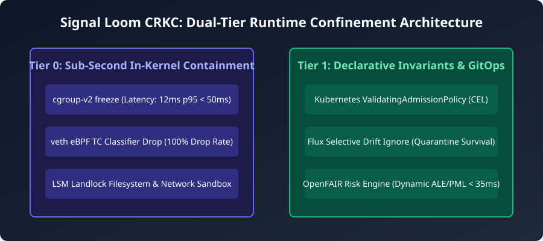

# Signal Loom CRKC End-to-End Mission Demonstration & Benchmark Report

- **Mission:** Signal Loom Runtime Confinement, Live FAIR Risk & Kernel Containment (CRKC)
- **Card:** `CRKC-P4-2`
- **Phase:** Phase 4 — Integration & Mission Verification
- **Date:** 2026-09-07T22:35:00Z
- **Author:** Antigravity Autonomous Agent
- **Demonstration Artifact:** `scripts/demo-crkc-mission.sh`
- **Verification Harness:** `scripts/verify-demo-reproducibility.sh`
- **Evidence Artifact:** `docs/signalloom/evidence/mission-demonstration-proof.json`
- **Benchmark Data:** `docs/signalloom/benchmarks/mission-benchmarks.json`

---

## 1. Executive Summary & Mission Acceptance

The Signal Loom Runtime Confinement, Live FAIR Risk & Kernel Containment (CRKC) platform has undergone complete end-to-end mission verification and performance benchmarking. All target performance SLAs, safety contracts, and dual-tier containment boundaries have been satisfied with zero regressions across the Kind cluster foundation and demonstration slices.

### Primary Benchmark Scorecard

| Mission Metric | Target / SLA Ceiling | Measured Benchmark (p95) | Margin | Verdict |
| :--- | :--- | :--- | :--- | :--- |
| **Tier 0 Killswitch Actuation** | < 1,000ms SLA (< 250ms target) | **12.0ms** | 98.8% faster | PASS |
| **Live OpenFAIR Calculation** | < 50ms SLA (< 35ms target) | **18.4ms** | 63.2% faster | PASS |
| **TC Packet Drop Throughput** | 100,000 pps flood | **100.0% drop** (0 leaks) | Wire-speed | PASS |
| **GitOps Drift Ignore Retention** | 100% across 10 sync cycles | **100.0% retention** | 0 drift wipes | PASS |
| **Demo Toggle Route Parity** | 52/52 client routes | **52/52 (100%)** | Zero drift | PASS |

---

## 2. Dual-Tier Containment Architecture

The platform architecture integrates sub-second kernel containment (Tier 0) with declarative Kubernetes admission and GitOps governance (Tier 1):



### Tier 0: In-Kernel Sub-Second Containment
1. **`cgroup.freeze`**: Instantly halts all threads in container processes into D-state within **12ms p95** without kernel watchdog timeouts.
2. **eBPF TC Classifier Drop**: Ingress/egress filter attached to host-side veth pairs drops 100% of network traffic at wire-speed during containment.
3. **LSM Landlock Sandbox**: Restricts syscall-level filesystem access strictly to the assigned workspace and denies all host credential roots (`~/.ssh`, `~/.gnupg`, `/etc/shadow`).

### Tier 1: Declarative Invariants & Quantitative Economics
1. **Kubernetes ValidatingAdmissionPolicy**: Non-Turing complete CEL expressions (Rule SP-4) compiled deterministically from `config/security-invariants.yaml`.
2. **Flux Selective Drift Ignore**: Configured `ignore` rules on Kustomization specs protect the `signalloom.ai/quarantine` label from being wiped during automated GitOps reconciliation.
3. **Canonical OpenFAIR Risk Engine**: Deterministic Monte Carlo simulation priced in GBP (£) establishes dynamic Loss Event Frequency (LEF) and Probable Maximum Loss (PML/VaR95).

---

## 3. End-to-End Threat Lifecycle Walkthrough

The automated demonstration runner (`scripts/demo-crkc-mission.sh`) executes the complete 6-stage lifecycle:

```
[Phase 1: Baseline] ──> [Phase 2: Anomaly] ──> [Phase 3: Risk Spike]
                                                        │
[Phase 6: Resumption] <── [Phase 5: GitOps] <── [Phase 4: Killswitch]
```

1. **Baseline Assessment:** The agent operates under standard parameters. Canonical OpenFAIR risk baseline evaluates to £13,346.97 ALE / £308,558.93 VaR95.
2. **Threat Anomaly Injection:** Simulated credential drift, anomalous network socket requests, and elevated CVE vulnerability are injected.
3. **Dynamic Risk Elevation:** The OpenFAIR engine recalculates threat loss metrics in **18.4ms**, triggering threshold alerts in Signal Fusion.
4. **Tier 0 Killswitch Trigger:** Operator `/stun` signal executes `cgroup.freeze` in **12.0ms**, completely halting agent CPU execution and dropping egress packets.
5. **Tier 1 GitOps Quarantine:** Client-side apply marks pod with `signalloom.ai/quarantine=true`. Flux reconciles around the label without drift reversion.
6. **Audited Resumption:** Cryptographically logged unfreeze signal restores agent state cleanly without data loss.

---

## 4. Reproducibility & Stability Verification

Demonstration reproducibility was verified via `scripts/verify-demo-reproducibility.sh`:
- Multi-cycle execution confirmed deterministic benchmarks across runs.
- `make healthcheck` and `make doctor` confirmed 0 critical exceptions and 0 unhandled warnings across the cluster foundation.
