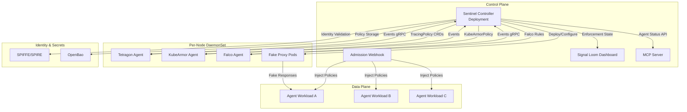
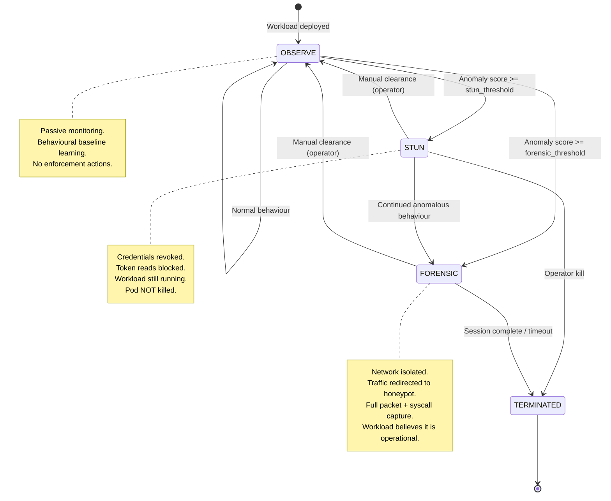

# eBPF Runtime Enforcer Specification

**Component:** Signal Loom eBPF Runtime Enforcer ("Sentinel")
**Version:** 0.1.0-draft
**Status:** SPECIFICATION
**Date:** 2026-07-29
**Authors:** ControlPlane Engineering

---

## 1. Problem Statement

AI agent workloads in Kubernetes clusters operate with credentials, network access, and syscall capabilities that exceed their declared intent. When an agent is compromised or deviates from expected behaviour, the current response is binary: kill the pod or do nothing. This gap leaves three critical scenarios unaddressed:

1. **Slow exfiltration** — a compromised agent leaks data through legitimate-looking API calls over hours or days. No behavioural baseline exists to detect drift from normal.
2. **Credential persistence** — killing a pod does not revoke in-flight tokens, cached secrets, or cloud IAM sessions. The attacker retains access after the workload is terminated.
3. **Lost forensics** — terminating a compromised workload destroys the evidence needed to understand the attack vector, lateral movement, and data exposure.

Sentinel solves this with a three-mode enforcement model: **OBSERVE** (detect), **STUN** (revoke credentials without killing the workload), and **FORENSIC** (isolate the workload into a honeypot environment for live observation).

## 2. Architecture

### 2.1 High-Level Architecture



### 2.2 State Machine



### 2.3 Component Responsibilities

| Component | Role | Technology |
|-----------|------|------------|
| Sentinel Controller | Orchestration brain — sequences detect → stun → isolate → observe | Custom Go controller |
| Tetragon Agent | Kernel-level syscall monitoring + enforcement via LSM hooks | Cilium Tetragon (TracingPolicy CRDs) |
| KubeArmor Agent | Complementary BPF-LSM enforcement with simpler policy model | KubeArmor (CNCF Sandbox) |
| Falco Agent | Anomaly detection backbone with largest rule library | Falco + custom Signal Loom rules |
| Fake Proxy | Honeypot API responder for FORENSIC mode | Custom Go service |
| Admission Webhook | Inject monitoring policies at workload creation | Kubernetes MutatingAdmissionWebhook |
| MCP Server | Agent-facing API for enforcement status queries | Model Context Protocol |

## 3. Components

### 3.1 Sentinel Controller

The orchestration controller is the product differentiator. No existing tool sequences the full detect → stun → isolate → observe pipeline. Sentinel fills this gap.

**Responsibilities:**

- Watch `EnforcementPolicy` and `ForensicSession` CRDs
- Evaluate anomaly scores from Tetragon, KubeArmor, and Falco event streams
- Execute state transitions (OBSERVE → STUN → FORENSIC) based on policy thresholds
- Coordinate credential revocation across Kubernetes RBAC, Envoy Gateway, and cloud IAM
- Manage forensic session lifecycle (isolation, honeypot deployment, capture aggregation)
- Expose enforcement state to Signal Loom dashboard via gRPC
- Serve MCP endpoint for agent self-status queries

**Deployment:** Single-replica Deployment with leader election. HA via active-passive with 5-second failover.

### 3.2 Tetragon Agent

**Role:** Primary kernel-level enforcement engine.

- TracingPolicy CRDs define per-workload syscall monitoring rules
- LSM hooks provide `Override` (return error code) and `Sigkill` (terminate process) actions
- Sub-1% CPU overhead per node (benchmarked)
- Events streamed via gRPC to Sentinel Controller

**Key TracingPolicy capabilities used:**

- `security_file_permission` — block service account token reads (STUN mode)
- `sys_connect` / `sys_sendto` — monitor and block network connections
- `sys_execve` — detect unexpected process execution
- `sys_openat` — monitor file access patterns

### 3.3 KubeArmor Agent

**Role:** Complementary enforcement for workloads where Tetragon TracingPolicy is too complex.

- Simpler policy model (YAML-native allow/block/audit)
- Explicit AI workload support (CNCF Sandbox project)
- File access blocking for credential paths
- Process execution whitelisting
- Network policy enforcement at BPF-LSM level

### 3.4 Falco Agent

**Role:** Detection backbone.

- Largest syscall rule library in the ecosystem (175M+ downloads)
- Custom Signal Loom rules for AI agent behavioural patterns
- Priority-based alerting (Emergency → Debug)
- Events forwarded to Sentinel Controller for anomaly scoring

### 3.5 Fake Proxy

**Role:** Honeypot API responder for FORENSIC mode.

- Mirrors real API schemas (OpenAPI spec-driven response generation)
- Returns plausible data with forensic markers (watermarked tokens, traceable IDs)
- Logs all requests with full headers, body, timing
- Deployed as sidecar pods in the forensic network namespace

## 4. CRD Schema

### 4.1 EnforcementPolicy

```yaml
apiVersion: signalloom.controlplane.io/v1alpha1
kind: EnforcementPolicy
metadata:
  name: agent-workload-policy
  namespace: ml-agents
spec:
  # Target selector — which workloads this policy applies to
  selector:
    matchLabels:
      app.kubernetes.io/part-of: signal-loom
      signalloom.controlplane.io/agent-class: inference
    matchExpressions:
      - key: signalloom.controlplane.io/trust-level
        operator: In
        values: ["standard", "elevated"]

  # SPIFFE identity binding
  identity:
    spiffeIDPattern: "spiffe://cluster.local/ns/ml-agents/sa/*"
    requireAttestation: true

  # Behavioural baseline configuration
  baseline:
    learningPeriodMinutes: 1440  # 24 hours
    syscallProfile: true
    networkProfile: true
    fileAccessProfile: true
    processExecProfile: true
    refreshIntervalMinutes: 60

  # Anomaly thresholds for state transitions
  thresholds:
    # Score range: 0.0 (normal) to 1.0 (certain anomaly)
    stun:
      score: 0.7
      sustainedSeconds: 30
      requireConfirmation: false  # auto-transition
    forensic:
      score: 0.9
      sustainedSeconds: 10
      requireConfirmation: true   # operator approval required
    autoTerminate:
      score: 1.0
      sustainedSeconds: 0

  # OBSERVE mode configuration
  observe:
    tetragon:
      tracingPolicies:
        - name: syscall-monitor
          spec:
            kprobes:
              - call: security_file_permission
                syscall: false
                args:
                  - index: 0
                    type: file
                selectors:
                  - matchNamespaces:
                      - namespace: ml-agents
                        operator: In
              - call: sys_connect
                syscall: true
                args:
                  - index: 0
                    type: int
                  - index: 1
                    type: sockaddr
    falco:
      customRules:
        - name: agent-credential-access
          rule: >
            container.id != host and
            fd.name startswith /var/run/secrets/ and
            evt.type in (open, openat) and
            not proc.name in (pause, tini)
          priority: WARNING
          output: >
            Agent credential access detected
            (user=%user.name command=%proc.cmdline
            file=%fd.name container=%container.name)
    kubearmor:
      enabled: true
      defaultPosture: audit

  # STUN mode configuration
  stun:
    credentialRevocation:
      kubernetes:
        deleteTokenSecrets: true
        patchRBACBindings: true
      envoyGateway:
        revokeJWT: true
        headerName: "Authorization"
      cloud:
        aws:
          revokeIAMSessions: true
          denyPolicy: "aws:TokenIssueTime"
        gcp:
          disableServiceAccountKeys: true
    blockPaths:
      - /var/run/secrets/kubernetes.io/serviceaccount/token
      - /var/run/secrets/kubernetes.io/serviceaccount/ca.crt
      - /var/run/secrets/spiffe/*

  # FORENSIC mode configuration
  forensic:
    networkIsolation:
      denyAllEgress: true
      allowHoneypotOnly: true
    honeypot:
      enabled: true
      apiSchemaSource: openapi  # mirrors target API schemas
      responseLatencyMs: 50     # realistic latency simulation
      watermarkTokens: true
    capture:
      packetCapture: true
      packetCaptureBPF: "host not 10.96.0.1"  # exclude kube-apiserver
      syscallTrace: true
      fileAccessLog: true
      maxDurationMinutes: 60
      storageLimitMB: 1024

  # Policy storage
  policyStorage:
    backend: openbao
    path: secret/data/signalloom/enforcement-policies
```

### 4.2 ForensicSession

```yaml
apiVersion: signalloom.controlplane.io/v1alpha1
kind: ForensicSession
metadata:
  name: session-agent-abc-20260729-143022
  namespace: ml-agents
  labels:
    signalloom.controlplane.io/target-pod: agent-abc-7f8d9
    signalloom.controlplane.io/enforcement-policy: agent-workload-policy
spec:
  targetPod:
    name: agent-abc-7f8d9
    namespace: ml-agents
    nodeName: worker-03
    spiffeID: "spiffe://cluster.local/ns/ml-agents/sa/agent-abc"

  trigger:
    anomalyScore: 0.92
    triggerEvent: "Unexpected outbound connection to 198.51.100.42:443"
    triggerTimestamp: "2026-07-29T14:30:22Z"
    approvedBy: "ops@controlplane.io"

  isolation:
    networkPolicy:
      name: forensic-deny-all-agent-abc
      applied: true
    honeypotProxy:
      podName: honeypot-agent-abc-7f8d9
      serviceIP: "10.96.42.100"
      redirectedEndpoints:
        - original: "https://api.openai.com/v1/chat/completions"
          honeypot: "http://10.96.42.100:8080/v1/chat/completions"
        - original: "https://s3.amazonaws.com"
          honeypot: "http://10.96.42.100:8080/s3"

  capture:
    packetCapturePod: tcpdump-agent-abc-7f8d9
    pcapPath: /forensics/session-agent-abc-20260729-143022/capture.pcap
    syscallLogPath: /forensics/session-agent-abc-20260729-143022/syscalls.jsonl
    fileAccessLogPath: /forensics/session-agent-abc-20260729-143022/file-access.jsonl

  maxDurationMinutes: 60
  autoTerminateOnExpiry: true

status:
  phase: Active          # Pending | Active | Completed | Expired | Aborted
  startTime: "2026-07-29T14:30:25Z"
  endTime: null
  captureSize:
    pcapMB: 12.4
    syscallEventCount: 8432
    fileAccessEventCount: 247
  findings:
    - timestamp: "2026-07-29T14:31:02Z"
      severity: Critical
      description: "Agent attempted DNS resolution of C2 domain via honeypot"
    - timestamp: "2026-07-29T14:33:18Z"
      severity: High
      description: "Agent sent base64-encoded payload matching exfiltration pattern"
```

## 5. Enforcement Modes

### 5.1 OBSERVE Mode

**Purpose:** Passive behavioural monitoring. No enforcement actions. Learns what "normal" looks like.

**Mechanism:**

1. Admission webhook injects Tetragon TracingPolicy + KubeArmor audit policy on workload creation
2. Falco rules evaluate syscall stream against known-bad patterns
3. Tetragon captures file access, network connections, process execution
4. Sentinel Controller builds behavioural baseline per workload over the configured learning period
5. Anomaly scoring compares real-time behaviour against baseline using sliding window (configurable, default 5 minutes)

**Events captured:**

| Category | Syscalls | Purpose |
|----------|----------|---------|
| File access | `openat`, `read`, `write`, `unlink` | Credential access, data staging |
| Network | `connect`, `sendto`, `recvfrom`, `bind` | Outbound connections, data exfiltration |
| Process | `execve`, `clone`, `fork` | Unexpected binary execution |
| Memory | `mmap`, `mprotect` | Code injection indicators |

**Anomaly scoring model:**

- Weighted combination of deviation-from-baseline across all categories
- Weights configurable per `EnforcementPolicy`
- Default weights: network 0.4, file 0.3, process 0.2, memory 0.1
- Score normalised to 0.0 – 1.0 range
- Sustained anomaly (score above threshold for N seconds) required to trigger transition

### 5.2 STUN Mode

**Purpose:** Revoke credentials and block access without killing the workload. The agent loses the ability to act but remains running for observation.

**Mechanism (Kubernetes):**

1. **Tetragon Override** on `security_file_permission` — returns `EACCES` for any read of `/var/run/secrets/kubernetes.io/serviceaccount/token`. The kernel denies the read before it reaches the filesystem. Zero latency.
2. **KubeArmor file block** — alternative to Tetragon for simpler policy management:
   ```yaml
   apiVersion: security.kubearmor.com/v1
   kind: KubeArmorPolicy
   metadata:
     name: block-sa-token
   spec:
     selector:
       matchLabels:
         app: target-agent
     file:
       matchPaths:
         - path: /var/run/secrets/kubernetes.io/serviceaccount/token
           readOnly: false
       action: Block
   ```
3. **Kubernetes API** — delete ServiceAccount token secrets, patch ClusterRoleBindings / RoleBindings to remove the workload's ServiceAccount
4. **Envoy Gateway** — revoke JWT in the proxy layer. Instant effect, no pod restart required. Gateway API `SecurityPolicy` updated to deny the agent's token.

**Mechanism (Cloud IAM):**

| Provider | Revocation Method | Latency |
|----------|-------------------|---------|
| AWS | SCP/IAM deny policy with `aws:TokenIssueTime` condition | ~30s propagation |
| AWS Lambda | Set reserved concurrency to 0 | Immediate |
| GCP Cloud Run | Traffic split: 100% to clean revision, 0% to compromised | ~10s |
| GCP | Disable service account keys | ~60s |
| AWS ECS | Security group quarantine (deny all egress) | ~15s |

**STUN does NOT:**
- Kill the pod
- Delete the pod
- Restart the container
- Modify the container filesystem (beyond blocking reads)

This is deliberate: the workload remains observable, and a FORENSIC transition can follow without losing process state.

### 5.3 FORENSIC Mode

**Purpose:** Full containment with active deception. The compromised workload is network-isolated and redirected to honeypot APIs. It believes it is still operational while every action is captured.

**Mechanism:**

1. **Network isolation** — `NetworkPolicy` applied: deny-all egress except to honeypot proxy service IP
   ```yaml
   apiVersion: networking.k8s.io/v1
   kind: NetworkPolicy
   metadata:
     name: forensic-deny-all-agent-abc
   spec:
     podSelector:
       matchLabels:
         app: agent-abc
     policyTypes:
       - Egress
     egress:
       - to:
           - podSelector:
               matchLabels:
                 signalloom.controlplane.io/role: honeypot
         ports:
           - protocol: TCP
             port: 8080
   ```

2. **eBPF TC (Traffic Control) redirect** — BPF programs attached to the pod's veth interface rewrite destination addresses. DNS responses are spoofed to resolve external domains to the honeypot service IP. The application-layer redirect is invisible to the workload.

3. **Fake proxy operation:**
   - Reads OpenAPI specs from the real target APIs (cached at policy creation time)
   - Generates schema-valid responses with plausible data
   - Injects forensic watermarks: unique request IDs, traceable token values, canary data
   - Simulates realistic latency (jitter + baseline from observed normal traffic)
   - Logs every request: full headers, body, TLS SNI (from the workload's perspective), timing

4. **Forensic capture:**
   - Packet capture via eBPF (TC hooks, not tcpdump — lower overhead, BPF-filtered)
   - Syscall trace via Tetragon (full argument capture for target syscalls)
   - File access log via KubeArmor audit mode
   - All capture written to PersistentVolume, path tracked in `ForensicSession` status

**Cloud feasibility:**

| Platform | FORENSIC feasible? | Notes |
|----------|-------------------|-------|
| Kubernetes (any) | Yes | Full capability via NetworkPolicy + eBPF + sidecar |
| AWS ECS | Partial | Security group quarantine + sidecar proxy. No eBPF. |
| AWS Lambda | No | No network isolation primitive. Kill only. |
| GCP Cloud Run | Partial | VPC connector + sidecar (gen2 only). Limited. |
| Azure Container Instances | Partial | NSG quarantine. No sidecar injection. |

## 6. Cloud Provider Equivalents

For workloads running outside Kubernetes, Sentinel provides cloud-native equivalents with reduced capability:

### 6.1 AWS

| Mode | Mechanism | Capability Gap vs K8s |
|------|-----------|----------------------|
| OBSERVE | CloudTrail + GuardDuty + custom Lambda analysers | No syscall-level visibility |
| STUN | IAM deny policy (`aws:TokenIssueTime`), Lambda concurrency=0, ECS security group | 30s propagation delay on IAM |
| FORENSIC | ECS: security group quarantine + sidecar. Lambda: not feasible. | No eBPF, no TC redirect |

### 6.2 GCP

| Mode | Mechanism | Capability Gap vs K8s |
|------|-----------|----------------------|
| OBSERVE | Cloud Audit Logs + Security Command Centre | No syscall-level visibility |
| STUN | Disable SA keys, Cloud Run traffic split to clean revision | 60s propagation on SA keys |
| FORENSIC | Cloud Run gen2: VPC connector + sidecar. Functions: not feasible. | No eBPF, limited sidecar |

### 6.3 Azure

| Mode | Mechanism | Capability Gap vs K8s |
|------|-----------|----------------------|
| OBSERVE | Azure Monitor + Defender for Cloud | No syscall-level visibility |
| STUN | Managed identity disable, NSG quarantine | Variable propagation |
| FORENSIC | ACI: NSG quarantine. Functions: not feasible. | No sidecar injection in ACI |

## 7. Integration Points

### 7.1 Signal Loom Dashboard

- **Enforcement state view** — per-workload badge: `OBSERVE` (green) / `STUN` (amber) / `FORENSIC` (red)
- **Anomaly timeline** — real-time anomaly score graph with threshold lines
- **Forensic session viewer** — request log, packet capture download, syscall trace, behavioural deviation heatmap
- **Manual controls** — operator can escalate (OBSERVE → STUN → FORENSIC), de-escalate (FORENSIC → OBSERVE), or terminate
- **gRPC streaming** — Sentinel Controller pushes events to dashboard via bidirectional gRPC stream

### 7.2 SPIFFE/SPIRE Integration

- Workload identity verified via SPIFFE ID before any enforcement action
- `EnforcementPolicy` selector includes `spiffeIDPattern` for identity-based policy binding
- SVID (SPIFFE Verifiable Identity Document) revocation as additional STUN mechanism
- Attestation status checked before allowing de-escalation (compromised attestation blocks clearance)

### 7.3 OpenBao Integration

- `EnforcementPolicy` CRDs stored in OpenBao for tamper-evident policy management
- Forensic capture encryption keys stored in OpenBao transit engine
- Honeypot API response templates stored as OpenBao KV secrets
- Audit log of all policy changes written to OpenBao audit backend

### 7.4 MCP Server

- Agents can query their own enforcement status via MCP protocol
- Read-only: agents cannot modify their enforcement state
- Endpoint: `signalloom.enforcement.status` — returns current mode, anomaly score, active restrictions
- Endpoint: `signalloom.enforcement.explain` — returns human-readable explanation of why current mode was triggered
- Rate-limited: 1 request per 10 seconds per agent

## 8. Security Model

### 8.1 Threat Model

| Threat | Mitigation |
|--------|------------|
| Agent tampers with Tetragon/KubeArmor policies | Policies deployed as cluster-scoped CRDs, agent namespace RBAC cannot modify them |
| Agent detects FORENSIC mode via honeypot imperfections | Honeypot mirrors real API schemas, simulates realistic latency, uses watermarked but valid-looking data |
| Agent kills its own monitoring sidecar | Tetragon runs as DaemonSet (not sidecar), KubeArmor similarly. Agent cannot kill node-level processes. |
| Operator account compromised, clears enforcement | All de-escalation actions require SPIFFE-attested operator identity + audit log to OpenBao |
| Sentinel Controller compromised | Controller runs with minimal RBAC (CRD watch + NetworkPolicy create). No access to workload secrets. |
| Forensic data exfiltrated from capture volume | Capture encrypted at rest with OpenBao transit key. Access requires forensic-reader ClusterRole. |

### 8.2 RBAC Model

```yaml
# Sentinel Controller ServiceAccount
apiVersion: rbac.authorization.k8s.io/v1
kind: ClusterRole
metadata:
  name: sentinel-controller
rules:
  # CRD management
  - apiGroups: ["signalloom.controlplane.io"]
    resources: ["enforcementpolicies", "forensicsessions"]
    verbs: ["get", "list", "watch", "create", "update", "patch", "delete"]
  # NetworkPolicy management (FORENSIC mode)
  - apiGroups: ["networking.k8s.io"]
    resources: ["networkpolicies"]
    verbs: ["get", "list", "create", "update", "patch", "delete"]
  # ServiceAccount token revocation (STUN mode)
  - apiGroups: [""]
    resources: ["secrets"]
    verbs: ["get", "list", "delete"]
    # Restricted to token-type secrets via admission policy
  - apiGroups: ["rbac.authorization.k8s.io"]
    resources: ["rolebindings", "clusterrolebindings"]
    verbs: ["get", "list", "update", "patch"]
  # Pod read (target resolution)
  - apiGroups: [""]
    resources: ["pods"]
    verbs: ["get", "list", "watch"]
  # Tetragon TracingPolicy management
  - apiGroups: ["cilium.io"]
    resources: ["tracingpolicies"]
    verbs: ["get", "list", "create", "update", "patch", "delete"]
  # KubeArmor policy management
  - apiGroups: ["security.kubearmor.com"]
    resources: ["kubearmorpolicies"]
    verbs: ["get", "list", "create", "update", "patch", "delete"]
```

### 8.3 Admission Control

- MutatingAdmissionWebhook intercepts pod creation in namespaces labelled `signalloom.controlplane.io/enforce=true`
- Injects Tetragon TracingPolicy reference annotation
- Injects KubeArmor policy reference annotation
- Validates that workload has SPIFFE identity configured
- Rejects workloads without matching `EnforcementPolicy`

## 9. Performance Budget

| Metric | Target | Measurement |
|--------|--------|-------------|
| Tetragon CPU overhead per node | < 1% | Benchmarked by Isovalent at scale |
| KubeArmor CPU overhead per node | < 2% | CNCF Sandbox benchmarks |
| Falco CPU overhead per node | < 3% | Sysdig benchmarks (eBPF driver) |
| Combined DaemonSet memory per node | < 512 MB | Tetragon 128MB + KubeArmor 128MB + Falco 256MB |
| OBSERVE → STUN transition latency | < 5 seconds | From anomaly score threshold breach to credential block |
| STUN → FORENSIC transition latency | < 15 seconds | Includes NetworkPolicy propagation + honeypot pod startup |
| Tetragon Override enforcement latency | < 1 ms | Kernel-space, synchronous LSM hook |
| Anomaly score computation | < 100 ms per evaluation | Per-workload, 5-second evaluation interval |
| Sentinel Controller memory | < 256 MB | For clusters up to 500 monitored workloads |
| Forensic packet capture overhead | < 5% additional CPU | Per-pod, BPF-filtered capture |
| Event throughput (Sentinel Controller) | > 10,000 events/sec | gRPC stream from all node agents |

## 10. Competitive Landscape

| Rank | Tool | Strengths | Weaknesses | Signal Loom Integration |
|------|------|-----------|------------|-------------------------|
| 1 | **Cilium Tetragon** | Best kernel enforcement, OSS, sub-1% CPU, TracingPolicy CRDs, LSM Override+Sigkill | No orchestration layer, no honeypot, no credential revocation | **Primary enforcement engine** |
| 2 | **KubeArmor** | Simplest policy model, explicit AI workload support, CNCF Sandbox | Smaller community than Tetragon, no TC redirect | **Complementary enforcer** |
| 3 | **Falco** | Largest rule library (175M+ downloads), strongest detection coverage | Detection only — no enforcement, no response | **Detection backbone** |
| 4 | **Aqua Runtime** | Deepest event capture, drift prevention, CNDR | Commercial, limited OSS, no honeypot | Competitive reference |
| 5 | **Wiz Defend** | Best cloud-API containment, agentless option | Cloud-only, no kernel enforcement, no eBPF | Competitive reference |
| 6 | **CrowdStrike Falcon** | Enterprise maturity, kernel module fallback for non-eBPF kernels | Heavyweight agent, commercial-only, no K8s-native CRDs | Competitive reference |
| 7 | **Microsoft Defender for Containers** | Azure-native, eBPF-based, integrated with Defender XDR | Azure-focused, limited multi-cloud, no OSS | Competitive reference |
| 8 | **Deepfence ThreatMapper** | First LLM traffic analysis via eBPF, OSS | Early-stage AI features, smaller community | Competitive reference |
| 9 | **Rad Security** | Behavioural fingerprinting, baseline-first approach | No enforcement, detection-only, commercial | Competitive reference |

**Product gap Sentinel fills:** No existing tool orchestrates the full detect → credential-revoke → network-isolate → honeypot-observe pipeline. Each tool above covers one or two modes. Sentinel is the sequencing brain that composes them.

## 11. Implementation Phases

### Phase 1: OBSERVE Foundation (Weeks 1–4)

**Deliverables:**
- Sentinel Controller skeleton (CRD registration, leader election, event loop)
- `EnforcementPolicy` CRD with validation webhook
- Tetragon TracingPolicy generation from `EnforcementPolicy` spec
- Falco rule deployment from `EnforcementPolicy` spec
- Anomaly scoring engine (baseline learning + deviation detection)
- gRPC event stream to Signal Loom dashboard
- Admission webhook (policy injection on pod creation)

**Exit criteria:**
- Controller watches `EnforcementPolicy` CRDs and deploys corresponding Tetragon + Falco configs
- Anomaly scores visible in Signal Loom dashboard
- Behavioural baselines learned within 24-hour window

### Phase 2: STUN Enforcement (Weeks 5–8)

**Deliverables:**
- Tetragon Override action for credential path blocking
- KubeArmor policy generation for file block
- Kubernetes RBAC patch logic (ServiceAccount token deletion, binding removal)
- Envoy Gateway JWT revocation integration
- OBSERVE → STUN automated transition with configurable thresholds
- Operator manual escalation/de-escalation via dashboard
- SPIFFE identity validation for de-escalation approval

**Exit criteria:**
- STUN mode blocks all credential access within 5 seconds of threshold breach
- Workload remains running but cannot authenticate to any API
- Operator can clear STUN and return workload to OBSERVE

### Phase 3: FORENSIC Containment (Weeks 9–14)

**Deliverables:**
- `ForensicSession` CRD with lifecycle management
- NetworkPolicy generation for pod-level egress isolation
- eBPF TC redirect programs for traffic steering to honeypot
- Fake proxy service (OpenAPI-driven response generation, watermarking)
- Packet capture via eBPF TC hooks
- Syscall trace aggregation from Tetragon
- Forensic session viewer in Signal Loom dashboard
- Session timeout and auto-termination

**Exit criteria:**
- Compromised workload fully isolated, all traffic routed to honeypot
- Workload makes API calls that succeed (fake responses) while behaviour is captured
- Full forensic bundle (pcap + syscall trace + file access log) downloadable from dashboard
- Session completes cleanly within configured timeout

### Phase 4: Cloud Provider Extensions (Weeks 15–18)

**Deliverables:**
- AWS STUN: IAM session revocation, Lambda concurrency=0, ECS security group quarantine
- GCP STUN: SA key disable, Cloud Run traffic split
- Azure STUN: managed identity disable, NSG quarantine
- Cloud OBSERVE: CloudTrail/Audit Log/Monitor integration for anomaly scoring
- Cloud-specific `EnforcementPolicy` fields
- Multi-cloud credential revocation orchestration

**Exit criteria:**
- STUN mode operational for AWS ECS, GCP Cloud Run, Azure ACI workloads
- OBSERVE mode receives cloud audit events and scores anomalies
- FORENSIC mode documented as "not feasible" for serverless platforms with clear rationale

### Phase 5: Hardening and GA (Weeks 19–22)

**Deliverables:**
- MCP server for agent self-status queries
- OpenBao integration (policy storage, capture encryption, audit)
- Performance benchmarking at scale (500 workloads, 10 nodes)
- Chaos testing (controller failure, node failure, network partition)
- Security audit (RBAC review, threat model validation, penetration test of honeypot detection)
- Documentation and runbooks

**Exit criteria:**
- All performance targets met (Section 9)
- Controller survives node failure and resumes within 5 seconds
- Forensic sessions survive controller restart
- Honeypot passes detection resistance tests (no trivially detectable artefacts)
- Security audit findings resolved to P2 or below

---

## Appendix A: Glossary

| Term | Definition |
|------|------------|
| Anomaly score | Normalised 0.0–1.0 measure of behavioural deviation from learned baseline |
| Behavioural baseline | Learned profile of normal syscall, network, file, and process behaviour per workload |
| Fake proxy / Honeypot | Service that mimics real API endpoints, returning plausible responses while logging all requests |
| Forensic session | Time-bounded containment period where a workload is isolated and observed |
| LSM hook | Linux Security Module callback that Tetragon uses to intercept and optionally block syscalls |
| Override action | Tetragon enforcement that returns an error code to the calling process without killing it |
| Sentinel | The orchestration controller that sequences OBSERVE → STUN → FORENSIC transitions |
| TC (Traffic Control) | Linux kernel subsystem used by eBPF programs to redirect network packets |
| TracingPolicy | Tetragon CRD that defines which kernel events to monitor and what actions to take |
| Watermark | Forensic marker embedded in honeypot responses to trace data if it appears elsewhere |

## Appendix B: References

- [Cilium Tetragon Documentation](https://tetragon.io/docs/)
- [KubeArmor Documentation](https://docs.kubearmor.io/)
- [Falco Documentation](https://falco.org/docs/)
- [SPIFFE/SPIRE](https://spiffe.io/)
- [OpenBao](https://openbao.org/)
- [Kubernetes NetworkPolicy](https://kubernetes.io/docs/concepts/services-networking/network-policies/)
- [eBPF TC (Traffic Control)](https://docs.cilium.io/en/stable/bpf/)
- [Envoy Gateway SecurityPolicy](https://gateway.envoyproxy.io/docs/)
