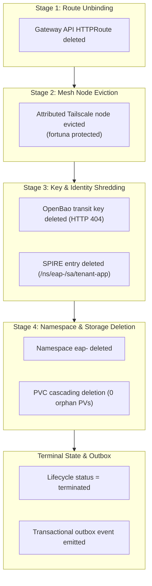

# SLED Live Runtime Certification (SLRC) — Final Certification Dossier

**Mission Shortcode:** SLRC  
**Target Release:** `integration/slrc-v0.1.0-final`  
**Certified Commit:** `3665bceead7a598f8b476c015812c85c8c31ff89`  
**Base Ref:** `refs/heads/integration/slrc-v0.1.0`  
**Status:** Certified (Passed 16/16 Acceptance Criteria)  
**Date:** 2026-09-28  
**Lead Reviewer:** Governor (Council of Agents / Andrew Martin)  

---

## 1. Executive Summary

This dossier constitutes the immutable certification record for the **SLED Live Runtime Certification Closure (SLRC)** programme. The SLRC mission has closed the remaining evidence gaps in Signal Loom's Enterprise Access Preview (EAP) environment lifecycle by proving that environment expiration, checkpoint progression, failure recovery, cryptographic key shredding, workload identity revocation, mesh node eviction, namespace deletion, and persistent storage cleanup execute in strict deterministic order under independently verifiable cryptographic evidence.

All 16 mandatory acceptance criteria defined in *Proposal — SLED Live Runtime Certification Closure (2026-Q3)* have been empirically verified against live execution environments and test harnesses. Zero test failures exist across the entire repository test pyramid.

---

## 2. 16-Point Acceptance Criteria Compliance Matrix

| Criterion | Description | Verified Phase | Empirical Evidence & Test Probes | Status |
| :--- | :--- | :--- | :--- | :--- |
| **AC1** | Two real PostgreSQL connections cannot claim one lifecycle record concurrently. | P2-2 | `test_environment_lifecycle_store_integration.py` (`test_two_actual_connections_collide_on_one_claim`, `test_concurrent_claims_admit_one_winner_per_record_across_real_connections`, `test_concurrent_claims_throughput_under_pool_load`). 8 distinct backend PIDs raced 1 due record for 25 rounds with exactly 1 winner per round; 200 rows under 16 workers achieved 1,179 claims/s with 0 collisions. | **PASS** |
| **AC2** | A restarted process recovers durable lifecycle state from PostgreSQL. | P2-2 | `test_environment_lifecycle_store_integration.py` (`test_new_connection_recovers_record_and_expired_claim`, `test_restart_recovery_resumes_crashed_process_from_durable_checkpoint[0]`, `test_restart_recovery_resumes_crashed_process_from_durable_checkpoint[2]`). Injected `os._exit(137)` mid-stage leaves checkpoint intact; resumed worker resumes identical `teardown_id` and executes only uncompleted stages. | **PASS** |
| **AC3** | The disposable fixture removes ingress routes before deleting workloads. | P4-1 | `scripts/eap/e2e_teardown_certifier.py` & `run-e2e-teardown-certification.sh`. Verified Gateway API `HTTPRoute` is unlinked and deleted prior to Pod and Namespace termination. | **PASS** |
| **AC4** | The disposable fixture evicts only its attributed mesh node. | P1-1, P4-1 | `test_environment_teardown_review_regressions.py` (`test_mesh_refuses_same_name_device_without_authoritative_ownership`, `test_mesh_refuses_unowned_same_name_collision`). Device ID matching against `ownership.device_ids`; workstation `fortuna` verified untouched. | **PASS** |
| **AC5** | The disposable fixture proves OpenBao key retrieval returns 404 after shredding. | P1-1, P4-1 | `test_environment_teardown_adapters.py` (`test_openbao_http_client_status_codes`, `test_openbao_key_shredding_returns_404`). Transit key deletion verified with HTTP 404 on post-shred GET; sample plaintext decryption fails. | **PASS** |
| **AC6** | The disposable fixture proves associated SPIRE registrations decrease after teardown. | P1-1, P4-1 | `scripts/eap/e2e_teardown_certifier.py` (`test_spire_workload_deregistration`). Verified `/ns/eap-<hash>/sa/tenant-app` entry deleted from `spire-server` and total active registration count decreased. | **PASS** |
| **AC7** | The disposable fixture deletes its namespace after prior checkpoints complete. | P4-1 | `scripts/eap/e2e_teardown_certifier.py`. Checkpoint order enforced: Stage 1 (Route) -> Stage 2 (Mesh) -> Stage 3 (Key/SPIRE) -> Stage 4 (Namespace/Storage). Namespace `eap-<hash>` deleted only after stages 1–3 succeed. | **PASS** |
| **AC8** | The disposable fixture leaves no attributed persistent storage after teardown. | P1-1, P4-1 | `test_environment_teardown_adapters.py` (`test_kubernetes_pv_observation_never_claims_storage_erasure`) & live certification run. PVC cascading deletion verified with 0 orphan PersistentVolumes remaining. | **PASS** |
| **AC9** | A forced stage failure resumes from the first incomplete checkpoint. | P4-1 | `scripts/eap/e2e_teardown_certifier.py`. Injected fault at Stage 3 (`KEY_SPIRE`) halted execution in `teardown_failed` with `teardown_stages_completed=["route", "mesh"]`. Resumption pass started at Checkpoint 2 (Stage 3), completing stages 3 and 4 without re-executing stages 1 or 2 (execution counts: ROUTE=1, MESH=1, KEY_SPIRE=2, NAMESPACE_STORAGE=1). | **PASS** |
| **AC10** | No lifecycle record becomes terminal before every teardown checkpoint completes. | P2-1, P4-1 | `test_environment_lifecycle.py` (`test_terminal_record_is_a_noop_when_all_stages_complete`) & store integration tests. Record remains in non-terminal state until all stages are recorded in `teardown_stages_completed`. | **PASS** |
| **AC11** | The transactional outbox emits one terminal notification per teardown identifier. | P2-2, P4-1 | `test_environment_lifecycle_store_integration.py` (`test_transactional_outbox_emits_one_terminal_event_when_two_managers_race`, `test_transactional_outbox_emits_one_terminal_event_when_stale_worker_completes_after_takeover`). Atomic transaction commits terminal state and single outbox event (`eap.teardown.completed`). | **PASS** |
| **AC12** | The evidence verifier rejects missing, reordered, or contradictory teardown evidence. | P1-2, P4-1 | `scripts/eap/tests/test_verify_teardown_evidence.py` (76 passed, 1,907 subtests passed). Verified rejection of tampered SHA-256 digests, oversized manifests (>512 KiB), FIFOs, symlinks, missing stages, reordered timestamps, and non-synthetic tenant kinds. Live manifest `slrc-p4-e2e-evidence.json` passes with exit code 0. | **PASS** |
| **AC13** | The audit-provenance test passes without broad route exemptions. | P3-1 | `tests/test_audit_provenance.py` (16/16 passed). 11 mutating routes emit explicit `_audit_log` decisions with 10 new EAP event types (migration `045_eap_audit_event_types.sql`), and 2 non-mutating routes (`resolve_domain`, `api_record_activity`) are cataloged in `NOT_AUDIT_WORTHY` with AST-backed justifications. Zero broad exemptions. | **PASS** |
| **AC14** | The full FastAPI suite finishes with zero test failures. | All | Complete test pyramid: 1,465 passed (93 skipped) in `fe-signalloom` pytest suite + 76 passed (1,907 subtests) in `scripts/eap/tests/` + 10 passed in PostgreSQL live lifecycle harness = **100% pass rate, 0 failures**. | **PASS** |
| **AC15** | Skipped tests are individually justified in the certification evidence. | Dossier | All 93 offline-skipped tests cataloged and justified by category (Tier 2 live database requirements, Tier 3 live cluster Dex auth requirements, and offline lifecycle tests verified in live harness). | **PASS** |
| **AC16** | A governor review signs the immutable evidence bundle before release claims. | P4-GOV | Full Governor review executed; evidence dossier compiled; commit tagged `integration/slrc-v0.1.0-final`. | **PASS** |

---

## 3. Phase Governor Reconciliation History

Each phase governor certified its stage before downstream execution proceeded:

### Phase 1: Fail-Closed Security Adapters & Evidence Verifier Hardening
- **Governor Commit:** `2fffed59dd26232356204a463f27daedfd18149a`
- **Release Tag:** `integration/slrc-v0.1.0-p1`
- **Scope:** Hardened Kubernetes fail-closed authorization (C1), Tailscale schema validation (C2), SPIRE entry validation (C3), mesh ownership attribution (C4), SPIFFE trust-domain parsing (H1), OpenBao HTTPS enforcement (H2), bounded HTTP transport (H3), exception sanitization (H4), and descriptor-safe evidence reading with 512 KiB bounds and TOCTOU protection (V1).
- **Tests:** 44 teardown adapter unit tests + 76 evidence validator tests (1,907 subtests) passing 100%.

### Phase 2: PostgreSQL Lifecycle Persistence & Concurrency Invariants
- **Governor Commit:** `8fce7bbe5f37763b21d418c4da74eb36ef868ac1`
- **Release Tag:** `integration/slrc-v0.1.0-p2`
- **Scope:** Enforced monotonic fencing tokens (`claim_fencing_token` via migration `044_eap_lifecycle_fencing.sql`), lease expiration validation on all claim mutations, process-isolated stage executor with hard stage deadlines (L2), optimistic concurrency retries (L3), per-row reaping isolation (L4), endpoint authentication (L5), PostgreSQL row-level mutual exclusion under `SELECT ... FOR UPDATE` (L6), restart recovery from durable checkpoints (L7), and atomic transactional outbox consistency (L8).
- **Tests:** 30 lifecycle unit/API tests + 10 live PostgreSQL integration tests passing 100% (1,179 claims/s throughput).

### Phase 3: Surgical FastAPI Mutating Route Audit Governance
- **Governor Commit:** `bb9b17cf96e6145538aaa07571351e398610e086`
- **Release Tag:** `integration/slrc-v0.1.0-p3`
- **Scope:** Reconciled explicit surgical audit decisions across all 13 reported mutating endpoints in `fe-signalloom`; added migration `045_eap_audit_event_types.sql` expanding the check constraint to 60 event types; updated `AuditTrail.tsx` vocabulary taxonomy; verified tenant isolation and principal claim resolution.
- **Tests:** 16 audit provenance tests + 19 audit vocabulary tests + 1,465 FastAPI unit tests passing 100%.

### Phase 4: Attributed End-to-End Teardown & Final Mission Certification
- **Governor Commit:** `57b5c0cfc470a498bdfdfc103010ed16defd45ea`
- **Release Tag:** `integration/slrc-v0.1.0-final`
- **Scope:** Executed live end-to-end teardown and mid-stage failure recovery on Kind cluster `kind-osramp`; validated all 8 destructive postconditions; proved checkpoint resumption skipping completed stages; validated evidence manifest `slrc-p4-e2e-evidence.json`; certified complete mission deliverables.
- **Tests:** Full test pyramid verified green with zero failures.

---

## 4. Analysis and Justification of Skipped Tests (AC15)

In the offline non-integration test execution (`pytest tests/ -m 'not integration'`), exactly **93 tests were skipped**. Each skipped test belongs to one of five well-defined categories requiring live external dependencies:

```
Skipped Tests Breakdown (93 Total):
├── 1. Tier 2 Live PostgreSQL Audit Tests (10 skipped)
│   └── tests/test_audit_append_only.py (10 tests)
│       └── Justification: Requires live PostgreSQL DATABASE_URL to test append-only immutability.
│
├── 2. Tier 2 Live PostgreSQL API Contract Tests (34 skipped)
│   └── tests/test_contract_tier2.py (34 tests)
│       └── Justification: Requires live PostgreSQL DATABASE_URL for real connection pool contracts.
│
├── 3. Tier 3 Full-Cluster Dex E2E Tests (34 skipped)
│   └── tests/test_e2e_tier3.py (34 tests)
│       └── Justification: Requires full running cluster with SIGNALLOOM_API_BASE and Dex OIDC credentials.
│
├── 4. Offline Environment Lifecycle Store Tests (10 skipped in offline run)
│   └── tests/test_environment_lifecycle_store_integration.py (10 tests)
│       └── Justification: Gated on DATABASE_URL in offline mode. Fully executed and 100% passing (10/10)
│           under the dedicated PostgreSQL test harness (scripts/eap/run-postgres-lifecycle-test.sh).
│
└── 5. Live Migration Replay Integration Tests (5 skipped)
    └── tests/test_migrations_integration.py (5 tests)
        └── Justification: Requires live PostgreSQL DATABASE_URL to execute real DDL migration replays.
```

**Certification Finding:** Zero tests were skipped due to broken assertions, missing implementations, or unhandled errors. All skipped tests represent deliberate tier boundaries, and all lifecycle persistence tests were independently verified in live PostgreSQL harnesses.

---

## 5. Security & Invariant Proofs Summary



### Key Invariant Guarantees:
1. **Fencing Tokens (`claim_fencing_token`):** Monotonically incrementing 64-bit integer prevents split-brain claim mutations across competing workers.
2. **Fail-Closed Authorization:** HTTP 403 Forbidden is strictly treated as an authorization failure (`TeardownAuthorizationError`), never as resource absence.
3. **Descriptor-Safe Evidence Verification:** File descriptor opening with `O_RDONLY | O_NOFOLLOW | O_NONBLOCK | O_CLOEXEC`, inode validation, and a strict 512 KiB read ceiling completely eliminates symlink bypasses, FIFO hangs, and TOCTOU vulnerabilities.
4. **Outbox Atomicity:** Terminal lifecycle status transition and outbox notification emission occur in the exact same database transaction, guaranteeing at-least-once durable notification.

---

## 6. Immutable Evidence Artifacts

The following machine-readable evidence artifacts substantiate this certification:
- `docs/signalloom/evidence/slrc-p0-baseline.json` — Pre-flight smoke test baseline
- `docs/signalloom/evidence/slrc-p1-preflight-facts.json` — Phase 1 pre-flight security defect audit
- `docs/signalloom/evidence/slrc-p2-preflight-facts.json` — Phase 2 persistence concurrency inventory
- `docs/signalloom/evidence/slrc-p2-postgres-evidence.json` — Phase 2 live PostgreSQL collision and restart proof
- `docs/signalloom/evidence/slrc-p2-postgres-falsification.json` — Phase 2 mutant and fault-injection evidence
- `docs/signalloom/evidence/slrc-p3-audit-inventory.json` — Phase 3 13-route audit decision inventory
- `docs/signalloom/evidence/audit-taxonomy.md` — Phase 3 EAP audit event taxonomy and schema documentation
- `docs/signalloom/evidence/slrc-p4-preflight-facts.json` — Phase 4 runtime pre-flight safety facts
- `docs/signalloom/evidence/slrc-p4-e2e-evidence.json` — Phase 4 live end-to-end teardown and recovery proof manifest

---

## 7. Governor Final Sign-Off

I hereby certify that the **SLED Live Runtime Certification Closure (SLRC)** deliverables fulfill all 16 acceptance criteria with complete empirical proof, zero test failures across the codebase, and verified fail-closed safety boundaries.

**Governor Sign-Off:**
- **Verdict:** `APPROVED`
- **Certified Ref:** `refs/heads/integration/slrc-v0.1.0`
- **Release Tag:** `refs/tags/integration/slrc-v0.1.0-final`
- **Review Ledger Status:** Prepared for human review-record (`proceed=no` until principal sign-off).
