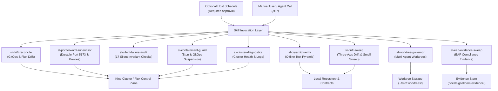

# Scheduled-Run Skills for Signal Loom

This document defines the scheduled-run skills for the Signal Loom
platform (`#partner-signal-loom`). These skills extract recurring operational
routines from historical development and debugging sessions. Run them on demand.
The listed cadences are reference policy. These audit commands do not arm schedules.

## Architecture

The skills follow the Matt Pocock skill design principles. They use leading words,
strict information hierarchy, progressive disclosure, and verified completion criteria.



## Skill Catalog

The table lists the operational skills and their reference cadences.

| Skill Name | Cadence | Trigger Phrase | Primary Invariants Checked |
|---|---|---|---|
| `sl-drift-reconcile` | `*/30 * * * *` | `/sl-drift-reconcile` | Flux Kustomization state, patch index drift, unresolved `${VAR}` tokens |
| `sl-portforward-supervisor` | `*/15 * * * *` | `/sl-portforward-supervisor` | Port 5173 binding, Dex redirect URI reachability, in-pod proxy responses |
| `sl-silent-failure-audit` | `0 */4 * * *` | `/sl-silent-failure-audit` | CRI layer verification (`crictl`), audit SQL AST match, route collisions |
| `sl-containment-guard` | `*/15 * * * *` | `/sl-containment-guard` | GitOps suspension annotation, H1 forensic probe suppression, DAG sync |
| `sl-pyramid-verify` | `0 3 * * *` | `/sl-pyramid-verify` | Documentation linting, Vitest suites, Go controller tests, schema sync |
| `sl-worktree-governor` | `0 */6 * * *` | `/sl-worktree-governor` | Dirty worktrees preservation, branch divergence, Kanban controller leases |
| `sl-eap-evidence-sweep` | `0 6 * * *` | `/sl-eap-evidence-sweep` | Cosign signatures, SLSA provenance, SPDX SBOMs, audit row continuity |
| `sl-drift-sweep` | `0 4 * * *` | `/sl-drift-sweep` | Standards, Spec, and approval-gated architecture analysis |
| `sl-architecture-audit` | On demand | `/sl-architecture-audit` | Documentation contracts, registered tests, static Flux workload reachability |
| `sl-security-audit` | On demand | `/sl-security-audit` | Offline scanners, trusted bundle signatures, evidence freshness, unmet runtime controls |
| `sl-cluster-diagnostics` | `*/15 * * * *` | `/sl-cluster-diagnostics` | Kubernetes pod lifecycle, warning events, multi-pod logs (stern / kubectl), failure signatures |

## Skill Details

### 1. `sl-drift-reconcile`

Reconciles in-cluster Flux state against committed git artifacts.
It audits array index drift in `d2-osramp-fleet/tenants/local/kustomization.yaml`.
It detects unexpanded `${VAR}` tokens in applied manifests.

Executable tool:
```bash
bash .agents/skills/sl-drift-reconcile/Tools/drift-audit.sh
```

### 2. `sl-portforward-supervisor`

Supervises the systemd user service `signalloom-portforward.service`.
It recovers dropped SPDY connections after pod rollouts.
It executes in-pod diagnostics across `/fleet-api/v1/fleet/topology` and `/api/v1/health`.

Executable tool:
```bash
bash .agents/skills/sl-portforward-supervisor/Tools/portforward-check.sh
```

### 3. `sl-silent-failure-audit`

Audits the 17 silent failure patterns cataloged from platform debugging.
It queries `crictl images` to confirm image layers exist in the container runtime.
It checks that all `_audit_log` call sites in `api_compat.py` match database constraints.
It verifies that no nginx proxy prefix shadows React Router paths in `App.tsx`.

Executable tool:
```bash
bash .agents/skills/sl-silent-failure-audit/Tools/audit-invariants.sh
```

### 4. `sl-containment-guard`

Enforces containment integrity on stunned agent workloads.
It verifies that each stunned deployment has `kustomize.toolkit.fluxcd.io/reconcile: disabled`.
Without this annotation, Flux reconciles the workload and destroys containment.
It confirms that Fleet Manager in-memory DAG state matches live topology endpoints.

Executable tool:
```bash
bash .agents/skills/sl-containment-guard/Tools/check-containment.sh
```

### 5. `sl-pyramid-verify`

Runs the entire offline test battery without requiring a running cluster.
It checks documentation style through `make docs-lint`.
It runs 160+ Vitest specs and Python contract tests through `make test-all-offline`.
It asserts zero drift between database migrations and `discovery-portal-bootstrap.sql`.

Executable tool:
```bash
bash .agents/skills/sl-pyramid-verify/Tools/pyramid-runner.sh
```

### 6. `sl-worktree-governor`

Audits active git worktrees across `~/src/.worktrees/` and `~/.cline/worktrees/`.
It identifies uncommitted files and unpushed commits before any cleanup.
It runs `scripts/kanban-check.sh doctor --repo .` to clear stale controller leases.

Executable tool:
```bash
bash .agents/skills/sl-worktree-governor/Tools/worktree-audit.sh
```

### 7. `sl-eap-evidence-sweep`

Audits cryptographic and supply chain evidence for EAP customer pilots.
It verifies SHA256 image digests, SPDX 2.3 SBOMs, and SLSA provenance files.
It verifies that the PostgreSQL `audit_events` table maintains active row insertion.

Executable tool:
```bash
bash .agents/skills/sl-eap-evidence-sweep/Tools/evidence-sweep.sh
```

### 8. `sl-drift-sweep`

Audits repository history across the Standards and Spec review axes.
It detects duplicated HTTP lifecycle boilerplate, file churn hotspots, and micro-proposal sprawl.
It pauses after the Cleanup Job Manifest unless Andrew approves `--auto`.
When approved or in `--auto` mode, it dispatches isolated worktree subagents with mutation proofs.

Executable tool:
```bash
bash .agents/skills/sl-drift-sweep/Tools/drift-sweep.sh
```

### 9. `sl-cluster-diagnostics`

Diagnoses Kubernetes cluster health, container lifecycle issues, and log errors across namespaces.
It uses `stern` for fast multi-pod log aggregation with regex noise exclusions, or falls back transparently to native `kubectl logs` bounded concurrency.
It maps observed error logs and warning events to automated remediations (e.g. ACME challenge finalizer deadlocks, OIDC redirect loops, unseeded Vault secrets, and eBPF correlator holds).

Executable tool:
```bash
bash .agents/skills/sl-cluster-diagnostics/Tools/cluster-diagnostics.sh
```

## Bounded audit execution

The [runner](../../scripts/test-scheduled-skills-parallel.sh) uses GNU Parallel for bounded collector processes.
It requires GNU Parallel, Python, GNU timeout, and Linux network namespaces.
It does not install missing tools.

The default collectors are architecture and security. Each emits a fixed JSON control report.
The runner checks required controls before it forms the machine verdict.
Missing tools and timeouts are `BLOCKED`. Unknown coverage is `UNVERIFIED`, even when a process exits zero.

The runner sends only sanitised control fields to the GPT-6.1 Sol audit reviewer.
The reviewer has no tool permissions. Its advice cannot change the machine verdict.
Raw scanner logs stay private. Failure summaries do not print credentials or raw logs.

```bash
make test-scheduled-skills-parallel
make architecture-audit
make security-audit
```

For continuous integration, explicitly omit model interpretation:

```bash
make test-scheduled-skills-parallel AUDIT_ARGS='--no-agent --jobs 2 --timeout 120'
make test-scheduled-skills-contracts
```

The runner accepts repeated `--skill` arguments. It resolves only registered repository collectors.
The `--all` option includes legacy control entries but does not grant live or mutating permissions.
Those entries remain blocked until a safe adapter exists.

Every run uses a private evidence directory. The terminal prints its path.
The directory contains the machine report and separate agent advice.
New reviewer profiles require a fresh OpenCode process. The runner starts one for each review.

## Audit remits and permission tiers

The [architecture skill](../../.agents/skills/sl-architecture-audit/SKILL.md) checks conformance and traceability.
It leaves deepening and remediation to the drift sweep. Diagram labels do not prove topology edges.

The [security skill](../../.agents/skills/sl-security-audit/SKILL.md) separates scanner findings, signature validity, and freshness.
An embedded public key cannot establish trusted signer identity. Historical evidence cannot certify current live enforcement.

Offline collectors have no network access. Live observations need a separate approved adapter.
Mutating tests need explicit approval in a disposable environment. Audit runs never expand scanner baselines or sign artifacts.

## Scheduling policy

The inactive Kanban scheduler configuration was removed. No repository schedule is armed by this runner.
Host scheduling requires separate approval after manual audit results and fixture contracts pass.
