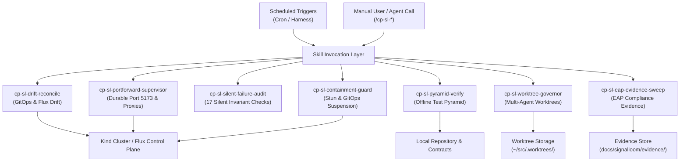

# Scheduled-Run Skills for Signal Loom

This document defines the scheduled-run skills for the Signal Loom
platform (`#partner-signal-loom`). These skills extract recurring operational
routines from historical development and debugging sessions. They run on
deterministic schedules or on demand.

## Architecture

The skills follow the Matt Pocock skill design principles. They use leading words,
strict information hierarchy, progressive disclosure, and verified completion criteria.



## Skill Catalog

The table lists the seven scheduled-run skills.

| Skill Name | Cadence | Trigger Phrase | Primary Invariants Checked |
|---|---|---|---|
| `cp-sl-drift-reconcile` | `*/30 * * * *` | `/cp-sl-drift-reconcile` | Flux Kustomization state, patch index drift, unresolved `${VAR}` tokens |
| `cp-sl-portforward-supervisor` | `*/15 * * * *` | `/cp-sl-portforward-supervisor` | Port 5173 binding, Dex redirect URI reachability, in-pod proxy responses |
| `cp-sl-silent-failure-audit` | `0 */4 * * *` | `/cp-sl-silent-failure-audit` | CRI layer verification (`crictl`), audit SQL AST match, route collisions |
| `cp-sl-containment-guard` | `*/15 * * * *` | `/cp-sl-containment-guard` | GitOps suspension annotation, H1 forensic probe suppression, DAG sync |
| `cp-sl-pyramid-verify` | `0 3 * * *` | `/cp-sl-pyramid-verify` | Documentation linting, Vitest suites, Go controller tests, schema sync |
| `cp-sl-worktree-governor` | `0 */6 * * *` | `/cp-sl-worktree-governor` | Dirty worktrees preservation, branch divergence, Kanban controller leases |
| `cp-sl-eap-evidence-sweep` | `0 6 * * *` | `/cp-sl-eap-evidence-sweep` | Cosign signatures, SLSA provenance, SPDX SBOMs, audit row continuity |

## Skill Details

### 1. `cp-sl-drift-reconcile`

Reconciles in-cluster Flux state against committed git artifacts.
It audits array index drift in `d2-osramp-fleet/tenants/local/kustomization.yaml`.
It detects unexpanded `${VAR}` tokens in applied manifests.

Executable tool:
```bash
bash ~/.andy_sync/confExt/skills/cp-sl-drift-reconcile/Tools/drift-audit.sh
```

### 2. `cp-sl-portforward-supervisor`

Supervises the systemd user service `signalloom-portforward.service`.
It recovers dropped SPDY connections after pod rollouts.
It executes in-pod diagnostics across `/fleet-api/v1/fleet/topology` and `/api/v1/health`.

Executable tool:
```bash
bash ~/.andy_sync/confExt/skills/cp-sl-portforward-supervisor/Tools/portforward-check.sh
```

### 3. `cp-sl-silent-failure-audit`

Audits the 17 silent failure patterns cataloged from platform debugging.
It queries `crictl images` to confirm image layers exist in the container runtime.
It checks that all `_audit_log` call sites in `api_compat.py` match database constraints.
It verifies that no nginx proxy prefix shadows React Router paths in `App.tsx`.

Executable tool:
```bash
bash ~/.andy_sync/confExt/skills/cp-sl-silent-failure-audit/Tools/audit-invariants.sh
```

### 4. `cp-sl-containment-guard`

Enforces containment integrity on stunned agent workloads.
It verifies that each stunned deployment has `kustomize.toolkit.fluxcd.io/reconcile: disabled`.
Without this annotation, Flux reconciles the workload and destroys containment.
It confirms that Fleet Manager in-memory DAG state matches live topology endpoints.

Executable tool:
```bash
bash ~/.andy_sync/confExt/skills/cp-sl-containment-guard/Tools/check-containment.sh
```

### 5. `cp-sl-pyramid-verify`

Runs the entire offline test battery without requiring a running cluster.
It checks documentation style through `make docs-lint`.
It runs 160+ Vitest specs and Python contract tests through `make test-all-offline`.
It asserts zero drift between database migrations and `discovery-portal-bootstrap.sql`.

Executable tool:
```bash
bash ~/.andy_sync/confExt/skills/cp-sl-pyramid-verify/Tools/pyramid-runner.sh
```

### 6. `cp-sl-worktree-governor`

Audits active git worktrees across `~/src/.worktrees/` and `~/.cline/worktrees/`.
It identifies uncommitted files and unpushed commits before any cleanup.
It runs `scripts/kanban-check.sh doctor --repo .` to clear stale controller leases.

Executable tool:
```bash
bash ~/.andy_sync/confExt/skills/cp-sl-worktree-governor/Tools/worktree-audit.sh
```

### 7. `cp-sl-eap-evidence-sweep`

Audits cryptographic and supply chain evidence for EAP customer pilots.
It verifies SHA256 image digests, SPDX 2.3 SBOMs, and SLSA provenance files.
It verifies that the PostgreSQL `audit_events` table maintains active row insertion.

Executable tool:
```bash
bash ~/.andy_sync/confExt/skills/cp-sl-eap-evidence-sweep/Tools/evidence-sweep.sh
```

## Scheduler Configuration

The schedules are registered in `.claude/scheduled_tasks.json`.
Each entry contains the cron expression, prompt contract, and target skill identifier.
