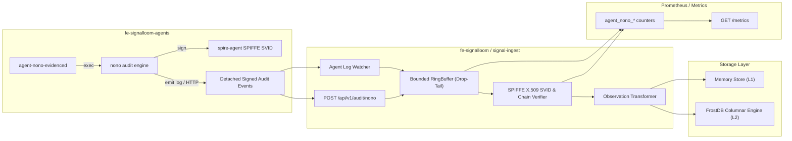

# SFAS-P1-2 Telemetry Pipeline Evidence: Detached SPIFFE SVID Verification & Observation Flow

**Card**: `SFAS-P1-2` (`b4dd5`)  
**Scope**: Ingest Pipeline Architecture, Verification Mechanics, and Store Interoperability  

---

## 1. Pipeline Architecture

---

## 2. Ingestion & Transformation Validation

Every `NonoAuditEvent` is transformed into an attested `model.Observation` containing:
- `Layer`: `LayerHostAudit` (`L4`)
- `Fidelity`: `FidelityAttested` (if cryptographic signature & SPIFFE X.509 SVID match) or `FidelitySuggestive` / `FidelityDegraded` (if unverified or tampered).
- `Source`: `agent-nono-audit`
- `ActorHint`: Resolved from agent name (`agent-nono-evidenced`) or SPIFFE Subject.
- `Labels`:
  - `spiffe_id`: `spiffe://signalloom.demo/ns/fe-signalloom-agents/sa/agent-nono-evidenced`
  - `verification_status`: `VERIFIED`, `TAMPERED`, `UNVERIFIED`, or `ERROR`
  - `hash_chain_digest`: SHA-256 rolling digest
  - `signature_gitoid`: Deterministic GitOID of signature payload
  - `landlock_status`: Landlock ABI level and restriction state
  - `session_id`: Unique audit session identifier

---

## 3. Falsification Verification

Falsification suites in `collectors/falsification_test.go` and `collectors/agentnono/verifier_test.go` verify:
1. **Payload Mismatch**: Modifying 1 byte of event payload immediately fails detached ECDSA/Ed25519 signature checks.
2. **Digest Chain Breakage**: Tampering with `prev_digest` or sequence counters produces `TAMPERED` status and increments `agent_nono_tampered_signals_total`.
3. **Untrusted Root CA**: SVID certificates signed by an unknown CA outside the SPIRE trust anchor are rejected with error.
4. **Saturation Resilience**: Bounded ring buffer drops excess events cleanly under 100x burst load without deadlocking or leaking memory.
