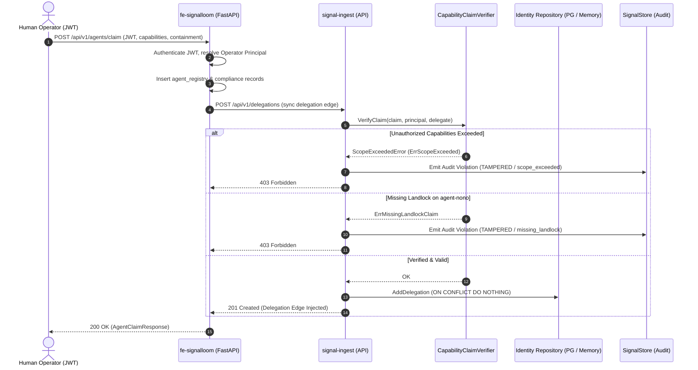

# SFAS-P1-3 Specification: Authenticated Human Onboarding Claims & Delegation Graph Injection

**Card**: `SFAS-P1-3` (`56aea`)  
**Component**: `d2-signalloom/apps/signal-ingest/identity/` and `d2-signalloom/apps/fe-signalloom/src/`  
**Status**: `VERIFIED_PASS`  

---

## 1. Overview & Architecture

`SFAS-P1-3` bridges Signal Loom operator onboarding claim mutations into the **Signal Fusion Actor-Resolution Spine (SFAS)**. When a human operator claims or onboards an autonomous agent workload, an authenticated `acts-on-behalf-of` delegation edge is automatically verified and injected into PostgreSQL and the in-memory Actor-Resolution Engine.



---

## 2. Capability Claim Verification Algebra

The `CapabilityClaimVerifier` enforces strict mathematical subset validation across delegation hops:

1. **Capability Scope Verification**:
   Let $C_{req}$ be the set of requested capabilities on the delegation claim, and $C_{auth}$ be the authorized capability set of the parent principal:
   $$C_{req} \subseteq C_{auth}$$
   If $\exists c \in C_{req} \text{ s.t. } c \notin C_{auth}$, the verifier returns `ScopeExceededError` with reason `ErrScopeExceeded`.

2. **Containment Policy Attestation**:
   For workloads identified with Landlock containment profiles (e.g., `agent-nono-evidenced`), the claim MUST provide explicit attestation of containment:
   $$\text{"containment:landlock"} \in \text{Claim.ContainmentClaims}$$
   Omission triggers `ErrMissingLandlockClaim` and rejects delegation ingestion.

3. **Signature Integrity**:
   If a cryptographic detached signature is attached to the claim, it is verified against the principal's public credentials. Any signature mismatch triggers `ErrForgedClaim`.

4. **Audit Violation Logging**:
   Whenever a claim fails verification, an immutable observation is written to `store.SignalStore` recording:
   - `VerificationStatus: "TAMPERED"`
   - `SignalType: "claim_verification_failure"`
   - Detailed violation metadata including failed capability scopes and actor IDs.

---

## 3. PostgreSQL Migration & Idempotent Seeding

Migration `003_idempotent_seeding.sql` adds composite unique indexes to guarantee safe, repeated replay of seed graphs:

```sql
CREATE UNIQUE INDEX IF NOT EXISTS idx_aliases_idempotent_seed
ON identity_actor_aliases (actor_id, namespace, alias_name)
WHERE deleted_at IS NULL;

CREATE UNIQUE INDEX IF NOT EXISTS idx_delegations_idempotent_seed
ON identity_delegations (principal_actor_id, delegate_actor_id, authz_ref)
WHERE deleted_at IS NULL;
```

### Delegation Clamping
When an operator releases or revokes an agent claim (`DELETE /api/v1/agents/claim/{claim_id}`), `ClampDelegation(ctx, identifier, clampTime)` clamps the `valid_until` timestamp:
```sql
UPDATE identity_delegations
SET valid_until = $2, updated_at = NOW()
WHERE id = $1 AND valid_until > $2 AND deleted_at IS NULL;
```
This terminates traversal paths through the engine without destructive row deletion, preserving audit lineage.

---

## 4. API Endpoints

### 4.1 `POST /api/v1/delegations`
- **Payload**:
  ```json
  {
    "principal_actor_id": "operator:alice@signalloom.test",
    "delegate_actor_id": "agent-worker-01",
    "authz_ref": "claim-8fbc923a1024",
    "capabilities": ["agent:operate"],
    "containment_claims": ["containment:landlock"]
  }
  ```
- **Responses**:
  - `201 Created`: Edge validated and stored.
  - `400 Bad Request`: Missing mandatory fields or malformed payload.
  - `403 Forbidden`: Capability escalation (`ScopeExceededError`) or missing Landlock claim.

### 4.2 `POST /api/v1/delegations/clamp`
- **Payload**:
  ```json
  {
    "delegate_actor_id": "agent-worker-01",
    "authz_ref": "claim-8fbc923a1024"
  }
  ```
- **Responses**:
  - `200 OK`: Delegation edge successfully clamped to current timestamp.
