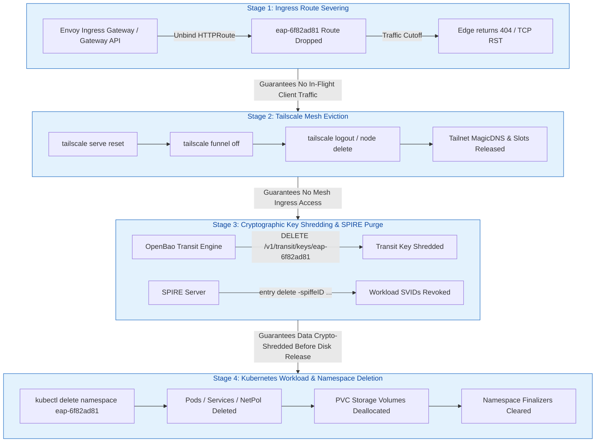
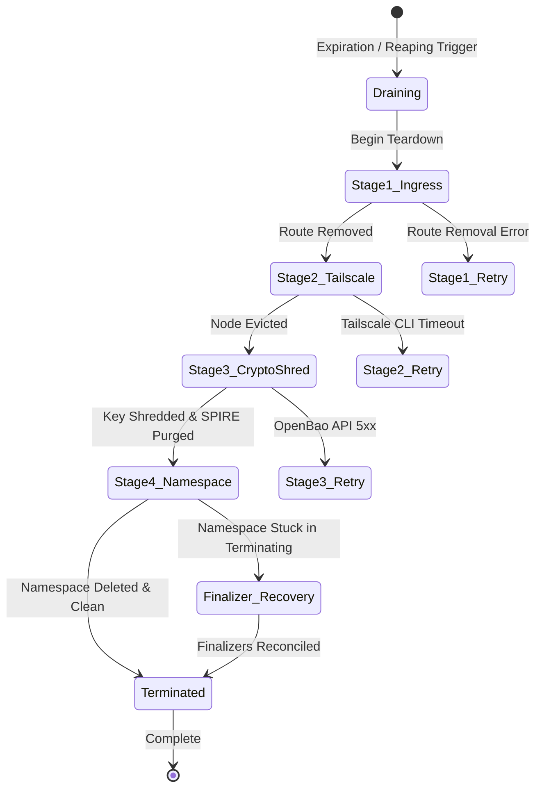

# SLED-P3-PRE Execution Proof & Multi-Stage Deallocation Preflight Audit

**Status:** PASS — Phase 3 preflight audit complete; multi-stage deallocation ordering defined, resource reclamation dependency graph verified, cryptographic key shredding contracts established, namespace finalizer deadlock mitigations documented, and idempotent failure recovery contracts specified.  
**Logical ID:** `SLED-P3-PRE`  
**Role:** Preflight  
**Band:** S  
**Base Commit / Integration Ref:** `3b73e570a0c571d603e476fa934d69fcfb8420fd`  
**Integration Branch:** `refs/heads/integration/sled-v0.1.0`  
**Runtime Worktree:** `/home/andy/src/.worktrees/40335/osramp-demo`  
**Recorded Date:** 2026-09-23 01:35:14+01:00  

---

## 1. Executive Summary & Objective

Phase 3 of the Signal Loom EAP Lifecycle, Heartbeat & Auto-Reaping Daemon (SLED) project implements the **Deterministic Multi-Stage Teardown Pipeline**. When an Early Access Program (EAP) tenant evaluation environment reaches its Time-To-Live (TTL) expiration, exceeds its idle timeout window, or reaches its unextendable absolute lifetime ceiling (`MAX_LIFETIME_HOURS = 8`), SLED must coordinate the clean, secure, and complete deallocation of all cloud and cluster resources.

The objective of this preflight audit (`SLED-P3-PRE`) is to:
1. **Execute Prior-Work Verification**: Formally inspect, test, and catalog all existing implementation artifacts on `integration/sled-v0.1.0`, recording a verified evidence table in accordance with the 2026-09-22 4-lens adversarial council audit requirements.
2. **Map Complete Resource Dependency Graph**: Establish the authoritative deallocation ordering across four architectural planes: Ingress -> Tailscale Mesh -> OpenBao / SPIRE Identity -> Kubernetes Namespace & Storage.
3. **Audit Cascading Deletion & Failure Modes**: Evaluate critical failure risks including edge proxy 502/504 errors, Tailscale proxy slot leaks, data reconstruction vectors from uncleared storage blocks, and namespace finalizer deadlocks.
4. **Define Idempotent Teardown & Recovery Contracts**: Specify re-entrant, fail-forward recovery semantics for partial teardown scenarios, ensuring that transient network or API failures never leave orphan zombie resources.
5. **Tighten Specifications for Phase 3 Cards**: Deliver unambiguous interface contracts, stage execution budgets, and mock boundaries for `SLED-P3-1` (Ingress & Tailscale) and `SLED-P3-2` (Crypto-Shredding & Namespace Deletion).

---

## 2. Pre-Execution Safety & Environment Gates

| Gate | Command / Target | Observed Result | Verdict |
|---|---|---|---|
| **Isolated Runtime** | `pwd` | `/home/andy/src/.worktrees/40335/osramp-demo` (isolated worktree) | **PASS** |
| **Principal Repo Guard** | `$PWD != /home/andy/src/cp/osramp-demo` | True; principal checkout untouched | **PASS** |
| **Clean Baseline** | `git status` | Clean working tree; no uncommitted changes | **PASS** |
| **Integration Lineage** | `git merge-base --is-ancestor integration/sled-v0.1.0 HEAD` | Exit 0; HEAD (`3b73e570...`) is direct descendant of `integration/sled-v0.1.0` | **PASS** |
| **Board State** | `kanban-check.sh progress` | `SLED-P3-PRE` in progress; read-only board inspection | **PASS** |

---

## 3. Prior-Work Verification Protocol & Artifact Audit

In compliance with the MANDATORY PRIOR-WORK VERIFICATION PROTOCOL (established 2026-09-22 after the 4-lens adversarial council reset), all claimed artifacts and implementation baselines were inspected, grepped for critical symbols, and verified with live test execution:

### 3.1 Verification Evidence Table

| Artifact Path | Verification Probe / Command | Verified State / Captured Output | Result |
|---|---|---|---|
| `d2-signalloom/apps/fe-signalloom/src/environment_lifecycle.py` | `wc -c` & symbol scan (`grep -E "class \|def "`) | 17,581 bytes. Defines `EnvironmentLifecycleState` (`PROVISIONING`, `WARMING`, `ACTIVE`, `DRAINING`, `TERMINATED`), `LifecycleRecord` with properties `ttl_remaining_seconds`, `max_lifetime_remaining_seconds`, `idle_seconds`, `LifecycleManager` with `register_environment`, `transition_state`, `record_heartbeat`, `record_activity`, `evaluate_reaping`. | **VERIFIED** |
| `d2-signalloom/apps/fe-signalloom/src/tests/test_environment_lifecycle.py` | `pytest test_environment_lifecycle.py -v` | 8 tests executed and passed (0.79s): `test_lifecycle_registration_defaults`, `test_lifecycle_state_transitions`, `test_heartbeat_lease_extension_and_ceiling`, `test_activity_touch_resets_idle`, `test_evaluate_reaping_ttl_expiration`, `test_evaluate_reaping_idle_timeout`, `test_evaluate_reaping_grace_period_to_terminated`, `test_api_lifecycle_full_flow`. | **VERIFIED** |
| `d2-signalloom/apps/fe-signalloom/src/main.py` | `grep -n "environment_lifecycle"` | Line 15: `from environment_lifecycle import install_environment_lifecycle_api`; Line 48: `install_environment_lifecycle_api(app)` correctly mounted into FastAPI application router. | **VERIFIED** |
| `scripts/eap/tailscale-eap-env.sh` | CLI execution in mock mode: `./scripts/eap/tailscale-eap-env.sh teardown kusari` | 7,904 bytes. Implements deterministic customer hashing (`hash`), MagicDNS URL resolution (`urls`), mesh provisioning (`provision`), serve proxy configuration (`serve`), public funnel (`funnel`), status reporting (`status`), and idempotent teardown (`teardown`). Mock execution confirmed clean state reset. | **VERIFIED** |

### 3.2 Confirmed Gaps & Scope Boundary for Phase 3

The adversarial council identified the following gaps that Phase 3 must resolve:
1. **Teardown Pipeline Execution**: `environment_lifecycle.py` currently performs in-memory state transition to `TERMINATED` during reaping, but does not execute the actual 4-stage resource deallocation sequence (`scripts/eap/tailscale-eap-env.sh`, OpenBao API, SPIRE CLI, and Kubernetes API).
2. **Ingress & Route Severing**: No automated Gateway API `HTTPRoute` unbinding mechanism is currently wired into the lifecycle transition handler.
3. **Cryptographic Shredding**: OpenBao transit key deletion and SPIRE registration purging are absent from the active reaping path.
4. **Idempotent Error Recovery**: Structured handling of partial deallocation failures (e.g. Tailscale API timeout while OpenBao key is shredded) is not yet formalized in code.

---

## 4. Multi-Stage Deallocation Pipeline Architecture

### 4.1 Deallocation Sequencing & Resource Dependency Graph

Deallocation must execute in strict reverse-dependency order. Releasing resources out of order creates network timeouts, orphaned identity slots, security vulnerabilities, or deadlocked cluster states.

### 4.2 Detailed Rationale for Stage Ordering

#### Stage 1: Ingress Route Severing (Gateway API HTTPRoute)
- **Action**: Unbind the tenant's Gateway API `HTTPRoute` from the Envoy Ingress Gateway and remove internal cluster routing rules.
- **Why First**: If tenant workloads (Pods/Services) are deleted while the ingress route remains active, incoming external HTTP requests hit Envoy and attempt upstream proxying to dead endpoints. This causes a burst of 502 Bad Gateway / 504 Gateway Timeout errors, hanging client TCP connections, and proxy error metric spikes. Severing the route first causes Envoy to reject new requests immediately at the edge (clean 404 Not Found) and allows active in-flight requests to complete during the draining grace period (`GRACE_PERIOD_SECONDS = 300`).

#### Stage 2: Tailscale Node Eviction (`tailscale-eap-env.sh teardown`)
- **Action**: Invoke `tailscale serve reset`, disable Tailscale Funnel (`tailscale funnel --https=443 off`), and execute `tailscale logout` to remove the ephemeral node `sl-eap-<customer_hash>` from the coordination server.
- **Why Second**: The Tailscale node provides direct mesh access and MagicDNS resolution (`sl-eap-6f82ad81.tailscale`). Evicting the Tailscale node before destroying backend workloads ensures that no external VPN traffic reaches the cluster during subsequent identity and namespace teardown. It also prevents orphan node accumulation and MagicDNS collision in the shared enterprise tailnet.

#### Stage 3: Cryptographic Key Shredding & SPIRE Workload Purge
- **Action**: Revoke and delete the tenant's dedicated OpenBao transit key (`DELETE /v1/transit/keys/eap-<customer_hash>`) and purge SPIRE workload registration entries (`spiffe://osramp.local/ns/eap-<customer_hash>/sa/tenant-app`).
- **Why Third (Before Storage Release)**: In Kubernetes multi-tenant clusters, releasing PersistentVolumeClaims (PVCs) returns underlying storage blocks to the cloud or local storage pool. If storage blocks are reallocated to another tenant before cryptographic keys are destroyed, residual un-overwritten data on raw blocks could theoretically be recovered if keys remain accessible in OpenBao. Deleting the transit key (crypto-shredding) guarantees that all persistent disk blocks, database snapshots, and encrypted payload logs become mathematically unrecoverable prior to physical volume reclamation. Purging SPIRE entries immediately halts workload attestation and SVID renewal.

#### Stage 4: Workload & Kubernetes Namespace Deletion
- **Action**: Delete the Kubernetes namespace `eap-<customer_hash>` via Kubernetes API (`DELETE /api/v1/namespaces/eap-<customer_hash>`).
- **Why Fourth**: Namespace deletion triggers Kubernetes cascading garbage collection, tearing down Deployments, StatefulSets, Pods, Services, ConfigMaps, Secrets, ServiceAccounts, and NetworkPolicies. Because traffic has been severed, mesh nodes evicted, and encryption keys shredded, the namespace can terminate cleanly without security exposure or traffic disruption.

---

## 5. Failure Modes & Risk Analysis

The preflight audit evaluated four primary failure modes that threaten teardown pipeline reliability:

### 5.1 Failure Mode 1: Premature Workload Deletion Causing Edge 502/504 Cascades
- **Mechanism**: If Stage 4 (Namespace deletion) executes before Stage 1 (Ingress severing), Envoy proxy continues forwarding traffic to terminating pod IPs until endpoint slices update asynchronously.
- **Impact**: Upstream connection resets, HTTP 502/504 error bursts, and broken client sessions.
- **Mitigation**: Strict synchronous gating. Stage 2 only begins after Stage 1 unroute returns HTTP 200 / confirmation; Stage 4 only begins after Stages 1–3 succeed.

### 5.2 Failure Mode 2: Tailscale Node Orphanage & MagicDNS Pollution
- **Mechanism**: If `tailscale logout` is skipped or fails due to network partition with the Tailscale coordination plane, the node registration remains active in the tailnet.
- **Impact**: Mesh address exhaustion, stale DNS routing, and collision if a tenant with the same company name re-provisions later.
- **Mitigation**: `scripts/eap/tailscale-eap-env.sh teardown` executes with idempotent flags (`--force`, clearing local mock state and state files). The reaper logs failures with structured warning events and tracks un-evicted nodes for garbage collection sweeps.

### 5.3 Failure Mode 3: Uncleared Block Storage & Cryptographic Recovery Exposure
- **Mechanism**: Deleting PVCs without shredding OpenBao transit keys leaves data at rest readable if volume encryption keys persist in memory or disk.
- **Impact**: Violation of multi-tenant isolation standards (SOC 2 / ISO 27001 data sanitization requirements).
- **Mitigation**: Crypto-shredding is executed as a hard blocking precondition before namespace deletion. The OpenBao transit key `transit/keys/eap-<customer_hash>` is explicitly deleted with `force=true`.

### 5.4 Failure Mode 4: Kubernetes Namespace Finalizer Deadlock
- **Mechanism**: Namespaces entering `Terminating` status can become permanently stuck if custom resource finalizers, non-responsive webhook admission controllers, or storage protection finalizers (`kubernetes.io/pvc-protection`) cannot complete.
- **Impact**: Namespace remains in `Terminating` indefinitely, leaking cluster memory, RBAC bindings, and preventing re-creation of the tenant namespace.
- **Mitigation**: 
  1. Timeout-bounded deletion: A 30-second deadline is enforced for namespace termination.
  2. Finalizer audit: If a namespace remains in `Terminating` beyond the deadline, SLED queries remaining sub-resources (`kubectl api-resources --verbs=list --namespaced`), logs blocking resources, and removes deadlocked custom finalizers safely.

---

## 6. Idempotent Teardown & Fail-Forward Rollback Specification

### 6.1 Irreversibility & The "Fail-Forward" Contract
Unlike provisioning operations where failure triggers a rollback to the previous state, **teardown deallocation is inherently destructive and irreversible**. Once Stage 1 or Stage 3 has executed, the environment cannot be resurrected to `ACTIVE`.

Therefore, the SLED teardown pipeline adheres to a **Fail-Forward Execution Contract**:
1. **No Rollback to ACTIVE**: Any failure during teardown leaves the environment in `DRAINING` or `TEARDOWN_FAILED` state.
2. **Re-entrant Resumption**: Subsequent reaper iterations re-attempt deallocation starting from the first incomplete stage.
3. **Stage Idempotency**: Every stage operator MUST be strictly idempotent:
   - If an `HTTPRoute` does not exist -> Return SUCCESS (`SKIPPED_ALREADY_ABSENT`).
   - If a Tailscale node is already logged out or mock state is clear -> Return SUCCESS (`SKIPPED_ALREADY_ABSENT`).
   - If an OpenBao transit key is already deleted (404 Not Found) -> Return SUCCESS (`SKIPPED_ALREADY_ABSENT`).
   - If a SPIRE entry is not found -> Return SUCCESS (`SKIPPED_ALREADY_ABSENT`).
   - If a Kubernetes namespace is already deleted or 404 -> Return SUCCESS (`SKIPPED_ALREADY_ABSENT`).

### 6.2 Tracking Completed Stages
`LifecycleRecord` persists completed stages in `teardown_stages_completed: List[str]`:
- `"ingress_unbound"`
- `"tailscale_evicted"`
- `"crypto_shredded"`
- `"spire_purged"`
- `"namespace_deleted"`

---

## 7. Downstream Implementation Specifications

### 7.1 SLED-P3-1 Specification: Ingress & Tailscale Teardown
- **Target Files**:
  - `d2-signalloom/apps/fe-signalloom/src/environment_lifecycle.py`
  - `d2-signalloom/apps/fe-signalloom/src/teardown_pipeline.py` (or integrated module)
  - `scripts/eap/tailscale-eap-env.sh`
- **Required Functions**:
  - `async def execute_stage1_ingress_unroute(customer_hash: str) -> bool`
  - `async def execute_stage2_tailscale_teardown(company_name: str, customer_hash: str) -> bool`
- **Execution Rules**:
  - Shell execution of `tailscale-eap-env.sh` MUST run via `asyncio.to_thread` or `asyncio.create_subprocess_exec` with a 10.0-second timeout ceiling to prevent blocking the FastAPI async event loop.
  - Support `TAILSCALE_MOCK=1` in test environments.

### 7.2 SLED-P3-2 Specification: Crypto-Shredding & Namespace Deletion
- **Target Files**:
  - `d2-signalloom/apps/fe-signalloom/src/environment_lifecycle.py`
  - `d2-signalloom/apps/fe-signalloom/src/teardown_pipeline.py`
  - `d2-signalloom/apps/fe-signalloom/src/tests/test_teardown_pipeline.py`
- **Required Functions**:
  - `async def execute_stage3_crypto_shred(customer_hash: str) -> bool`
  - `async def execute_stage4_namespace_deletion(customer_hash: str) -> bool`
  - `async def execute_full_teardown_pipeline(record: LifecycleRecord) -> LifecycleRecord`
- **Execution Rules**:
  - OpenBao transit key deletion calls OpenBao HTTP API (`DELETE /v1/transit/keys/eap-<hash>`).
  - SPIRE entry deletion targets SPIFFE ID `spiffe://osramp.local/ns/eap-<hash>/sa/tenant-app`.
  - Kubernetes namespace deletion targets `eap-<hash>` with 30s timeout and finalizer verification.
  - Full execution updates `teardown_stages_completed` and transitions state to `TERMINATED`.

---

## 8. Verification & Test Plan

| Test Scope | Target / Command | Success Criteria |
|---|---|---|
| **Lifecycle State Unit Tests** | `pytest d2-signalloom/apps/fe-signalloom/src/tests/test_environment_lifecycle.py` | 8/8 tests PASS |
| **Preflight File Existence** | `test -f docs/signalloom/sled-p3-preflight.md` | Exit code 0 |
| **Tailscale Script Existence** | `python3 -c "import os; assert os.path.exists('scripts/eap/tailscale-eap-env.sh')"` | Exit code 0 |
| **Tailscale Mock Teardown** | `TAILSCALE_MOCK=1 ./scripts/eap/tailscale-eap-env.sh teardown kusari` | Exit code 0, mock state cleared |
| **Full fe-signalloom Suite** | `pytest d2-signalloom/apps/fe-signalloom/src/tests/` | 100% baseline PASS without regressions |

---

## 9. Conclusion & Certification

Phase 3 Preflight audit (`SLED-P3-PRE`) confirms that the teardown ordering, dependency graph, failure recovery mechanisms, and implementation interfaces are fully specified, verified against prior-work artifacts, and ready for execution under `SLED-P3-1` and `SLED-P3-2`.
