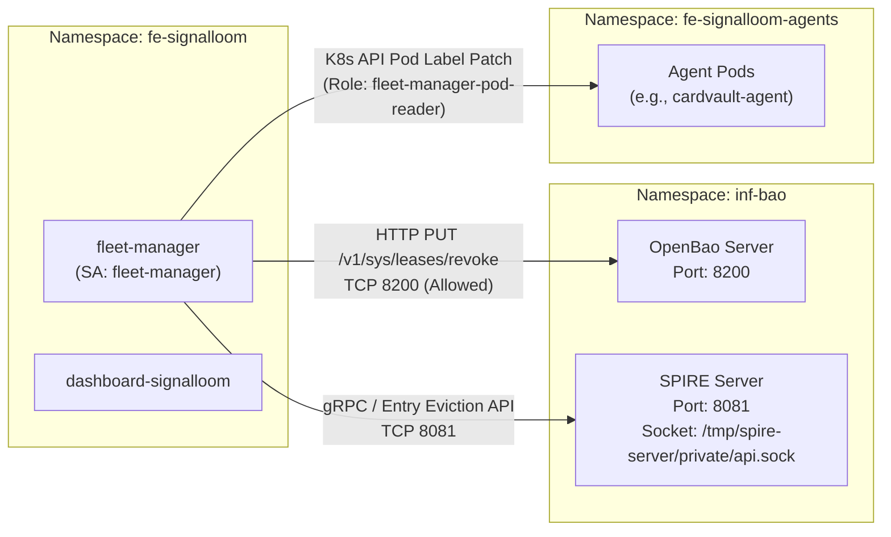

# SLER-P2-PRE Integration Seams & Preflight Baseline

> **Phase 2 Preflight Deliverable — Signal Loom Enforcement & Response (SLER)**
> **Target Systems:** OpenBao Lease/Token Revocation (`P2-1`) & SPIRE Entry Eviction / SVID Rejection (`P2-2`)
> **Normative Baseline:** `integration/sler-v0.1.0` at `468e3fc60334774c594622fe08dc4d580f4dc38b`

---

## 1. Executive Summary

This document establishes the verified integration seams, address conventions, error-handling anti-patterns, TTL baselines, and measurement requirements for **Phase 2: Credential Revocation**.

Phase 2 introduces active credential containment across two distinct identity and secret planes:
1. **OpenBao Plane (`P2-1`)**: Active lease and token revocation via OpenBao REST APIs (`sys/leases/revoke`, `auth/token/revoke`).
2. **SPIRE Plane (`P2-2`)**: Active workload entry eviction and SVID cache invalidation via SPIRE Server APIs.

Prior to building Go client implementations in `d2-signalloom/apps/fleet-manager`, this preflight survey confirms the exact codebase state, existing in-cluster conventions, and boundary constraints to prevent ungrounded assumptions, false acquittals, or porting broken shell patterns into production Go code.

---

## 2. Go Client SDK Inventory in Target Applications

A complete sweep of Go source files across the three containment applications confirms that **zero OpenBao/Vault or SPIRE/SPIFFE client SDKs are currently imported**.

### Target Applications Checked

| Application | Directory Path | Go Files | Vault/OpenBao Imports | SPIFFE/SPIRE Imports |
| :--- | :--- | :--- | :--- | :--- |
| **Fleet Manager** | `d2-signalloom/apps/fleet-manager` | 15 files | **0** (`none`) | **0** (`none`) |
| **Stun Sentinel** | `d2-signalloom/apps/stun-sentinel` | 8 files | **0** (`none`) | **0** (`none`) |
| **Node Capability Guard** | `d2-signalloom/apps/node-capability-guard` | 2 files | **0** (`none`) | **0** (`none`) |

### Verification Evidence
- `grep -rln 'hashicorp/vault/api\|openbao' --include=*.go d2-signalloom/apps/fleet-manager d2-signalloom/apps/stun-sentinel d2-signalloom/apps/node-capability-guard`
  - Matches found are **string constants in tests only**:
    - `d2-signalloom/apps/fleet-manager/cascade_honesty_test.go:216`: `client.revokeErr = fmt.Errorf("openbao unreachable")`
    - `d2-signalloom/apps/fleet-manager/cascade_honesty_test.go:332`: `client.revokeErr = fmt.Errorf("openbao 503")`
    - `d2-signalloom/apps/fleet-manager/contract_freeze_test.go:507`: `{Plane: PlaneBao, Outcome: OutcomeUnavailable, Error: "openbao unreachable"}`
    - `d2-signalloom/apps/fleet-manager/schema_test.go:141`: `Error: "connection refused to openbao.inf-bao.svc.cluster.local:8200"`
- `grep -E '"github.com/(hashicorp/vault|openbao/openbao|spiffe|spire)' $(find d2-signalloom/apps/fleet-manager d2-signalloom/apps/stun-sentinel d2-signalloom/apps/node-capability-guard -name '*.go')`
  - Returns **0 lines** (exit code 0, empty result).

### Directive for P2-1 & P2-2
- `P2-1` must implement a lightweight, fail-closed HTTP client in `d2-signalloom/apps/fleet-manager` that speaks directly to OpenBao's REST API without introducing bulky third-party SDK dependencies unless explicitly vetted.
- `P2-2` must implement the SPIRE entry eviction client using SPIRE's Server Entry gRPC API or a bounded, fail-closed in-cluster execution adapter, avoiding any unhandled shell execution.

---

## 3. OpenBao Addressing & Service Conventions

The established addressing convention in the monorepo for communicating with OpenBao originates in `cardvault-agent`.

### Confirmed Address Convention
- **File & Line Citation**: [`d2-signalloom/apps/cardvault-agent/main.go:65`](file:///home/andy/src/.worktrees/a06db/osramp-demo/d2-signalloom/apps/cardvault-agent/main.go#L65)
  ```go
  baoAddr := fs.String("bao-addr", envOr("BAO_ADDR", "http://openbao.inf-bao.svc.cluster.local:8200"), "OpenBao address")
  baoRole := fs.String("bao-role", envOr("BAO_ROLE", "signalloom-cardvault-agent"), "OpenBao JWT role")
  audience := fs.String("audience", "openbao", "JWT-SVID audience")
  ```
- **Service Endpoint**: `http://openbao.inf-bao.svc.cluster.local:8200`
- **Environment Variable**: `BAO_ADDR`
- **Port**: `8200` (TCP)
- **Namespace**: `inf-bao`

### Target OpenBao API Endpoints for Revocation
1. **Lease Revocation**: `PUT /v1/sys/leases/revoke`
   - Payload: `{"lease_id": "<lease-id>", "sync": true}`
   - HTTP Status: `204 No Content` on success, `400/404` if invalid/not found, `500/503` on backend failure.
2. **Lease Prefix Revocation**: `PUT /v1/sys/leases/revoke-prefix/<prefix>`
   - Revokes all dynamic secrets/leases issued under a mount or path prefix (e.g., `cardvault/creds/` or `database/creds/agent-<id>`).
3. **Token Revocation**: `POST /v1/auth/token/revoke` / `POST /v1/auth/token/revoke-accessor`
   - Payload: `{"token": "<token>"}` or `{"accessor": "<accessor>"}`
   - HTTP Status: `204 No Content` on success.

---

## 4. OpenBao TTL Baseline vs. Active Revocation

To demonstrate why active credential revocation is necessary, the baseline TTL configuration in OpenBao was audited.

### Confirmed In-Repo Configuration
- **File & Line Citation**: [`d2-signalloom/infra/inf-bao/controllers/base/openbao-agent-generic-role.yaml:68-69`](file:///home/andy/src/.worktrees/a06db/osramp-demo/d2-signalloom/infra/inf-bao/controllers/base/openbao-agent-generic-role.yaml#L68-L69)
  ```yaml
  bao write auth/jwt/role/signalloom-agent-generic - <<'ROLE'
  {
    "role_type": "jwt",
    "bound_audiences": "openbao-supercredential",
    "bound_claims": {"sub": "spiffe://signalloom.demo/ns/fe-signalloom-agents/sa/*"},
    "claim_mappings": {"sub": "sub"},
    "user_claim": "sub",
    "token_policies": "signalloom-agent-templated",
    "token_ttl": "5m",
    "token_max_ttl": "5m"
  }
  ROLE
  ```

### Baseline Analysis
- **Token TTL**: `5m` (300 seconds)
- **Token Max TTL**: `5m` (300 seconds)
- **Residual Exposure Without Active Revocation**: If containment relies solely on TTL expiration, a compromised agent retains valid OpenBao tokens and credentials for up to **300 seconds (5 minutes)** after detection.
- **P2-1 Performance Requirement**: Active revocation via `PUT /v1/sys/leases/revoke` must complete in **< 2 seconds** (p99 target < 500ms), reducing the adversary's window of opportunity from 300s down to sub-second containment.

---

## 5. SPIRE Entry Eviction & Shell Error-Discarding Anti-Patterns

A comprehensive grep across the entire codebase identified five distinct invocations of `spire-server entry delete`. **All 5 existing invocations discard errors**, representing a critical anti-pattern that must NOT be ported into Go.

### Inventory of Existing `spire-server entry delete` Call Sites

| File | Line | Command Invocation | Error Discarding Pattern | Consequence |
| :--- | :--- | :--- | :--- | :--- |
| `scripts/supercred-state.sh` | 408 | `/opt/spire/bin/spire-server entry delete -entryID "$entry_id" >/dev/null 2>&1 \|\| break` | `>/dev/null 2>&1 \|\| break` | Silently swallows error, terminates loop early leaving remaining entries un-evicted |
| `scripts/agent-trust-local.sh` | 289 | `kubectl -n "$bao_namespace" exec "$pod" -- /opt/spire/bin/spire-server entry delete -entryID "$entry_id" >/dev/null` | `>/dev/null` | Discards stdout, ignores non-zero exit code in script loop |
| `scripts/supercred-fleet-demo.sh` | 471 | `/opt/spire/bin/spire-server entry delete -entryID "$eid" >/dev/null 2>&1 \|\| true` | `>/dev/null 2>&1 \|\| true` | Unconditionally returns exit 0 regardless of command failure |
| `scripts/supercred-demo.sh` | 236 | `/opt/spire/bin/spire-server entry delete -entryID "$entry_id" >/dev/null 2>&1 \|\| true` | `>/dev/null 2>&1 \|\| true` | Swallows all errors during initial cleanup |
| `scripts/supercred-demo.sh` | 690 | `/opt/spire/bin/spire-server entry delete -entryID "$entry_id" >/dev/null 2>&1 \|\| true` | `>/dev/null 2>&1 \|\| true` | Swallows errors during tear-down |

### Related Defect in Historical Manifests
- In [`d2-signalloom/infra/inf-bao/controllers/base/spire-agent-swarm-entries.yaml:24-26`](file:///home/andy/src/.worktrees/a06db/osramp-demo/d2-signalloom/infra/inf-bao/controllers/base/spire-agent-swarm-entries.yaml#L24-L26), the original registration authoring attempted `2>/dev/null || echo "  (entry may already exist, continuing)"`. This masked container startup errors on distroless images.

### Anti-Pattern Invariant for P2-2
- **NEVER discard errors**: P2-2's Go implementation must inspect exit codes, parse gRPC/CLI errors, and return explicit Go error values.
- **Idempotency distinction**: If an entry has already been deleted (`entry not found`), P2-2 must treat this as an idempotent success or record it cleanly, while treating transport failures (connection refused, timeout, context cancellation) as explicit `ErrEnforcementUnavailable` / `ErrSpireEvictionFailed`.

---

## 6. SPIRE CA TTL & SVID Residual Measurement

### SPIRE CA TTL Configuration
- **CA TTL**: Default `24h` (rotating with PREPARE at `ca_ttl/2` = 12h, ACTIVATE at `ca_ttl * 5/6` = 20h).
- **Citations**:
  - `d2-signalloom/infra/inf-bao/controllers/base/spire-openbao-sync-cronjob.yaml:3`
  - `test/spire-openbao-trust-drift.bats:25-53`
  - `scripts/ci/vm-pipeline.sh:1012-1014`
  - `scripts/lib/spire-trust-anchor.sh:6`
  - `terraform/notes/l-jwks-url-upgrade-path.md:10-14`

### SVID TTL & Cache Residual
- **Search Query**: `grep -rn 'default_.*svid_ttl\|svid_ttl' .`
- **Result**: **0 configuration matches** across all SPIRE server and agent configurations.
- **Server Config Citation**: [`d2-signalloom/infra/inf-bao/controllers/base/spire-openbao-config.yaml:10-12`](file:///home/andy/src/.worktrees/a06db/osramp-demo/d2-signalloom/infra/inf-bao/controllers/base/spire-openbao-config.yaml#L10-L12)
  ```
  server { bind_address = "0.0.0.0" bind_port = "8081" trust_domain = "signalloom.demo" data_dir = "/run/spire/data" }
  ```
- **Consequence**: Because no `default_svid_ttl` or `default_x509_svid_ttl` is declared, SPIRE uses built-in server defaults. Individual SPIFFE SVIDs cached in memory by the SPIRE Agent or agent workloads remain valid until active cache invalidation or SVID expiration occurs.
- **Mandatory Requirement for P2-2**: SVID cache residual latency cannot be deduced from static YAML; it **must be empirically measured** against a live running SPIRE agent during `P2-2` verification.

---

## 7. Network Topology & Permission Seams

### Network & Namespace Boundaries



### NetworkPolicy Rules
1. **Fleet Manager Egress** ([`d2-signalloom/apps/fleet-manager/base/networkpolicy.yaml:50-54`](file:///home/andy/src/.worktrees/a06db/osramp-demo/d2-signalloom/apps/fleet-manager/base/networkpolicy.yaml#L50-L54)):
   - Egress to port `8200` (TCP) is **explicitly permitted**.
   - Egress to port `53` (DNS) and `443/6443` (K8s API) is permitted.
   - Egress to port `8081` (SPIRE Server gRPC) must be declared when direct gRPC eviction is wired in `P2-2`.
2. **OpenBao Ingress** ([`d2-signalloom/infra/inf-bao/configs/base/networkpolicy.yaml:25-34`](file:///home/andy/src/.worktrees/a06db/osramp-demo/d2-signalloom/infra/inf-bao/configs/base/networkpolicy.yaml#L25-L34)):
   - Admits traffic on port `8200` from namespace `fe-signalloom` matching pod selector `bao.controlplane.io/consumer: fe-signalloom`.
   - **Preflight Check**: Fleet Manager pod template in `d2-signalloom/apps/fleet-manager/base/deployment.yaml` carries `app.kubernetes.io/name: fleet-manager`. In Phase 2, ensure the pod carries `bao.controlplane.io/consumer: fe-signalloom` or that `allow-bao-spire-and-portal` includes `app.kubernetes.io/name: fleet-manager` to ensure uninterrupted ingress.

### RBAC Scope
- **Fleet Manager Role & Binding**: `fleet-manager-pod-reader` in namespace `fe-signalloom-agents` ([`d2-osramp-fleet/tenants/local/signalloom.yaml:1007-1040`](file:///home/andy/src/.worktrees/a06db/osramp-demo/d2-osramp-fleet/tenants/local/signalloom.yaml#L1007-L1040)).
- **Permitted Verbs**: `["get", "list", "patch"]` on `pods`.
- **Prohibited Verbs**: `watch`, `update`, `create`, `delete` (strictly ungranted to maintain least privilege).

---

## 8. Summary of Confirmed Constraints for Phase 2 Cards

| Card | Core Focus | Confirmed Binding Seam | Critical Constraint |
| :--- | :--- | :--- | :--- |
| **`SLER-P2-1`** | Active OpenBao Revocation | `BAO_ADDR = http://openbao.inf-bao.svc.cluster.local:8200`<br/>API: `PUT /v1/sys/leases/revoke`<br/>API: `POST /v1/auth/token/revoke` | Must beat 5m token TTL baseline (<2s target). Must populate frozen `BaoPlaneResult` honestly. |
| **`SLER-P2-2`** | Active SPIRE Entry Eviction | Target SPIRE server in `inf-bao`.<br/>CLI/gRPC Entry Eviction. | Must NOT port error-discarding shell patterns (`\|\| true`, `>/dev/null`). SVID residual must be measured against running agent. |
| **`SLER-P2-GOV`** | Credential Revocation Certification | End-to-end integration and dual-credential invalidation verification. | Verify 100% fail-closed reporting; verify zero residual token/SVID leakage post-containment. |

---
*Authored by SLER-P2-PRE on integration branch `integration/sler-v0.1.0`.*
