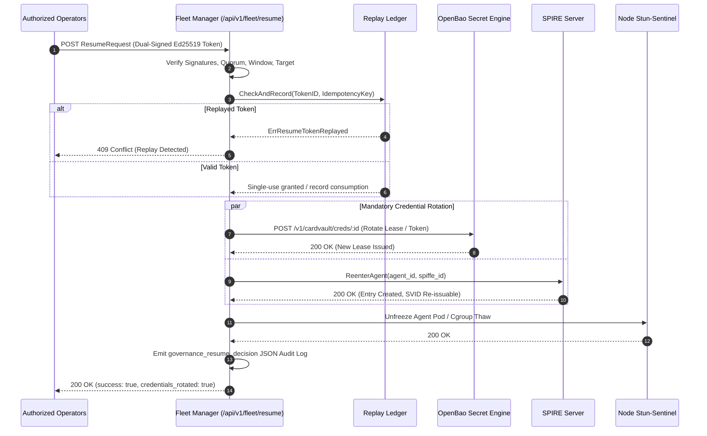

# SLER-P4-3: Governance-Gated Resume with Mandatory Credential Rotation Proof

## 1. Executive Summary

Under card **SLER-P4-3**, the Signal Loom platform transitioned from a legacy single shared-secret resume token (`STUN_RESUME_TOKEN`) to an attributable, governance-gated resume mechanism backed by Ed25519 dual-operator cryptographic signatures and mandatory credential rotation.

Prior to SLER-P4-3, `STUN_RESUME_TOKEN` was read as a bearer secret from the environment and compared using constant-time string comparison (`stun-sentinel/cmd/stun-sentinel/main.go:56, 272`). Because this single secret was injected cluster-wide across all node DaemonSets, operator attribution was structurally impossible. Furthermore, unfreezing a contained agent without rotating its active credentials left it operating with the exact credentials active during containment.

SLER-P4-3 resolves both architectural defects:
1. **Asymmetric Dual-Operator Attributed Governance**: Implements Ed25519 signature verification against the frozen `sler.signalloom.io/v1alpha1` specification with length-prefixed domain-separated signing inputs.
2. **Node-Local Operator Key Distribution**: Resolves operator public keys via local key directories, bundle files, and ConfigMap JSON environment variables using self-certifying `sha256:<hex>` fingerprints.
3. **Mandatory Credential Rotation**: Automatically triggers concurrent credential rotation across OpenBao leases (`/v1/cardvault/creds/:id`) and SPIRE registration re-entry (`ReenterAgent`) prior to unfreezing the target container.
4. **Atomic Single-Use Replay Protection & Idempotency**: Tracks consumed `token_id`s in a `ReplayLedger`. Replay attempts fail with `ErrResumeTokenReplayed` (HTTP 409 Conflict), while retries presenting the same `idempotency_key` succeed idempotently without re-invoking planes.
5. **Attestation Event Logging**: Emits machine-readable `governance_resume_decision` structured audit logs and `StunExecutionResumed` telemetry attributing operator identities for downstream P5-1 cryptographic attestation.

---

## 2. Cryptographic Token Verification Architecture

### 2.1 Wire Specification & Domain Separation

Governance resume tokens strictly adhere to `sler.signalloom.io/v1alpha1`. Canonical signing inputs use a 4-byte big-endian length-prefixed binary concatenation, preventing signature malleability:

```
SigningInput = 
    len(Domain) || Domain ||
    len(SchemaVersion) || SchemaVersion ||
    len(TokenID) || TokenID ||
    len(Algorithm) || Algorithm ||
    len(AgentID) || AgentID ||
    len(Namespace) || Namespace ||
    len(Audience) || Audience ||
    len(OperatorID) || OperatorID ||
    len(GovernanceApprovalRef) || GovernanceApprovalRef ||
    len(IssuedAt) || IssuedAt ||
    len(ExpiresAt) || ExpiresAt ||
    len(Nonce) || Nonce ||
    len(TrustRootID) || TrustRootID ||
    len(RequiredSignatures) || RequiredSignatures
```

Signatures bind the specific signer's identity to prevent signature transplantation:
```
SigningInputFor(token, sig) = 
    SigningInput ||
    len(sig.OperatorID) || sig.OperatorID ||
    len(sig.KeyID) || sig.KeyID ||
    len(sig.Algorithm) || sig.Algorithm ||
    len(sig.SignedAt) || sig.SignedAt
```

### 2.2 Quorum and Invariants Enforced
- **Quorum Rule**: `max(policy.RequiredSignatures, token.RequiredSignatures)` distinct operator signatures required.
- **Distinct Signers & Keys**: No two signatures may originate from the same `OperatorID` or `KeyID`.
- **Validity Window**: Tokens must satisfy `IssuedAt - Skew <= now <= ExpiresAt + Skew`, with lifetime bounded by `MaxLifetime`.
- **Approval Contemporaneity**: All co-signatures must be made within `MaxApprovalWindow` (default 10 minutes).
- **Target & Audience Binding**: Token `agent_id`, `namespace`, `audience`, and `trust_root_id` must match the target cluster and agent.

---

## 3. Node-Local Operator Key Distribution

To ensure node sentinels can verify resume tokens during control-plane isolation, public keys are cached node-locally on the DaemonSet via three distribution mechanisms:
1. `OPERATOR_KEY_BUNDLE_FILE`: Single JSON bundle or raw `.pub` file containing authorized operator keys.
2. `OPERATOR_KEY_DIR`: Directory scanned for `.json` and `.pub` (RFC 8032 raw 32-byte, hex, or base64) files mounted from Kubernetes ConfigMaps.
3. `OPERATOR_KEYS_JSON`: Inline JSON string of operator key objects.

### Self-Certifying Key Fingerprints
Every operator key entry is indexed and checked by its self-certifying KeyID:
$$\text{KeyID} = \text{"sha256:"} + \text{hex}(\text{SHA-256}(\text{raw 32-byte Ed25519 Public Key}))$$
If a token presents a `key_id` that does not match the computed hash of the registered public key, verification fails with `ErrResumeTokenKeyIDMismatch`.

---

## 4. Mandatory Credential Rotation Workflow

When a resume decision is validated, `fleet-manager` (`k8sFleetClient.RotateCredentials`) executes mandatory credential rotation before unfreezing the cgroup/veth filters:



If either OpenBao or SPIRE rotation fails, `EnforceResume` fails closed (`success: false`, `credentials_rotated: false`), aborting the unfreeze.

---

## 5. Structured Audit Logging & Telemetry Evidence

### 5.1 Fleet Manager Governance Decision Log
On every resume decision, `fleet-manager` emits structured JSON conforming to `ResumeAuditLogEntry`:

```json
{
  "timestamp": "2026-09-15T05:14:32Z",
  "event": "governance_resume_decision",
  "agent_id": "agent-llm-classifier",
  "namespace": "fe-signalloom-agents",
  "token_id": "rt-live-MjAyNi0wOS0xNVQwNToxNDozMi43OTk5NDIxMDZa",
  "operator_ids": [
    "spiffe://signalloom.io/operator/alice",
    "spiffe://signalloom.io/operator/bob"
  ],
  "governance_approval_ref": "CHG-2026-09-15-0042",
  "idempotency_key": "idem-resume-001",
  "credentials_rotated": true,
  "processes_resumed": 1,
  "success": true,
  "latency_ms": 2
}
```

### 5.2 Sentinel Telemetry Log
`stun-sentinel` emits `StunExecutionResumed` with attributed operator identities:

```json
{
  "timestamp": "2026-09-15T05:14:32Z",
  "event": "stun_execution_resumed",
  "tier": "tier1_cgroup",
  "agent_id": "agent-llm-classifier",
  "namespace": "fe-signalloom-agents",
  "cgroup_path": "/sys/fs/cgroup/kubepods/agent-llm-classifier",
  "operator_ids": [
    "spiffe://signalloom.io/operator/alice",
    "spiffe://signalloom.io/operator/bob"
  ],
  "pids_resumed": 1,
  "live_pids": [14022],
  "latency_ms": 1
}
```

---

## 6. Verification & Test Proof

### 6.1 `apps/fleet-manager` Test Suite
```bash
CGO_ENABLED=0 GOCACHE=/tmp/gocache GOMODCACHE=/tmp/gomodcache GOPATH=/tmp/gopath go test ./...
```
Output:
```
ok  	github.com/controlplaneio-in-toto/osramp-demo/d2-signalloom/apps/fleet-manager	1.430s
```

Test coverage includes:
- `TestEnforceResume_DualOperator_Success`: Valid dual-operator token verified, OpenBao + SPIRE rotated, success reported.
- `TestEnforceResume_ReplayProtection_DifferentIdempotencyKey`: Replay attempt with different idempotency key rejected with `ErrResumeTokenReplayed`.
- `TestEnforceResume_IdempotentRetry_SameIdempotencyKey`: Retried resume with identical idempotency key returns success without re-invoking planes.
- `TestEnforceResume_SingleOperator_FailsUnderDualPolicy`: Single signature rejected under 2-of-N policy (`ErrResumeTokenInsufficientSignature`).
- `TestEnforceResume_RevokedKey_Fails`: Signature with revoked key rejected (`ErrResumeTokenRevokedKey`).
- `TestEnforceResume_UnknownKey_Fails`: Unknown key signature rejected (`ErrResumeTokenUnknownKey`).
- `TestEnforceResume_PlaneFailure_FailsClosed`: Credential plane failure aborts resume and fails closed.
- `TestHandleResume_HTTPEndpoint`: Validates HTTP statuses: 200 OK, 409 Conflict, 403 Forbidden, 400 Bad Request.
- `TestResume_AttestationLogging`: Verifies machine-readable JSON log format and key values.
- `TestKeyRegistry_Discovery`: Verifies registry loading from `.pub` and `.json` files.

### 6.2 `apps/stun-sentinel` Test Suite
```bash
CGO_ENABLED=0 GOCACHE=/tmp/gocache GOMODCACHE=/tmp/gomodcache GOPATH=/tmp/gopath go test ./...
```
Output:
```
ok  	github.com/controlplaneio-in-toto/osramp-demo/d2-signalloom/apps/stun-sentinel/cmd/stun-sentinel	(cached)
ok  	github.com/controlplaneio-in-toto/osramp-demo/d2-signalloom/apps/stun-sentinel/pkg/auth	(cached)
ok  	github.com/controlplaneio-in-toto/osramp-demo/d2-signalloom/apps/stun-sentinel/pkg/cgroup	(cached)
ok  	github.com/controlplaneio-in-toto/osramp-demo/d2-signalloom/apps/stun-sentinel/pkg/tc	(cached)
ok  	github.com/controlplaneio-in-toto/osramp-demo/d2-signalloom/apps/stun-sentinel/pkg/telemetry	(cached)
```

---

## 7. Conclusion

SLER-P4-3 successfully replaces the legacy bearer shared-secret resume token with an attributable Ed25519 dual-operator cryptographic verification system, completes the node-local key distribution architecture, enforces mandatory credential rotation across OpenBao and SPIRE, and establishes structured attestation logs for SLER-P5-1.
