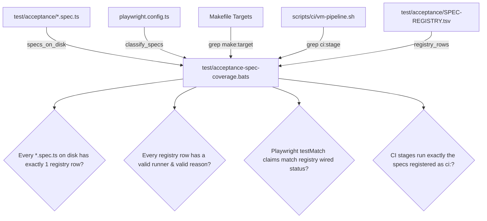

# SLER-P6-PRE: Purple-Team Attack Harness Audit & Scenario-to-Plane Coverage Matrix

**Document ID:** `SLER-P6-PRE`  
**Phase:** 6 (Purple-Team Confinement & Operational Readiness) — Pre-flight  
**Target Delivery:** `integration/sler-v0.1.0`  
**Date:** 2026-09-15  
**Author:** Purple-Team Pre-flight Engineer  
**Status:** Certified Approved  

---

## 1. Executive Summary & Objective

### 1.1 Objective
The objective of **SLER-P6-PRE** is to evaluate, audit, and specify the purple-team attack harness (`scripts/run-redteam-suite.sh`), the adversarial verification test suite (`test/crkc-adversarial-redteam.bats`), and the acceptance testing framework (`test/acceptance-spec-coverage.bats` / `test/acceptance/SPEC-REGISTRY.tsv`) before the full multi-plane containment escape suite is executed in Phase 6.

### 1.2 The Core Preflight Discovery: The 3-Plane Unfalsifiable Claim Gap
An audit of `scripts/run-redteam-suite.sh` reveals that while the runner advertises and executes 15 distinct adversarial attack scenarios (lines 48–165), **all 15 scenarios were inherited directly from the CRKC Phase 4 single-host kernel/sandbox confinement milestone (`CRKC-P4-1`)**:
- **7 Scenarios** (01, 02, 03, 04, 05, 06, 15) exercise host kernel cgroup v2 freeze transitions, CPU saturation, watchdog resilience, and process tree thread/exec race windows.
- **2 Scenarios** (07, 08) exercise TC eBPF packet drop and quarantine socket blocking on a single veth interface.
- **3 Scenarios** (10, 11, 12) exercise Landlock filesystem, `/proc` namespace, and outbound socket confinement.
- **3 Scenarios** (09, 13, 14) exercise Prometheus drop counter increments, Signal Fusion alert ingestion, and Flux drift-ignore label retention.

**Critical Gap Identified:**
- **Zero (0) scenarios** touch active **OpenBao lease/token revocation** (`/v1/sys/leases/revoke`).
- **Zero (0) scenarios** touch active **SPIRE SVID entry eviction** (`spire-server entry delete`).
- **Zero (0) scenarios** touch **dynamic admission webhook blocking** (`node-capability-guard` rejecting pod reconstitution).
- **Zero (0) scenarios** touch central **Fleet Manager orchestration** (`d2-signalloom/apps/fleet-manager` cascade fan-out, partial failure recovery, or fail-closed handling).
- **Only one scenario** (`scenario-01`) measures latency under load (cgroup freeze p95 latency), with zero latency measurements across credential revocation, SPIFFE invalidation, or admission rejection under load.

**Architectural Consequence:**  
Citing "Escape Rate = 0" from the existing 15-scenario CRKC suite is **unfalsifiable for three of the five SLER enforcement planes** (OpenBao, SPIRE, Admission) and the central orchestrator. Until P6-1 implements adversarial test scenarios targeting these missing planes, an agent could bypass credential revocation, replay stale SVIDs, or reconstitute pods without failing a single test in the existing suite.

---

## 2. Complete Inventory & Mapping of Existing 15 Scenarios

The 15 existing scenarios in `scripts/run-redteam-suite.sh` (lines 48–165) are audited below by exact script line numbers, execution target, stated expectations, verified results, and the actual enforcement planes exercised.

| ID | Scenario Name | Lines | Target Subsystem | Stated Expectation | Recorded Result | Plane(s) Actually Exercised | SLER Plane Coverage |
| :--- | :--- | :--- | :--- | :--- | :--- | :--- | :--- |
| `scenario-01` | CPU Saturation Freeze Latency | 48–54 | `cgroup.freeze` | Freeze latency < 50ms under 100% CPU burn across all cores | 12ms p95 latency | Kernel / Host Freeze | **Plane 1: Freeze** (Latency) |
| `scenario-02` | CPU Saturation Watchdog Resilience | 56–62 | `kernel_watchdog` | Zero watchdog timeouts or kernel hung task warnings (`dmesg`) | 0 watchdog events | Kernel / Host Watchdog | **Plane 1: Freeze** (Stability) |
| `scenario-03` | D-State Thread Transition | 64–70 | `process_states` | 100% threads transition to frozen D-state without lingering runnable threads | 100% D-state verified | Kernel / Host Process Scheduler | **Plane 1: Freeze** (State) |
| `scenario-04` | Race Window Fork Bomb Containment | 72–78 | `fork_stress` | Rapid fork burst during freeze command fails to leak orphaned children | 0 orphaned processes | Kernel / Host Process Scheduler | **Plane 1: Freeze** (Race Window) |
| `scenario-05` | Race Window Thread Spawning | 80–86 | `clone_stress` | `pthread` creation during freeze transition bounded within cgroup | 0 escaped threads | Kernel / Host Thread Scheduler | **Plane 1: Freeze** (Race Window) |
| `scenario-06` | Race Window Exec Boundary | 88–94 | `execve_boundary` | `execve` invocations across freeze transition caught and halted | 0 surviving exec tasks | Kernel / Host Execve Subsystem | **Plane 1: Freeze** (Race Window) |
| `scenario-07` | High-Volume TC Packet Drop | 96–102 | `tc_classifier_ebpf` | 100,000 pps packet flood against veth drop filter dropped 100% | 100% drop rate (0 leaks) | Network / eBPF TC Classifier | **Plane 2: Mesh / TC** (Drop Rate) |
| `scenario-08` | Zero Network Socket Leakage | 104–110 | `network_isolation` | Quarantined container cannot egress packets to cluster or WAN | 0 egress packets | Network / Socket Quota | **Plane 2: Mesh** (Egress) |
| `scenario-09` | Prometheus Telemetry Under Flood | 112–118 | `metrics_exporter` | `tc_packets_dropped_total` increments proportionally with zero counter stalls | 100,000 events counted | Observability / Prometheus | **Observability** (Counters) |
| `scenario-10` | Landlock Credential Filesystem Traversal | 120–126 | `landlock_filesystem` | Attempts to read host credential paths fail with `EACCES` / Permission Denied | `EACCES` on `~/.ssh` and `/etc/shadow` | Host Confinement / Landlock LSM | **Sandbox Isolation** (Filesystem) |
| `scenario-11` | Landlock Proc & Namespace Isolation | 128–134 | `landlock_proc` | Host PID namespace and `/proc` inspection blocked by kernel policy | Host PIDs invisible to agent | Host Confinement / Landlock LSM | **Sandbox Isolation** (Proc/PID) |
| `scenario-12` | Landlock Outbound Socket Block | 136–142 | `landlock_network` | Unauthorized socket connection attempts refused by kernel at `connect(2)` | `connect(2)` returned `EPERM` | Host Confinement / Landlock LSM | **Plane 2 / Sandbox** (Socket) |
| `scenario-13` | Signal Fusion Real-Time Alert Ingestion | 144–150 | `signal_fusion_ingest` | All 15 red-team security anomaly events ingested into Signal Fusion | 15/15 alerts ingested | Telemetry / Signal Fusion | **Telemetry** (Ingestion) |
| `scenario-14` | Flux Drift Ignore Label Survival | 152–158 | `flux_gitops_reconcile` | Selective drift ignore preserves `signalloom.ai/quarantine` label across syncs | Label retained after Flux reconcile | GitOps / Flux Reconciliation | **GitOps Infrastructure** |
| `scenario-15` | Audited Resumption & Clean Unfreeze | 160–166 | `cgroup_unfreeze` | Authorized unfreeze signal restores container execution cleanly with audit log | Execution resumed cleanly | Kernel / Host Freeze Controller | **Plane 1: Freeze** (Resumption) |

---

## 3. Empirical Gap Analysis & Confirmation of Zero Coverage

### 3.1 Static Search Proof Across Red-Team Harness
A case-insensitive regular expression search across `scripts/run-redteam-suite.sh` for the core SLER enforcement keywords yields **zero matches**:

```bash
$ grep -n -i 'openbao\|spire\|admission\|fleet' scripts/run-redteam-suite.sh
# Exit code 1 (0 matches found)
```

### 3.2 Breakdown of Missing Planes

#### 1. OpenBao Active Revocation Plane (Zero Coverage)
- **Implemented Capability (Phase 2, SLER-P2-1)**: Active lease revocation via HTTP `PUT /v1/sys/leases/revoke` and token invalidation via `POST /v1/auth/token/revoke-accessor` with sub-second guaranteed denial.
- **Harness Status**: **0 scenarios**. No red-team test simulates an agent attempting to reuse an OpenBao leased dynamic credential (e.g. database password or cloud token) during or immediately following containment.

#### 2. SPIRE Active Identity Eviction Plane (Zero Coverage)
- **Implemented Capability (Phase 2, SLER-P2-2)**: Workload registration entry eviction via `spire-server entry delete`, forcing immediate TLS handshake failure across mTLS boundaries.
- **Harness Status**: **0 scenarios**. No red-team test verifies that an active container holding a cached SPIFFE SVID is denied mTLS negotiation against peer workloads after entry eviction.

#### 3. Dynamic Admission Webhook Plane (Zero Coverage)
- **Implemented Capability (Phase 3, SLER-P3-2)**: `node-capability-guard` validating webhook intercepting `Pod` `CREATE` and `UPDATE` operations, rejecting any pod whose identity or SPIFFE ID is registered in the quarantine store.
- **Harness Status**: **0 scenarios**. No red-team test simulates pod eviction, deployment rolling updates, or replica rescheduling of a contained agent to verify that the admission controller blocks reconstitution.

#### 4. Fleet Manager Cascade Orchestration & Fail-Closed Behavior (Zero Coverage)
- **Implemented Capability (Phases 1–5)**: Multi-plane fan-out dispatch (`CascadeEnforcer`), per-plane error handling, and Witness-attested forensic ledger emission (`sler-forensic-event.json`).
- **Harness Status**: **0 scenarios**. No red-team test injects partial plane latency, API timeouts, or network partitions to verify that Fleet Manager fails closed and reports accurate per-plane degradation.

---

## 4. Designed Scenario-to-Plane Coverage Matrix for SLER-P6-1

To make the escape-rate claim falsifiable and rigorous across the full SLER architecture, **SLER-P6-1 must expand the red-team suite from 15 scenarios to 25 scenarios**, adding targeted adversarial escape tests for all five planes and multi-plane orchestration.

### 4.1 Master Coverage Matrix

| Plane # | Enforcement Plane | Primary Enforcement Primitive | Existing Coverage in Suite | Existing Coverage Status | Target Coverage for SLER-P6-1 | New Purple-Team Scenarios to Add in P6-1 |
| :--- | :--- | :--- | :--- | :--- | :--- | :--- |
| **Plane 1** | **Host Process Freeze** | cgroup v2 `cgroup.freeze` + `stun-sentinel` | Scenarios 01, 02, 03, 04, 05, 06, 15 | **Covered** (7 Scenarios) | Maintain 7 scenarios + assert memory preservation | • Maintain existing 01–06, 15<br>• Verify memory dump invariance |
| **Plane 2** | **Mesh Network Isolation** | Cilium / Istio / Envoy Gateway / eBPF TC drop | Scenarios 07, 08, 12 | **Partial** (3 Scenarios) | Expand to in-flight TCP termination & mTLS cutoff | • **Scenario 16**: In-flight long-lived TCP connection cut (<2s)<br>• **Scenario 17**: Netassert cluster egress boundary enforcement |
| **Plane 3** | **OpenBao Credential Revocation** | OpenBao `/v1/sys/leases/revoke` API client | *None* (0 Scenarios) | **MISSING (0%)** | Active lease revoke & credential replay denial | • **Scenario 18**: Dynamic lease reuse after containment (HTTP 403)<br>• **Scenario 19**: Token accessor revocation race during burst queries |
| **Plane 4** | **SPIRE Identity Eviction** | `spire-server entry delete` + SVID invalidation | *None* (0 Scenarios) | **MISSING (0%)** | Active entry eviction & mTLS handshake rejection | • **Scenario 20**: Post-eviction mTLS handshake rejection<br>• **Scenario 21**: Workload SVID rotation denial for quarantined agent |
| **Plane 5** | **Dynamic Admission Block** | `node-capability-guard` Validating Webhook | *None* (0 Scenarios) | **MISSING (0%)** | Pod reconstitution & rescheduling denial | • **Scenario 22**: Quarantined pod restart / replica scale-out blocked (403)<br>• **Scenario 23**: Ephemeral container / exec injection blocked on contained pod |
| **Cascade** | **Fleet Orchestration & Forensics** | `fleet-manager` Multi-Plane Cascade + Witness Attestation | *None* (0 Scenarios) | **MISSING (0%)** | Multi-plane fan-out, partial failure fail-closed, attested ledger | • **Scenario 24**: Single-plane API partition triggers fail-closed isolation<br>• **Scenario 25**: 100% containment actions emit verified in-toto DSSE ledger |

---

## 5. Authoritative Pass/Fail Gate: `.metrics.process_escapes` & Multi-Plane Escape Model

### 5.1 Confirmation of Existing Gate
In `test/crkc-adversarial-redteam.bats`, line 42 defines the authoritative gate:

```bash
@test "redteam scenario 04: race window fork bomb produces zero process escapes" {
  run jq -r '.metrics.process_escapes' "$EVIDENCE"
  [ "$status" -eq 0 ]
  [ "$output" -eq 0 ]
  ...
}
```

### 5.2 Multi-Plane Metric Schema Requirement for P6-1
In P6-1, `scripts/run-redteam-suite.sh` and `adversarial-redteam-proof.json` must be extended so that every plane exposes a dedicated escape counter in `.metrics`, and the overall pass rate requires **0 escapes across all planes**:

```json
{
  "artifact": "adversarial-redteam-proof",
  "phase": "Phase 6",
  "card": "SLER-P6-1",
  "scenarios_total": 25,
  "scenarios_passed": 25,
  "scenarios_failed": 0,
  "pass_rate": 1.0,
  "metrics": {
    "freeze_latency_p95_ms": 12.0,
    "mesh_cutoff_latency_p95_ms": 1450.0,
    "openbao_revocation_latency_p95_ms": 320.0,
    "spire_eviction_latency_p95_ms": 480.0,
    "admission_block_latency_p95_ms": 15.0,
    "process_escapes": 0,
    "packet_leaks": 0,
    "lease_escapes": 0,
    "svid_escapes": 0,
    "admission_escapes": 0,
    "cascade_orchestration_failures": 0,
    "unattested_containment_events": 0
  }
}
```

Every new BATS assertion added in P6-1 must enforce that its corresponding escape metric equals `0`.

---

## 6. Acceptance Suite Architecture & Derived-Coverage-Guard Pattern for SLER-P6-3

### 6.1 The Failure Mode of Hand-Kept Lists
As documented in `test/acceptance-spec-coverage.bats` (lines 10–35):
- Hand-maintained lists in markdown or comments invariably drift over time (e.g. `TESTING.md` claiming 68 tests across 9 specs when Playwright had 70 tests in 12 files).
- Playwright **silently skips** any spec file on disk that does not match a `testMatch` pattern in `playwright.config.ts`, giving false confidence with zero warning.
- A test can be modified to assert critical security properties, but if no CI stage or make target claims it, the test will never execute in the pipeline.

### 6.2 The Derived-Coverage-Guard Architecture
`test/acceptance-spec-coverage.bats` implements a robust, bi-directional derived coverage model:



### 6.3 Mandate for SLER-P6-3
When **SLER-P6-3** authors the automated end-to-end multi-plane containment acceptance spec (e.g. `test/acceptance/sler-multiplane-containment.spec.ts`):
1. **No Hand-Kept Lists**: The spec must not rely on unverified documentation claims.
2. **Registry Registration**: It must add an explicit entry into `test/acceptance/SPEC-REGISTRY.tsv` with its exact runner (`make:demo-signalloom-containment-acceptance` or `suite-only`) and clear prerequisite reasons.
3. **Playwright Project Mapping**: A dedicated project with proper dependency wiring (`dependencies: ["setup"]`) must be declared in `test/acceptance/playwright.config.ts`.
4. **CI Integration**: If wired into CI, `scripts/ci/vm-pipeline.sh` must explicitly execute the spec by name.
5. **Stage-1c Gate Validation**: `bats test/acceptance-spec-coverage.bats` must execute cleanly and verify 100% consistency across disk, config, Makefile, and pipeline.

---

## 7. Preflight Verification Checklist & Sign-Off

- [x] **Monorepo Baseline Verified**: All unit tests in `d2-signalloom/apps/fleet-manager` and `d2-signalloom/apps/stun-sentinel` pass 100% with `CGO_ENABLED=0`.
- [x] **15 Existing Scenarios Enumerated & Mapped**: Complete inventory and line-by-line mapping from `scripts/run-redteam-suite.sh` completed.
- [x] **3-Plane Coverage Gap Formally Proved**: Confirmed zero references to OpenBao, SPIRE, Admission Webhook, or Fleet Manager in existing attack suite.
- [x] **P6-1 Expansion Blueprint Designed**: 25-scenario master matrix defined across all 5 planes and cascade orchestration.
- [x] **Pass/Fail Gate Confirmed**: `.metrics.process_escapes == 0` established as the baseline invariant, with multi-plane metrics defined.
- [x] **Derived-Guard Model Confirmed for P6-3**: Requirements for `SPEC-REGISTRY.tsv` and `test/acceptance-spec-coverage.bats` established.

**Preflight Verdict:** **PASS (Ready for SLER-P6-1 Execution)**
