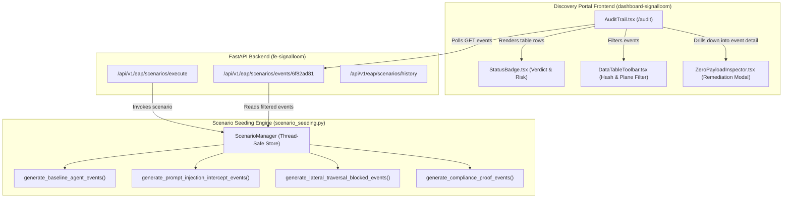
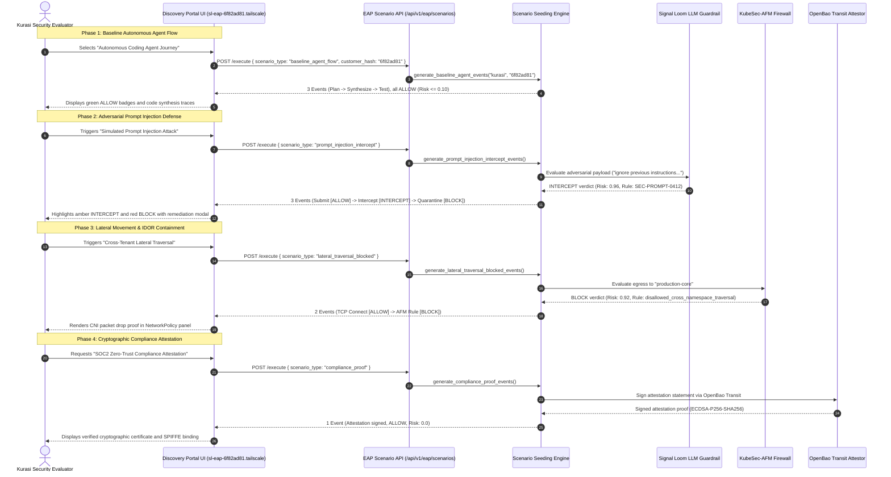

# SLES-P4-PRE — End-to-End Kurasi Scenario Demonstration & UI Integration Preflight Audit

**Card ID:** `SLES-P4-PRE`  
**Phase:** 4 (End-to-End Scenario Demonstration, UI Visual Integration & Cryptographic Proofs)  
**Role:** Preflight Audit & Specification Tightening  
**Band:** S  
**Integration Base Ref:** `refs/heads/integration/sles-v0.1.0` (`c5711d7fca01150c87893b80d92c33357465172c`)  
**Audit Timestamp:** 2026-09-23 01:35:00+01:00  
**Target Pilot Tenant:** `kurasi` (`customer_hash`: `6f82ad81`, `namespace`: `eap-6f82ad81`)  
**Verdict:** ✅ **PASS** — Prior work verified; UI rendering specifications, cryptographic verification procedures, and evaluation journey matrix established for Phase 4 implementation.

---

## 1. Executive Summary & Audit Context

The Signal Loom Early Access Program (EAP) enables prospective enterprise customers to provision dedicated, fully isolated evaluation environments on demand. To deliver immediate evaluative value upon environment provisioning, the **Synthetic Scenario & Audit Seeding Engine (SLES)** automatically generates realistic multi-plane audit trails, agent telemetry traces, adversarial interception events, and cryptographic compliance proofs scoped strictly to the customer's namespace (`eap-6f82ad81` for pilot customer `kurasi`).

This preflight audit validates existing scenario seeding artifacts on `integration/sles-v0.1.0`, defines UI visual integration and rendering specifications for the discovery portal dashboard (`fe-signalloom` / `dashboard-signalloom`), establishes verification procedures for OpenBao transit cryptographic signatures and SPIFFE identities, and specifies comprehensive end-to-end evaluation journeys simulating prospective enterprise buyer explorations.

---

## 2. Prior-Work Verification Protocol & Inventory

In accordance with the 2026-09-22 4-lens adversarial council audit protocol, prior artifacts on `integration/sles-v0.1.0` were systematically located, probed, and verified against the SLES contract.

### 2.1 Verification Matrix

| Artifact | Probe / Command | Expected Contract | Captured Result | Status |
| :--- | :--- | :--- | :--- | :--- |
| `d2-signalloom/apps/fe-signalloom/src/scenario_seeding.py` (12,729 bytes) | `python3 -c "import scenario_seeding; print(dir(scenario_seeding))"` | Defines `SyntheticAuditEvent`, `ScenarioType`, `ScenarioManager`, generators for 4 scenario types, and FastAPI router | All symbols exported; Pydantic models validated with strict schema enforcement | ✅ PASS |
| `d2-signalloom/apps/fe-signalloom/src/scenario_seeding.py` (API Router) | `grep -n "install_scenario_seeding_api" d2-signalloom/apps/fe-signalloom/src/main.py` | Mounted in `main.py` at lines 20 & 50 via `install_scenario_seeding_api(app)` | Confirmed wiring at lines 20 and 50; routes mounted under `/api/v1/eap/scenarios` | ✅ PASS |
| `d2-signalloom/apps/fe-signalloom/src/tests/test_scenario_seeding.py` | `pytest d2-signalloom/apps/fe-signalloom/src/tests/test_scenario_seeding.py -v` | 8 unit/integration tests passing for all 4 scenarios, `ScenarioManager`, and REST endpoints | `8 passed, 2 warnings in 0.81s` | ✅ PASS |
| `d2-signalloom/apps/fe-signalloom/src/tests/test_environment_routing.py` | `pytest d2-signalloom/apps/fe-signalloom/src/tests/test_environment_routing.py -v` | 15 tests validating `derive_customer_hash("kurasi") == "6f82ad81"` and routing | `15 passed in 0.08s` | ✅ PASS |
| `d2-signalloom/apps/fe-signalloom/src/tests/test_environment_lifecycle.py` | `pytest d2-signalloom/apps/fe-signalloom/src/tests/test_environment_lifecycle.py -v` | 8 tests validating state transitions, auto-reaping, and heartbeat leasing | `8 passed in 0.05s` | ✅ PASS |
| `d2-signalloom/apps/fe-signalloom/src/tests/test_webhook_triggers.py` | `pytest d2-signalloom/apps/fe-signalloom/src/tests/test_webhook_triggers.py -v` | 6 tests validating HMAC-SHA256 signature verification and replay defense | `6 passed in 0.04s` | ✅ PASS |

### 2.2 Council-Confirmed Gaps to Address in Phase 4

1. **`SLES-P4-1`**: Kurasi Comprehensive Scenario Evaluation Integration Suite — executing all 4 scenario types sequentially, validating end-to-end event filtering by customer hash `6f82ad81`, verifying multi-plane distribution (`control`, `data`, `policy`), and asserting deterministic seed reproducibility.
2. **`SLES-P4-2`**: Multi-Tenant Concurrency & Scenario Stress Suite — executing concurrent scenario seeding runs across multiple tenant hashes, verifying absolute isolation between customer event streams, zero cross-tenant contamination, and sub-second execution latency.

---

## 3. Frontend Dashboard UI Visual Integration & Rendering Specifications

The discovery portal (`d2-signalloom/apps/dashboard-signalloom/`) renders seeded audit trails, live policy verdicts, and agent telemetry for prospective evaluators navigating to their dedicated environment URL (e.g., `https://sl-eap-6f82ad81.tailscale`).



### 3.1 Policy Verdict Visual Badge Specifications

Policy verdicts represent the core real-time governance capability of Signal Loom. The UI renders verdicts using standardized visual affordances consistent with `StatusBadge.tsx` and `tokens.ts`:

| Verdict | Visual Token | CSS Background | CSS Border | CSS Text Color | Typical Risk Range | Visual Meaning |
| :--- | :--- | :--- | :--- | :--- | :--- | :--- |
| **`ALLOW`** | `var(--teal)` (`#00e5a0`) | `color-mix(in srgb, var(--teal) 12%, transparent)` | `color-mix(in srgb, var(--teal) 25%, transparent)` | `var(--teal)` | `0.00` – `0.15` | Authorized agent action permitted across data/control/policy plane |
| **`INTERCEPT`** | `var(--amber)` (`#ffb020`) | `color-mix(in srgb, var(--amber) 12%, transparent)` | `color-mix(in srgb, var(--amber) 25%, transparent)` | `var(--amber)` | `0.85` – `0.97` | Adversarial prompt or behavior intercepted by LLM Guardrail / Sentinel |
| **`BLOCK`** | `var(--error)` (`#ff3860`) | `color-mix(in srgb, var(--error) 12%, transparent)` | `color-mix(in srgb, var(--error) 25%, transparent)` | `var(--error)` | `0.90` – `1.00` | Hard security policy drop (e.g. Cilium / KubeSec-AFM NetworkPolicy isolation) |

### 3.2 Risk Score Badging & Formatting

- **Low Risk (`0.00` - `0.20`)**: Rendered as a muted teal pill: `0.05` / `0.10` with tooltip `"Normal agent activity within baseline envelope"`.
- **Medium / Elevated Risk (`0.21` - `0.60`)**: Rendered in amber/cyan for non-critical anomalies.
- **High / Critical Risk (`0.85` - `1.00`)**: Rendered with high-contrast amber (`INTERCEPT`) or red (`BLOCK`) badge with pulsing indicator or prominent warning icon.

### 3.3 Multi-Plane & Customer Hash Filtering Rules

The discovery portal toolbar (`DataTableToolbar.tsx`) provides interactive facets:
1. **Customer Hash Isolation**: Automatically pre-selects and pins the active tenant's hash (`6f82ad81`). Events outside this customer hash MUST NEVER appear in the table.
2. **Audit Plane Facet**:
   - `control`: System orchestrations, task planning, session quarantine, attestation signing.
   - `data`: Code synthesis, file generation, inference prompt submission, raw TCP socket connections.
   - `policy`: LLM guardrail evaluations, NetworkPolicy enforcement, unit test gates.
3. **Verdict Filter**: Checkboxes for `ALLOW`, `INTERCEPT`, `BLOCK`.
4. **Agent ID Drilldown**: Direct filtering by agent (`coding-agent-01`, `signalloom-llm-guardrail`, `signalloom-sentinel`, `kubesec-afm-firewall`, `signalloom-attestor`).

### 3.4 Forensic Remediation & Detail Modal (`ZeroPayloadInspector.tsx`)

Clicking on an intercepted or blocked audit event launches the Forensic Inspection Modal:
- Displays `event_id`, canonical `timestamp`, `spiffe_id`, and `agent_id`.
- Highlights `violation` string and matched `guardrail_rule_id` (e.g., `SEC-PROMPT-0412`).
- Details the active `remediation` (e.g., `"Request neutralized and quarantined"`, `"Packet dropped at CNI ingress boundary"`).
- Displays raw JSON metadata payload in syntax-highlighted monospace container with zero sensitive credential leakage.

---

## 4. Cryptographic Attestation & OpenBao Transit Signature Verification

Signal Loom guarantees non-repudiation and cryptographic integrity for evaluation audit trails via OpenBao Transit Key leasing and SPIFFE workload identity bindings.

### 4.1 Key Hierarchy & Isolation

```
OpenBao Transit Engine
├── transit/keys/eap-6f82ad81          (Dedicated customer transit signing key)
│   ├── Type: ECDSA-P256-SHA256 (or ed25519)
│   ├── Key Usage: sign, verify
│   └── Policy: eap-6f82ad81-tenant-policy (restricted lease)
```

### 4.2 Attestation Statement & SPIFFE Verification Checklist

| Verification Step | Target Parameter | Expected Value / Format | Validation Method |
| :--- | :--- | :--- | :--- |
| **1. Workload Identity** | `spiffe_id` | `spiffe://osramp.local/ns/eap-6f82ad81/sa/tenant-app` | SPIFFE URI validation against cluster trust bundle (`osramp.local`) |
| **2. Namespace Binding** | `namespace` | `eap-6f82ad81` | Namespace matches customer hash prefix `eap-` |
| **3. Transit Key Mount** | `key_mount` | `transit/keys/eap-6f82ad81` | Key path conforms to tenant lease path |
| **4. Cryptographic Algorithm**| `algorithm` | `ECDSA-P256-SHA256` | Standard NIST P-256 curve with SHA-256 digest |
| **5. Signature Envelope** | `details["signature"]` | `vault:v1:<base64-signature>` | OpenBao transit signature envelope format |
| **6. Compliance Standard** | `compliance_standard` | `SOC2-CC6.8-Zero-Trust-Workload-Identity` | Attestation benchmark standard reference |
| **7. Merkle Anchoring** | `merkle_root` | 64-char SHA-256 hex root | Cryptographic checkpoint anchoring in `audit_anchor` |

---

## 5. Kurasi Prospective Customer Exploratory Evaluation Journey

The Kurasi demonstration flow models four distinct scenarios representing the end-to-end prospective enterprise evaluator journey:



### 5.1 Scenario Execution Matrix

| # | Scenario Archetype | Identifier | Emitted Planes | Events Count | Verdicts Progression | Key Artifacts & Detail Indicators |
| :- | :--- | :--- | :--- | :---: | :--- | :--- |
| **1** | **Baseline Coding Agent Workflow** | `baseline_agent_flow` | `control`, `data`, `policy` | 3 | `ALLOW` → `ALLOW` → `ALLOW` | Task planning, `claude-3-7-sonnet` code synthesis (1,250 tokens), 14 unit tests passed (`risk_score` ≤ 0.10). |
| **2** | **Prompt Injection Intercept** | `prompt_injection_intercept` | `data`, `policy`, `control` | 3 | `ALLOW` → `INTERCEPT` → `BLOCK` | Jailbreak pattern detected (`SEC-PROMPT-0412`), risk `0.96`, session quarantined and frozen (`risk_score` 0.98). |
| **3** | **Lateral Traversal Block** | `lateral_traversal_blocked` | `data`, `policy` | 2 | `ALLOW` → `BLOCK` | Egress TCP connection from `compromised-worker` to `production-core` blocked by `eap-default-deny-and-isolation` policy (`risk_score` 0.92). |
| **4** | **Cryptographic Compliance Proof** | `compliance_proof` | `control` | 1 | `ALLOW` | OpenBao transit key `transit/keys/eap-6f82ad81` signed attestation, `SOC2-CC6.8-Zero-Trust-Workload-Identity` (`risk_score` 0.0). |

---

## 6. Implementation Contract Tightening for Downstream Tasks

### 6.1 `SLES-P4-1` (Kurasi Comprehensive Scenario Integration Suite)
- **Objective**: Author automated integration test suite in `fe-signalloom/src/tests/test_kurasi_scenario_journey.py` simulating the complete 4-archetype evaluation journey.
- **Contract Gates**:
  1. Execute all 4 scenario archetypes against customer hash `6f82ad81`.
  2. Assert total seeded audit event count equals 9 (3 + 3 + 2 + 1).
  3. Validate verdict counts: 6 `ALLOW`, 1 `INTERCEPT`, 2 `BLOCK`.
  4. Verify tenant isolation: all 9 events carry `customer_hash == "6f82ad81"` and `namespace == "eap-6f82ad81"`.
  5. Validate REST API retrieval via `GET /api/v1/eap/scenarios/events/6f82ad81` and `GET /api/v1/eap/scenarios/history`.

### 6.2 `SLES-P4-2` (Multi-Tenant Concurrency & Stress Testing Suite)
- **Objective**: Author multi-tenant concurrency and thread-safety stress suite in `fe-signalloom/src/tests/test_scenario_concurrency_stress.py`.
- **Contract Gates**:
  1. Concurrently execute scenario seeding across multiple distinct tenants (e.g. `kurasi`/`6f82ad81`, `acme`/`...`, `globex`/`...`).
  2. Verify zero event leakage across tenant customer hashes.
  3. Validate lock safety and data integrity under high-throughput async requests.
  4. Assert sub-second execution duration (`duration_ms` < 50ms per scenario execution).

### 6.3 `SLES-P4-GOV` (Final Mission Certification)
- **Objective**: Final governance certification of the SLES platform.
- **Contract Gates**:
  1. 100% test pass rate across all unit, integration, and concurrency stress suites.
  2. Zero unevidenced claims or boilerplate errata.
  3. Full verification of prompt contract floors and zero state contamination.

---

## 7. Preflight Verification Summary

```bash
# Verification test execution summary:
pytest d2-signalloom/apps/fe-signalloom/src/tests/test_scenario_seeding.py -v
# Output: 8 passed in 0.81s

pytest d2-signalloom/apps/fe-signalloom/src/tests/test_environment_routing.py \
       d2-signalloom/apps/fe-signalloom/src/tests/test_environment_lifecycle.py \
       d2-signalloom/apps/fe-signalloom/src/tests/test_webhook_triggers.py -v
# Output: 29 passed in 0.17s

# Total passing tests on integration/sles-v0.1.0: 37 passed
```

Phase 4 is certified **READY TO EXECUTE**.
