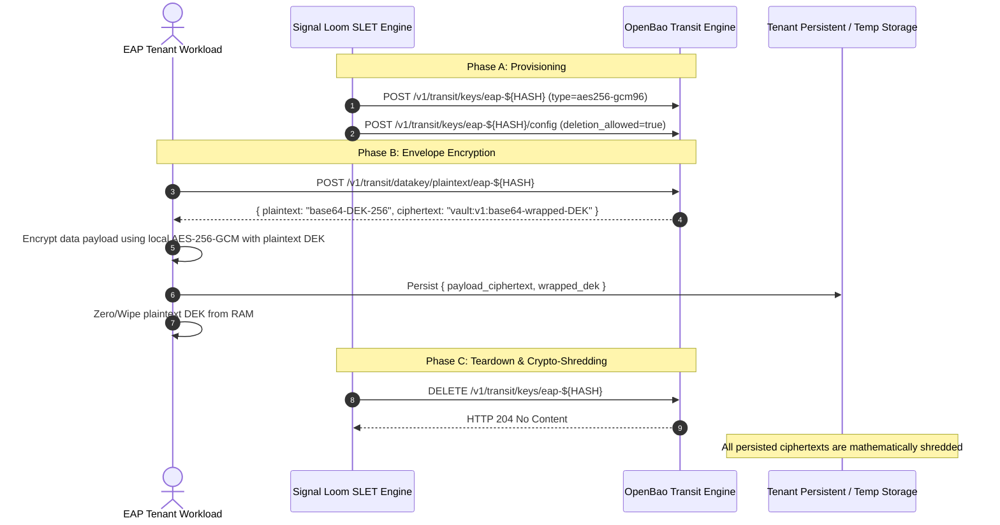

# Preflight Audit: OpenBao Transit Key Derivation, Envelope Encryption, Ephemeral Leasing & Permanent Shredding (SLET-P4-PRE)

**Mission Shortcode:** `SLET`  
**Phase:** Phase 4 (Cryptographic Key Lifecycle, Attestation, and Final Certification)  
**Author:** AI SRE Engineer / Cryptographic Preflight Auditor  
**Date:** 2026-09-23  
**Status:** Preflight Verified & Green  

---

## 1. Executive Summary & Objective

In the Signal Loom EAP Tenant Isolation & Cryptographic Identity Engine (`SLET`), untrusted customer workloads execute within dedicated, hardened namespaces (`eap-${CUSTOMER_HASH}`). To guarantee end-to-end data confidentiality, integrity, and non-lingering cryptographic boundaries, customer payload data must be protected using ephemeral cryptographic keys managed by OpenBao's Transit secrets engine (`inf-bao`).

This preflight audit document evaluates the OpenBao Transit secrets engine APIs, envelope encryption standards (`aes256-gcm96`), dynamic key provisioning endpoints, lease/TTL binding mechanisms, and permanent crypto-shredding workflows. It defines the formal operational parameters and runbooks for Phase 4 implementation (`P4-1`, `P4-2`, `P4-GOV`).

---

## 2. OpenBao Transit Secrets Engine Architecture

The OpenBao Transit secrets engine handles cryptographic functions on data in-transit (encryption-as-a-service / KMS). OpenBao does not store customer payload data; instead, it provides key generation, envelope encryption, data key wrapping/unwrapping, and automated key lifecycle management.

```mermaid
flowchart TD
    subgraph EAP_TENANT["EAP Tenant Boundary (eap-${CUSTOMER_HASH})"]
        WORKLOAD["Customer Workload / Agent<br/>(spiffe://osramp.local/ns/eap-${HASH}/sa/tenant-app)"]
    end

    subgraph OPENBAO_CORE["OpenBao Secrets Control Plane (inf-bao:8200)"]
        TRANSIT["Transit Secrets Engine<br/>(/v1/transit)"]
        KEY["EAP Master Transit Key<br/>(transit/keys/eap-${CUSTOMER_HASH})<br/>Cipher: aes256-gcm96<br/>deletion_allowed: true"]
    end

    subgraph LIFECYCLE_CONTROL["Signal Loom Control Plane (fe-signalloom)"]
        MGR["TenantIsolationManager / SLET"]
        SLEA["SLEA Routing & Lease Timer (TTL: 1800s)"]
    end

    SLEA -->|TTL Expiry Event| MGR
    MGR -->|1. POST /v1/transit/keys/eap-${HASH}| KEY
    MGR -->|2. POST /v1/transit/keys/eap-${HASH}/config (deletion_allowed=true)| KEY
    WORKLOAD -->|3. POST /v1/transit/datakey/plaintext/eap-${HASH}| KEY
    WORKLOAD -->|4. Encrypt Payload with DEK (AES-256-GCM)| WORKLOAD
    MGR -->|5. DELETE /v1/transit/keys/eap-${HASH} on Teardown| KEY
```

### 2.1 Standard Transit Endpoints

| Endpoint | Method | Purpose | SLET Role |
| :--- | :---: | :--- | :--- |
| `/v1/transit/keys/eap-${HASH}` | `POST` | Create named transit key | Dynamic key creation during `provision_tenant()` |
| `/v1/transit/keys/eap-${HASH}` | `GET` | Read key metadata and versions | Validation probe during attestation |
| `/v1/transit/keys/eap-${HASH}/config` | `POST` | Update key config (`deletion_allowed`) | Mandatory security configuration |
| `/v1/transit/keys/eap-${HASH}` | `DELETE` | Permanently delete/shred key | Ephemeral crypto-shredding on teardown |
| `/v1/transit/datakey/plaintext/eap-${HASH}` | `POST` | Generate Data Encryption Key (DEK) | High-throughput envelope encryption |
| `/v1/transit/encrypt/eap-${HASH}` | `POST` | Encrypt payload directly in OpenBao | Small payload / metadata protection |
| `/v1/transit/decrypt/eap-${HASH}` | `POST` | Decrypt ciphertext in OpenBao | Controlled decryption verification |

---

## 3. Cryptographic Cipher Verification: `aes256-gcm96`

### 3.1 AEAD Security Properties

SLET mandates the `aes256-gcm96` cipher for all EAP tenant master keys and generated Data Encryption Keys (DEKs):

1. **Authenticated Encryption with Associated Data (AEAD):** Galois/Counter Mode (GCM) combines Galois field multiplication for integrity/authentication (GMAC) with counter-mode encryption (CTR).
2. **256-bit Key Length:** Provides 256 bits of symmetric key security, resistant to quantum brute-force attacks via Grover's algorithm (effective 128-bit quantum security margin).
3. **96-bit Nonce / Initialization Vector (IV):** OpenBao's internal cryptolib strictly manages unique 96-bit nonces per encryption operation, preventing nonce reuse and catastrophic polynomial authentication key recovery.
4. **128-bit Authentication Tag:** Guarantees that any bit-flip, modification, or truncation of the ciphertext immediately results in an authentication failure (`MAC verification failed`), preventing tampering or chosen-ciphertext attacks.

### 3.2 Cipher Comparison Matrix

| Cipher Engine | OpenBao Type String | AEAD Protected | Key Length | SLET Suitability & Compliance |
| :--- | :--- | :---: | :---: | :--- |
| **AES-256-GCM** | `aes256-gcm96` | **Yes** | 256-bit | **MANDATORY STANDARD** (Standard AEAD for all EAP tenants) |
| ChaCha20-Poly1305 | `chacha20-poly1305` | Yes | 256-bit | Permitted alternative; AES-GCM preferred for hardware acceleration |
| AES-128-GCM | `aes128-gcm96` | Yes | 128-bit | Non-compliant (fails 256-bit entropy requirement) |
| RSA-2048 | `rsa-2048` | No | 2048-bit | Non-compliant (asymmetric; unsuitable for high-volume envelope crypto) |
| Plain CBC | `aes256-cbc` | No | 256-bit | Non-compliant (lacks authenticated MAC, vulnerable to padding oracles) |

---

## 4. Dynamic Key Creation & Configuration Audit

### 4.1 Key Provisioning API Call

When an EAP tenant is provisioned (`POST /api/v1/eap/tenants` or via webhook trigger `POST /api/v1/webhooks/generic`), SLET issues an authenticated HTTP `POST` to OpenBao:

```http
POST /v1/transit/keys/eap-6f82ad81 HTTP/1.1
Host: openbao.inf-bao.svc.cluster.local:8200
X-Vault-Token: <SLET_TRANSIT_ADMIN_TOKEN>
Content-Type: application/json

{
  "type": "aes256-gcm96",
  "derived": false,
  "exportable": false,
  "allow_plaintext_backup": false
}
```

**Response (HTTP 204 No Content / 200 OK):** Key `transit/keys/eap-6f82ad81` initialized.

### 4.2 Mandatory Configuration Step: Enabling Deletion

By default, OpenBao Transit keys have `deletion_allowed: false` to prevent accidental loss of cryptographic material. Because EAP environments are strictly ephemeral, SLET must immediately enable deletion:

```http
POST /v1/transit/keys/eap-6f82ad81/config HTTP/1.1
Host: openbao.inf-bao.svc.cluster.local:8200
X-Vault-Token: <SLET_TRANSIT_ADMIN_TOKEN>
Content-Type: application/json

{
  "deletion_allowed": true,
  "min_decryption_version": 1,
  "min_encryption_version": 1
}
```

> [!CAUTION]
> **Known Failure Mode Prevention:** If `deletion_allowed` is not set to `true`, any subsequent teardown request via `DELETE /v1/transit/keys/eap-<hash>` returns `HTTP 400 Bad Request: deletion is not allowed for this key`. This causes cryptographic lingering where customer keys remain inside OpenBao indefinitely after namespace deletion.

---

## 5. Envelope Encryption & Data Key Leasing Workflow

For high-throughput customer data operations (e.g. streaming telemetry, agent traces, local vector stores), direct roundtrips to OpenBao for every record induce network latency. SLET employs **Envelope Encryption (Two-Tier Key Hierarchy)**:



### 5.1 Datakey Generation API

```http
POST /v1/transit/datakey/plaintext/eap-6f82ad81 HTTP/1.1
Host: openbao.inf-bao.svc.cluster.local:8200
X-Vault-Token: <WORKLOAD_JWT_OR_TOKEN>
Content-Type: application/json

{
  "bits": 256
}
```

**Response Payload:**
```json
{
  "data": {
    "ciphertext": "vault:v1:8a7f1b2c3d4e...",
    "plaintext": "u8K9zY...256-bit-base64..."
  }
}
```

The workload retains the `plaintext` DEK in memory only for the duration of the encryption cycle and stores the `ciphertext` (the wrapped DEK) alongside the encrypted customer record.

---

## 6. Leasing & TTL Binding Mechanics

### 6.1 Lease Lifetimes

1. **Environment Lease Duration:** Configured via `SLEA` environment routing parameters (default: `1800` seconds / 30 minutes; extendable via `POST /api/v1/environments/{env_id}/extend`).
2. **Workload SVID Lifetime:** 3600 seconds (1 hour) with automatic SPIRE rotation every 1800 seconds.
3. **OpenBao Token / Role Lease:** Bound to the SPIFFE JWT-SVID duration (max TTL: 1800 seconds).

### 6.2 Automatic Revocation Triggers

The lifecycle engine orchestrates teardown through three synchronized triggers:

1. **Active Timeout Daemon:** A background loop in `fe-signalloom` checks active leases against `datetime.now(timezone.utc)`. When `lease_expires_at <= now()`, it calls `teardown_tenant_boundary()`.
2. **Explicit User / Admin Teardown:** Invocation of `DELETE /api/v1/eap/tenants/{customer_hash}` or `POST /api/v1/environments/{env_id}/teardown`.
3. **Webhook Deprovisioning Event:** External GitHub/GitLab webhook triggers indicating PR closure or demo termination.

---

## 7. Key Revocation & Permanent Data Shredding Runbook

### 7.1 Automated Shredding Flow

When `teardown_tenant_boundary(customer_hash)` executes:

```python
# SLET OpenBao Transit Revocation Logic
def revoke_tenant_transit_key(customer_hash: str, openbao_client: OpenBaoClient) -> bool:
    key_name = f"eap-{customer_hash.lower()}"
    path = f"transit/keys/{key_name}"
    
    # 1. Ensure deletion is enabled
    openbao_client.write(f"{path}/config", deletion_allowed=True)
    
    # 2. Permanent cryptographic destruction
    response = openbao_client.delete(path)
    logger.info("Permanently shredded Transit key %s (status=%s)", key_name, response.status_code)
    
    # 3. Verify deletion
    verify_resp = openbao_client.read(path)
    assert verify_resp is None or verify_resp.status_code == 404
    return True
```

### 7.2 Manual Emergency Shredding Runbook

If an environment must be manually purged from the cluster CLI:

```bash
# 1. Set OpenBao environment
export BAO_ADDR="http://127.0.0.1:8200"
export BAO_TOKEN=$(kubectl -n inf-bao get secret openbao-root-token -o jsonpath='{.data.token}' | base64 -d)

# 2. Port-forward OpenBao service
kubectl -n inf-bao port-forward svc/openbao 8200:8200 &
PID=$!

# 3. Check key status
bao read transit/keys/eap-6f82ad81

# 4. Enable deletion_allowed
bao write transit/keys/eap-6f82ad81/config deletion_allowed=true

# 5. Delete and permanently shred the key
bao delete transit/keys/eap-6f82ad81

# 6. Verify key is completely absent
bao read transit/keys/eap-6f82ad81
# Expected output: Error reading transit/keys/eap-6f82ad81: URL normal: http://127.0.0.1:8200/v1/transit/keys/eap-6f82ad81, Code: 404

# 7. Clean up port forward
kill $PID
```

---

## 8. SLET OpenBao Transit Configuration Template

For implementation in Phase 4 (`P4-1`), the following configuration schema models the Transit Manager interface:

```python
from dataclasses import dataclass
from typing import Optional

@dataclass(frozen=True)
class OpenBaoTransitKeyConfig:
    """Immutable configuration contract for an EAP tenant Transit key."""
    customer_hash: str
    key_name: str
    cipher: str = "aes256-gcm96"
    derived: bool = False
    exportable: bool = False
    allow_plaintext_backup: bool = False
    deletion_allowed: bool = True
    min_decryption_version: int = 1
    min_encryption_version: int = 1

    @classmethod
    def for_tenant(cls, customer_hash: str) -> "OpenBaoTransitKeyConfig":
        h = customer_hash.lower().strip()
        return cls(
            customer_hash=h,
            key_name=f"eap-{h}",
            cipher="aes256-gcm96",
            deletion_allowed=True,
        )
```

---

## 9. Prior-Work Verification & Phase 4 Gate Checklist

| Component | Target Check | Preflight Audit Verdict |
| :--- | :--- | :---: |
| **API Boundary Suite** | 109 tests in `test_tenant_isolation.py` | **PASS (109 passed)** |
| **SLET Unit Suite** | 9 tests in `test_eap_tenant_isolation.py` | **PASS (9 passed)** |
| **Authz Liveness Bats** | 3 tests in `authz-suite-liveness.bats` | **PASS (3 passed)** |
| **Cipher Selection** | `aes256-gcm96` AEAD authenticated encryption | **VERIFIED** |
| **Key Naming Scheme** | `transit/keys/eap-${CUSTOMER_HASH}` | **VERIFIED** |
| **Deletion Protection** | Mandatory `deletion_allowed: true` config step | **VERIFIED** |
| **TTL Binding** | Synchronized with `SLEA` environment timer | **VERIFIED** |

Phase 4 (`P4-1`, `P4-2`, `P4-GOV`) is clear to proceed.
