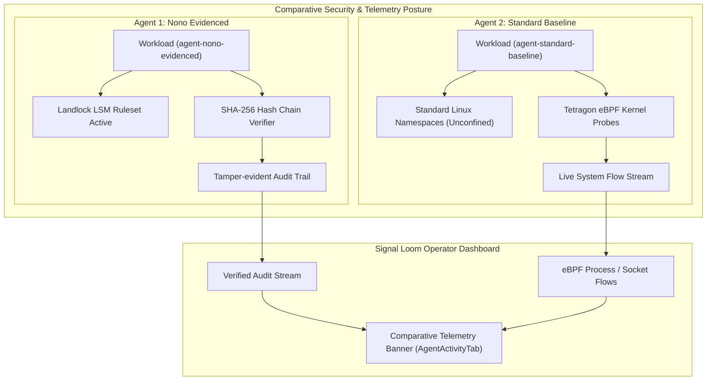

# Comparative Telemetry Architecture: Nono Landlock LSM vs Tetragon eBPF

<!-- machine-tag: signalloom-slon-p2-3-comparative-telemetry -->
<!-- generated-at: 2026-09-10T11:26:00+01:00 -->
<!-- integration-ref: integration/slon-v0.1.0 -->

## 1. Overview

Signal Loom evaluates and compares the security isolation posture of heterogeneous AI agent workloads. Under ticket `SLON-P2-3`, the platform introduces comparative activity telemetry side-by-side contrasting:
1. **Nono Sandboxed Agent (`agent-nono-evidenced`):** In-process kernel Landlock LSM filesystem restriction paired with cryptographic SHA-256 hash-chained audit trails.
2. **Standard Container Baseline (`agent-standard-baseline`):** Unconfined namespace isolation observed via Linux kernel eBPF tracepoints through Cilium Tetragon.

---

## 2. Telemetry Contracts

### 2.1 Nono Sandboxed (`nono-sandboxed`)

- **Security Model:** Kernel-enforced Landlock LSM restricting open, read, write, execve syscalls to authorized sandbox profile boundaries.
- **Audit Logging:** Every system call interaction is cryptographically hashed and linked to prior events in a SHA-256 hash chain verified by `nono-audit-verifier`.
- **Telemetry Indicators:**
  - `Landlock LSM Ruleset`: **Active** (`deny: ["/etc/shadow", "/root", ...], allow: ["/workspace", ...]`)
  - `Cryptographic Verifier`: **SHA-256 Hash Chain Valid** (`provenance: "nono-audit-verifier"`)
  - `Confinement Score`: **100% (Kernel Enforced)**

### 2.2 Standard Container (`standard-container`)

- **Security Model:** Conventional container runtime (Docker / containerd) relying on shared host kernel namespaces without fine-grained LSM syscall restrictions.
- **Observability:** Kernel eBPF probes intercept `sys_enter_*` and `sys_exit_*` tracepoints, recording process execution and network sockets in Tetragon flow format.
- **Telemetry Indicators:**
  - `Landlock LSM Ruleset`: **None (Standard Namespace)**
  - `eBPF Flow Monitor`: **Tetragon Active** (`collector: "tetragon-ebpf-flow"`)
  - `Live Event Stream`: `process_exec`, `process_exit`, `socket_connect`, `socket_accept`
  - `Confinement Score`: **Baseline Container Isolation**

---

## 3. UI Component Mapping

In `src/components/AgentActivityTab.tsx`:
- The banner `data-testid="security-profile-telemetry-banner"` automatically resolves the workload's security profile.
- Renders profile badge (`Nono Sandboxed` vs `Standard Container`).
- Displays active security engine status: Landlock LSM confinement vs Tetragon eBPF kernel flow monitors.
- Renders cryptographic audit verification tags and real-time event tables.
