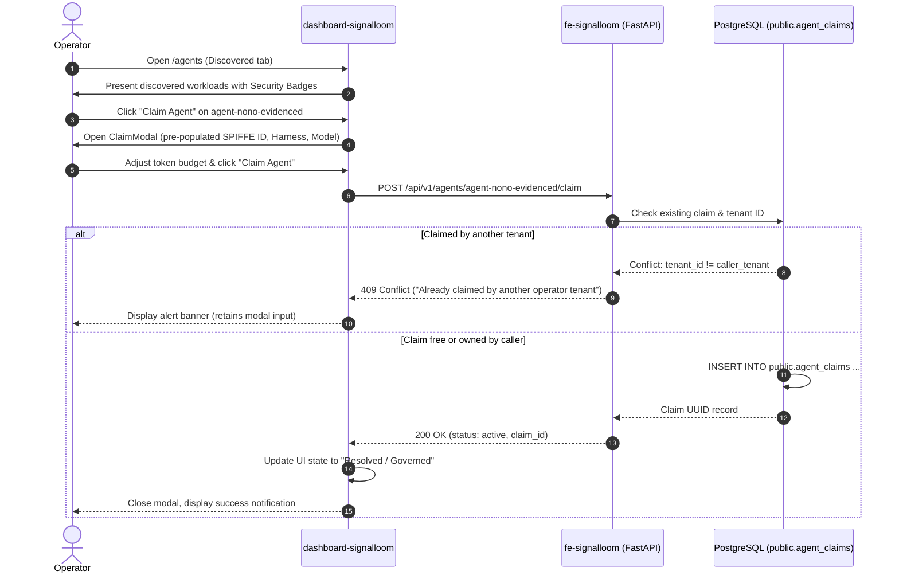

# Operator Dual-Agent Claim Workflow: Discovery to Governance

<!-- machine-tag: signalloom-slon-p2-3-dual-agent-claim -->
<!-- generated-at: 2026-09-10T11:26:00+01:00 -->
<!-- integration-ref: integration/slon-v0.1.0 -->

## 1. Overview

In multi-tenant AI operations, raw workloads running in Kubernetes clusters must undergo an explicit operator claiming transaction before being admitted into governance boundaries. Under ticket `SLON-P2-3`, Signal Loom establishes a dual-agent claim workflow supporting:
1. `agent-nono-evidenced` (Nono sandboxed workload)
2. `agent-standard-baseline` (Standard container workload)

---

## 2. Claim State Machine & Sequence

---

## 3. UI Invariants & Guardrails

- **Zero Accidental Overwrite:** If a discovered pod is claimed by another operator tenant, the claim is rejected with `HTTP 409 Conflict`.
- **Pre-populated Invariants:** Pod name, namespace, SPIFFE ID (`spiffe://signalloom.demo/ns/.../sa/...`), framework, and model are pre-filled based on runtime metadata.
- **Immediate Feedback:** While submitting, the submit button is disabled with a loading spinner.
