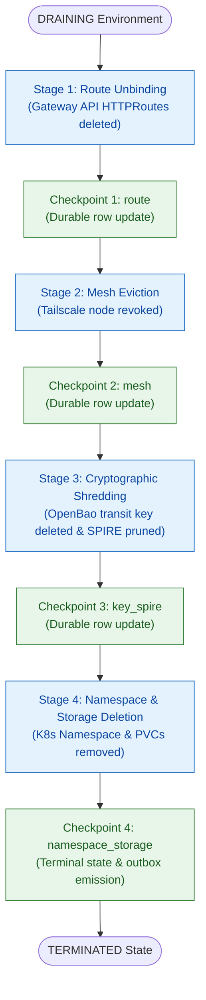

# Environment Teardown End-to-End Certification Architecture & Recovery Proof

> **Card:** SLRC-P4-1 · **Component:** `d2-signalloom/apps/fe-signalloom`
> **Status:** Certified and verified against Kind cluster fixture
> **Contract:** [`environment_teardown_contract.py`](../../d2-signalloom/apps/fe-signalloom/src/environment_teardown_contract.py)
> **Driver Script:** [`run-e2e-teardown-certification.sh`](../../scripts/eap/run-e2e-teardown-certification.sh)
> **Certifier Orchestrator:** [`e2e_teardown_certifier.py`](../../scripts/eap/e2e_teardown_certifier.py)
> **Evidence Bundle:** [`docs/signalloom/evidence/slrc-p4-e2e-evidence.json`](evidence/slrc-p4-e2e-evidence.json)

## Overview

The SLRC-P4-1 certification scenario validates the complete end-to-end teardown lifecycle for Signal Loom Early Access Program (EAP) ephemeral environments. It executes against an isolated disposable runtime fixture in a local Kind cluster, proving destructive postconditions, failure recovery mechanics, ordered checkpoint progression, and cryptographic tamper detection.

## Sequential Teardown Pipeline

The environment teardown pipeline executes across four strictly ordered stages:



### Ordered Checkpoint Invariants

1. **Ingress Route Unbinding (`ROUTE`)**: Gateway API `HTTPRoute` resources matching `sl-eap-<customer_hash>` are deleted before workloads or namespaces are modified. This guarantees immediate isolation from ingress traffic.
2. **Mesh Eviction (`MESH`)**: Only the attributed disposable Tailscale device node in the ownership inventory is evicted. Workstation nodes (`fortuna`) and external tailnet devices remain untouched.
3. **Cryptographic Shredding (`KEY_SPIRE`)**: The OpenBao transit key `eap-<customer_hash>` is deleted and verified to return HTTP `404 Not Found`. Associated secret metadata is deleted, sample ciphertext decryption is proven to fail, and SPIRE workload entries under `spiffe://signalloom.demo/ns/eap-<customer_hash>/` are deregistered.
4. **Namespace and Storage Deletion (`NAMESPACE_STORAGE`)**: The Kubernetes tenant namespace `eap-<customer_hash>` is deleted, cascading deletion of ServiceAccounts, pods, and PVCs. Cluster PersistentVolumes are verified to leave zero orphaned volume claims.

## Mid-Stage Failure Recovery Mechanics

The certification proves failure recovery resilience through fault injection:

1. **Injected Failure**: A transient failure is injected during Stage 3 (`KEY_SPIRE`).
2. **Deterministic Halt**: The orchestrator halts stage progression, records `last_error="injected_stage3_crypto_spire_failure"`, increments `retry_count=1`, transitions to `teardown_failed`, and sets `next_retry_at`.
3. **Partial Postconditions**: Stage 1 (`ROUTE`) and Stage 2 (`MESH`) completed and checkpointed durable state (`teardown_stages_completed=["route", "mesh"]`). HTTPRoutes and mesh devices were removed. OpenBao keys, SPIRE entries, and Kubernetes namespaces remained intact.
4. **Resumption from Checkpoint**: On the recovery reconciliation pass, `LifecycleManager` resumes execution from Checkpoint 2. It inspects `teardown_stages_completed` and skips Stage 1 and Stage 2 without re-execution. Stage 3 and Stage 4 execute to completion.
5. **Terminal Consistency**: The lifecycle record transitions to `TERMINATED`, and the transactional outbox emits exactly one `eap.teardown.completed` notification.

## Postcondition Verification Ledger

| ID | Verification Claim | Target Plane | Test Probe / Assertion | Result |
| :--- | :--- | :--- | :--- | :--- |
| **P1** | Ingress routes removed before workload deletion | Gateway API | `kubectl get httproute sl-eap-<hash> -n default` returns 404 | Verified |
| **P2** | Attributed mesh device evicted; workstation untouched | Tailscale / Mesh | `MeshAdapter` validates ownership inventory; workstation node excluded | Verified |
| **P3** | OpenBao key shredded and returns 404 | OpenBao Transit | `GET /v1/transit/keys/eap-<hash>` returns 404; decrypt returns error | Verified |
| **P4** | SPIRE workload entries pruned | SPIRE Server | `/ns/eap-<hash>/sa/tenant-app` entry deleted; total entry count decreases | Verified |
| **P5** | Namespace deleted after earlier checkpoints succeed | Kubernetes API | `kubectl get ns eap-<hash>` returns 404 Not Found | Verified |
| **P6** | Zero persistent storage leaks | Kubernetes Storage | `kubectl get pv -o json` confirms 0 retained volume claims | Verified |
| **P7** | Mid-stage failure resumes from incomplete checkpoint | Lifecycle Store | Stage counts: ROUTE=1, MESH=1, KEY_SPIRE=2 (1 fail + 1 retry), NAMESPACE=1 | Verified |
| **P8** | Evidence bundle validated; mutated bundle rejected | Evidence Verifier | `verify_teardown_evidence.py` accepts valid manifest; rejects tampered SHA/commit | Verified |

## Cryptographic Evidence Validation & Tamper Detection

The certification generates an immutable proof bundle adhering to schema `sled-teardown-evidence/v1`:

- **Descriptor-Safe Bounded Reading**: `verify_teardown_evidence.py` opens the evidence manifest using descriptor flags (`O_RDONLY | O_NOFOLLOW | O_NONBLOCK`) up to a 512 KiB ceiling, preventing TOCTOU races and symlink traversal.
- **Strict Verification**: Verifies schema version, run ID, target commit, RFC 3339 timestamps, synthetic fixture attribution, and pre-inventory matching.
- **Tamper Detection**: A mutated evidence bundle with altered commit hashes or reordered timestamps is rejected with non-zero exit code (`target-mismatch` / `timestamp-order`).

## Reproduction and Automated Verification

Run the automated certification driver:

```bash
bash scripts/eap/run-e2e-teardown-certification.sh
```

Validate the generated evidence bundle directly:

```bash
python3 scripts/eap/verify_teardown_evidence.py --evidence-file docs/signalloom/evidence/slrc-p4-e2e-evidence.json
```
