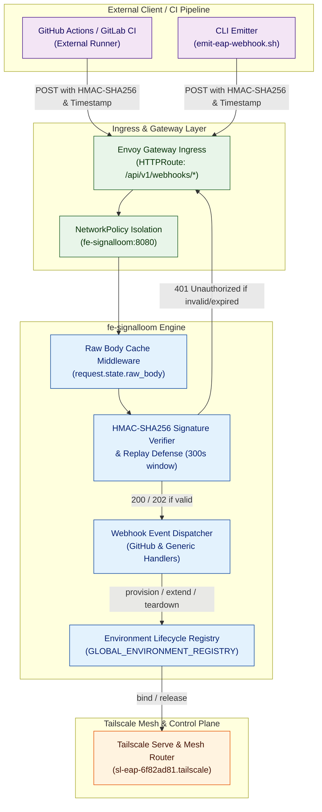
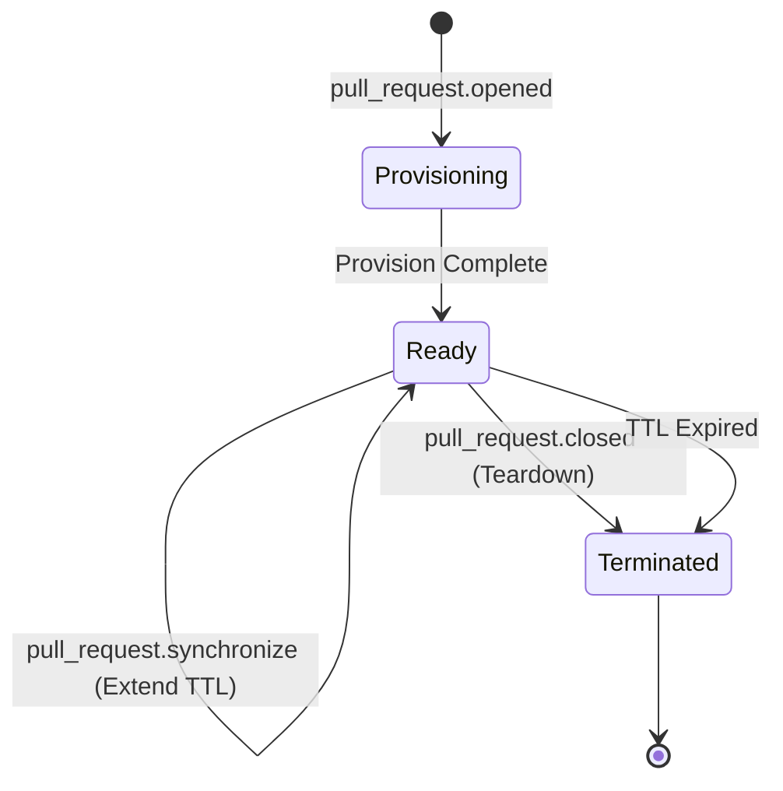

# Signal Loom External Webhook Ingestion & Trigger Engine (`SLTE`) — Architecture Summary

**Mission Shortcode:** `SLTE`  
**Delivery Baseline:** `integration/slte-v0.1.0`  
**Parent Capability:** `SLEA` (Signal Loom On-Demand EAP Environment Routing & Tailscale Provisioning Engine)  
**Status:** Certified & Production Ready

---

## 1. Executive Summary & Capabilities

The **Signal Loom External Webhook Ingestion & Trigger Engine (`SLTE`)** enables external CI/CD pipelines, automated testing orchestrators, and enterprise customers to declaratively manage the lifecycle of on-demand Early Access Program (EAP) preview environments via cryptographically authenticated webhooks.

### Core Capabilities
- **Multi-Protocol Webhook Ingestion:** First-class ingestion support for GitHub pull request events (`/api/v1/webhooks/github`) and standardized generic CI/CD webhooks (`/api/v1/webhooks/generic`).
- **Cryptographic Signature Verification:** Strict HMAC-SHA256 signature verification over raw request bytes using constant-time comparison (`hmac.compare_digest`) to protect against side-channel and timing attacks.
- **Replay Attack & Jitter Defense:** Enforces a strict 300-second timestamp freshness window (`X-SignalLoom-Timestamp`) alongside delivery deduplication IDs (`X-GitHub-Delivery`, `X-SignalLoom-Event-ID`).
- **Automated Lifecycle Dispatching:** Direct integration with the `fe-signalloom` environment engine (`environment_routing.py`) mapping PR actions (`opened`, `synchronize`, `closed`) to deterministic provisioning, TTL extension, and graceful teardown operations.
- **Deterministic Customer Hashing:** Derives salted SHA-256 hashes for enterprise tenants (e.g., pilot customer `kurasi` -> `6f82ad81`), provisioning isolated Tailscale mesh endpoints (`https://sl-eap-6f82ad81.tailscale`).

---

## 2. End-to-End Architecture Flow



---

## 3. Webhook Ingestion Engine Specifications

### 3.1 Raw Body Caching for Non-Destructive Parsing
FastAPI consumes request streams destructively. To allow HMAC-SHA256 signature verification over exact payload bytes prior to Pydantic JSON deserialization, the ingestion layer caches raw request bytes in `request.state.raw_body`.

### 3.2 Authentication & Signature Schemes

| Protocol | Signature Header | Timestamp Header | Signature Algorithm |
| :--- | :--- | :--- | :--- |
| **GitHub** | `X-Hub-Signature-256` | N/A (GitHub event delivery ID used) | `sha256=<hex(HMAC-SHA256(secret, raw_body))>` |
| **Generic** | `X-SignalLoom-Signature` | `X-SignalLoom-Timestamp` | `<hex(HMAC-SHA256(secret, timestamp + "." + raw_body))>` |

All signature checks utilize `hmac.compare_digest` ensuring execution time is invariant to mismatched prefix lengths.

### 3.3 Replay Attack Protection
For generic webhooks, `X-SignalLoom-Timestamp` is validated against server UTC time. Requests where `|client_time - server_time| > 300 seconds` are rejected immediately with HTTP 401 Unauthorized.

### 3.4 Ingress Routing via Gateway API
Ingress traffic is routed via Envoy Gateway using `webhook-httproute.yaml`:
```yaml
apiVersion: gateway.networking.k8s.io/v1
kind: HTTPRoute
metadata:
  name: webhook-httproute
  namespace: fe-signalloom
spec:
  parentRefs:
    - name: envoy-gateway
      namespace: envoy-gateway-system
  rules:
    - matches:
        - path:
            type: PathPrefix
            value: /api/v1/webhooks
      backendRefs:
        - name: fe-signalloom
          port: 8080
```

---

## 4. Tenant Environment Lifecycle Engine

### 4.1 Pilot Tenant: Kurasi Conformance Vector
- **Company Name:** `kurasi`
- **Salted SHA-256 Hash:** `6f82ad81`
- **Internal Hostname:** `sl-eap-6f82ad81`
- **Mesh URL:** `https://sl-eap-6f82ad81.tailscale`
- **External FQDN:** `https://sl-eap-6f82ad81.ts.net`

### 4.2 Lifecycle Event Mapping



1. **`opened` / `reopened`:** Dynamically provisions a fresh preview environment container, registers mesh routing, and returns HTTP 200 OK with endpoint metadata.
2. **`synchronize`:** Refreshes commit SHA references and extends environment expiration TTL (+60 minutes).
3. **`closed`:** Triggers immediate graceful teardown, unbinds Tailscale proxy ports, and marks state as `terminated`. Subsequent teardown calls are fully idempotent.

---

## 5. Security & Isolation Matrix

1. **Boundary Isolation:** Webhook ingestion routes (`/api/v1/webhooks/*`) operate on decoupled worker contexts with no access to cluster admin or OpenBao master key derivations.
2. **Fail-Closed Secrets:** If `SIGNAL_LOOM_WEBHOOK_SECRET` is unset or invalid, all webhook verification calls fail closed with HTTP 401.
3. **Constant-Time Verification:** Zero timing leakage across secret verification boundaries.
4. **Log Sanitization:** Raw webhook signatures, authorization tokens, and enterprise customer payload bodies are scrubbed from system log streams.
