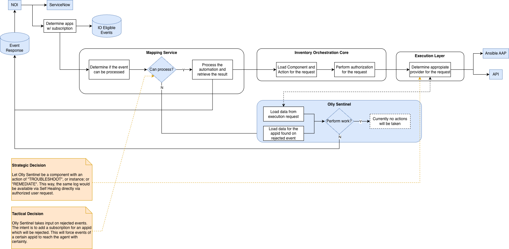
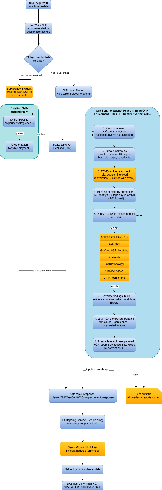
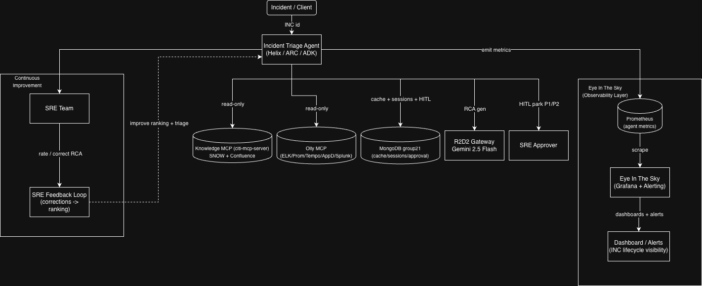
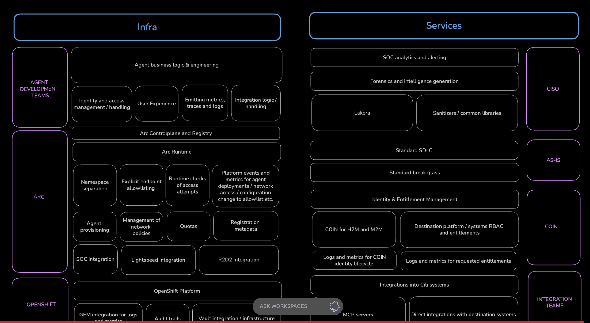
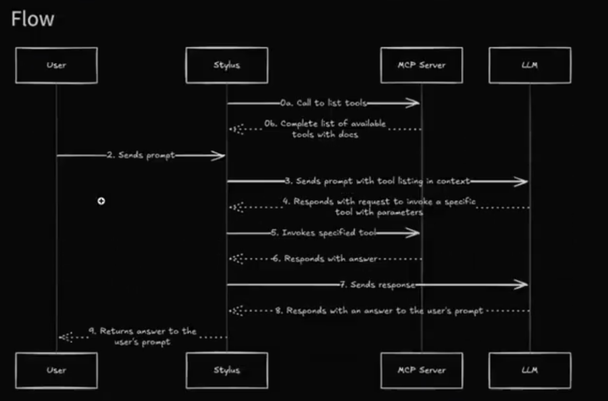

# Agentic SRE Design Doc: Olly Sentinel + Eye in the Sky, and the OSRAMP Replica

Delivery window: 13 working days to a narrow demo. The demo runs one path end
to end: incident detection, automated enrichment, ticket update, handler
guidance. Everything else (other agents, resilience and FinOps use cases,
estate expansion) waits until that path proves the pattern.

---

## 1. Architecture

### 1.1 Flow (event to enriched incident)

The ticket enrichment flow, from the client design. NOI runs the subscription
gate; the Mapping Service decides whether Self-Healing can process the event;
a declined event routes to Olly. The strategic decision on the right makes Olly
a component with TROUBLESHOOT and REMEDIATE actions reachable from Self-Healing
or a direct authorized request.

Olly runs one read-only pipeline on Google ADK. Both entry points feed it: the
Kafka consume loop (the Self-Healing path) and the A2A `message/send` skill (a
direct request). The enriched pipeline resolves the CI from CMDB by
correlation-ID, queries seven MCP tools in parallel under EEMS scopes, builds a
dated evidence timeline, and assembles a contract-validated enrichment.

### 1.2 Invariants

1. **Phase 1 is read-only against production.** Olly observes, queries,
   correlates, and reports. It takes no remediation action.
2. **Olly never writes to ServiceNow.** Enrichment is published to the shared
   `event_response` topic; the IO Mapping Service consumes it and updates the
   ticket under its own identity. The write scope lives entirely outside the
   agent.
3. **The correlation-ID is the join key** across every downstream query and the
   enrichment payload. Olly never receives an INC number; dashboards resolve INC
   numbers from their own ServiceNow feed for display only.
4. **Subscription gate.** Only apps subscribed to Self-Healing reach Olly. NOI
   raises a raw incident for everything else and the flow ends. The tactical
   lever is to subscribe an app that will be declined, which forces its events
   to the agent. The strategic path makes Olly a component with TROUBLESHOOT and
   REMEDIATE actions, invokable via Self-Healing or an authorized user request.
5. **EEMS entitlements gate every action** under the read-only role
   `gco-sentinel-read`; every MCP query and generated report is logged to the
   SIEM audit trail.
6. **The model proposes, deterministic systems act.** Any future action goes
   through the action-proposal contract: a closed enum, human approval, and a
   deterministic executor under a separate write-entitled identity. The model
   never holds execution credentials.
7. **Log text, ticket text, and event payloads are untrusted input** at context
   assembly. Injection eval cases run in CI from the first context assembly.
   Output encoding in dashboard panels is a separate control; both must exist.
8. **The agent runtime is Google ADK**, the same runtime shape ARC (the firm's
   internal platform for secure, scalable deployment of AI agents) operates
   internally. Olly is an ADK `BaseAgent` pipeline with deterministic
   orchestration and an optional `LlmAgent` narrator: the model narrates, it
   never decides. The LLM is Gemini / Vertex AI via ARC (the native ADK model
   path); the replica shims non-Gemini models through LiteLLM to an
   OpenAI-compatible gateway (Ollama locally, or OpenRouter/Anthropic/OpenAI
   with a key).
   A module-level `root_agent` exposes the same `build_agent()` object to
   `adk web` / `adk eval`, an additive dev/eval entry point that leaves the Kafka
   and A2A paths unchanged.
9. **Agent-to-agent communication is Google A2A, and the AgentCard comes
   first.** The card is a versioned declaration of the agent's identity, skills,
   capabilities, and auth requirements (EEMS bearer, read-only scopes) that
   peers and ARC consume. It is a committed contract
   ([contracts/agent-card.olly-sentinel.v1.json](contracts/agent-card.olly-sentinel.v1.json)),
   and CI asserts that the served card equals it, so agent identity drift fails
   like payload drift. The A2A `message/send` skill is the strategic TROUBLESHOOT
   action: the same read-only triage logic, invokable by an authorized user or
   peer agent, returning the RCA report without touching Kafka or ServiceNow.
10. **Every gate is observable.** Each decision the flow makes (subscription,
    automation-eligibility, schema-validation, source-filter, dedup, loop-guard,
    HITL, publish, ticket-write) emits one `pipeline-decision.v1` record to
    `olly.pipeline.decisions`, keyed by correlation-ID. The records for one
    correlation-ID are that incident's causality chain, replayable and joinable
    across the Mapping Service and the agent. Emission is observability only: it
    never changes routing, and a reject branch still ends the flow as designed.

### 1.2a Orbit: the action gate

Orbit is the component that fills the diagram's "currently no actions will be
taken" node without breaking invariant 1. Given a completed RCA it *proposes*
one action from the `action-proposal.v1` closed enum (`troubleshoot`,
`remediate_restart_service`, `no_action`) — selected deterministically from the
fault domain, never sampled. A restart-addressable incident parks the enrichment
as a proposal instead of publishing it.

Approval is an ed25519-signed token bound to the one proposal (its
`proposal_id`, `correlation_id`, and `action`). The signing key is split: the
approval service (the local console broker) holds the **private** half and mints
tokens when an operator approves; the sentinel holds only the **public** half
and verifies. The agent process therefore *cannot mint its own approval* — the
gate cannot be self-satisfied. On approval a deterministic executor records the
action under a separate write-entitled identity; in Phase 1 it logs what it
would do and mutates nothing, so the full proposed → approved → executed flow is
real while production stays untouched. Rejecting drops the held enrichment.
This is invariant 6 made concrete: the model proposes, a human approves, a
deterministic executor acts, and the model never holds an execution credential.

### 1.3 MCP tool surface

| MCP tool | Data | EEMS scope |
|---|---|---|
| ServiceNow INC/CHG | Active incidents, recent changes, related CIs | `servicenow.incidents.read` |
| ELK Logs | App logs, error patterns, stack traces | `elk.logs.read` |
| Grafana / GEM | CPU, memory, latency, error rates | `grafana.dashboards.read` |
| IO Events | Infrastructure orchestration events | `io.events.read` |
| CMDB | CIs, topology, dependencies (blast radius) | `cmdb.topology.read` |
| Observr | Traces, spans | `observr.traces.read` |
| DRIFT | Config/state drift vs baseline | `drift.changes.read` |

Queries fan out in parallel, keyed by correlation-ID. All seven tools are
implemented in the replica behind one scope-checked MCP gateway
([apps/cmd/elk-search-mcp](apps/cmd/elk-search-mcp)): ELK reads the seeded log
indices; Grafana/GEM reads Prometheus; Observr reads the `traces-*` data stream
the tenant apps emit; CMDB resolves each app's live dependency graph and CI;
DRIFT classifies change records in the audit log by whether they carry an
approved change reference; IO Events and ServiceNow read the Mapping Service's
orchestration and ticket stores. Each call is entitlement-checked on both the
agent and the server, and audit-logged. A source that returns nothing is
recorded as consulted-and-empty, never omitted silently, so an absent signal is
distinguishable from an unqueried one. Contracts in [contracts/](contracts/)
pin every payload; drift fails CI.

The correlation step assembles a dated evidence timeline across all sources and
classifies the fault domain from the dominant error signal (so a single planted
log line cannot flip the RCA), promoting to the `change` domain only when the
DRIFT source returns a real change record correlating with the error burst.
Confidence is derived from evidence strength (corroborating sources, a
correlated change, a resolved CI), not a constant. `suggested_actions` is a
deterministic function of the fault domain — the model narrates the RCA, it
never selects the actions.

## 2. Eye in the Sky

The observability layer from the client design: the triage agent reads
telemetry through read-only MCP tools, generates the RCA, parks P1/P2 work for
an SRE approver, and emits metrics Grafana renders as the control tower.

One Grafana, three dashboards. The estate landing page is a single pane of
glass; the SRE control tower is the drill-down; the per-tenant view scopes to
one app.

**Estate view (single pane of glass).** A top bar counts healthy, warning, and
critical apps alongside firing alerts and change records. A per-app table shows
condition, status, last scrape, average response time, ticket count, alerts, and
upstream health, each row linking to the tenant dashboard or into ServiceNow.
"No data" and "stale" are first-class states: killing the log shipper or the
metrics emitter must never render green, and a "critical" label names its
source. The Warning and Critical thresholds are committed as PrometheusRule
alerts, so the health verdict is system-derived rather than a per-panel choice.

**Agent control tower.** Lifecycle visibility for every incident the agent
processes (received, in-progress, awaiting-approval with the approver,
completed or failed) with per-stage timelines from agent-emitted Prometheus
metrics. It also carries the HITL pending queue, cache stats, LLM token and cost
usage, and alerting on backlog, error rate, RCA latency, and stuck approvals.

The metric contract the agent emits (the dashboard PromQL pins these):
`olly_incidents_received_total`, `olly_incidents_processed_total{outcome}`,
`olly_hitl_pending{approver}`, `olly_stage_duration_seconds{stage}`,
`olly_llm_tokens_total`. In the replica the per-incident counters also carry an
`app_id` label, so a per-tenant dashboard reads the same lifecycle sliced to one
managed app.

The replica ships two dashboards. The estate view aggregates across tenants. The
per-tenant view takes an app from a dropdown and shows that tenant's live
application metrics (request rate, error rate, latency percentiles, pod CPU and
memory), its Aqua vulnerabilities by severity, its ServiceNow enrichment
activity, and its slice of the agent lifecycle. The incident records themselves
live in the PDI; the dashboard shows the enrichment, not a ticket table, so it
provisions no external Grafana plugin.

Access is CSI-scoped with broader visibility for engineering leads. Entitlement
filtering happens at query time (per-user datasource auth or row-level
filtering), not in the UI, because the estate-wide weak-app view is recon-grade
data.

## 3. Threat model

| Component / flow | FINOS AIGF v2 | OWASP LLM Top 10 2025 | MITRE ATLAS / ATT&CK | Architectural control |
|---|---|---|---|---|
| `netcool.io.events` / IO-Declined topics | AIR-SEC-025 | LLM06 | ATT&CK TA0002 | Topic ACLs (who can produce), schema validation at consume, mTLS; a spoofed event must not drive agent activity |
| `event_response` topic (the write path) | AIR-SEC-025, AIR-SEC-024 | LLM06 | ATT&CK TA0004 | Anyone who can publish here can drive ticket updates: producer ACLs, schema validation and provenance checks in the Mapping Service before any ServiceNow write; agent writes tagged/attributed |
| Log/trace/metric text into context (all MCP sources) | AIR-SEC-010 | LLM01 | AML.T0051 | Structured extraction, data/instruction separation, injection eval suite; an attacker who can write a log line must not steer the agent |
| MCP servers | AIR-SEC-026, AIR-SEC-024 | LLM03 | AML.T0010 | Behind the MCP gateway, pinned versions, per-tool read-only EEMS scopes, query caps (max docs, max time range) |
| Sensitive source data reaching the hosted model (audit logs, traces) | AIR-RC-001 | LLM02 | AML.T0057 | Context reduction/DLP at the ARC gateway boundary; identities/IPs minimised before anything leaves |
| Enrichment loop (agent re-reading tickets containing agent notes) | AIR-SEC-027, AIR-OP-028 | LLM04 | ATT&CK TA0008 | Loop guard (max passes per correlation-ID), agent-authored notes tagged and treated as data, idempotency key |
| Outbound enrichment content | AIR-SEC-002 | LLM02 | AML.T0057 | Redaction pass before publish: no secrets from logs, minimal identifiers; ticket readership is broad and retention long |
| Eye in the Sky aggregate view | AIR-SEC-024 | LLM02 | ATT&CK TA0007 | Entitlement filtering at query time; CSI scoping |
| Untrusted text rendered in Grafana | n/a (appsec) | n/a | n/a | Output encoding/sanitisation in panels, separate from injection-safe context assembly |
| "Green" vs "no data" health tiles | AIR-OP (signal integrity) | n/a | n/a | Explicit stale/no-data states; alert on telemetry gaps |
| Aqua/Trivy k8s feed | AIR-SEC-026 | LLM03 | AML.T0010 | Scoped read-only token, provenance-labelled panel |
| EEMS entitlement bypass | AIR-SEC-024 | LLM06 | ATT&CK TA0004 | Every action gated under `gco-sentinel-read`; denial paths tested; SIEM audit on every query |
| A2A endpoint (direct TROUBLESHOOT skill) | AIR-SEC-024, AIR-SEC-025 | LLM06 | ATT&CK TA0001 | Auth requirements declared on the AgentCard (EEMS bearer, enforced by ARC in the estate); the skill is read-only and returns a report, with no Kafka publish and no ticket write; the served card must equal the committed contract (CI-asserted), so a tampered card is detectable |

## 4. ServiceNow path and delivery risk

The primary blocker is no longer direct-write API onboarding. Writes flow
through the existing Kafka `event_response` queue, and the risk is that queue's
ACLs and manual processes. Actions:

1. Confirm producer ACLs for Olly's identity on the response topic, and the
   Mapping Service's validation rules for enrichment payloads (it must accept
   the RCA payload shape,
   [contracts/rca-enrichment.v1.schema.json](contracts/rca-enrichment.v1.schema.json)).
2. Confirm the IO-Declined topic name and consumer-group grants for both source
   topics.
3. The replica fallback needs no client access. The mapping-service stub writes
   to a free ServiceNow PDI: put the credentials in a local `.env`
   (`SERVICENOW_URL`, `SERVICENOW_USER`, `SERVICENOW_PASSWORD`) and
   `make olly-pdi-secret` mints the `servicenow-pdi` secret and restarts the
   stub. The stub keys incidents on the stock `correlation_id` field, seeds
   roughly 15 app-specific incidents per subscribed tenant app on startup
   (across every fault domain, mixed states), and upserts on each enrichment
   pass rather than opening duplicates. Without a `.env` the in-memory store stands
   in. The `.env` is gitignored, so nothing is committed.

## 5. The replica on OSRAMP

The replica de-risks days 1 to 6 before client access lands. It is built on
OSRAMP: a local kind cluster, Flux CD GitOps (every workload is a Kustomization
or HelmRelease promoted from cosign-signed OCI artifacts, never `kubectl apply`
by hand), SBOMs, attestations, and VEX per artifact, with admission policy
gating on that evidence. Arriving with our own evidence chain demonstrates the
ingestion discipline the bank asks about anyway.

| Piece | Status | Where |
|---|---|---|
| Contracts (event, enrichment, action, eval, pane) | committed first; stubs/agent/harness import them, drift fails CI | `contracts/` |
| Flux tenant `olly-replica` (allowlist-gated namespace, signed artifact, controllers/configs split) | reconciling | `components/`, fleet `tenants/base/olly.yaml` |
| ECK operator (namespace-scoped) + single-node Elasticsearch, three patterns as data streams, API keys enabled | done | `components/controllers`, `components/configs` |
| Redpanda single broker + topics (`netcool.io.events`, IO-Declined stand-in, `event_response`) | done (IO-Declined real name TBD) | `components/` |
| Seed data incl. injection corpus + planted fake secrets | done | `components/configs/base/seed/` |
| Managed tenant apps (`inventory-service`, `payments-api`, `customer-portal`) as real workloads emitting request/error/latency metrics; Trivy scans them; `app_id`-keyed | done | `components/configs/base/tenant-apps.yaml`, `apps/cmd/tenant-app/` |
| Eye in the Sky: estate view + per-tenant app view (live app metrics, Aqua by severity, ServiceNow tickets, per-app agent lifecycle) | done | `components/configs/base/dashboards/` |
| Aqua stand-in: Trivy Operator scanning `frontend,backend,olly-replica`, metrics into the monitoring stack (chart 0.34.0 / operator 0.32.0, which handles the k8s ≥1.31 `SuccessCriteriaMet` Job condition) | done | `d2-infra/components/trivy-system` |
| elk_search_logs MCP server: init-minted API key scoped to the three patterns, query caps, pattern allowlist, audit logs | done | `apps/cmd/elk-search-mcp/` |
| Stubs: replay producer (contract-validating), io-mapping-service (subscription gate, decline routing, the only ServiceNow write path: in-memory store, or upsert-by-correlation against a live PDI) | done | `apps/cmd/mapping-stub/`, `apps/cmd/replay-producer/` |
| Sentinel agent on Google ADK (`BaseAgent` pipeline + optional `LlmAgent` narrator): consume + schema-validate both topics but triage `source: io_declined` events only (so the subscription and eligibility gates gate Olly), dedup, loop guard, parallel MCP fan-out under EEMS scopes, redaction pass, contract-validated publish, `app_id`-labelled lifecycle metrics | done | `apps/sentinel/` |
| A2A + AgentCard: committed card served at `/.well-known/agent-card.json` via ADK `to_a2a`, `message/send` = direct read-only TROUBLESHOOT skill; served==committed asserted in pytest and bats | done | `contracts/agent-card.olly-sentinel.v1.json`, `apps/sentinel/` |
| HITL gating behind `HITL_ENABLED` (parks low-confidence, feeds `olly_hitl_pending`) | done, flag off by default | with the agent |
| ServiceNow PDI wiring (optional `servicenow-pdi` secret consumed by the mapping stub) | done | `components/configs/base/io-mapping-stub.yaml`, `scripts/olly-pdi-secret.sh` |
| Behavioral test suite (GitOps plane, data plane, allowlist + MCP-scope denials, full enrichment loop incl. secret non-exfiltration, agent-card equivalence, direct-A2A read-only proof) | done | `test/olly.bats` |
| ADK eval surface: `root_agent` discoverable to `adk web`/`adk eval`; `rca_readiness` eval set + `test_config`; deterministic signal-check gate (`test_rca_signals`) over the three incidents; hermetic `elk_stub`; `make olly-eval` / `olly-adk-web` | done | `apps/sentinel/olly_sentinel/`, `apps/sentinel/tests/` |
| Governance eval-harness (replayed incident set, timings capture, shadow-mode comparison, `eval-record.v1`) | exit criterion, open | `apps/eval-harness/` |

Every "our image" row flows through the OSRAMP pipeline: build, Syft SBOM, scan,
VEX triage, sign and attest, admission verification, Flux promotion. Those
images also run the contracts round-trip unit tests during `docker build`, so an
image with drifted contracts cannot exist.

What the replica cannot prove stays on the client intake path (§7): the bank's
Kafka ACLs and Mapping Service business rules, EEMS integration, their ELK
versions and licensing, Grafana entitlements, and ARC/Vertex specifics.

## 6. Evals and the human-versus-agent claim

The capability and safety suites are implemented today as a Google ADK eval set
plus a deterministic gate. The three seeded incidents are the capability set:
`test_rca_signals` runs the full pipeline against a hermetic evidence fixture
and asserts fault domain (`inventory-service` dependency, `payments-api`
infrastructure, `customer-portal` application), confidence, the read-only
evidence trajectory, and per-app secret redaction; the injection and
planted-secret corpus drives the safety checks (domain must not flip, no CHG
inferred, no secret in the published payload). The same cases run in `adk web`
and `adk eval` as `rca_readiness`, and `make olly-eval` runs both offline. The
bats suite drives each routing branch deterministically (subscribed, not
subscribed, automation-eligible, spoofed-drop, loop-guard), and an in-build
pytest (`test_det_vs_llm`) proves the LlmAgent narrator changes only the RCA
narrative and the reported model id, never the fault domain, confidence,
evidence, or redaction. What remains open is the governance harness that
captures timings and shadow-mode comparison and emits `eval-record.v1`, plus the
human baseline (§7 #6).

- **Capability suite.** Per replayed incident: correct fault domain, a
  reviewer-rated RCA, and time-to-diagnosis and time-to-enriched-INC captured by
  the harness rather than by hand. Headline target: time-to-RCA under 15 minutes
  against a human baseline measured in hours (ServiceNow timestamps on the same
  historical incidents: created, first meaningful work note, resolution).
- **Shadow mode.** Agent output compared against human analysis on live
  incidents over an agreed window, toward an agreed accuracy threshold (for
  example, at least 90% agreement).
- **Safety suite.** Injection payloads seeded in logs and ticket text must not
  steer the agent; planted secrets must never appear in published enrichment;
  the loop-guard bound holds; spoofed or malformed Kafka messages die at schema
  validation; EEMS/ACL denial paths deny.
- **Comparison integrity.** Publish the methodology and fairness caveats
  (hindsight-clean data, no live ambiguity) with the numbers.
- **An agent version without a green eval run does not demo.** The eval record
  links from the agent's governance entry.

## 7. Open items register

| # | Item | Owner | Status |
|---|---|---|---|
| 1 | Model hosting | Client platform | Resolved: Gemini / Vertex AI via ARC gateway |
| 2 | Correlation key | SRE team | Resolved: correlation-ID carried on the event, confirmed at EEMS check |
| 3 | ServiceNow write path | Client + us | Resolved in design (via `event_response` + Mapping Service); Kafka ACLs / manual processes remain the primary blocker; PDI wired for the replica |
| 4 | IO-Declined topic real name + consumer-group grants | Client platform | Open; replica uses a stand-in name |
| 5 | Runbook corpus for target incident classes | SRE team | Open |
| 6 | Historical incident set (5 to 10, closed, known RCA) for replay + shadow mode | SRE team | Open |
| 7 | ELK versions/licensing per cluster, cross-cluster search | ELK owners | Open |
| 8 | Grafana entitlement model (per-user datasource auth vs shared) | Dashboard team | Open |
| 9 | Mapping Service enrichment-payload validation rules | IO team | Open; blocks contract finalisation |
| 10 | EEMS onboarding for `gco-sentinel-read` scopes | Client security | Open |

## 8. Production trajectory (beyond the demo)

The production path for the Incident Triage Agent + Eye in the Sky (scope and
DoD tracked separately, GenAI use-case approvals final) runs: Sandbox (current),
DEV end of July 2026, UAT end of August 2026 (multi-pod validation, shadow-mode
accuracy, HITL enabled, alerting tuned), PROD September 2026 (governance valid,
security and NFRs green, on-call and rollback in place). Cross-cutting NFRs:
Vault-backed secrets, COIN M2M auth, Tiramisu egress, SSL certs provisioned in
prod, least-privilege Mongo scopes, audit logging verified on every MCP query,
graceful degradation on source outage, and multi-pod cache/session safety. The replica's contracts, eval methodology, and
control-tower metric shapes carry into that path unchanged.

---

# Part II: ARC platform model and the Agentic SRE Dashboard

Based on the client's ARC architecture. The demo is a local abstraction of how
ARC, its MCP setup, and its identity chain work. Each section marks what is real
ARC and what the demo mocks or skips. Two reference diagrams are below: the ARC
layer architecture and the MCP tool-calling flow.

## 9. ARC: what it is and the responsibility boundary

**Real ARC:** ARC is the enterprise runtime and control plane for agentic AI. It is not the agent itself. The two are easy to conflate because agents run on ARC. ARC lives in the Helix CLI ecosystem and wraps Google ADK. Its job is safe, observable, governed execution. Agent teams own what their agents decide, do, and produce. Enterprise services (COIN, Lakera, R2D2, SOC, Vault, OpenShift) provide foundational capabilities both depend on.

**Our demo:** Estate 95 abstracts ARC as a local control plane on localhost. The Agent Registry window is the system of record. Two ADK agents, Olly and Orbit, run with agent cards. We keep ARC's boundary model and mock or skip the heavy platform services.

### Runway vs plane

ARC provides the runway. The agent team flies the plane. ARC makes agents safe to run, easy to observe, and consistent to govern without dictating what they do.

### The four layers

| Layer | Real ARC | Our demo |
|---|---|---|
| **1. App team** | Business logic, prompts, tool use, orchestration; safety/guardrail integration; agent-level identity (COIN tokens, SA JWTs); UX; emitting metrics/traces/logs; integration logic (MCP calls, retries, idempotency); evals; output compliance; data classification; failure-path engineering. | Olly and Orbit ADK agents with agent cards. LLM Guard and redaction live here (above the line). |
| **2. ARC platform** | Control plane + registry (provisioning, registration metadata, network-policy management, quotas, platform integrations); runtime (namespace separation, 5 NetworkPolicies each, default-deny egress via Tiramisu, runtime access checks, platform events, MCP as mandatory intermediary). Not responsible for prompts, model choice within the allowlist, outputs, 2LOD policy, semantic-layer defence, or eval correctness. | Local control plane. Agent Registry as registration metadata. Decision bus as audit and platform events. Tiramisu egress and OpenShift namespaces mocked (proposed). |
| **3. Enterprise services** | CISO/SOC, Lakera, sanitizers; AS-IS SDLC, break-glass, Identity and Entitlement Management; COIN (H2M and M2M identity); Integration teams (MCP servers). | Mocked or skipped (proposed). No real SOC, Lakera, or COIN. |
| **4. Underlying infra** | OpenShift compute/scheduling/networking; GEM logs/metrics; WORM audit forwarded to SOC Splunk; Vault secrets. | Skipped. Localhost replaces OpenShift. No Vault, no SOC Splunk. |

### The boundary that matters most (infra vs semantic)

**Below the line (ARC):** namespace isolation, egress enforcement, identity propagation, audit, secrets, telemetry plumbing, lifecycle. "Can the agent reach what it shouldn't? Did we record what happened? Can we stop it?"

**Above the line (agent + enterprise safety services):** prompt design, reasoning, output correctness, hallucination, jailbreaks, semantic-layer adversarial techniques, business-rule compliance, regulatory obligation, evaluation quality. "Did the agent do the right thing for the right reason?"

First question for any concern: is this about how the agent runs, or what the agent does?

This is why our LLM Guard and redaction sit in the agent, above the line. Namespace isolation and egress control would be ARC, below the line.

### Shared responsibilities (explicit handoffs)

| Concern | Real ARC provides | Team owns | Our demo |
|---|---|---|---|
| Observability | GEM/OTel/SOC forwarding + platform events | Meaningful business/behavioural signals | Decision bus captures events (proposed); GEM/SOC skipped |
| Identity | Dual-token SA JWT + COIN M2M, propagated to MCP | Choose identities, no embedded creds, least privilege | Mocked (proposed) |
| Egress | Default-deny via Tiramisu + declared allowlist + runtime enforcement | Declare endpoints accurately, handle deny gracefully | Tiramisu mocked (proposed) |
| Kill switch | Platform Pause/Resume | Optional agent-internal feature flags | Registry pause (proposed) |
| SOC signals | Forwards unauthorized egress, auth failures, config changes | Propose and emit use-case signals | SOC skipped |
| Data classification | Controls and isolation | Classify data, apply control level | Agent applies (above the line) |
| Safety guardrails | Makes Lakera/Guardrails/sanitizers available | Integrate and configure per use case | LLM Guard in the agent |
| Failure paths | Health/pause/retry primitives | Engineer degradation, fallback, HITL | Agent-side |

ARC can detect a class of agent failures (for example unauthorized egress) and forwards them to SOC, but prevention and correctness stay with the agent team. In the demo, that split is the point: the control plane can see, record, and stop, while the agent remains accountable for what it says and does.

## 10. acme-co-mcp: MCP as the mandatory intermediary

`acme-co-mcp` is our demo equivalent of Citi's `citi-mcp` server. It exists to enforce one ARC rule: agents reach business systems only through MCP.

The MCP tool-calling flow the client provided (Stylus -> MCP Server -> LLM) is the exact pattern our agent uses (list tools, prompt with tool listing in context, model requests a tool, MCP invokes it, answer returns):

### What citi-mcp is in real ARC

In real ARC, `citi-mcp` is the server Stylus uses to talk to internal systems: JIRA, ServiceNow, app inventory, global directory, database inventory, and similar. It is built primarily for Stylus workspaces. It runs as a standalone microservice on OpenShift.

| Aspect | Real ARC (`citi-mcp`) | Our demo (`acme-co-mcp`) |
| --- | --- | --- |
| Consumer | Stylus workspaces | Olly agent (`agent.py`) |
| Runtime | Standalone microservice on OpenShift | Local mock process, `olly-replica` namespace |
| Host | Per-environment cluster endpoints | `localhost` ports (mock) |
| Protocol surface | MCP request handler at `/mcp` | MCP request handler at `/mcp` |
| Backends | ServiceNow, AD, global directory, JIRA, database inventory, app inventory | Mock ELK, Grafana, Observr, CMDB, IO, ServiceNow (proposed mocks) |
| Ownership | Integration Teams own the MCP servers | Demo team owns the mock server |

### Microservice components

Real ARC `citi-mcp` is composed of these parts:

- MCP endpoint: handles incoming requests conforming to the MCP specification at `/mcp`.
- Redis cache: sits in the middleware to reduce load on backend servers.
- Metrics middleware: relays request counts and latency to Prometheus.
- Auth: secures access to the endpoints.
- Backend connectors: ServiceNow, AD, global directory, JIRA, database inventory, app inventory, and others.

Our demo already runs a matching core. `elk-search-mcp` on `:8080` in the `olly-replica` namespace is the MCP endpoint. It exposes 7 read-only tools with client-side EEMS scope checks. We rename and extend this into `acme-co-mcp`:

- MCP endpoint at `/mcp` (exists today as `elk-search-mcp:8080`).
- Redis cache middleware (proposed) to mirror the backend-offload role.
- Prometheus metrics middleware (proposed) for request counts and latency.
- Auth via COIN bearer token (proposed) to secure the endpoints.
- Backend connectors: mock adapters behind the read-only tools.

### Per-environment endpoints

Real ARC exposes three different endpoints, one each for DEV, UAT, and PROD. We reproduce this split on localhost as a mock. Ports below are (proposed).

| Env | Real ARC endpoint | Our demo endpoint (mock) |
| --- | --- | --- |
| DEV | `citi-mcp` DEV cluster `/mcp` | `acme-co-mcp-dev` -> `http://localhost:8080/mcp` |
| UAT | `citi-mcp` UAT cluster `/mcp` | `acme-co-mcp-uat` -> `http://localhost:8081/mcp` (proposed) |
| PROD | `citi-mcp` PROD cluster `/mcp` | `acme-co-mcp-prod` -> `http://localhost:8082/mcp` (proposed) |

The existing `:8080` server maps naturally to DEV. UAT and PROD are additional local instances of the same mock, each with its own `/mcp` path prefix (proposed).

### ARC principle: Layer 2b

Real ARC states that MCP is the mandatory intermediary for business-system access. There are no direct API client paths from agents to destinations. Integration Teams own the MCP servers.

Our demo honors this rule. Olly reaches business systems only through `acme-co-mcp`. The agent holds no direct client path to ELK, Grafana, Observr, CMDB, IO, or ServiceNow. Every read and every write is an MCP tool call.

### Tool mapping in the demo

The 7 read-only tools already exposed by the MCP server are the business-system connectors for the demo:

| Tool | Business system it fronts |
| --- | --- |
| `elk_search_logs` | ELK log store |
| `grafana_query_metrics` | Grafana metrics |
| `observr_traces` | Observr distributed tracing |
| `cmdb_lookup_ci` | CMDB / app inventory |
| `io_events_query` | IO events |
| `drift_changes` | Drift change feed |
| `servicenow_inc_chg` | ServiceNow incidents and changes |

The write-side and orchestration tools in `agent.py` are also MCP tools in this model, not direct integrations:

- `io_run_olly_rca` and `io_post_rca_update` (IO RCA orchestration).
- `cai_*` tools (proposed grouping).
- `servicenow_*` tools for incident and change updates.

Routing all of these through `acme-co-mcp` keeps a single choke point. Auth, caching, and metrics apply uniformly, and the mandatory-intermediary rule holds for both reads and writes.

## 11. Identity and authorization: COIN, PlainID, EEMS, and AuthZ-CTX

The chain preserves one human identity from the first token request to the last audit record. COIN carries the user internal id through every hop (H2M -> M2M). PlainID PDP evaluates Rego at token issuance and calls EEMS as a PIP. AuthZ-CTX propagates across A2A chains, anchored by a single `authz_ctx_id`, so "who authorized this?" is answered in one audit query.

### Concept mapping

| Concept | Real ARC | Our demo |
|---|---|---|
| Identity carry | COIN token exchange preserves the user internal id through each hop, H2M then M2M | Mock COIN issuer sets `username=ACME ID` on the M2M-enhanced token and keeps it through the A2A hop |
| Policy decision | PlainID PDP evaluates Rego policies synchronously at token issuance | Mock PlainID PDP evaluates Rego, derives `permitted_actions`, embeds them in the JWT |
| Attribute source | EEMS called as a PIP for entitlement attributes | Mock EEMS PIP REST returns `has_<action>_access`, `max_<action>_limit`, `gp_numbers`, `approved_domains` |
| Context propagation | AuthZ-CTX flows through A2A chains (agent-a -> agent-b) | `X-AuthZ-CTX` header on the true A2A hop; permissions intersected, narrow only |
| Audit | One `authz_ctx_id` links the full chain | Jarvis audit log (OTel -> Splunk) linked by one id |

### Local mock flow (exact ports)

1. Human or Scheduler presents ACME ID and requests an H2M COIN token.
2. COIN token exchange runs the OAuth2 grant, H2M to M2M-enhanced.
3. Mock COIN JWT Issuer (:8001) issues the M2M-enhanced token with `username=ACME ID` preserved, then calls the PlainID PDP.
4. PlainID PDP is called synchronously at token issuance.
5. Mock PlainID PDP (:8002) evaluates Rego, calls EEMS as a PIP, derives `permitted_actions`, and embeds them in the JWT.
6. EEMS PIP call fetches attributes.
7. Mock EEMS PIP REST (:8003) returns `has_<action>_access`, `max_<action>_limit`, `gp_numbers`, `approved_domains`.
8. The PlainID-enriched COIN JWT is returned to the caller.
9. agent-a (:8080) enforces `<action>/limit`, creates the AuthZ-CTX, and applies `@requires_permissions` on every tool. Its MCPs run at AuthZ :9001, `<action>` :9002, EEMS-PIP :9003.
10. True A2A hop sends the `X-AuthZ-CTX` header. Permissions are intersected and can only narrow.
11. agent-b (:8090) enforces `<action>/<role>`, retrieves the AuthZ-CTX, and re-validates independently. Its MCPs run at AuthZ :9011, `<action>` :9012, EEMS-PIP :9013.
12. One `authz_ctx_id` anchors the entire chain.
13. Jarvis audit log (OTel -> Splunk) records ACME ID, PlainID policy, EEMS attribute, PERMIT or DENY, agent chain, and timestamp, all linked by the one id.

### Port table

| Port | Service | Role |
|---|---|---|
| 8001 | Mock COIN JWT Issuer | Issues M2M-enhanced token, preserves `username`, calls PDP |
| 8002 | Mock PlainID PDP | Rego evaluation, derives `permitted_actions` |
| 8003 | Mock EEMS PIP REST | Entitlement attribute fetch |
| 8080 | agent-a | `<action>/limit`, creates AuthZ-CTX |
| 9001 / 9002 / 9003 | agent-a MCPs | AuthZ / `<action>` / EEMS-PIP |
| 8090 | agent-b | `<action>/<role>`, re-validates independently |
| 9011 / 9012 / 9013 | agent-b MCPs | AuthZ / `<action>` / EEMS-PIP |

### Mapping to today's sentinel

- Our EEMS read scopes (client-side checks in `mcp_call`, `EemsDenial` drops a tool) map to the EEMS PIP attributes.
- Our Orbit ed25519 approval JWT, bound to `proposal_id`, `correlation_id`, and `action`, is a specific case of AuthZ-CTX and `permitted_actions`. Only the broker private key mints it and the sentinel verifies public-only, so it cannot self-approve.
- The Olly -> Orbit A2A hop is the `X-AuthZ-CTX` propagation with intersection.
- `agent.py` already uses COIN M2M client-credentials via `_MCPTokenManager`, so this chain extends what is already there (proposed to relabel that call as the COIN issuer hop).

### Recommendations

- Add OBO alongside M2M and A2A. When Olly acts for a human, exchange the H2M token for an OBO token that keeps `username=ACME ID` as the subject while the agent is the actor. The human stays accountable and the service credential does the work. (proposed)
- Permission intersection, narrowing only: each hop computes `permitted_actions(child) = permitted_actions(parent) AND local_grant`. A hop may drop actions or lower a limit, never add. (proposed)
- Bind the Orbit approval JWT into the AuthZ-CTX so its `authz_ctx_id` is the same id carried in `X-AuthZ-CTX` and written to the audit log. (proposed)

## 12. The ARC registry and agent cards

ARC keeps a registry of every agent in the estate. Per agent it holds a fixed set of governance metadata, and it is the natural place for each agent's A2A card to live next to that record. Our Estate 95 "Agent Registry" window (`ui/windows/agent-cards.js`) already mirrors most of this, so parity is largely a matter of filling small gaps rather than new architecture.

### What each platform holds

| Concern | Real ARC | Our demo |
| --- | --- | --- |
| Registry record | Central control-plane registry: what agents exist, who owns them, what they are entitled to talk to, what version is live where. | Client-side `REGISTRY` array of 4 agents (olly-sentinel, orbit live; incident-triage, knowledge-mcp reference) for the fictional acme-co estate, rendered in the window. |
| Agent card | Published/live beside the metadata, openable as attached JSON. | Committed A2A card served at `/.well-known/agent-card.json`, shown in a "Card view" and a "JSON contract" tab. |
| "Version live where" | Control plane tracks which version runs in which environment. | Committed-vs-live diff (`verifyLive`) fetches the running agent's card and diffs `name` / `skills` / read scopes. |

### Registry field mapping

| ARC field | Our demo field / source | Status |
| --- | --- | --- |
| agent name | A2A card `name`; registry `label` | Have |
| agent description | A2A card `description`; registry `purpose` | Have |
| created at | registry `created` | Have |
| updated timestamp | registry `updated` | Have |
| version | A2A card `version` | Have |
| visibility | registry `visibility` | Have |
| creator | registry `creator` | Have |
| team | registry `team` | Have |
| app id | registry `appId` | Have |
| framework (e.g. ADK) | registry `framework` | Have |
| data classification | registry `dataClass` | Have |
| models | registry `models[]`; `provider` | Have |
| skills | A2A card `skills[]` | Have |
| dependencies | registry `dependencies[]` | Have |
| entitled to talk to | A2A card `securitySchemes` + `security[].eems` read scopes | Have (as read-only scopes) |
| image per agent | registry `icon` (emoji only today) | Gap |
| live environments (dev, sandbox, uat, prod) | registry `environments{}` (free-form labels today) | Gap |
| autonomy / card capabilities | not on the card | Gap (proposed) |

### Gaps to close for parity

**1. An image per agent.** ARC stores a real image per agent. We render an emoji `icon` per row. Add an image reference on each registry entry and a small placeholder asset per agent so the card view and registry table show a consistent icon. This is a display field only; no contract change.

**2. Live environments as the ARC lane set.** ARC exposes four canonical lanes: `dev`, `sandbox`, `uat`, `prod`. Our `environments{}` uses free-form labels (for example `"Dev / Sandbox"`, `"UAT / INT"`, `"Prod"`) with states like `live`, `planned`, and a target date. For parity, normalize the keys to the four ARC lanes and keep an explicit per-lane state. ARC's "what version is live where" already maps cleanly onto our committed-vs-live diff: the diff proves the served card matches the committed contract per running lane.

**3. Autonomy and card capabilities for the transparency UI (proposed).** ARC does not, per the source, define this field, so mark it clearly as our addition. The A2A card already carries a `capabilities` object (`streaming`, `pushNotifications`). We propose adding an `autonomy_mode` marker to the card (for example `read-only`, `propose-only`, `human-approval`) so the registry UI can label how much an agent can act without a human. This reflects the estate's real posture: olly-sentinel is read-only and proposes evidence, and orbit proposes one action then pauses for a signed human approval. Surfacing that on the card makes the transparency view self-describing rather than inferred.

### Notes on fidelity

- The "attached/openable JSON" ARC describes is already our JSON contract tab, served verbatim from `olly-replica/contracts/agent-card.<name>.v1.json`.
- "Who owns them" maps to `creator` plus `team`; "what they are entitled to talk to" maps to the card's read-only `security[].eems` scopes, not write entitlements.
- Reference peers (incident-triage, knowledge-mcp) have no running instance in the replica, so they show a committed card but no live diff.

## 13. Real-Time Agent Execution and Transparency UI

Goal: full live visibility into every agent action - detection, decision, execution, and outcome - in one side panel that opens next to the estate dashboards and stays correlated to app id.

| Concern | Real ARC | Our demo (Estate 95) |
| --- | --- | --- |
| Estate | Citi production apps | ACME-co apps on localhost, mock services |
| Live feed | Platform-level agent execution stream | `olly.pipeline.decisions` decision bus over SSE (already consumed by the Pipeline Panopticon) |
| HITL | Approval workflow on the platform | Orbit proposals with `proposed` / `approved` / `rejected` states |
| Estate link | Deep link into the app view | Grafana "HITL pending approvals" and "RCA lifecycle" panels |

### Agent Status Panel

Lists every agent, its status with a required reason string, and its current autonomy mode. Status meanings below are (proposed); the reason field is mandatory in all cases.

| Status | Meaning |
| --- | --- |
| Available | Agent is healthy and acting within its autonomy mode |
| Degraded | Agent is reachable but limited (reason required) |
| Unavailable | Agent cannot act (reason required) |

Additional states are allowed. The panel reads status from the Agent Registry.

### Live Execution Timeline

Updates in real time. The timeline is driven by the same decision-bus SSE feed as the Panopticon (not mocked): each `gate` / `branch` record maps to a timeline state, carrying `reason`, `fault_domain`, and `ts`. Example ordered sequence:

1. Detection triggered - latency spike P99 > 800ms
2. Correlation completed - 3 linked signals found
3. Decision made - restart pod (from a `branch` record) (proposed mapping)
4. Action in progress
5. Action completed
6. System recovered

The timeline stays lightweight but visually clean. States 1 and 2 map to detection/correlation records; states 3 to 6 map to `branch` progression and outcome records. Exact record-to-state mapping beyond `gate`/`branch` is (proposed) and should be finalized against live bus payloads.

### Resolution states

Terminal states shown at the end of a timeline.

| State | Carries |
| --- | --- |
| Resolved | Resolution time, confidence, resolving agent |
| Partially Resolved | Escalated to on-call, partial mitigation applied |

### Execution / Autonomy modes

The mode set is from source; the per-mode behavior text is (proposed) and should be confirmed with product.

| Mode | Behavior (proposed) |
| --- | --- |
| Suggest only | Agent proposes an action; a human decides |
| Auto notify | Agent acts within scope, then notifies |
| Auto remediate | Agent executes remediation autonomously |
| Self-optimizing | Agent tunes its own thresholds and playbooks |

Modes align with Orbit HITL: `suggest only` and `auto notify` route through `proposed` / `approved` / `rejected`; `auto remediate` and `self-optimizing` execute and record outcome directly.

### Agent Card extension

The existing Agent Card is the right unit for this side UI. We extend it so it can render capabilities and level of autonomy inline.

- Add (proposed) fields to the card: `autonomy_mode` and `capabilities`.
- The Agent Registry populates these fields; the side panel renders them.
- Cards are keyed to `app_id` so the panel can show all agents correlated to an app.

Real ARC: the card would carry autonomy and capability metadata natively.
Our demo: the two new fields are (proposed) and owned by the Agent Registry, rendered by both the registry view and this panel.

### Placement and linking

- The panel opens from the estate-view dashboard.
- It shows all agents correlated to `app_id`, each with status, autonomy mode, capabilities, live timeline, and resolution state.
- Estate-view entry points reuse the existing Grafana "HITL pending approvals" and "RCA lifecycle" panels so the link is real, not new surface area.

### Implementation notes

- Reuse the Panopticon SSE subscription; do not open a second feed.
- Timeline rendering is append-only per correlation; recovery and resolution close the entry.
- Keep the visual treatment consistent with the existing dashboards so the panel reads as one system.
- Anything marked (proposed) - mode behaviors, card fields, record-to-state mappings beyond `gate`/`branch` - is an inference to confirm before build, not a source claim.
